https://blog.csdn.net/purple_love/article/details/127254449

## 1、[模型量化](https://so.csdn.net/so/search?q=模型量化&spm=1001.2101.3001.7020)是什么？

  简而言之，所谓的模型量化就是将浮点存储（运算）转换为整型存储（运算）的一种[模型压缩](https://so.csdn.net/so/search?q=模型压缩&spm=1001.2101.3001.7020)技术。**简单直白点讲，即原来表示一个权重需要使用float32表示，量化后只需要使用int8来表示就可以啦，仅仅这一个操作，我们就可以获得接近4倍的网络加速**！


## 2、为什么需要做模型量化？模型量化动机是什么？

- **更少的存储开销和带宽需求**。即使用更少的比特数存储数据，有效减少应用对存储资源的依赖，但现代系统往往拥有相对丰富的存储资源，这一点已经不算是采用量化的主要动机；
- **更快的计算速度**。即对大多数处理器而言，整型运算的速度一般（但不总是）

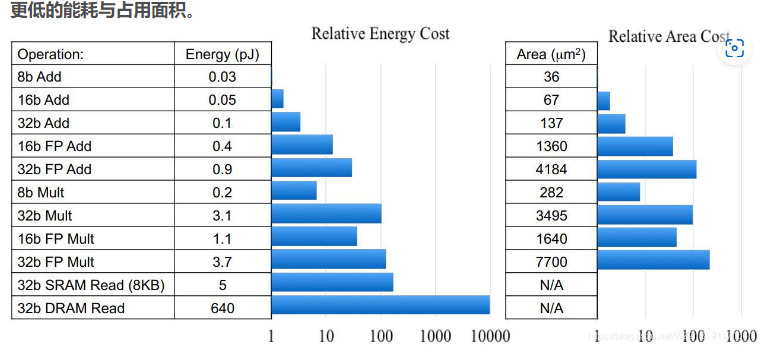

 	**FP32乘法运算的能耗是INT8乘法运算能耗的18.5倍，芯片占用面积则是int8的27.3倍**，
 	
 	**尚可接受的精度损失**。**即量化相当于对模型权重引入噪声，所幸CNN本身对噪声不敏感（在模型训练过程中，模拟量化所引入的权重加噪还有利于防止过拟合），在合适的比特数下量化后的模型并不会带来很严重的精度损失**。

## 3、模型量化的方案

1. `data free`：不使用校准集，传统的方法直接将浮点参数转化成量化数，使用上非常简单，但是一般会带来很大的精度损失，但是高通最新的论文 `DFQ` 不使用校准集也得到了很高的精度。
2. `calibration`：基于校准集方案，通过输入少量真实数据进行统计分析。很多芯片厂商都提供这样的功能，如 `tensorRT`、高通、海思、地平线、寒武纪
3. `finetune`：基于训练 `finetune` 的方案，将量化误差在训练时仿真建模，调整权重使其更适合量化。好处是能带来更大的精度提升，缺点是要修改模型训练代码，开发周期较长。

## 4、模型量化分类

### 4.1 线性量化

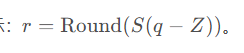

​	**q 表示的是原始的float32数值；**
​	**Z表示的是float32数值的偏移量，在很多地方又叫Zero Point；**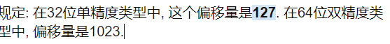

**	S表示的是float32的缩放因子，在很多地方又叫Scale；**

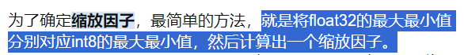	**Round(⋅) 表示的是四舍五入近似取整的数学函数，除了四舍五入，使用向上或者向下取整也是可以的；**
	**r表示的是量化后的一个整数值。**

**根据参数 Z 是否为零可以将线性量化分为两类—即对称量化和非对称量化**。

#### 4.1.1 对称量化

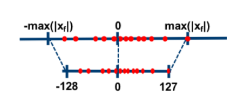

​	使用一个映射公式将输入数据映射到[-128,127]的范围内

  在对称量化中，r 是用有符号的整型数值(int8)来表示的，此时 Z=0，且 q=0时恰好有r=0。在对称量化中，我们可以取Z=0，S的取值可以使用如下的公式，也可以采用其它的公式。其中，n 是用来表示该数值的位宽，x 是数据集的总体样本。

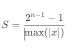

#### 4.1.2 非对称量化

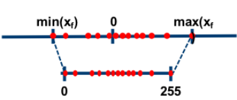


​	使用一个映射公式将输入数据映射到[0,255]的范围内

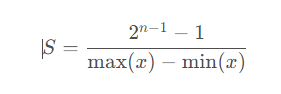

### 4.3 在线量化和离线量化

**根据激活值的量化方式，可以分为在线（online）量化和离线（offline）量化。**

- **在线量化**，即指激活值的S和Z**在实际推断过程中根据实际的激活值动态计算**；Z表示Zero Point的数值，S表示Scale的数值
- **离线量化**，即指**提前确定好**激活值的S和Z；

​	由于不需要动态计算量化参数，通常离线量化的推断速度更快些，通常通过以下的三种方法来确定相关的量化参数。

1. ```
   1. **指数平滑法**。即将校准数据集送入模型，收集每个量化层的输出特征图，计算每个batch的S和Z值，并**通过指数平滑法来更新S和Z值**。
   2. **直方图截断法**。即在计算量化参数Z和S的过程中，由于**有的特征图**会出现偏离较远的奇异值，导致max非常大，所以可以通过直方图截取的形式，比如**抛弃最大的前1%数据，以前1%分界点的数值作为max计算量化参数**。
   3. **KL散度校准法**。-即通过计算KL散度（也称为**相对熵**，用以描述两个分布之间的差异）来评估量化前后的两个分布之间存在的差异，**搜索并选取KL散度最小的量化参数Z和S作为最终的结果**。
   
   
   ```

   


### 4.4 比特量化

**根据存储一个权重元素所需的位数，可以将其分为8bit量化、4bit量化、2bit量化和1bit量化等。**

- **二进制神经网络**。即在运行时具有二进制权重和激活的神经网络，以及在训练时计算参数的梯度。
- **三元权重网络**。即权重约束为+1,0和-1的神经网络。
- **XNOR网络**。即过滤器和卷积层的输入是二进制的。XNOR 网络主要使用二进制运算来近似卷积。


### 4.5 权重量化和权重激活量化

**根据需要量化的参数可以分类两类-权重量化和权重激活量化**。

- **权重量化**，即仅仅需要对网络中的权重执行量化操作。由于网络的权重一般都保存下来了，因而我们可以提前根据权重获得相应的量化参数S和Z。由于仅仅对权重执行了量化，这种量化方法的压缩力度不是很大
- **权重激活量化**，即不仅对网络中的权重进行量化，还对激活值进行量化。由于激活层的范围通常不容易提前获得，因而需要在网络推理的过程中进行计算或者根据模型进行大致的预测


### 4.6 **对数量化，**一种比较特殊的量化方法。

​	两个同底的幂指数进行相乘，那么等价于其指数相加，降低了计算强度。同时加法也被转变为索引计算。目前 nvdia gpu，x86、arm 三大平台上没有实现对数量化的加速库，但是目前已知海思 351X 系列芯片上使用了对数量化


## 5、模型量化原理

### 5.1 原理详解

  **模型量化桥接了定点与浮点，建立了一种有效的数据映射关系，使得以较小的精度损失代价获得了较好的收益**，要弄懂模型量化的原理就是要弄懂这种数据映射关系。
浮点转换为定点的公式如下所示：

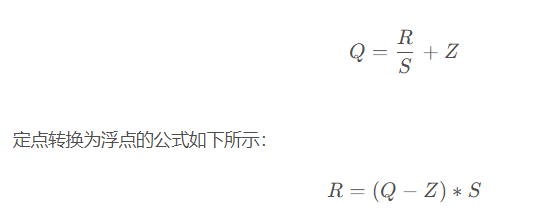

**其中R表示输入的浮点数据，Q表示量化之后的定点数据，Z表示Zero Point的数值，S表示Scale的数值，我们可以根据S和Z这两个参数来确定这个映射关系**。

求解S和Z有很多种方法，这里列举中其中的一种求解方式如下：

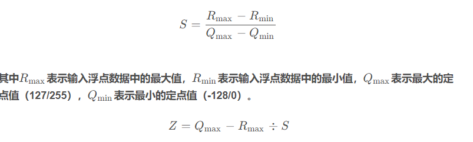

### 5.2 具体案例

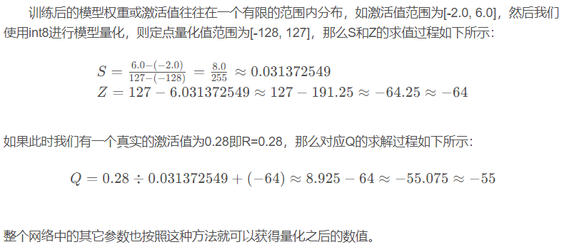


## 6、量化功能

具体包括训练后动态量化、训练后静态量化和训练时量化。

### 训练后动态量化。

这是最简单的量化形式，其中权重被提前量化，而激活在推理过程中被动态量化。这种方法用于模型执行时间由从内存加载权重而不是计算矩阵乘法所支配的情况，这适用于批量较小的LSTM和Transformer类型。对整个模型应用动态量化只需要调用一次torch.quantization.quantize_dynamic()函数即可完成具体的细节请参考该量化教程。

**实现对某些层进行量化，量化后的模型只能用于推理验证，不能用作训练**

### **训练后静态量化。**

这是最常用的量化形式，其中权重是提前量化的，并且基于在校准过程中观察模型的行为来预先计算激活张量的比例因子和偏差。CNN是一个典型的用例，训练后量化通常是在内存带宽和计算节省都很重要的情况下进行的。进**行训练后量化的一般过程如下所示：**
步骤1-准备模型：通过添加QuantStub和DeQuantStub模块，指定在何处显式量化和反量化激活值；确保不重复使用模块；将需要重新量化的任何操作转换为模块的模式；
步骤2-将诸如conv + relu或conv + batchnorm + relu之类的组合操作融合在一起，以提高模型的准确性和性能；
步骤3-指定量化方法的配置，例如选择对称或非对称量化以及MinMax或L2Norm校准技术；
步骤4- 插入torch.quantization.prepare()模块来在校准期间观察激活张量；
步骤5-使用校准数据集对模型执行校准操作；
步骤6-使用torch.quantization.convert() 模块来转化模型，具体包括计算并存储每个激活张量要使用的比例和偏差值，并替换关键算子的量化实现等。

### 训练时量化。

在极少数情况下，训练后量化不能提供足够的准确性，可以插入torch.quantization.FakeQuantize()模块执行训练时量化。计算将在FP32中进行，但将值取整并四舍五入以模拟INT8的量化效果。具体的量化步骤如下所示：
步骤1-准备模型：通过添加QuantStub和DeQuantStub模块，指定在何处显式量化和反量化激活值；确保不重复使用模块；将需要重新量化的任何操作转换为模块的模式；
步骤2-将诸如conv + relu或conv + batchnorm + relu之类的组合操作融合在一起，以提高模型的准确性和性能；
步骤3-指定伪量化方法的配置，例如选择对称或非对称量化以及MinMax或L2Norm校准技术；
步骤4-插入torch.quantization.prepare_qat() 模块，该模块用来在训练过程中的模拟量化；
步骤5-训练或者微调模型；
步骤6-使用torch.quantization.convert() 模块来转化模型，具体包括计算并存储每个激活张量要使用的比例和偏差值，并替换关键算子的量化实现等。

量化步骤

![image-20231019153830100](./2023年10月19日-deploy_量化1介绍/image-20231019153830100.png


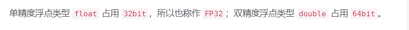
