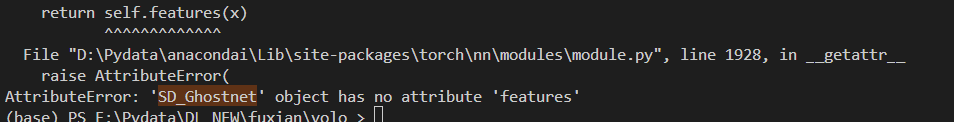
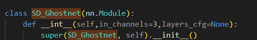

- 2

RuntimeError: Input type (torch.cuda.FloatTensor) and weight type (torch.FloatTensor) should be the same

**没有明确指定模型应该在GPU上运行。你可以使用`model.to(device)`将模型移动到GPU上**

- 3

  PIL.UnidentifiedImageError: cannot identify image file 'F:\\Dataset\\PetImages\\Cat\\666.jpg'

**图片损坏**

- 继承Conv基类错误了  

