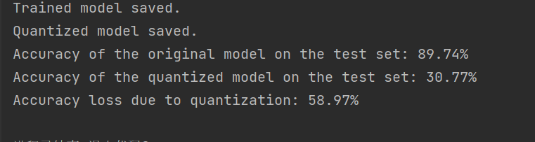
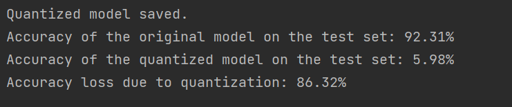
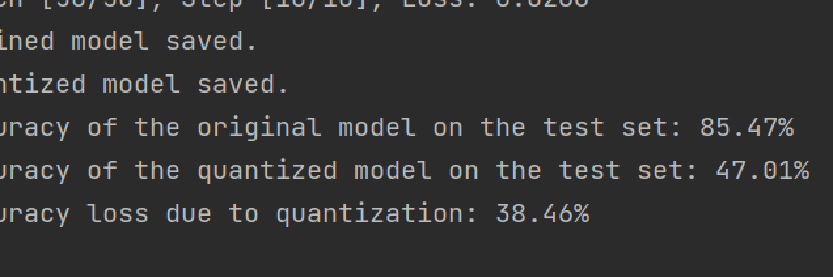
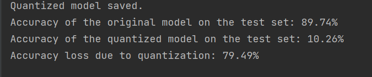

## 1 cuda

NotImplementedError: Could not run 'quantized::linear_prepack_fp16' with arguments from the 'CUDA' backend.

**量化过程中使用到了一个不支持CUDA的操作。**


### 1 为什么量化层少了，acc却降低了？

```python
quantized_model = torch.quantization.quantize_dynamic(model, {nn.Linear}, dtype=torch.qint8)
```






```python
quantized_model = torch.quantization.quantize_dynamic(model, {nn.Linear, nn.Conv2d}, dtype=torch.qint8)
```




