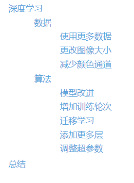
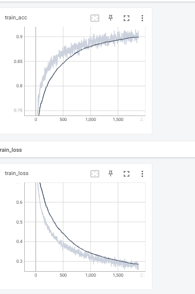

### 1 如何不用卷积对图片分类

 全连接神经网络， 

HOG

 

### 2 断点继续训练，数据集是否保证不变比较好

#### 数据集不变的好处：

1. **一致性**：在继续训练时使用相同的数据集，可以确保模型在相同的数据分布上进行训练，保持了训练的一致性。
2. **避免分布变化**：如果数据集发生变化，可能会引入新的数据分布，导致模型在新数据上表现不佳。
3. **追溯性**：如果需要回溯到特定训练点以排查问题或者进行对比实验，保持数据集不变会更容易复现相同的训练状态。

#### 数据集变化的情况：

1. **数据扩充**：有时候会对现有数据进行扩充、修正或更新，这种情况下训练过程中可能会引入新的数据。
2. **实时学习**：某些场景下，模型需要不断从实时流数据中学习，此时数据集可能会不断变化。


### 3 训练的数据集不同，加载预训练模型参数还有用吗

预训练模型在大规模数据集上进行了训练，学习到了**通用的特征表示**，可能有助于加速模型收敛并提高模型的表现。

如果你的训练数据集与预训练模型的训练数据集**非常不同**（，可能需要更多的微调或者甚至完全冻结预训练模型的参数。


#### 4 model val准确率再80上不去？




#### 5 什么是梯度消失

进行反向传播算法时，较低层的权重更新变得非常小甚至消失的现象。这种情况通常发生在很深的神经网络中

在反向传播期间，梯度会随着每一层的权重更新而逐渐减小。对于某些激活函数，特别是 Sigmoid 函数在输入很大或很小时会饱和，导致函数的梯度非常接近于零。




#### 6 如何设置学习率衰减

```
import torch.optim as optim
from torch.optim import lr_scheduler

# 定义模型和优化器
model = YourModel()  # 请替换成您的模型
optimizer = optim.SGD(model.parameters(), lr=0.1)  # 设置初始学习率

# 定义学习率衰减器，例如 StepLR
# StepLR 每隔 step_size 个epoch将学习率乘以 gamma
# 这里可以根据需要选择其他的学习率衰减策略，如使用其他的调度器类
scheduler = lr_scheduler.StepLR(optimizer, step_size=5, gamma=0.1)

# 在训练过程中，每个 epoch 结束后更新学习率
for epoch in range(num_epochs):
    # 训练步骤，包括前向传播、损失计算、反向传播等

    # 更新学习率
    scheduler.step()

    # 其他训练步骤
    # ...

```

