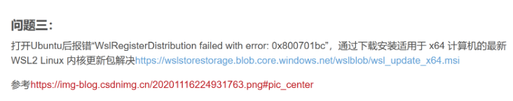
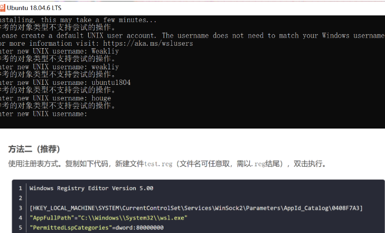
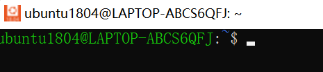
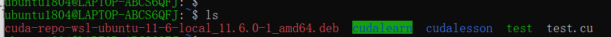
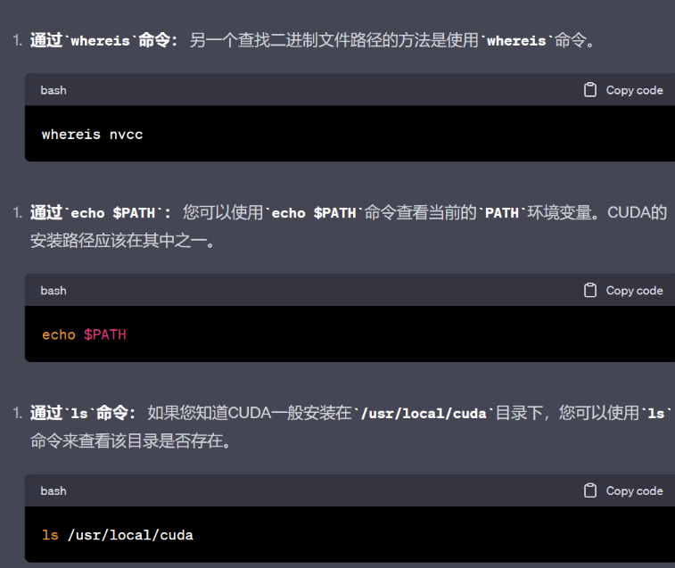
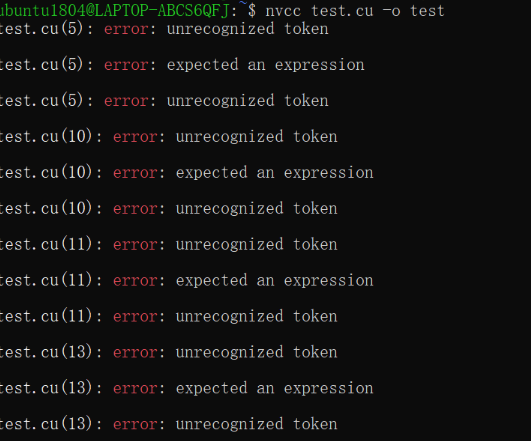
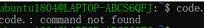
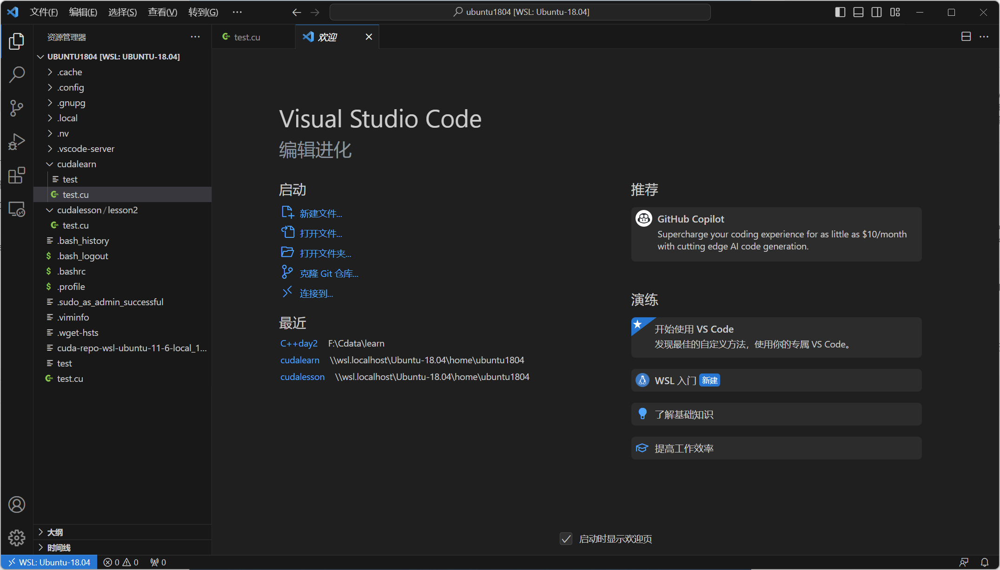
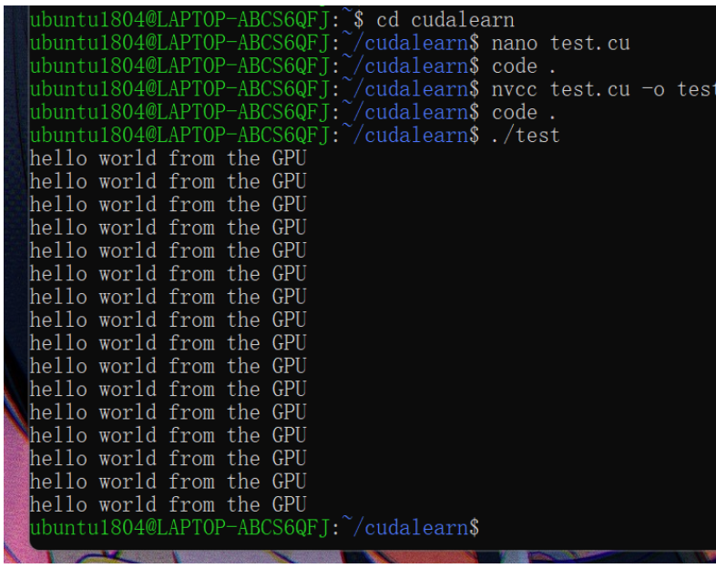

# Ubuntu配置以及问题总结

## 一、WSL无法成功安装Ubuntu



## 二、问题如下图：


## 	2.1Ubuntu初始化无法正常输入密码




## 	2.2.更改密码

```
1. 以管理员身份打开 PowerShell
2. 输入命令 wsl -u root
3. 输入命令 passwd username 修改用户密码，username即待重置的用户的名称
```

​	**切换用户**

```
ubuntu1804 config --default-user ubuntu1804
```

​	成功！



## 三、无法编译

```
			nvcc : 无法将“nvcc”项识别为 cmdlet、函数、脚本文件或可运行程序的名称。请检查名称的拼写 ，如果包括路径，请确保路径正确，然后再试一次。 所在位置 行:1 字符: 1 + nvcc test.cu -o test + ~~~~    + CategoryInfo          : ObjectNotFound: (nvcc:String) [], CommandNotFoundExceptio     n    + FullyQualifiedErrorId : CommandNotFoundException cuda

​		cuda安装成功但是出现上面报错（nvcc-v成功运行）
```


**文件目录：**



### 	3.1 可能存在的问题：环境变量未配置、cuda是否安装成功、



### 	3.2 代码未保存、

​	用vscode编写cuda代码，写完却一直无法成功编译，经检查才发现忘记保存，但是保存的时候才发现vscode无权限无法保存、百般调试后可能的问题：1. vscode无权限， 2. 未给创建的文件赋予读写权限。

​	基于上面的两种可能，解决办法。1：重新创建文件，赋予权限，重新编写代码。2：改用nano编写（nano在ubuntu上安装）

创建新文件

```python
mkdir cudalesson
chmod 777 cudalesson  # 赋予读写权限
```

在nano上编写代码

```
nano test.cu
```

发现代码有误，更改：

```c++
#include <stdio.h>

__global__ void hello_from_gpu()
{
    printf("hello world from the GPU\n");
}

int main(void)
{
    hello_from_gpu<<<4, 4>>>();
    cudaDeviceSynchronize();

    return 0;
}
```

## 四、配置

### 	4.1 链接vscode

**完美解决window11 wsl ubuntu下code.出现code：commandnot found的问题**



**解决办法**

安装 [VS Code 安装页](https://code.visualstudio.com/download)

选中“添加到 PATH”选项

安装[远程开发扩展包](https://marketplace.visualstudio.com/items?itemName=ms-vscode-remote.vscode-remote-extensionpack)

更新Ubuntu

```
sudo apt-get update
```

输入

```
code .   # 注意code空格.
```

成功运行：




## 五、编译：

```
nvcc test.cu -o test
```

```
./test	 # 运行
```

### 成功！

!
