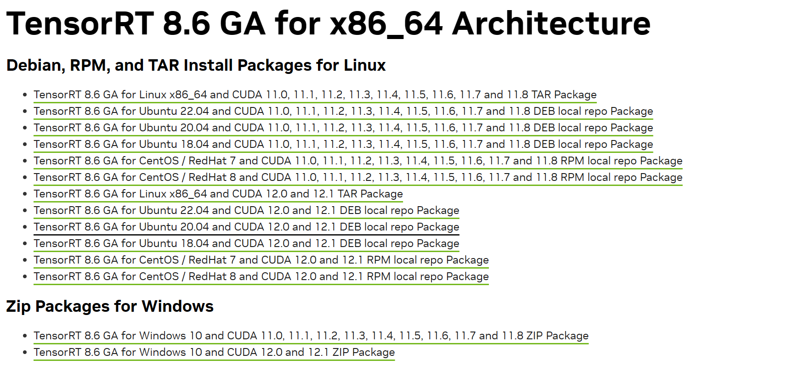
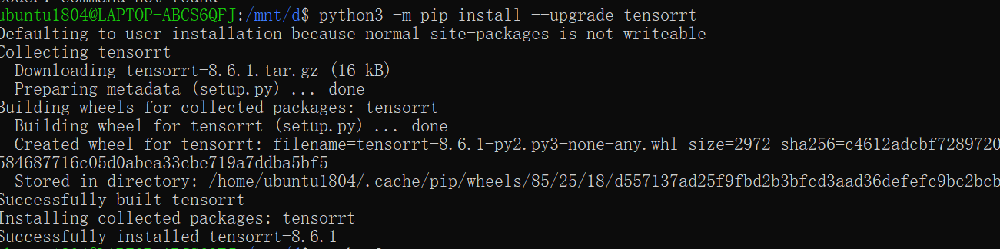
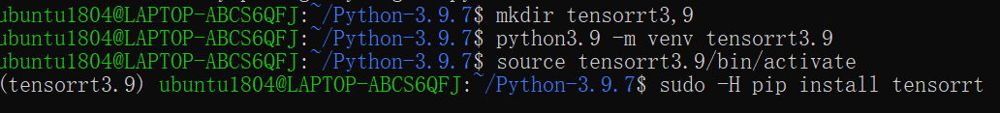

# 1 pip安装

## 介绍

在TensorRT中，这三个文件都是针对Windows系统和Python 3.8的TensorRT Wheel包，但它们分别代表TensorRT库的不同部分或变体：

**tensorrt-8.6.1-cp38-none-win_amd64.whl：**

>  这个文件是TensorRT的标准版Python Wheel包。
> 它包含了TensorRT库的主要功能，用于深度学习模型的优化和推理。
> 适用于需要TensorRT所有功能的通用用途。

**tensorrt_lean-8.6.1-cp38-none-win_amd64.whl：**

> “Lean”版本可能是TensorRT的一个精简版，它可能去除了某些不常用的功能或组件，以便在资源受限的环境中提供更高效的执行。
> 这种版本可能特别适合于那些只需要TensorRT核心功能的应用场景。

**tensorrt_dispatch-8.6.1-cp38-none-win_amd64.whl：**

> “Dispatch”版本可能包含了TensorRT的动态调度功能，这意味着它可以在运行时根据不同的输入参数或环境条件来动态选择最适合的处理逻辑或算法。
> 这对于需要在多种不同配置或硬件上运行的应用来说可能非常有用。


# Ubuntu下的TensorRT 安装

**原因：win11 下无法安装**



```
https://blog.csdn.net/qq_43573527/article/details/131414861?spm=1001.2101.3001.6661.1&utm_medium=distribute.pc_relevant_t0.none-task-blog-2%7Edefault%7ECTRLIST%7ERate-1-131414861-blog-126454422.235%5Ev38%5Epc_relevant_sort_base2&depth_1-utm_source=distribute.pc_relevant_t0.none-task-blog-2%7Edefault%7ECTRLIST%7ERate-1-131414861-blog-126454422.235%5Ev38%5Epc_relevant_sort_base2&utm_relevant_index=1

https://www.bilibili.com/video/BV1Um4y1w7g6/?share_source=copy_web&vd_source=ef8119f427d19b904b7ce3026143d3f7
```


##   1.安装相关工具箱

```powershell
mv /mnt/d/nv-tensorrt-local-repo-ubuntu1804-8.6.1-cuda-11.8_1.0-1_amd64.deb download_  # 移动文件
sudo dpkg -i i nv-tensorrt-local-repo-ubuntu1804-8.6.1-cuda-11.8_1.0-1_amd64.deb
sudo apt update
sudo apt install tensorrt
```

##  2.安装tensorRT

```
python3 -m pip install --upgrade setuptools pip
```



### 3.运行

```python
python3
import tensorrt
print(tensorrt.__version__)
exit()
```

### 4. 在vscode中运行

安装 [VS Code 安装页](https://code.visualstudio.com/download)

### 5. 配置python环境

```bash
sudo apt-get install python3-venv
sudo python3 -m venv tensorrt_env
cd tensorrt_env
source cd tensorrt_env/bin/activate
sudo /home/ubuntu1804/tensorrt_env/tensorrt_env/bin/python -m pip install tensorrt

```


### 6.出现问题： vscode拓展无法编译python3.6

#### 	解决： 

##### 1.更换拓展

下载就拓展：https://marketplace.visualstudio.com/_apis/public/gallery/publishers/ms-python/vsextensions/python/2022.6.0/vspackage

**结果：无法正常安装，使用下面的方法2.** 

#####  2.更换python

更换python：

​	安装编译 Python 3.9 所需的工具和库：

```bash
sudo apt install build-essential zlib1g-dev libffi-dev libssl-dev

```

下载 Python 3.9 源代码并编译安装：

```bash
wget https://www.python.org/ftp/python/3.9.7/Python-3.9.7.tgz
tar -xf Python-3.9.7.tgz
cd Python-3.9.7
./configure --enable-optimizations
make -j$(nproc)
sudo make altinstall
```

### 7.安装成功 创建环境

```bash
mkdir myenv
cd myenv
cd Python-3.9.7   # 这是我的
python3.9 -m venv tensorrt3.9
source tensorrt3.9/bin/activate
pip install tensorrt -H  # 安装
deactivate  # 退出环境

sudo -H pip install tensorrt  # 不要用sudo安装，安装成功后无法使用，该怎么办因为使用了 sudo 来安装包会导致文件权限问题，使得虚拟环境无法正常访问已安装的库。 
```



创建文件夹来编写代码

```bash
mkdir rtlesson
chmod 777 rtlesson  # 赋予读写权限
```

### 8. 打开vscode并激活环境

```bash
code .
Ctrl + ~ 来打开终端。
source /Python-3.9.7/tensorrt3.9/bin/activate
```

### 9.检查安装是否成功 **trtexec --version**


```python
# 代码验证
import tensorrt as trt
print("TensorRT imported successfully!")
```


### 10.安装一些常用的库

```bash
pip install pycuda onnx onnxruntime torch torchvision opencv-python torchaudio numpy -i https://pypi.tuna.tsinghua.edu.cn/simple
```


### 11.转移windows上的文件

```bash
cd ~/rtlesson
# 复制
cp "/mnt/f/Pydata/Project/鱼类识别+onnx/my_model.onnx" . 
# 移动
mv "/mnt/f/Pydata/Project/鱼类识别+onnx/fish_classes_list.json" . 
# 查看
ls ~/rtlesson
```

## 12.运行代码 onxx转TensorRt运行

```python
# 占位符	
def 查看下一篇博客：
	pass
```

