# 3 阿里天池特征工程

## 3.1  概念和作用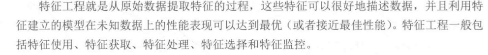

```
“数据和特征决定了机器学习的上限，而模型和算法只是逼近这个上限而已”
```

```
什么是有用特征和无用特征？
```

## 3.2 处理

### 3.2.1 预处理

```
采集
清洗
采样（正负样本不均匀）
```

```
为什么要采样？作用？
```

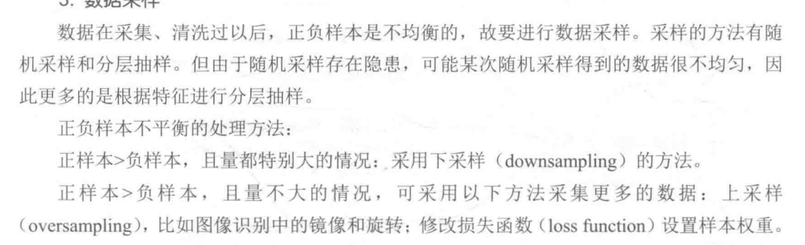

### 3.2.2 特征处理

```
标准化、区间缩放法、归一化、定量特征二值化、特征呀编码、缺失值处理、数据转换？？
```

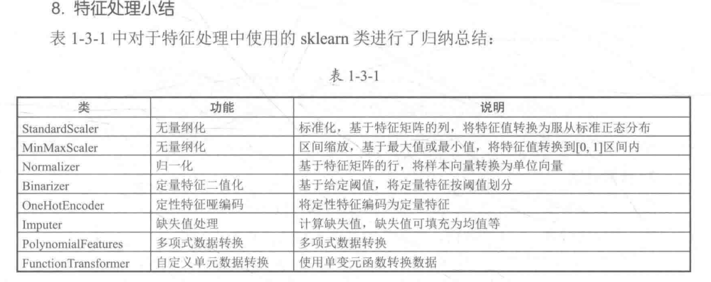

## 3.3 降维

### 3.3.1 特征选择

```
定义：
```

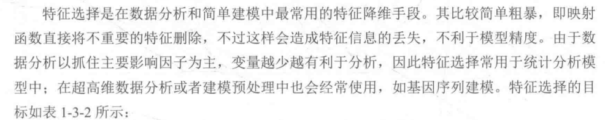

```
方法：
```


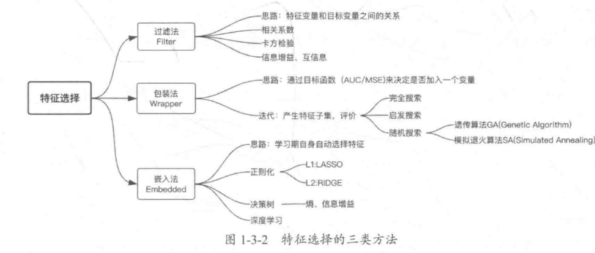

```
实现：
```

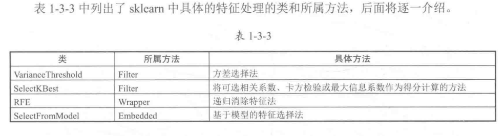

```
，，，代码？
```


### 3.3.2 线性降维

```python
'''占位符  不懂'''
```


#### 1 主成分分析

```
定义

```

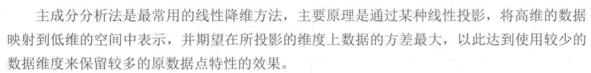

#### 2 线性判别

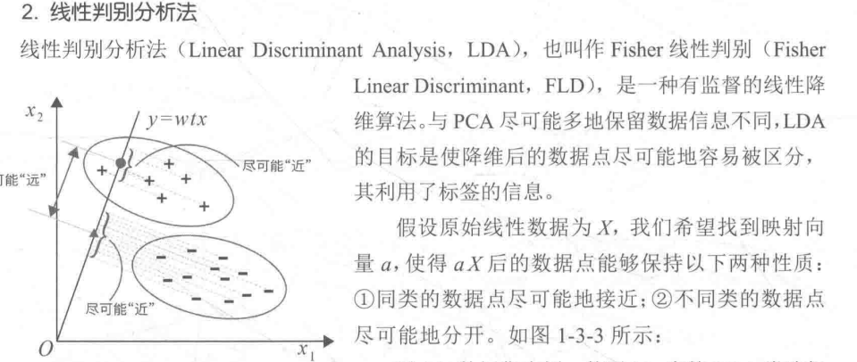


## 3.4 实战

### 3.4.1 异常分析

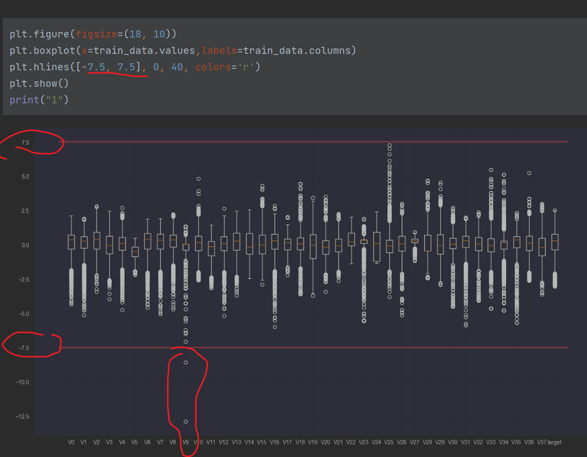

**差异过大删除**

### 3.4.2 最大最小值归一化

```
如何操作的？看代码
```

```python
from sklearn import preprocessing 

features_columns = [col for col in train_data.columns if col not in ['target']]

min_max_scaler = preprocessing.MinMaxScaler()

min_max_scaler = min_max_scaler.fit(train_data[features_columns])

train_data_scaler = min_max_scaler.transform(train_data[features_columns])
test_data_scaler = min_max_scaler.transform(test_data[features_columns])

train_data_scaler = pd.DataFrame(train_data_scaler)
train_data_scaler.columns = features_columns

test_data_scaler = pd.DataFrame(test_data_scaler)
test_data_scaler.columns = features_columns

train_data_scaler['target'] = train_data['target']
```

**比较：**

```
主要看什么？
```

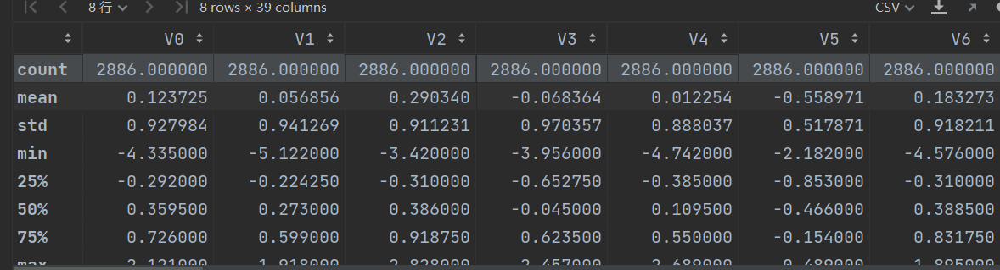

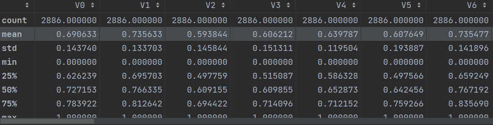

#### 3.4.3 查看数据分布

**和前面的一样** 删除特征'V5', 'V17', 'V28', 'V22', 'V11', 'V9'数据的数据分布

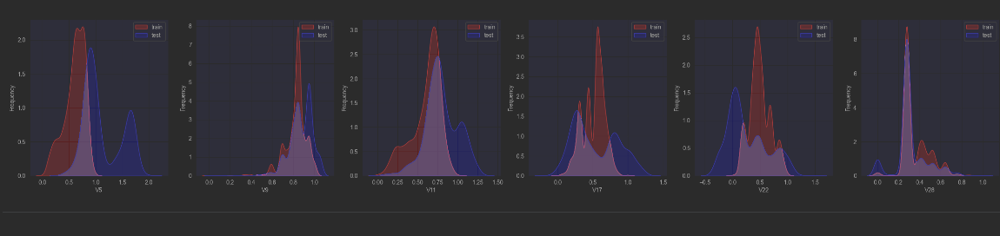

#### 3.4.4 特征相关性

**一样**

#### 3.4.5 特征降维

1. **筛选出相关性大于0.1的特征变量***

   ```python
   mcorr=mcorr.abs()
   numerical_corr=mcorr[mcorr['target']>0.1]['target']
   print(numerical_corr.sort_values(ascending=False))
   
   index0 = numerical_corr.sort_values(ascending=False).index
   print(train_data_scaler[index0].corr('spearman'))
   ```

   

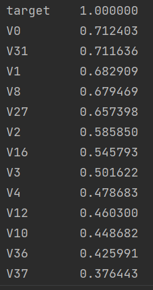

2. 相关性排序并修改为>0.3的

   ```python
   features_corr = numerical_corr.sort_values(ascending=False).reset_index()
   features_corr.columns = ['features_and_target', 'corr']
   features_corr_select = features_corr[features_corr['corr']>0.3] # 筛选出大于相关性大于0.3的特征
   print(features_corr_select)
   select_features = [col for col in features_corr_select['features_and_target'] if col not in ['target']]
   new_train_data_corr_select = train_data_scaler[select_features+['target']]
   new_test_data_corr_select = test_data_scaler[select_features]
   ```

   

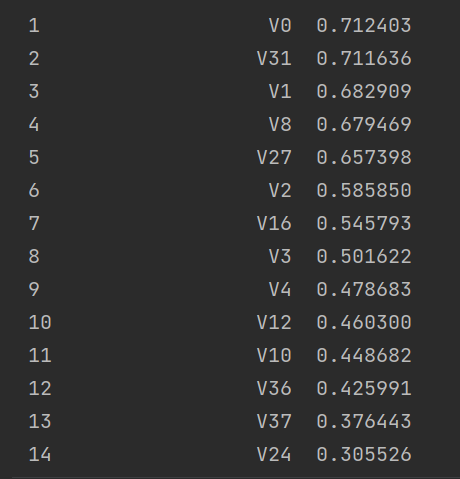

### 3.4.6 多重共线性分析

```
原因： 特征之间相关性大
```

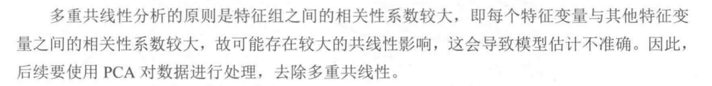

#### 查看

```
怎么辨别？筛选？
```

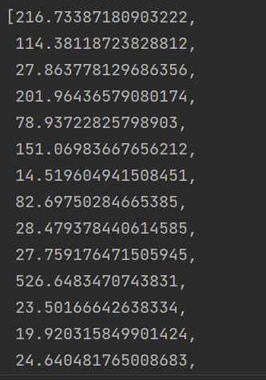

```python
from statsmodels.stats.outliers_influence import variance_inflation_factor #多重共线性方差膨胀因子

#多重共线性
new_numerical=['V0', 'V2', 'V3', 'V4', 'V5', 'V6', 'V10', 'V11', 
                         'V13', 'V15', 'V16', 'V18', 'V19', 'V20', 'V22','V24','V30', 'V31', 'V37']
X=np.matrix(train_data_scaler[new_numerical])
VIF_list=[variance_inflation_factor(X, i) for i in range(X.shape[1])]
VIF_list

```

#### 处理

```
from sklearn.decomposition import PCA   #主成分分析法

#PCA方法降维
#保持90%的信息
pca = PCA(n_components=0.9)
new_train_pca_90 = pca.fit_transform(train_data_scaler.iloc[:,0:-1])
new_test_pca_90 = pca.transform(test_data_scaler)
new_train_pca_90 = pd.DataFrame(new_train_pca_90)
new_test_pca_90 = pd.DataFrame(new_test_pca_90)
new_train_pca_90['target'] = train_data_scaler['target']
new_train_pca_90.describe()
```

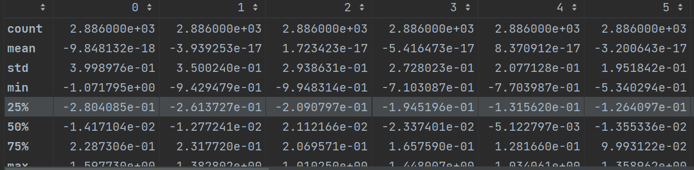

#### 对比原来的

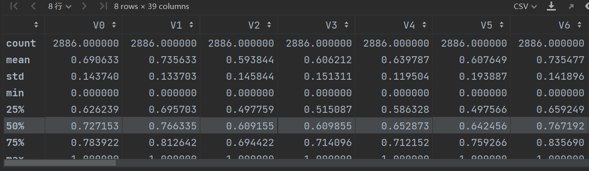

#### 保留16个主成分

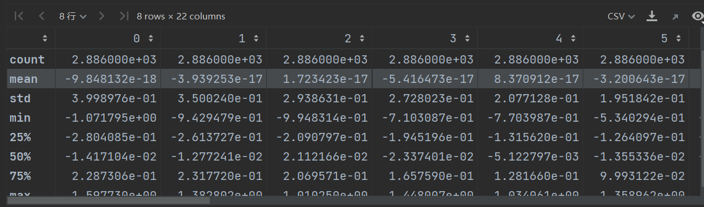


