# 4 模型训练

## 4.1 回归

```python
"""不多介绍"""
```

###  4.1.3 线性多元回归

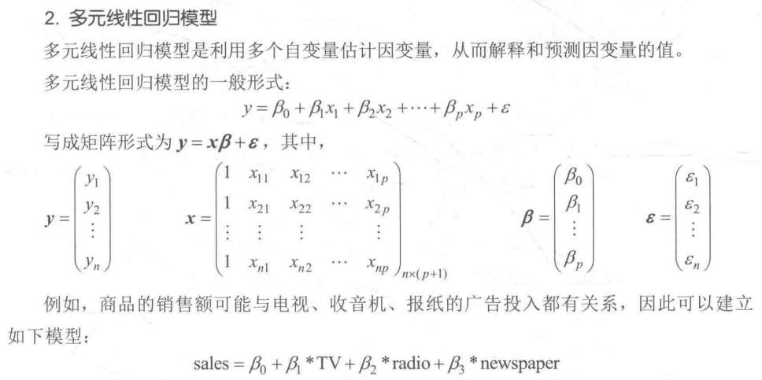

#### 普通结果

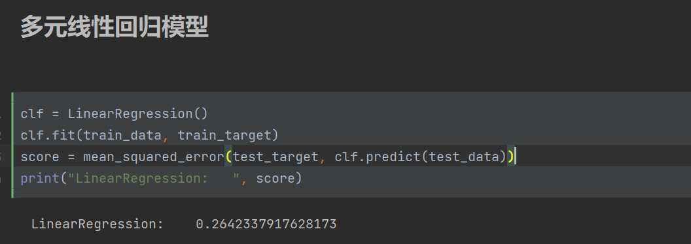

#### 不同训练量结果

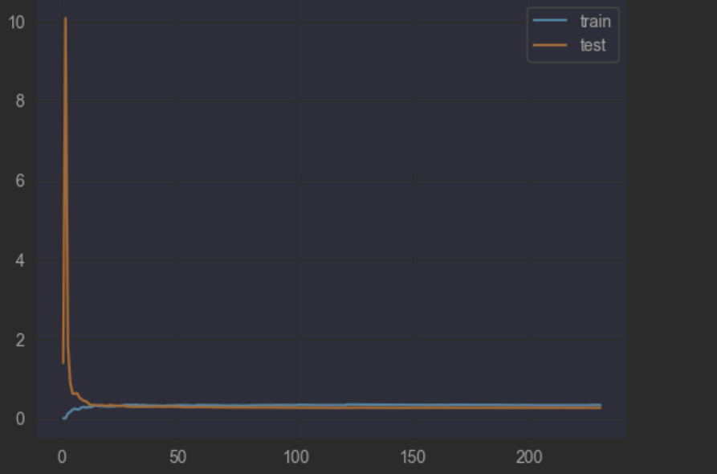

#### 总结


### 4.1.5 K近邻回归

```
距离采用欧式距离
```

#### 结果

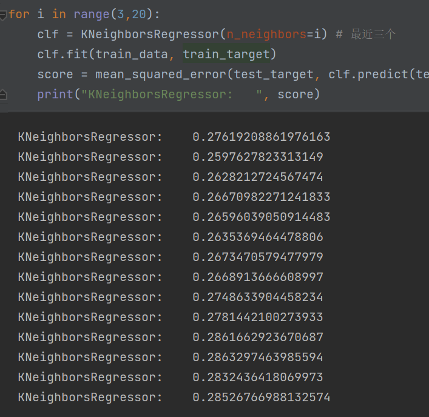

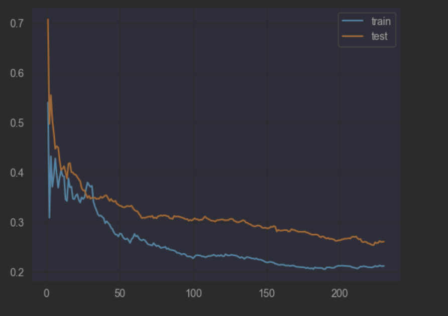

#### 总结

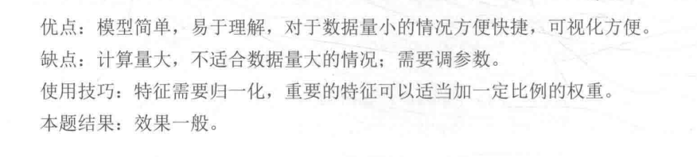

### 4.1.6 决策树回归

```
解释一下： 具体计算过程
```

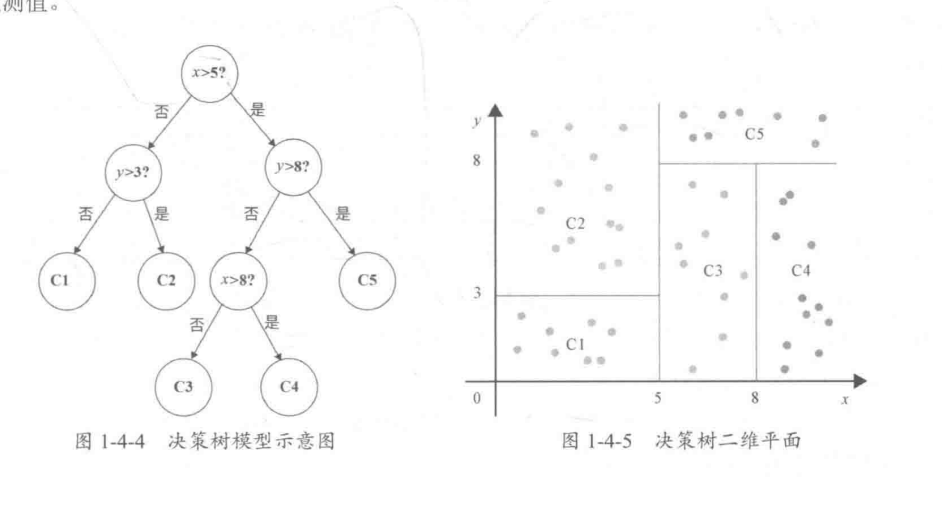

#### 结果

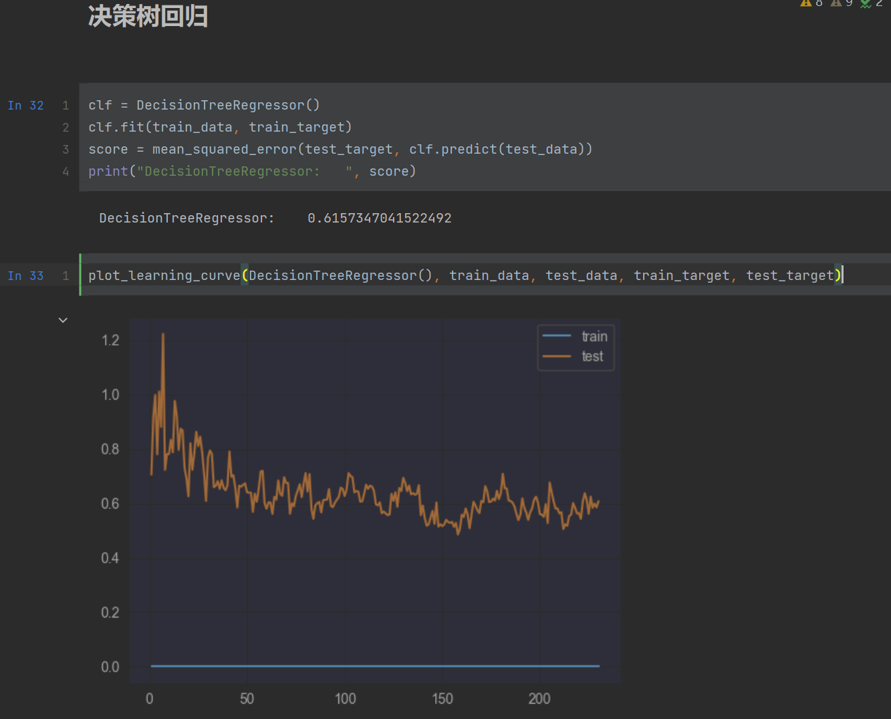

### 4.1.6 集成学习之随机森林

```
解释一下：
```

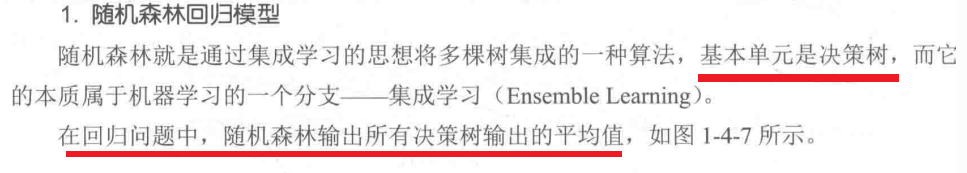
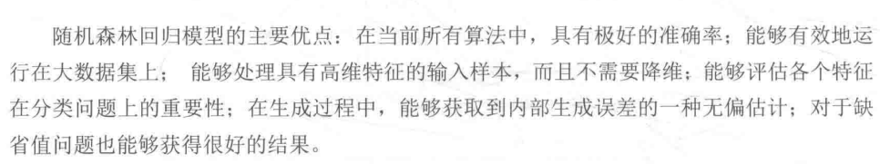

#### 结果：很慢

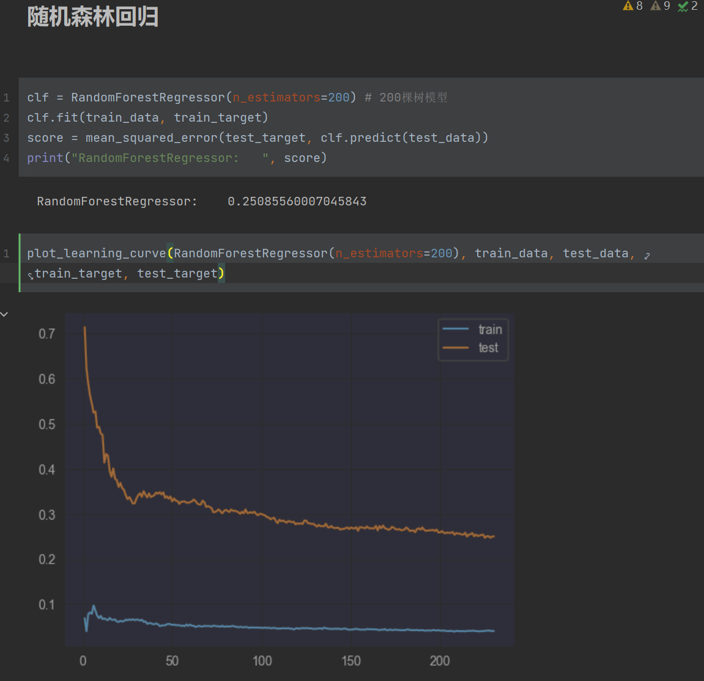

#### 总结

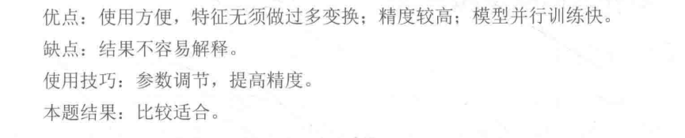

### 4.1.7 集成学习之lightGBM


```
解释一下：
```

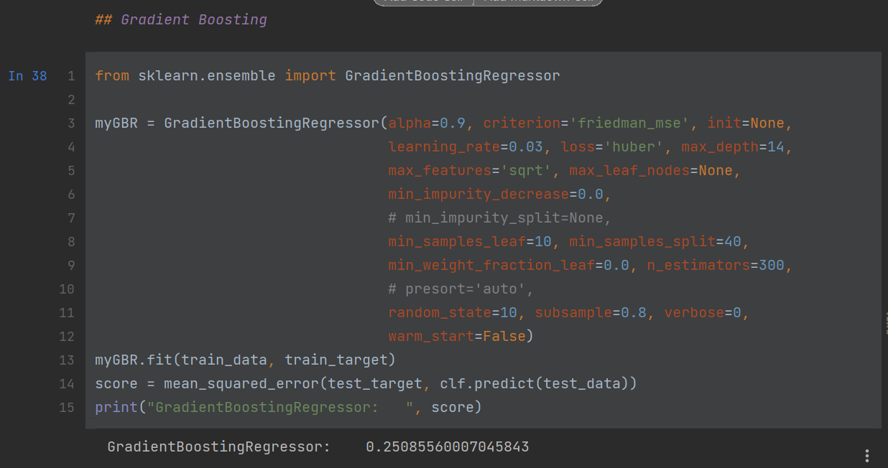

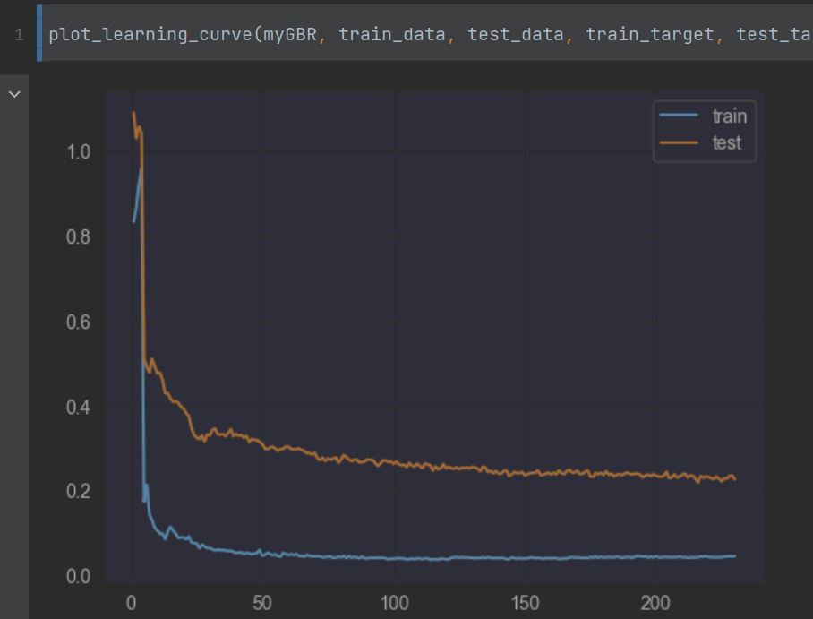

#### 总结

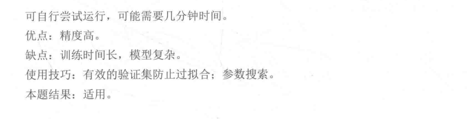


