# 5模型验证

## 5.1 模型评估方法

### 5.1.1 过拟合与欠拟合

不多解释

### 5.1.2 泛化和正则化

#### 泛化

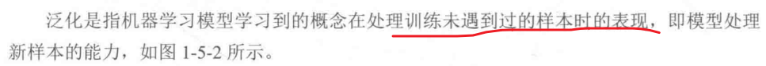

#### 正则化

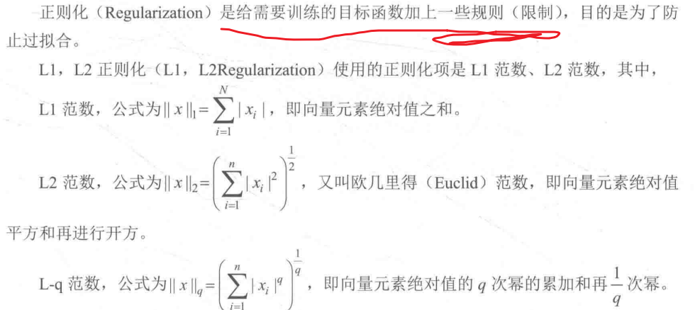

```
这个是什么意思？？？
```

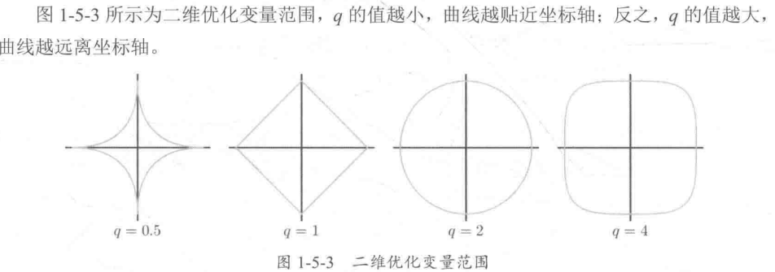

```
代价函数是干什么用的？


```

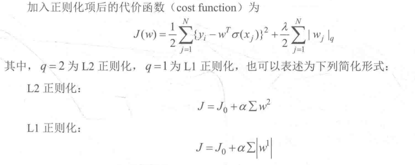

#### 岭回归和lasso回归

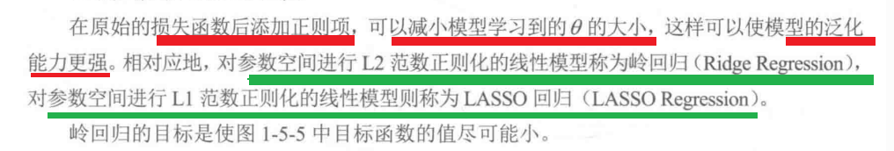

##### 作用

```
这个图是什么意思？？？
```

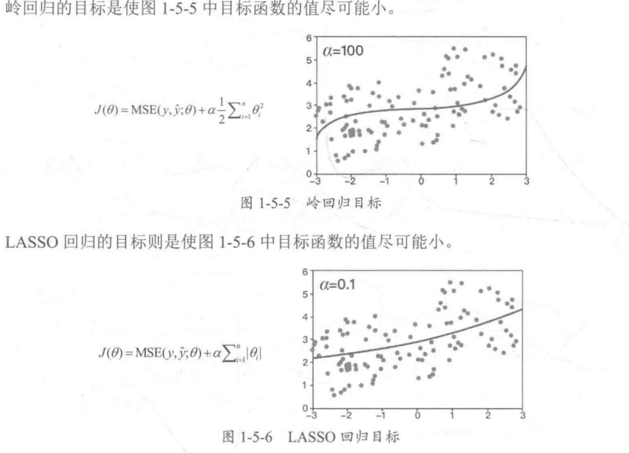

##### 不同之处

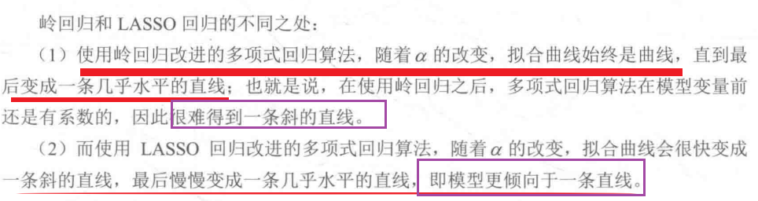

### 5.1.3 评估指标和调用方法

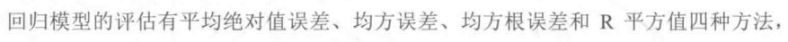

### 5.1.4 交叉验证

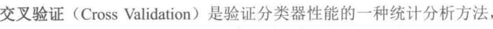

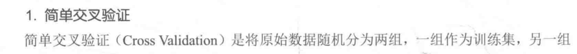


 （如果 k = n， 这等价于 Leave One Out（留一）         策略），都具有相同的大小（如果可能）。预测函数学习时使用 k - 1 个折叠中的数据，最后一个剩下的折叠会用于测试。      

​        **K折重复多次**：         RepeatedKFold 重复 K-Fold n 次。当需要运行时可以使用它 KFold n 次，在每次重复中产生不同的分割。      

​        **留一交叉验证**：         LeaveOneOut (或 LOO) 是一个简单的交叉验证。每个学习集都是通过除了一个样本以外的所有样本创建的，测试集是被留下的样本。         因此，对于 n 个样本，我们有 n 个不同的训练集和 n         个不同的测试集。这种交叉验证程序不会浪费太多数据，因为只有一个样本是从训练集中删除掉的:      

​        **留P交叉验证**： LeavePOut         与 LeaveOneOut 非常相似，因为它通过从整个集合中删除 p 个样本来创建所有可能的 训练/测试集。对于 n 个样本，这产生了 {n         \choose p} 个 训练-测试 对。与 LeaveOneOut 和 KFold 不同，当 p > 1 时，测试集会重叠。      

​        **用户自定义数据集划分： ShuffleSplit**         迭代器将会生成一个用户给定数量的独立的训练/测试数据划分。样例首先被打散然后划分为一对训练测试集合。      

​        **设置每次生成的随机数相同**：         可以通过设定明确的 random_state ，使得伪随机生成器的结果可以重复。      

####         基于类标签、具有分层的交叉验证迭代器      

​        如何解决样本不平衡问题？ 使用StratifiedKFold和StratifiedShuffleSplit 分层抽样。         一些分类问题在目标类别的分布上可能表现出很大的不平衡性：例如，可能会出现比正样本多数倍的负样本。在这种情况下，建议采用如         StratifiedKFold 和 StratifiedShuffleSplit 中实现的分层抽样方法，确保相对的类别频率在每个训练和验证         折叠 中大致保留。      

​        **StratifiedKFold**是 k-fold 的变种，会返回 stratified（分层）         的折叠：每个小集合中， 各个类别的样例比例大致和完整数据集中相同。      

​        **StratifiedShuffleSplit**是 ShuffleSplit         的一个变种，会返回直接的划分，比如： 创建一个划分，但是划分中每个类的比例和完整数据集中的相同。      

####         用于分组数据的交叉验证迭代器      

​        如何进一步测试模型的泛化能力？ 留出一组特定的不属于测试集和训练集的数据。有时我们想知道在一组特定的 groups         上训练的模型是否能很好地适用于看不见的 group 。为了衡量这一点，我们需要确保验证对象中的所有样本来自配对训练折叠中完全没有表示的组。      

​        **GroupKFold**是 k-fold 的变体，它确保同一个 group 在测试和训练集中都不被表示。         例如，如果数据是从不同的 subjects 获得的，每个 subject         有多个样本，并且如果模型足够灵活以高度人物指定的特征中学习，则可能无法推广到新的 subject 。 GroupKFold         可以检测到这种过拟合的情况。      

​        **LeaveOneGroupOut**是一个交叉验证方案，它根据第三方提供的 array of integer         groups （整数组的数组）来提供样本。这个组信息可以用来编码任意域特定的预定义交叉验证折叠。      

​        每个训练集都是由除特定组别以外的所有样本构成的。      

​        **LeavePGroupsOut**类似于 LeaveOneGroupOut ，但为每个训练/测试集删除与 P         组有关的样本。      

​        **GroupShuffleSplit**迭代器是 ShuffleSplit 和 LeavePGroupsOut         的组合，它生成一个随机划分分区的序列，其中为每个分组提供了一个组子集。      

####         时间序列分割      

​        **TimeSeriesSplit**是 k-fold 的一个变体，它首先返回 k 折作为训练数据集，并且         (k+1) 折作为测试数据集。 请注意，与标准的交叉验证方法不同，连续的训练集是超越前者的超集。         另外，它将所有的剩余数据添加到第一个训练分区，它总是用来训练模型。      

## 5.2 模型调参

### 5.2.1 调参

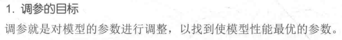

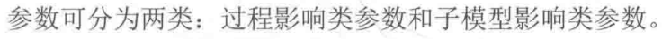

#### 例子

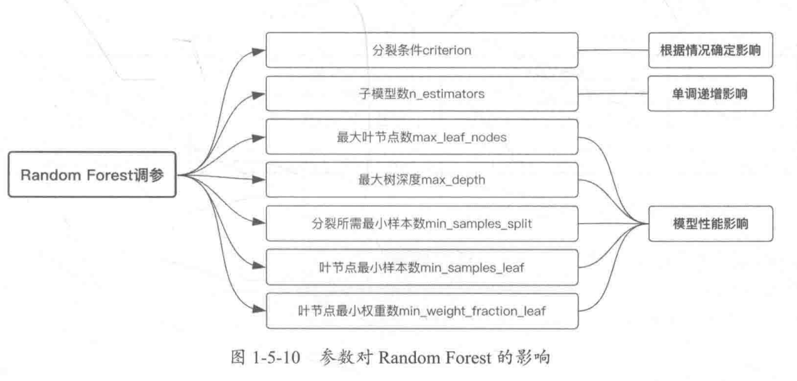


### 5.2.2 网格搜索

```
作用：
```

​	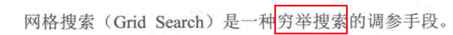

### 5.2.3 学习曲线

```
作用：
```

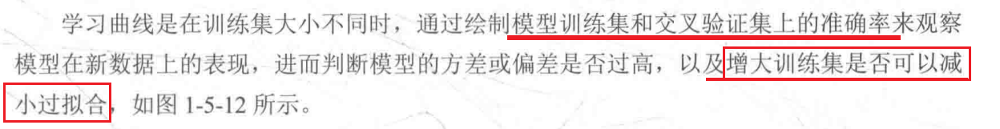

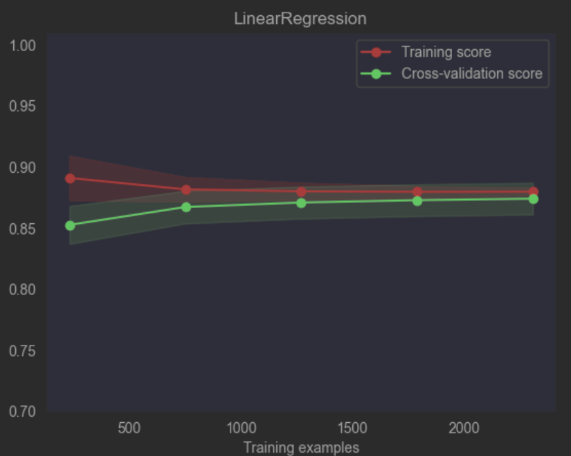

### 5.2.3 验证曲线

```
和网格搜索的区别？？

验证曲线关注于单个超参数的影响，帮助你理解如何调整某个特定参数以获得更好的模型性能。
```

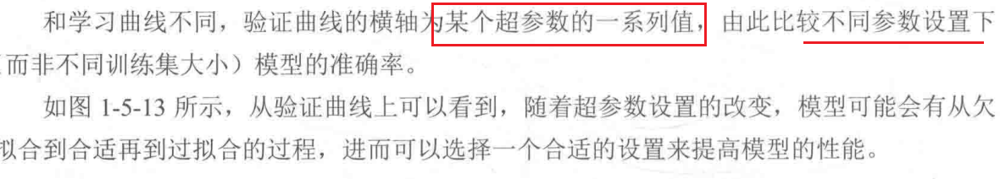

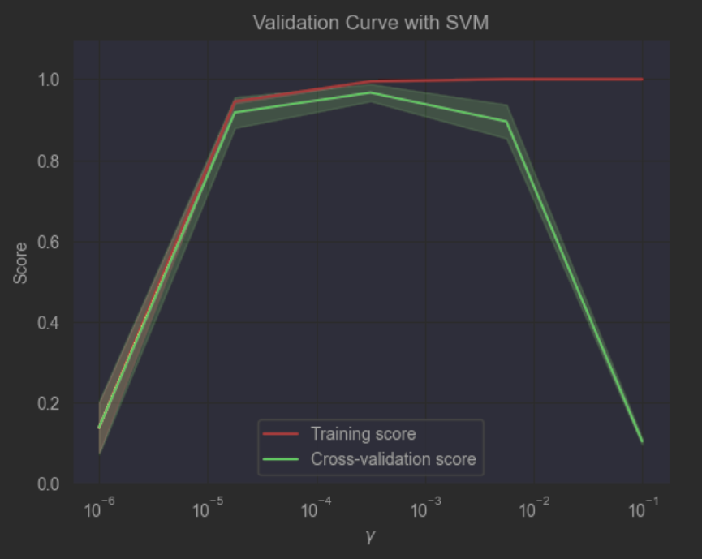


