# 6 特征优化

## 6.1 

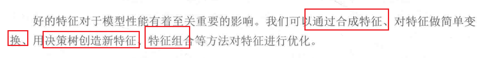

### 6.1.1 合成特征

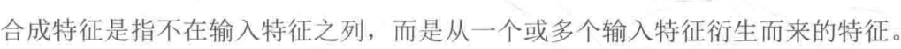

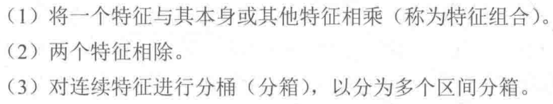

### 6.1.2 特征变化

#### 数值特征

```
不懂
```

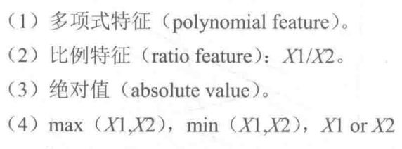

#### 类别特征

```
不懂
```

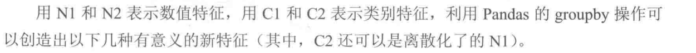

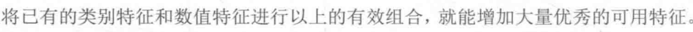

### 6.1.3 创造特征 

```
似乎适用性很窄
```

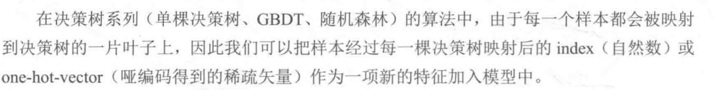

### 6.1.4 特征组合

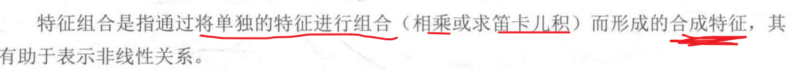

##### 1 

```
如果在别的模型下该如何处理呢？？
```

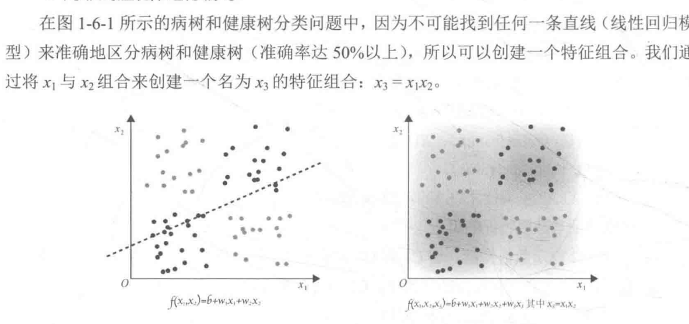

#### 2 独热编码

```
pass 
```

#### 3 分桶特征

```
看起来很简单
```

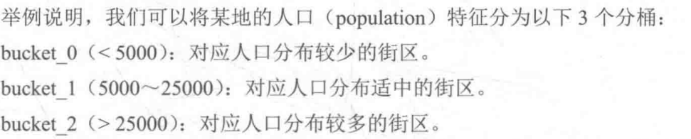

## 6.2 实战

构造特征

```python
epsilon=1e-5

#组交叉特征，可以自行定义，如增加： x*x/y, log(x)/y 等等
func_dict = {
        'add': lambda x,y: x+y,
        'mins': lambda x,y: x-y,
        'div': lambda x,y: x/(y+epsilon),
        'multi': lambda x,y: x*y
        }
def auto_features_make(train_data,test_data,func_dict,col_list):
    train_data, test_data = train_data.copy(), test_data.copy()
    for col_i in col_list:
        for col_j in col_list:
            for func_name, func in func_dict.items():
                for data in [train_data,test_data]:
                    func_features = func(data[col_i],data[col_j])
                    col_func_features = '-'.join([col_i,func_name,col_j])
                    data[col_func_features] = func_features
    return train_data,test_data
```

主成分分析

```python
from sklearn.decomposition import PCA   # 导入主成分分析法

# PCA方法降维
pca = PCA(n_components=500)  # 创建一个PCA对象，设置要保留的主成分数量为500

# 对训练数据进行PCA降维
train_data2_pca = pca.fit_transform(train_data2.iloc[:,0:-1])  # 将训练数据进行PCA降维，并保存降维后的结果

# 对测试数据进行PCA降维
test_data2_pca = pca.transform(test_data2)  # 对测试数据进行PCA降维，并保存降维后的结果

# 将降维后的训练数据转换为DataFrame
train_data2_pca = pd.DataFrame(train_data2_pca)

# 将降维后的测试数据转换为DataFrame
test_data2_pca = pd.DataFrame(test_data2_pca)

# 将原始训练数据的目标列（通常是标签列）添加到降维后的训练数据中
train_data2_pca['target'] = train_data2['target']

# 从训练数据中选择与测试数据相同的特征列，并将其转换为NumPy数组
# 防止训练集中有测试集里没有的特征
X_train2 = train_data2[test_data2.columns].values

# 将原始训练数据的目标列（通常是标签列）存储在y_train中
y_train = train_data2['target']

```

结果


# 7 模型融合

## 7.1 模型优化

```
具体如何操作？？
```

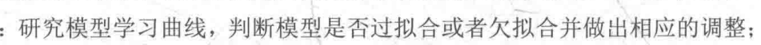

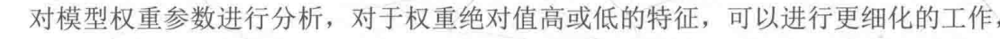

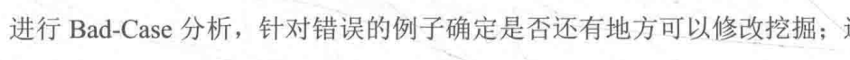

### 7.1.1 看拟合程度

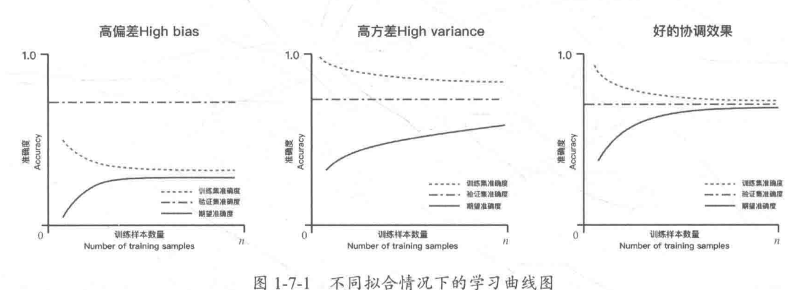

### 7.1.2 模型融合技术

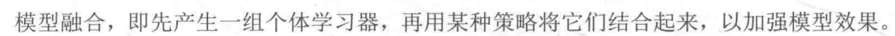

```
为什么模型融合？？
```

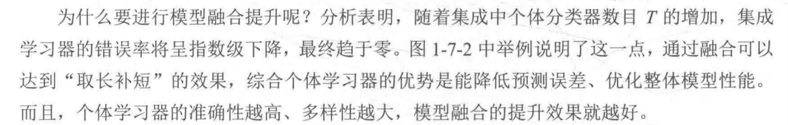

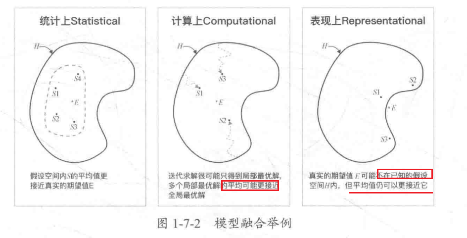

按照个体学习器的关系，模型融合提升技术可以分为两类:
(1)个体学习器间不存在强依赖关系可同时生成的并行化方法，代表是 Bagging 方法和随机森林。
(2)个体学习器间存在强依赖关系必须串行生成的序列化方法，代表是Boosting 方法。

#### 1 Bagging 和随机森林。

放回的抽样

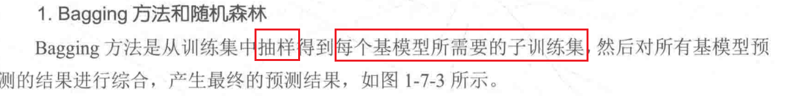

**随机森林只限于决策树**

#### 2 Boosting 方法。

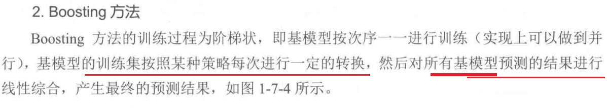

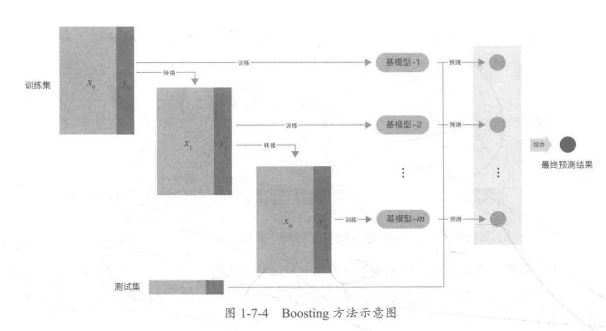

```
算法和Boosting方法有什么关系？
AdaBoost、提升树、梯度提升树，都是 Boosting 方法的三种实现方法

```

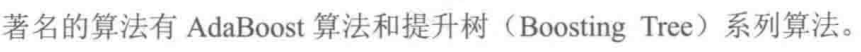

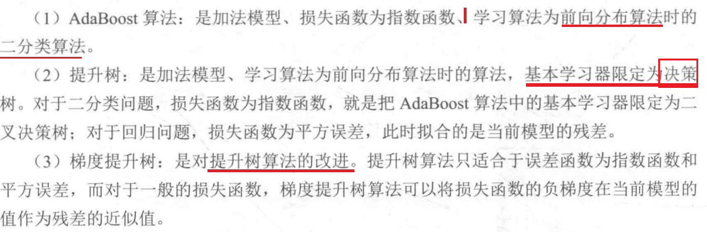

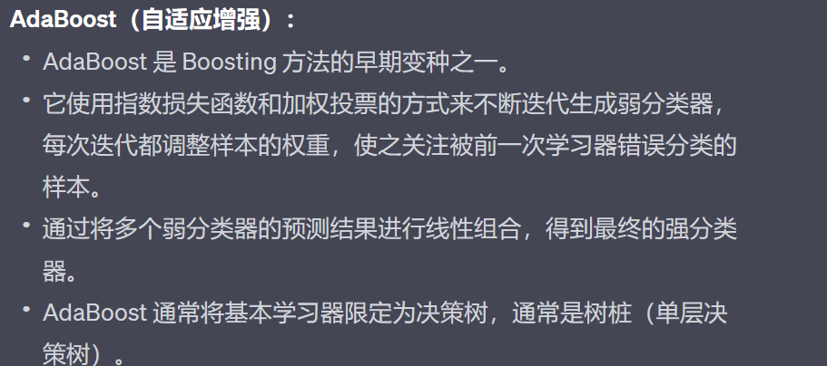

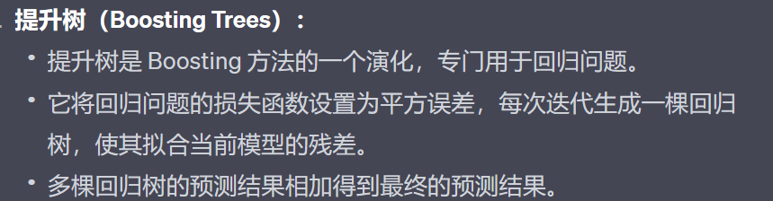

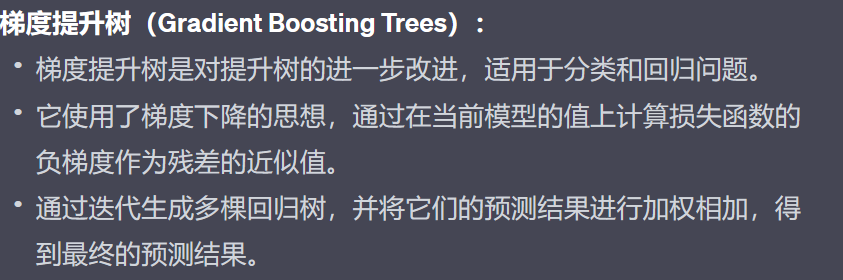

### 7.1.3 模型融合策略

####  1 投票

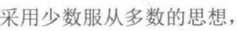

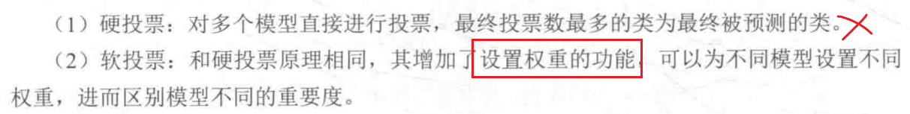

####  软投票方法

##### 1 averaging

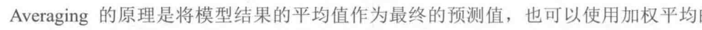

##### 2 ranking

```
排名权重通常是自行设置的
```

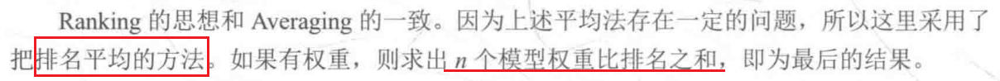

##### 3 blending

```
似乎是训练方法也是融合方法

多模型融合下的训练方法
```

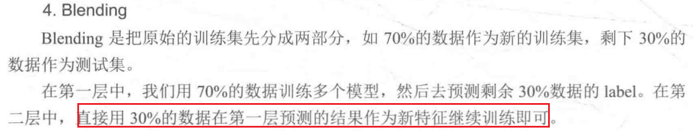

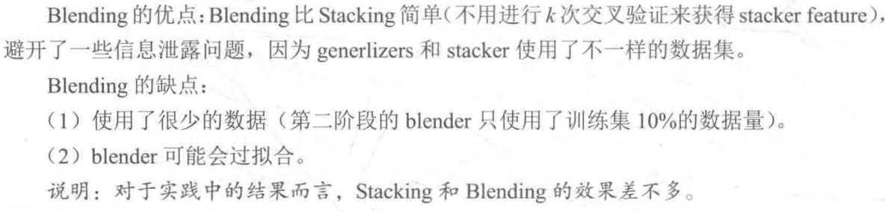

##### 4 stacking

```
基学习器和基模型是指同一件事情
```

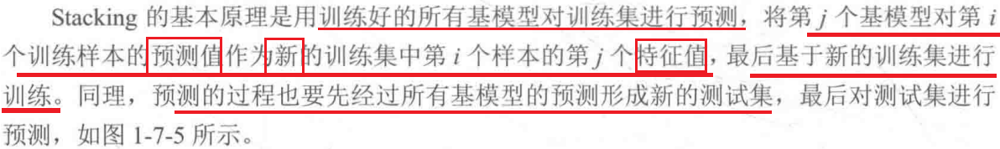

图解

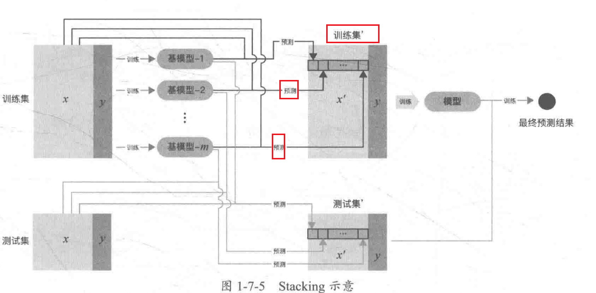


## 7.2代码演示


```python
# 模型预测–多模型Bagging
def model_predict(test_data,test_y=[],stack=False):
    #poly_trans=PolynomialFeatures(degree=2)
    #test_data1=poly_trans.fit_transform(test_data)
    #test_data=MinMaxScaler().fit_transform(test_data)
    i=0
    y_predict_total=np.zeros((test_data.shape[0],))
    for model in opt_models.keys():
        if model!="LinearSVR" and model!="KNeighbors":
            y_predict=opt_models[model].predict(test_data)
            y_predict_total+=y_predict
            i+=1
        if len(test_y)>0:
            print("{}_mse:".format(model),mean_squared_error(y_predict,test_y))
    y_predict_mean=np.round(y_predict_total/i,3)
    if len(test_y)>0:
        print("mean_mse:",mean_squared_error(y_predict_mean,test_y))
    else:
        y_predict_mean=pd.Series(y_predict_mean)
        return y_predict_mean
```

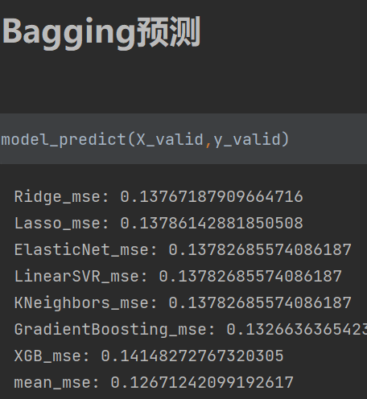

```python
# 模型软投票

import numpy as np
import matplotlib.pyplot as plt
import matplotlib.gridspec as gridspec
import itertools
from sklearn.linear_model import LogisticRegression
from sklearn.svm import SVC
from sklearn.ensemble import RandomForestClassifier

##主要使用pip install mlxtend安装mlxtend
from mlxtend.classifier import EnsembleVoteClassifier
from mlxtend.data import iris_data
from mlxtend.plotting import plot_decision_regions
%matplotlib inline

# Initializing Classifiers
clf1 = LogisticRegression(random_state=0)
clf2 = RandomForestClassifier(random_state=0)
clf3 = SVC(random_state=0, probability=True)
eclf = EnsembleVoteClassifier(clfs=[clf1, clf2, clf3], weights=[2, 1, 1], voting='soft')

# Loading some example data
X, y = iris_data()
X = X[:,[0, 2]]

# Plotting Decision Regions
gs = gridspec.GridSpec(2, 2)
fig = plt.figure(figsize=(10, 8))

for clf, lab, grd in zip([clf1, clf2, clf3, eclf],
                         ['Logistic Regression', 'Random Forest', 'RBF kernel SVM', 'Ensemble'],
                         itertools.product([0, 1], repeat=2)):
    clf.fit(X, y)
    ax = plt.subplot(gs[grd[0], grd[1]])
    fig = plot_decision_regions(X=X, y=y, clf=clf, legend=2)
    plt.title(lab)
plt.show()
```

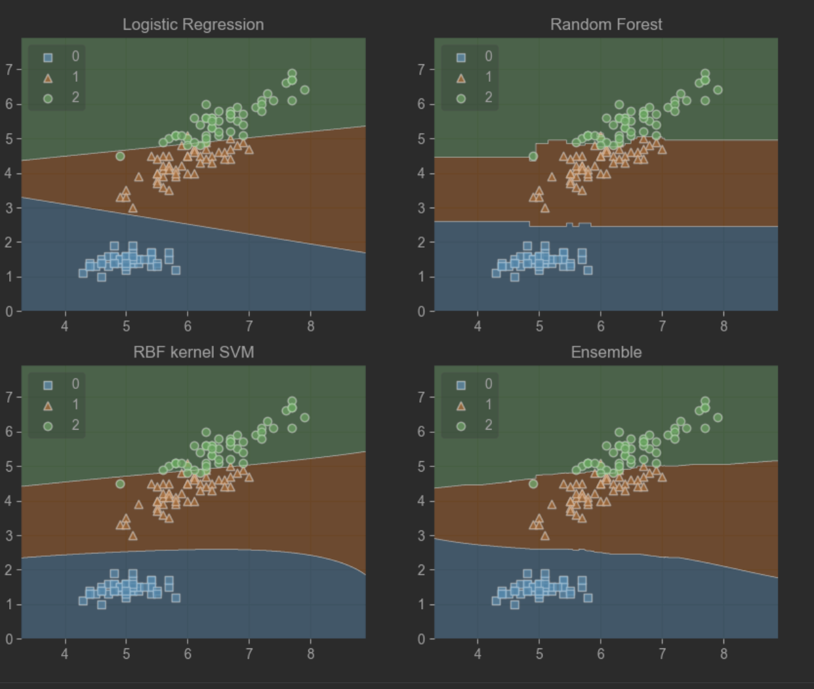


```
2023年8月18日17点11分
```


