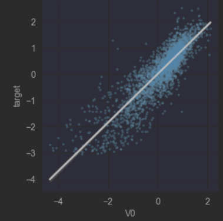
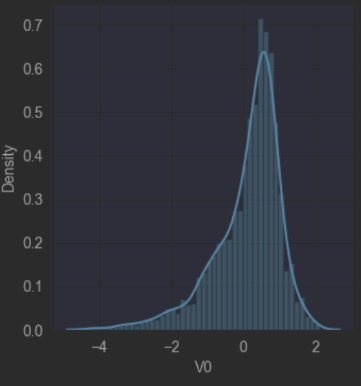

# 

## 1 箱线图

展示数据分布和统计信息的图表工具。

它可以帮助人们理解数据的**中位数、分位数、异常值等关键统计量**

箱线图通常由以下五个关键统计量组成：

1. 最小值（Minimum）：数据集中的最小值。
2. 第一四分位数（**Q1，下四分位数、上边缘**）：将数据从小到大排列，取中间值的中位数，即一半数据的中位数。
3. 中位数（Median）：数据集的中间值，将数据从小到大排列后的正中间值。
4. 第三四分位数（**Q3，上四分位数、下边缘**）：将数据从小到大排列，取中间值的中位数，即一半数据的中位数。
5. 最大值（Maximum）：数据集中的最大值


## 2 直方图 

帮助我们了解数据的集中趋势、分散程度、偏斜度以及是否存在异常值。

```

```


## 3 QQ图的目的

​	**分位数-分位数图**

检查一个数据集是否与**某个理论分布**相符。

通过观察QQ图，我们可以判断数据是否符合某个理论分布，或者是否存在偏差。


## 4 KDE核函数

一种非参数估计方法，用于从数据样本中估计概率密度函数（PDF）。它可以在没有先验假设的情况下估计数据的分布，从而更好地理解数据的概率分布特征。

**作用**

通过训练集数据和测试集数据的分布情况，查看数据分布是否一致，找出分布不一样的的某个特征变量

**注意**

**观察差异：**特别注意两个分布的形状、波峰位置、峰值高度等

```python
import seaborn as sns
import matplotlib.pyplot as plt
from scipy.stats import ks_2samp
# train_data 和 test_data 分别是训练集和测试集的数据框
# 选择要比较的特征变量
feature_to_compare = 'feature_name'
# 使用Seaborn绘制数据集和训练集的KDE图
plt.figure(figsize=(10, 6))
sns.kdeplot(train_data[feature_to_compare], label='Train Data')
sns.kdeplot(test_data[feature_to_compare], label='Test Data')
# 添加标题和标签
plt.title(f"KDE Comparison for {feature_to_compare}")
plt.xlabel("Feature Values")
plt.ylabel("Density")
plt.legend()

# 显示图表
plt.show()
# 执行K-S检验
ks_statistic, p_value = ks_2samp(train_data[feature_to_compare], test_data[feature_to_compare])
print("K-S Statistic:", ks_statistic)
print("P-Value:", p_value)
```


可以计算**KL散度**、**K-S**来查看


```python
# KL散度
import numpy as np
from scipy.stats import entropy
# train_data 和 test_data 分别是训练集和测试集的数据框
# 选择要比较的特征变量
feature_to_compare = 'feature_name'
# 从数据框中提取特征数据
train_feature_data = train_data[feature_to_compare]
test_feature_data = test_data[feature_to_compare]
# 计算训练集和测试集的分布
train_distribution = np.histogram(train_feature_data, bins='auto', density=True)
test_distribution = np.histogram(test_feature_data, bins='auto', density=True)
# 计算KL散度
kl_divergence = entropy(train_distribution[0], test_distribution[0])
# 自定义阈值
custom_threshold = 0.1  # 自定义的阈值
# 比较KL散度和自定义阈值
if kl_divergence > custom_threshold:
    print("分布差异超过阈值，分布不一致")
else:
    print("分布差异未超过阈值，分布可能一致")
```

KS检验用于比较两个样本是否来自同一分布，而KL散度用于度量两个概率分布之间的差异

## 线性回归关系图

分析数据的线性回归关系图可以帮助你在数据分析和建模过程中获得有关**变量或者变量与目标之间关系**的重要信息。

**作用**

```
决定是否值得在建模中考虑这个关系。
观察是否存在偏离主要趋势的异常值---考虑是否需要进行数据清洗或处理。
```



## **数据分布图（核密度估计图）**

```
sns.distplot() 绘制数据分布图，其中包括直方图和KDE曲线。
似乎没有什么关系
```



## 特征变量相关性和热力图

**主要用于线性关系的模型**其他模型不考虑

```
只线性模型考虑！！！
```

## 树模型的特征重要性选择

计算每个特征对预测目标的贡献程度

可以使用随机森林模型对数据进行建模，然后获取每个特征的重要性分数。重要性分数越高表示该特征对目标变量的预测影响越大。

```python
import numpy as np
import pandas as pd
from sklearn.model_selection import train_test_split
from sklearn.ensemble import RandomForestRegressor

# 假设 df 是你的数据框，其中 'features' 是特征变量，'target' 是目标变量
X = df.drop('target', axis=1)
y = df['target']

# 划分训练集和测试集
X_train, X_test, y_train, y_test = train_test_split(X, y, test_size=0.2, random_state=42)

# 构建随机森林模型
rf_model = RandomForestRegressor(n_estimators=100, random_state=42)
rf_model.fit(X_train, y_train)

# 获取特征重要性分数
feature_importances = rf_model.feature_importances_

# 将特征重要性分数与特征名对应起来
feature_importance_df = pd.DataFrame({'Feature': X.columns, 'Importance': feature_importances})

# 根据特征重要性分数进行降序排序
feature_importance_df = feature_importance_df.sort_values(by='Importance', ascending=False)

# 输出特征重要性结果
print(feature_importance_df)

```


## box-cox转换

一种处理数据变换的方法 ，旨在**改善数据的正态性（正态分布）**。


## 归一化的时候为什么要先对训练集和测试集数据进行合并

确保归一化的尺度参数基于所有数据的范围进行计算，从而避免在训练集和测试集之间引入额外的尺度差异从而**影响模型在测试集上的性能**。

**保持一致的尺度 和 防止信息泄露**


