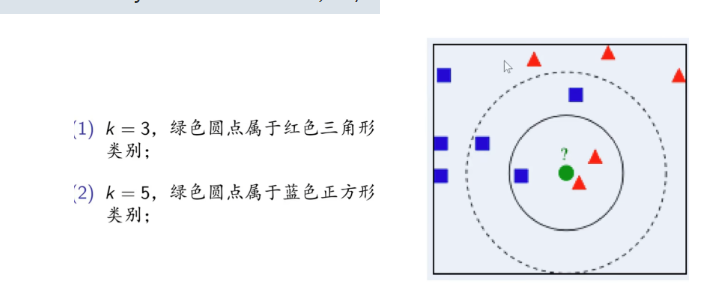
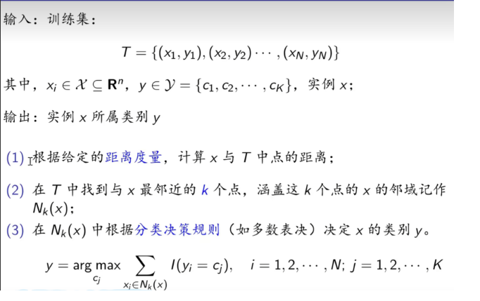
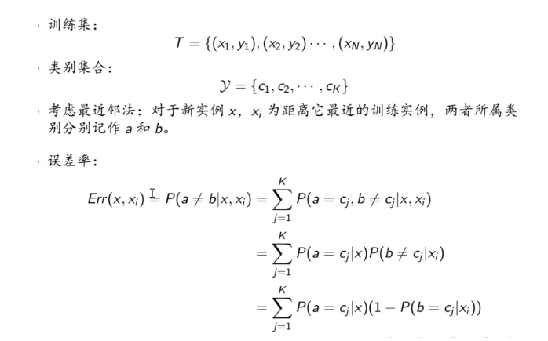
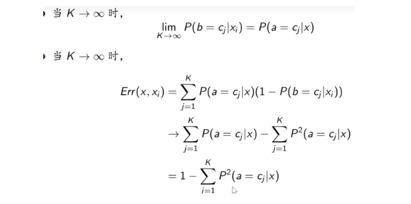
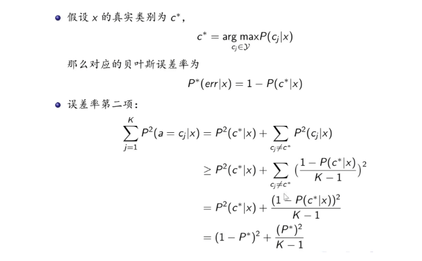
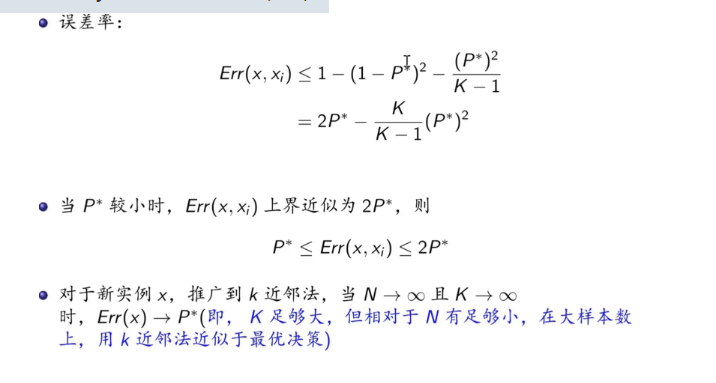

## K近邻法

```pyhon
# 概念
K近邻法 (k-nearest neighbor，k-NN) 是一种基本的分类与回归方法。主要思想: 假定给定一个训练数据集，其中实例标签已定，当输入新的实例时，可以根据其最近的 k 个训练实例的标签，预测新实例对应的标注信息。
分类问题:对新的实例，根据与之相邻的 k 个训练实例的类别，通过多数表决等方式进行预测。
回归问题: 对新的实例，根据与之相邻的 k 个训练实例的标签，通过均值计算进行预测。
```

## 0X1图像理解：




```
(1) k=3，绿色圆点属于红色三角形类别;
(2) k=5，绿色圆点属于蓝色正方形类别;
较小的 k 值，学习的近似误差减小，但估计误差增大，敏感性增强，而且模型复杂，容易过拟合
较大的 k 值，减少学习的估计误差，但近似误差增大，而且模型简单
注: k 的取值可通过交叉验证来选择，一般低于训练集样本量的平方
```

#### 	拓展：欧氏距离，三维等等

## 0X2 算法

​	

```
输入:训练集:
T=[(x1,y1),(x2,y2)·.·,(xN,yN)}其中，XiEXCR”，yEy={c,C2,···,CK}，实例x;输出:实例x所属类别 y
(1)r根据给定的距离度量，计算X与 T中点的距离:
(2)在 T中找到与x 最邻近的 k 个点，涵盖这 k 个点的x 的邻域记作Nk(x);
(3)在Nk(x)中根据分类决策规则 (如多数表决) 决定 的类别 y。
```


## 0X3 误差率




```
概率类别求和
```







## 0X4 三要素

###  1.距离度量lp距离


```
	欧氏距离 p=2

​	曼哈顿距离 p=1

​	切比雪夫距离 p=∞
```

### 2.p范式取不同值时，所计算的距离不相同：


​	


### 3.分类决策选择

#### 	多数表决规则:由输入实例的 k 个邻近的训练实例中的多数类决定输入实例的类。

```
分类函数f:Rn={c1,C2,··,CK}
损失函数L(Y,F(x)=  Y = f(X) or Y≠f(X)
误分类概率P(Y ≠f(X))=1- P(Y = f(X))
```


```

```


## 0X5 kd树

### 1.构造kd树

#### 	1.概念

```
概念
kd 树是一种对 k 维空间中的实例点进行储存以便对其进行快速检索的树形数据结构。

本质:二叉树，表示对 k 维空间的一个划分
构造过程:不断地用垂直于坐标轴的超平面将 k 维空间切分，形成k 维超矩形区域
kd 树的每一个结点对应于一个 k 维超矩形区
```

#### 	2.算法	

```
输入: k 维空间数据集:
T={x1,X2,···,XN
其中，X;=(x;输出:kd 树
(1) 开始:构造根节点。
选取 x(1)为坐标轴，以训练集中的所有数据 (1) 坐标中的中位数作为切分点，将超矩形区域切割成两个子区域将该切分点作为根结点。由根结点生出深度为 1的左右子结点，左节点对应坐标小于切分点，右结点对应坐标大于切分点。
(2) 重复
对深度为j的结点，选择 x(0)为切分坐标轴,] = ( mod k)+1，以该结点区域中所有实例 ()坐标的中位数
作为切分点，将区域分为两个子区域。
生成深度为i+1的左、右子结点。左节点对应坐标小于切分点，右结点对应坐标大于切分点。
直到两个子区域没有实例时停止。
```

 

#### 	3.例子


### 2.搜索KD树

	寻找“当前最近点”
		寻找最近邻的子结点作为目标点的“当前最近点9
	回溯
		以目标点和“当前最近点”的距离沿树根部进行回溯和迭代
```python
输入:已构造的 kd 树，目标点X
输出:X的最近邻
寻找“当前最近点
	从根结点出发，递归访问 kd 树，找出包含X的叶结点:以此叶结点为“当前最近点”
回溯
	若该结点比“当前最近点”距离目标点更近，更新“当前最近点”
	当前最近点一定存在于该结点一个子结点对应的区域，检查子结点的父结点的另一子结点对应的区域是否有更近的点。
当回退到根结点时，搜索结束，最后的“当前最近点”即为 X 的最近邻部o
```

#### 1 寻找

根据分离点寻找

#### 2 回溯

先看最近点---半径画圆---相交父节点超平面---是则：检查兄弟节点--判断距离--迭代回到最初判断；否：确定该点---得到最临点


```
2023年8月8日
```


## 0X6 代码实现

```python
# 作者：Weakliy
# 创建日期：2023/8/11 15:50
# 描述：这个文件实现了分类。

import matplotlib.pyplot as plt
import seaborn as sns
from sklearn.datasets import load_iris
from sklearn.model_selection import train_test_split
from sklearn.neighbors import KNeighborsClassifier
from sklearn.metrics import accuracy_score, confusion_matrix
import numpy as np

# 加载鸢尾花数据集
data = load_iris()
X = data.data
y = data.target
target_names = data.target_names

# 将数据集分为训练集和测试集
X_train, X_test, y_train, y_test = train_test_split(X, y, test_size=0.2, random_state=42)

# 创建k临近法分类器，这里选择k=3
k = 3
knn_classifier = KNeighborsClassifier(n_neighbors=k)

# 在训练集上训练分类器
knn_classifier.fit(X_train, y_train)

# 在测试集上进行预测
y_pred = knn_classifier.predict(X_test)

# 计算分类器的准确率
accuracy = accuracy_score(y_test, y_pred)
print(f"Accuracy: {accuracy:.2f}")

# 可视化数据分布
sns.set(style="whitegrid")
sns.pairplot(sns.load_dataset("iris"), hue="species")
plt.show()

# 可视化混淆矩阵
cm = confusion_matrix(y_test, y_pred)
plt.figure(figsize=(8, 6))
sns.heatmap(cm, annot=True, cmap="Blues", fmt="d", xticklabels=target_names, yticklabels=target_names)
plt.xlabel('Predicted')
plt.ylabel('True')
plt.title('Confusion Matrix')
plt.show()

```


```python
# 作者：Weakliy
# 创建日期：2023/8/11 15:51
# 描述：这个文件实现了回归功能。


import numpy as np
import matplotlib.pyplot as plt
from sklearn.datasets import make_regression
from sklearn.model_selection import train_test_split
from sklearn.neighbors import KNeighborsRegressor
from sklearn.metrics import mean_squared_error

# 生成模拟的回归数据集
X, y = make_regression(n_samples=100, n_features=1, noise=10, random_state=42)

# 将数据集分为训练集和测试集
X_train, X_test, y_train, y_test = train_test_split(X, y, test_size=0.2, random_state=42)

# 创建k临近法回归器，这里选择k=3
k = 3
knn_regressor = KNeighborsRegressor(n_neighbors=k)

# 在训练集上训练回归器
knn_regressor.fit(X_train, y_train)

# 在测试集上进行预测
y_pred = knn_regressor.predict(X_test)

# 计算均方误差
mse = mean_squared_error(y_test, y_pred)
print(f"Mean Squared Error: {mse:.2f}")

# 可视化回归结果
plt.scatter(X_test, y_test, color='blue', label='True values')
plt.scatter(X_test, y_pred, color='red', label='Predicted values')
plt.xlabel('X')
plt.ylabel('y')
plt.title('K-Nearest Neighbors Regression')
plt.legend()
plt.show()

```

