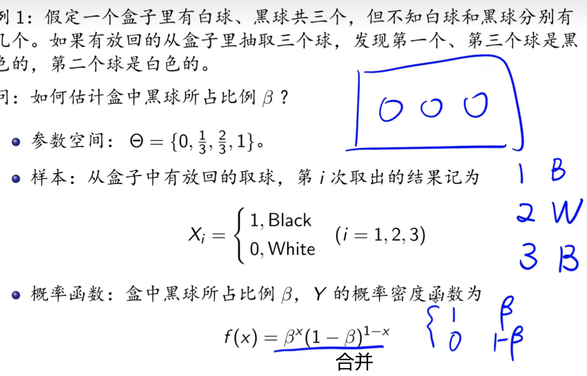
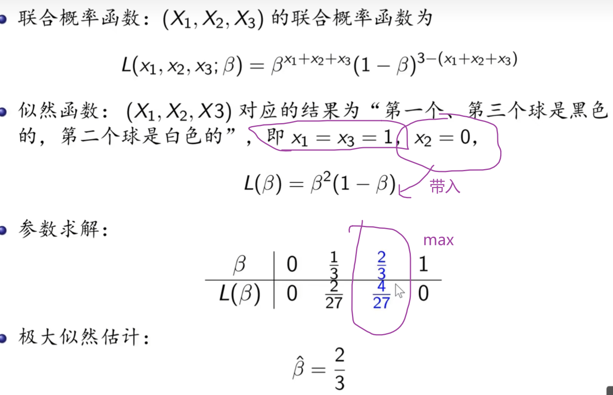
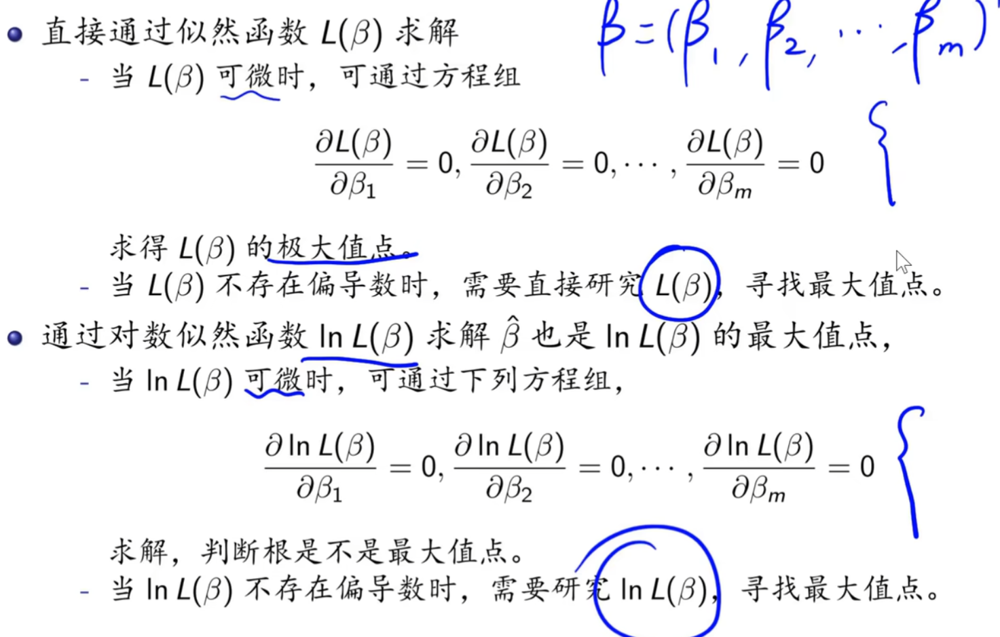
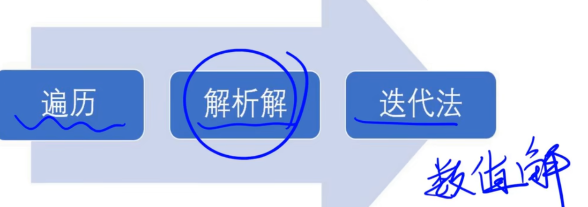
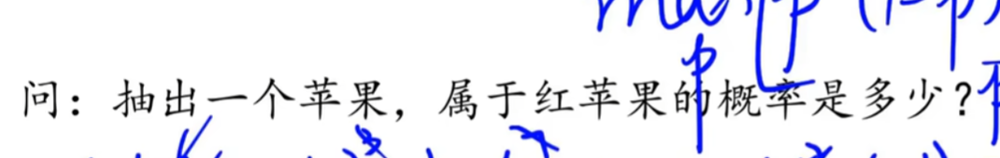

# 朴素贝叶斯1

## 0X1 概念-

### 	1. 条件概率


### 	2.贝叶斯定理---逆概率思维

```

```

 												

```

```


```
贝叶斯分类
```


### 	3.朴素贝叶斯

​			

```
样本之间相互独立
```


```
2023年8月8日16点51分
```

## 0X2 朴素贝叶斯

### 	1.朴素？

​			生成方法

​			

### 	2.后验概率最大化


## 0X3 极大似然估计

```
朴素贝叶斯2
```

## 0X4 朴素贝叶斯算法

### 	1.模型

```python
# 求出后验概率最大化 --->分类
```


### 	2.例题

#### 		1.数据


#### 		2.计算


## 0x5 贝叶斯估计

### 	1.估计方法

	

# 朴素贝叶斯2

### 0X1 极大似然估计

​	样本


### 0X2 实例1

#### 	1. 求出概率函数

​	


#### 		2.根据样本求出似然函数




#### 		3.通过遍历，求偏导或者迭代求出极大值



#### 		4. 如下




```

```

### 0X2 实例2

#### 	极大似然估计



​		