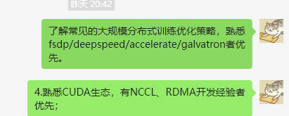

```
分布式训练（Distributed Training）：分布式训练是将深度学习模型的训练任务分布到多个计算节点上，以加速训练过程。这通常涉及到数据并行性（Data Parallelism）和模型并行性（Model Parallelism）等策略。以下是一些常见的大规模分布式训练优化策略和工具：

a. 数据并行性（Data Parallelism）：在数据并行性中，每个计算节点都拥有完整的模型副本，但是它们在不同的数据批次上训练。这个策略需要在不同节点之间同步模型参数。

b. 模型并行性（Model Parallelism）：在模型并行性中，模型被分解成多个部分，每个部分由不同的计算节点负责。这对于非常大的模型特别有用。

FSDP（Fully Sharded Data Parallelism）：FSDP是一种用于大规模分布式训练的策略，它通过将模型参数分成多个碎片并在多个节点之间分发这些碎片来提高训练效率。这可以减少通信开销并允许更大的模型。

DeepSpeed：DeepSpeed是一个用于训练大型模型的优化工具，它提供了多种分布式训练策略，包括数据并行性、模型并行性和FSDP。它还提供了一些性能优化技术，如优化的混合精度训练和模型压缩。

Accelerate：Accelerate是一个PyTorch生态系统中的库，它旨在简化分布式训练的使用，并提供了许多有用的功能，如自动混合精度训练、分布式数据加载和模型检查点
```

```
CUDA（Compute Unified Device Architecture）：CUDA是由NVIDIA开发的并行计算平台和API。它允许开发者在NVIDIA GPU上编写并行程序，以加速各种计算任务，包括深度学习训练。CUDA提供了一种并行编程模型，通过在GPU上执行大规模线程块，可以在大规模数据上实现高性能计算。

NCCL（NVIDIA Collective Communications Library）：NCCL是NVIDIA开发的用于高性能计算的库，旨在优化多GPU系统上的通信和集体操作。NCCL提供了高效的GPU之间的数据传输和同步机制，这对于分布式训练非常关键。

RDMA（Remote Direct Memory Access）：RDMA是一种用于高性能计算和数据传输的通信协议。在CUDA生态中，NCCL RDMA支持通过GPU直接进行数据传输，而不涉及主机内存的拷贝，从而提高了通信效率
```

