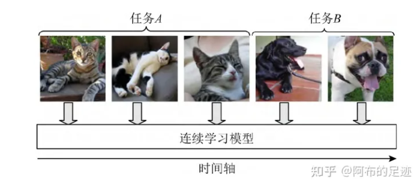
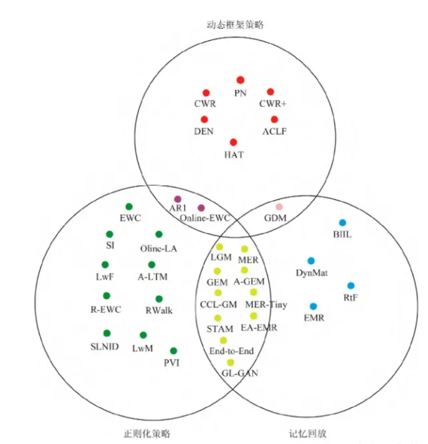
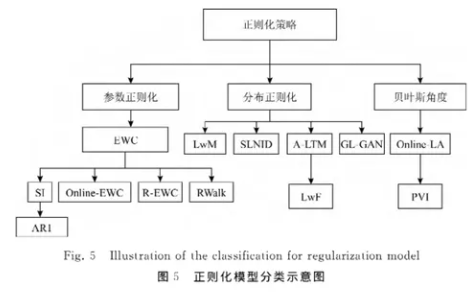
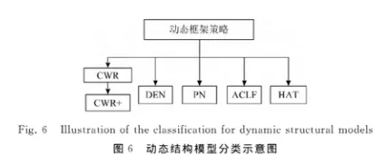
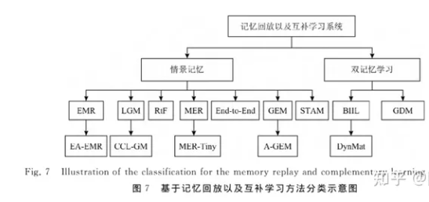

# 持续学习model

## 一、持续学习相关概念

### 特点

# 

持续学习模拟了人类大脑的学习思考方式，能够对非独立同分布（not IID）的数据流进行学习。

他的本质是既能够对到来的新数据进行利用，并基于之前任务积累的经验，在新的数据上很好的完成任务；

又能够避免遗忘问题，对曾经训练过的任务依旧保持很高的精度（即避免灾难性遗忘的问题）。

即：**可塑性**（学习新知识的能力）和**稳定性**（旧知识的记忆能力）。

模型对连续的非独立同分布数据进行依次学习，并且每组数据**仅访问一次。**

### 包括三种学习场景：

- Task-IL（任务增量学习）：解决当前任务，提供任务ID号
- Domain-IL（域增量学习）：解决当前任务，不提供任务ID号（新的任务与原任务类别相同）
- Class-IL（类增量学习）：解决每一个任务，推断任务ID号（新任务与原任务的类别可能不同）

### Tips：

（1）多任务学习与持续学习的区别：多任务学习要求同时获得所有的训练数据，而在持续学习中数据是以数据流的方式依次获得的，旧数据无法获取。多任务学习随着时间的推移，不会积累任何知识。

（2）迁移学习与持续学习的区别：迁移学习不是连续的，仅仅使用源域来帮助目标域的学习，并且没有将过去的知识进行积累。其仅仅实现了源域帮助目标域进行学习，反向的促进没有实现。

（3）在线学习往往考虑单一任务域，并不强调模型的抗遗忘能力，更关注于当下数据。

## 二、持续学习的主流方法包括以下三类：

1. 基于**正则化**的方法
2. 基于**动态结构**的方法
3. 基于**情景记忆**的方法

### 基于正则化的方法

该类方法通过为损失增添额外损失项，对权重进行约束，保护巩固已学习的知识，但这样可能会制衡新任务的学习性能，无法很好的权衡新旧任务，避免灾难性遗忘的能力是十分有限的。该类方法不需要保存任何以前的数据，只需要对每个任务进行一次训练。但是，随着任务数量的不断增加，可能导致特征漂移现象的发生。

### 基于动态结构的方法

动态的对网络结构进行调整，使其适应新的任务，也可以扩展网络结构来学习新的任务，使用更多的神经元或网络层。然而随着任务数量的不断增多，模型结构会不断变大，因此这样的方法无法应用到大规模数据中，影响其在实际场景中的使用。另外，该类方法也不能从任务之间的正向迁移中获益。

### 基于情景记忆的方法

该类方法通过保存一些之前任务的样例进行记忆回放来缓解灾难性遗忘，有一定的效果。但是随着任务数量的增长，计算成本会快速增加，同时由于需要保存之前的数据，不利于数据安全保护。为了解决这些问题，人们提出了生成模型来生成之前任务的一些相似分布样例，但在每次生成样本时，可能会造成“语义漂移”，且随着时间推移，模型训练准确率逐渐下降，并且模型训练效率很低。

## 三、持续学习常用数据集
