 

# 大创云服务器部署总结

## 1 背景

​	服务器：阿里云测试，腾讯云运用

​	最终网站：https://www.dachuangchatang.cn

​	api：https://www.dachuangchatang.cn/process_image

## 2 步骤

### 1. 编写flask网页代码

#### 	1.设置主界面

```
主界面：
1. 选择图片按钮
2. 上传图片按钮（运行api）
3. 返回结果并展示
```

app.py:

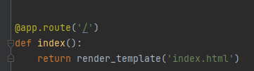

index.html:

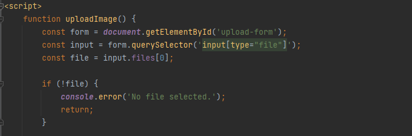

#### 	2.编写api

```
传输格式：
data = {'encoded_data': encoded_image}
其中：encoded_image是进行 Base64 编码后的图像文件
```

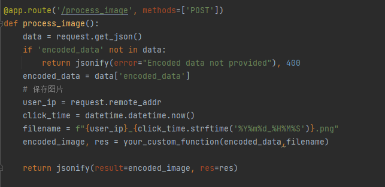

#### 	3.实现功能函数

```
功能列表：
1. 解码base64编码的图片
2. 图片备份与预处理
3. 加载model预测
4. 返回结果（process后的图片和预测结果）
```

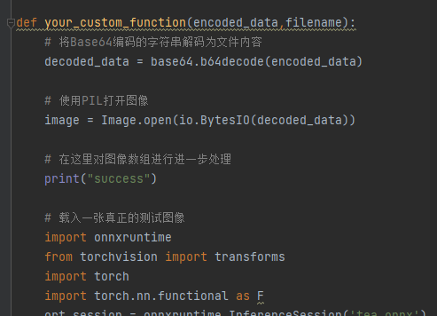

#### 4.问题总结：

##### 1. 函数返回值以及页面显示

##### 2.显示图像处理

```python
    # 2023年9月24日修改
    # 设定最大宽度和最大高度
    max_width = 512
    max_height = 512

    # 计算按比例缩放后的新尺寸
    width, height = image.size
    if width > max_width or height > max_height:
        ratio = min(max_width / width, max_height / height)
        new_width = int(width * ratio)
        new_height = int(height * ratio)
        image.thumbnail((new_width, new_height))
    elif width <= max_width or height <= max_height:
        # 如果宽度和高度都小于512像素，将图像等比例放大至512像素
        ratio = min(max_width / width, max_height / height)
        new_width = int(width * ratio)
        new_height = int(height * ratio)
        image = image.resize((new_width, new_height), Image.ANTIALIAS)
    image_save = image.resize((int(image.width * 0.5), int(image.height * 0.5)), Image.ANTIALIAS)
    # print(image.width,image.height)
    save_path = os.path.join('./static', filename)
    image_save.save(save_path, format="PNG")
```

##### 3.

### 2.部署到云服务器

#### 	1 注册服务器

**创建和配置ECS实例步骤：**

1. **登录阿里云控制台**：
   - 打开浏览器，访问阿里云官方网站（https://www.aliyun.com/）。
   - 点击右上角的“登录”按钮，输入你的阿里云账号和密码进行登录。
2. **进入ECS管理页面**：
   - 登录后，在控制台首页或导航栏中找到“ECS”服务，点击进入ECS管理页面。
3. **创建ECS实例**：
   - 在ECS管理页面，点击“实例”左侧的“创建实例”按钮。
   - 根据需求选择实例配置，包括地域、可用区、实例规格、操作系统等。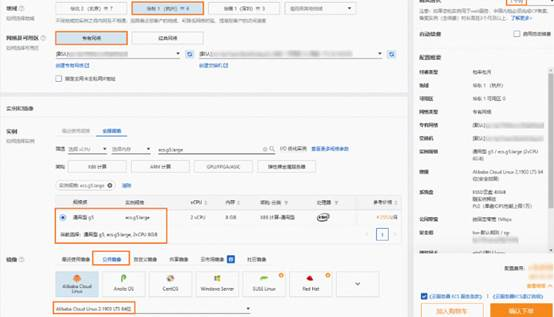
   - 配置网络设置，包括VPC、网络类型、安全组等。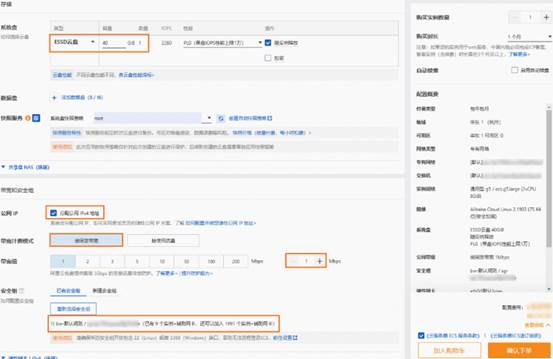
   - 根据需求设置其他选项，如购买时长、公网带宽等。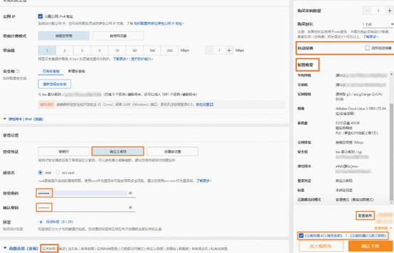
   - 点击“立即购买”按钮完成购买。

 

1. **等待实例创建完成**：
   - 创建实例后，系统会自动进行初始化和启动，需要等待一段时间才能使用。

**连接和管理ECS实例步骤：**

1. **连接到ECS实例**：
   - 在ECS管理页面找到已创建的实例，在实例列表中点击实例名称进入详情页面。
   - 复制实例的公网IP地址或内网IP地址，用于远程连接。
   - 使用SSH工具（XFTP）通过公网IP地址或内网IP地址连接到ECS实例。
2. **管理ECS实例**：
   - 通过SSH连接后，使用root账号或其他具有管理员权限的账号登录ECS实例。
   - 通过**宝塔面板**可以进行系统配置、软件安装、文件管理等操作，根据需求进行管理。
3. **监控和维护ECS实例**：
   - 安装宝塔面板查看实例的监控信息，包括CPU、内存、网络等指标。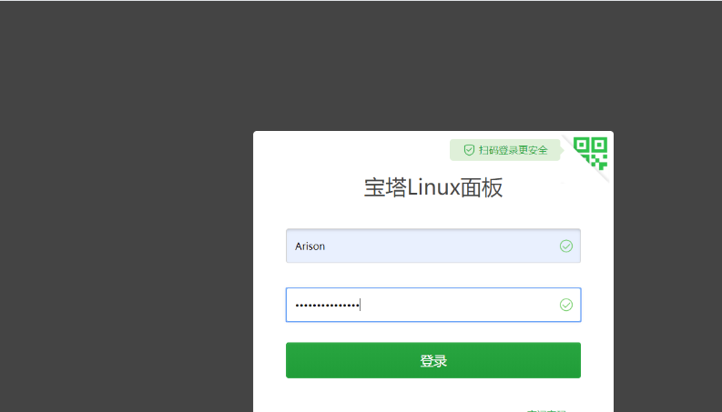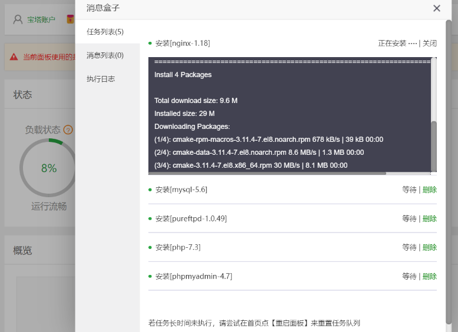


#### 	2 配置环境

传输文件：

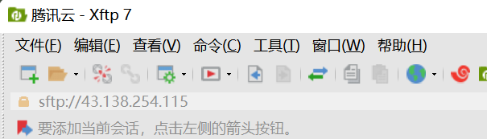


```
配置环境
1. python安装
2. 创建虚拟环境
3. 安装环境依赖
4. 运行测试代码
5. 设置安全组，开放端口（重要！）
```

```cmd
sudo yum install python3-virtualenv
python3 -m venv myenv
source myenv/bin/activate
pip install ./torch-1.8.0-cp36-cp36m-manylinux1_x86_64.whl 
pip install pillow onnxruntime numpy flask
pip install torchvision==0.9.0
deactivate # 退出环境 
```

设置安全组，开放端口

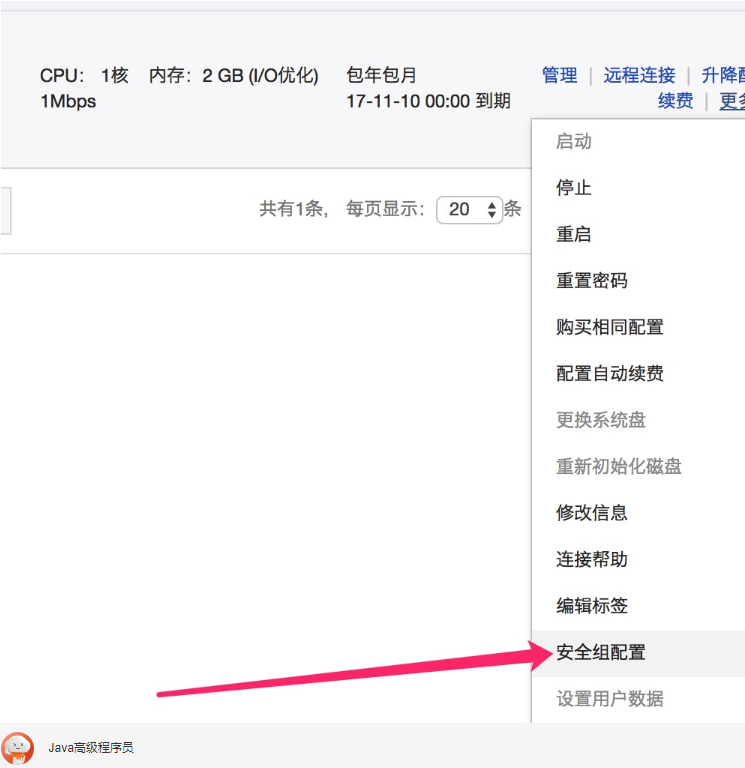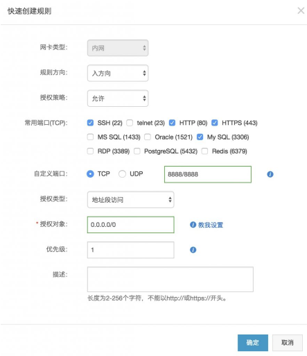

#### 	3 注册域名与备案

```
步骤：
1. 注册域名
2. 域名绑定ip
```

#### 

#### 4 域名证书与域名绑定

步骤：

```

1. 生成证书，并下载相关的密钥（nigix）
2. 网站备案和公安备案
3. 配置conf文件（ip链接域名，配置密钥，）
```

命令：

```cmd
sudo yum update
sudo yum install nginx # 安装 nginx
# 编辑conf文件
nginx -t  # 检查错误
service nginx restart  # 重启并检查状态
sudo systemctl start nginx
sudo systemctl status nginx
```


### 3.部署与测试

#### 	1. 用flask部署，

```cmd
python3 app.py
```


#### 	2.爬虫测试

```python
# 作者：Weakliy
# 创建日期：2023/8/28 22:00
# 描述：这个文件实现了爬虫测试网站。
import requests
import base64

# 读取图像文件并进行 Base64 编码
with open(r"F:\Pydata\tea_flask\bigimg.jpg", 'rb') as image_file:
    encoded_image = base64.b64encode(image_file.read()).decode('utf-8')

# 构造请求数据
data = {'encoded_data': encoded_image}

# 发送 POST 请求到 /process_image 路由
response = requests.post('https://www.dachuangchatang.cn/process_image', json=data)

# 解析响应
if response.status_code == 200:
    result = response.json()
    print("Result:", result['result'])
    print("Prediction:", result['res'])
else:
    print("Error:", response.status_code)
    print(response.text)

```


#### 	3. 程序挂起

```cmd
nohup python3 app.py &
ps aux | grep python # 查找进程
kill 25360 # 杀死进程
```


#### 	4. 解决：程序自动关闭

```
修改/etc/ssh/sshd_config的conf：

ClientAliveInterval 30
ClientAliveCountMax 86400
```

#### 	5. 解决：传输文件大小限制

```
修改nginx.conf
添加代码：
client_max_body_size 20M;
```

## 4 最终结果展示


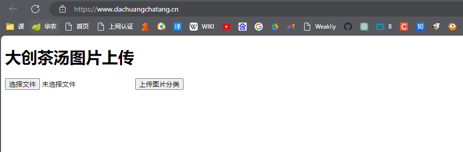


# 编写日期：2023年9月24日22点38分
