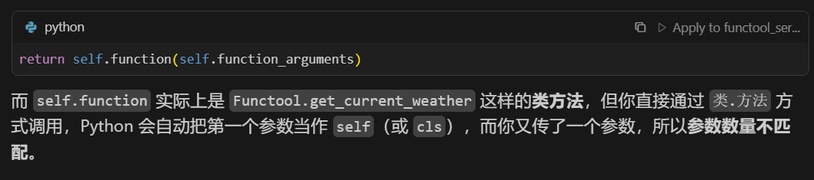
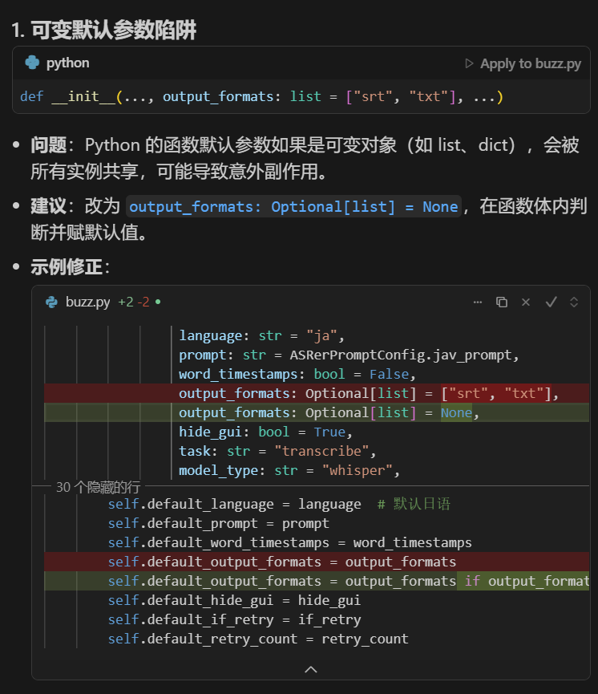
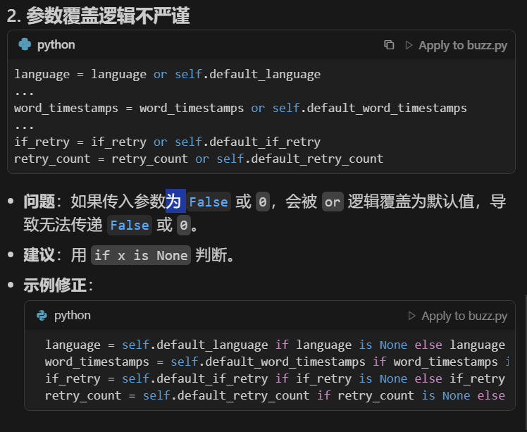

# ✍️Python 杂项

## **单个类内部的摆放顺序（最重要）**

这是 **PEP8 + Google 风格指南** 统一规定的顺序：

**类内部从上到下：**


1. **类文档字符串**
2. **类属性（类变量）**
3. `__init__` 构造方法
4. **魔术方法（`__str__`、`__len__` 等）**
5. **@property 装饰器方法**
6. **公共实例方法**
7. **私有实例方法（以 _ 开头）**
8. **@staticmethod 静态方法**
9. **@classmethod 类方法**

```python
"""
模块说明：用户相关类定义
"""

# 1. 导入
import json
from dataclasses import dataclass

# 2. 常量
MAX_USER_COUNT = 100

# 3. 私有类
class _InternalHelper:
    pass

# 4. 公共类（内部严格按顺序摆放）
class User:
    """用户类，管理用户信息"""  # 1. 文档字符串
    
    # 2. 类属性
    version = "1.0"
    
    def __init__(self, name):  # 3. 构造方法
        self.name = name

    def __str__(self):  # 4. 魔术方法
        return f"User: {self.name}"

    @property
    def username(self):  # 5. 属性方法:为了让你 “像访问变量一样调用方法”，同时还能保留方法的控制能力。
        return self.name.upper()

    def get_info(self):  # 6. 公共方法
        return self._format_info()

    def _format_info(self):  # 7. 私有方法
        return f"INFO: {self.name}"

    @staticmethod
    def is_valid_name(name):  # 8. 静态方法
        return len(name) > 2

    @classmethod
    def from_dict(cls, data):  # 9. 类方法
        return cls(data["name"])
```


# 🤝属性

## 列表

1. 空列表获取[0] 会怎么样, 能返回 '' 空字符串吗


## 可变对象

（如列表）

- 原因：直接赋值可变对象（如列表）会导致所有实例共享同一个对象，修改一个实例会影响其他实例：

```python
# 如果直接赋值
class BadExample:
    items: List[str] = ["default"]  # 所有实例共享同一个列表！

obj1 = BadExample()
obj2 = BadExample()
obj1.items.append("new")  # 修改 obj1
print(obj2.items)  # ['default', 'new']  # obj2 也被影响了！

# 使用 default_factory
class GoodExample:
    items: List[str] = Field(default_factory=lambda: ["default"])

obj1 = GoodExample()
obj2 = GoodExample()
obj1.items.append("new")  # 修改 obj1
print(obj2.items)  # ['default']  # obj2 不受影响
```

#### 「类属性」和「实例属性」的区别。

| 写法                                      | 属性类型 | 是否共享     | 核心原因                 |
| ----------------------------------------- | -------- | ------------ | ------------------------ |
| `items = ["default"]`（类级别）           | 类属性   | 所有实例共享 | 属于类，不是某个实例     |
| `self.items = ["default"]`（**init** 里） | 实例属性 | 不共享       | 每个实例创建时都新建列表 |


## isinstance

```
isinstance(int, type)        # True - int 是一个类型
isinstance(str, type)        # True - str 是一个类型
isinstance(list, type)       # True - list 是一个类型

isinstance(123, type)        # False - 123 是整数实例，不是类型
isinstance("hello", type)    # False - "hello" 是字符串实例，不是类型

class MyClass:
    pass
isinstance(MyClass, type)    # True - MyClass 是一个类型（类）
isinstance(MyClass(), type) # False - MyClass() 是实例，不是类型
```

## issubclass(类, 父类)：

判断类是否为指定父类的子类


## `items()` 

是 Python 字典中的一个方法，用于返回字典的键值对。


# 🪜进阶

## 装饰器@

### 1.用法


### 2.静态方法和类方法

#### `普通方法（不使用装饰器）`

需要一个实例（`self`）作为第一个参数。普通方法通常用于操作类的**实例**属性和方法。

> #### 特点
>
> - **必须通过实例调用**：普通方法需要先创建类的实例，然后通过实例调用方法。
> - **访问实例属性和方法**：普通方法可以访问和修改实例的属性和其他方法。
>
> ```
> obj = MyClass(10)
> obj.normal_method()  # 输出：The value is 10
> ```
>
> 

#### `@classmethod`

用于定义**类**方法。类方法的第一个参数是**类本身**（通常命名为 `cls`），而不是实例（`self`）

> ```python
> MyClass.class_method()  # 输出：The class value is 100
> ```


#### `@staticmethod`

用于定义静态方法。静态方法既不接收实例参数（`self`），也不接收类参数（`cls`），它就是一个普通的函数，**只是恰好定义在类中**

> **独立于类和实例**
>
> 静态方法通常用于与类相关的工具函数或辅助函数




## With

### 1. 定义


### 2. contextlib  contextmanager

把任意一段代码，变成 `with` 语句的装饰器。

**with**

```
from contextlib import contextmanager

@contextmanager
def 你的工具():
    # 1. 进入 with 时执行（准备）
    print("进入 with")
    
    try:
        yield  # 2. 交出控制权，执行 with 内部代码
        
    finally:
        # 3. 退出 with 时 必执行（清理）
        print("退出 with")
```

**使用：**

```
with 你的工具():
    print("我在中间执行")
```

------

> ### 例子 1：自动加锁、自动解锁
>
> ```
> from contextlib import contextmanager
> import threading
> 
> lock = threading.Lock()
> 
> @contextmanager
> def auto_lock():
>     lock.acquire()   # 加锁
>     try:
>         yield
>     finally:
>         lock.release() # 自动解锁（哪怕报错也会解锁）
> 
> # 使用
> with auto_lock():
>     # 这里自动安全
>     print("安全操作")
> ```
>
> ### 例子 2：自动计时
>
> ```
> @contextmanager
> def timer():
>     start = time.time()
>     try:
>         yield
>     finally:
>         print(f"耗时：{time.time() - start:.2f}s")
> 
> # 使用
> with timer():
>     time.sleep(1)
> ```
>
> ### 例子 3：自动捕获异常
>
> ```
> @contextmanager
> def ignore_error():
>     try:
>         yield
>     except Exception:
>         print("出错了，但我帮你吃掉了")
> 
> # 使用
> with ignore_error():
>     1 / 0  # 报错不会崩
> ```
>
> ------
>
> ## 4. 带返回值（yield 传东西出来）
>
> ```
> @contextmanager
> def connect_db():
>     conn = "数据库连接"
>     print("打开连接")
>     try:
>         yield conn  # 把对象传给 with
>     finally:
>         print("关闭连接")
> 
> # 使用
> with connect_db() as db:
>     print(f"使用：{db}")
> ```


### 3 区别

| 对比项   | 普通函数装饰器             | @contextmanager 上下文管理器             |
| -------- | -------------------------- | ---------------------------------------- |
| 作用对象 | **整个函数**               | **任意一段代码块**                       |
| 调用方式 | `@装饰器` 贴函数头上       | `with 函数():` 包裹代码                  |
| 异常处理 | 需自己写 try/except        | 天然适合 try-finally，**报错也必走收尾** |
| 传值方式 | 函数参数传参               | `yield 变量` + `as 变量` 接收            |
| 核心用途 | 函数增强、切面、日志、权限 | **资源管控**：锁、连接、文件、线程、模型 |

#### 1. 普通装饰器（出错容易漏收尾）

```
def deco(func):
    def wrap():
        print("打开资源")
        func()
        print("关闭资源") # 函数内报错，这句不执行！
    return wrap

@deco
def run():
    1/0
run()
```

报错后**关闭资源代码直接跳过**，资源泄露。

#### 2. contextmanager 天生安全

```
@contextmanager
def safe_resource():
    print("打开资源")
    try:
        yield
    finally:
        print("强制关闭资源") # 无论是否报错，必执行

with safe_resource():
    1/0
```

**哪


# ✅python语法总结


> 

## `__init__.py`实用示例

一个比较标准的 `__init__.py`：

```
python复制编辑# 包元信息
__version__ = "1.0.0"
__author__ = "OpenAI Learner"

# 导入核心功能
from .core import CoreClass, helper_function
from . import utils

# 定义公开 API
__all__ = ["CoreClass", "helper_function", "utils"]
```

> 如果init是空的
>
> from mypackage import Core  # ❌ 报错：找不到 Core
> from mypackage import utils  # ✅ OK，因为 utils 是个模块


## 赋值变量

> 不是浅拷贝，也不是深拷贝 — `result_frame = frame` 只是引用赋值（两个变量指向同一块 `numpy` 数组）。
>
> ### 实际会发生什么
>
> 1. `cv2.putText(result_frame, ...)` 是原地修改
>    OpenCV 会直接改传入数组的像素，所以 `putText` 之后 `frame` 上也会有文字（和 `result_frame` 是同一张图）。
> 2. `append_depth_to_result_frame` 可能换一张新图
>    有深度且 `show_color_and_depth=True` 时，内部用 `np.hstack` 拼接，会新建数组：
>
> deep_detect_utils.pyLines 180-180
>
> ​        return np.hstack([color_bgr, depth_bgr])
>
> 此时 `result_frame` 指向拼接后的新图；`frame` 仍指向原彩色图，但上面已经有 `putText` 画过的字。
>
> 1. 没有深度可拼时
>    `append_depth_to_result_frame` 直接 `return result_frame`，仍是同一块被 `putText` 改过的数组。
>
> ### 为什么要写 `result_frame = frame`
>
> 主要是给后面 `putText` / `append_depth_to_result_frame` 一个“输出帧”变量名，和 fruit processor 写法一致；本身并不复制数据。
>
> - `plot_debug=False`：走 `result_frame = frame`，原样返回，不会画。
> - `plot_debug=True`：会画，且画在 `frame` 本体上（除非后面 `hstack` 换了新数组）。


## class

### 1 成员函数的变量 和成员变量

```pyThon
def run_asr(self, video_file_path, segment_duration=30):
```

> 只有方法用到 那就作为参数
>
> 如果是全局变量可以用self成员变量/属性


#### 类参数




### 2 类属性 vs 实例属性

#### 1. **类属性**（无需 `self`）

- **定义位置**：直接在类内部定义，不在任何方法中。
- **归属**：属于类本身，所有实例共享同一个值。
- **访问方式**：通过类名或实例名访问（但不通过 `self`）。

#### 2. **实例属性**（必须用 `self`）

- **定义位置**：通常在 `__init__` 方法或其他实例方法中通过 `self.属性名` 定义。
- **归属**：每个实例单独拥有，值可以不同。
- **访问方式**：只能通过实例对象（`self`）访问。


## 泛型

### 2️⃣ 泛型类定义

```
class AgentHistoryList(BaseModel, Generic[AgentStructuredOutput]):
```

✔ 含义：

这个类可以这样用：

```
class MyOutput(BaseModel):
    name: str
    age: int

agent = AgentHistoryList[MyOutput](...)
```

👉 此时：

- `AgentStructuredOutput == MyOutput`
- 整个类“被绑定成一个具体类型版本”


# 语法

## or

> ```
> name = ""  # 空字符串
> result1 = name or "默认值"          # => "默认值"
> result2 = name if name is not None else "默认值"  # => "" （保留空字符串）
> 
> print(result1)  # "默认值"
> print(result2)  # ""
> 
> ```
>

 

## **`b''`：**

**是 Python 中表示字节串（bytes）**

 的前缀区别于普通的字符串（str）


## 海象运算符 `:=`

`a := b` 等价于「先执行 `a = b` 完成赋值，再把 `b` 作为整个 `a := b` 表达式的返回值，参与后续的运算 / 判断 / 传参」。

> 普通赋值 `=`：只做赋值，无返回值
>
> 海象运算符 `:=`：赋值 + 返回值，二合一

```python
# 传统写法：取值 → 赋值 → 判断（分步做）
messages = inputs.get("messages", [])  # 取值+赋值
if messages:  # 判断是否非空
    # 执行后续逻辑
    pass

# 海象运算符：一行完成取值+赋值+判断
if messages := inputs.get("messages", []):
    # 执行后续逻辑
    pass

# 错误
# 普通赋值：把[]赋值给msg，整个表达式没有返回值（Python中赋值语句返回None）
msg = []
# 尝试直接判断赋值语句，会报错（因为None不能参与布尔判断）
if msg = []:  # SyntaxError: invalid syntax
    pass
```


# 内置方法

## `getattr()` 

是 Python 内置函数，作用是**动态获取对象的属性值**。

- 语法：

  ```
  getattr(object, name[, default])
  ```

  - `object`：要获取属性的对象（比如你的 `self`，即类的实例）
  - `name`：字符串类型的属性名（比如你的 `field`，是 `__fields__` 里的字段名字符串）
  - `default`（可选）：如果属性不存在时要返回的默认值，不指定的话属性不存在会抛 `AttributeError`

### 1 

```
retry_delay = (
            getattr(config.search_config, "retry_delay", 60)
            if config.search_config
            else 60
        )
```

> 这是一个三元表达式：值 if 条件 else 默认值
>
> ### 执行逻辑
>
> 1. 先判断 config.search_config 是否存在（truthy）
>
> 1. 如果存在：
>
> - 执行 getattr(config.search_config, "retry_delay", 60)
>
> - 尝试获取 retry_delay 属性，不存在则返回 60
>
> 1. 如果不存在（None/False/空等）：
>
> - 直接返回 60
>
> ### 为什么需要这样写？
>
> - getattr 需要对象存在才能调用
>
> - 如果 config.search_config 为 None，直接调用 getattr 会报 AttributeError
>
> - 因此先检查对象是否存在，再决定是否调用 getattr

## 解包

```python
def replace(self, **kwargs):
    """Returns a new ToolResult with the given fields replaced."""
    # return self.copy(update=kwargs)
    return type(self)(**{**self.dict(), **kwargs})
```

- **kwargs：接受任意关键字参数，例如 replace(error="...")。

- self.dict()：Pydantic 方法，返回当前对象的 dict。

- {**self.dict(), **kwargs}：

  - 使用字典解包语法，把原来的字段和要修改的字段合并。

  - **后面的 kwargs 会覆盖前面的同名字段。**

- type(self)(...)：等价于 ToolResult(...)，但用 type(self) 支持子类调用时返回子类实例。


## `__call__ `是什么？

- 在 Python 里，__call__ 是一个魔术方法，定义在类里后，这个类的实例就可以像函数一样被“调用”。

- 语法形式：

```python
class MyClass:
    def __call__(self, *args, **kwargs):
        ...
```

然后：

```python
obj = MyClass()
obj(1, 2, x=3)  # 实际调用的是 obj.__call__(1, 2, x=3)
```

> ### 什么时候用 __call__？
>
> - 想让“对象本身”看起来像一个函数：
>
> - 工具类 / 模型类 / 预测器：result = model(x)
>
> - 你的场景：await tool(...) 调用一个工具实例，比 await tool.execute(...) 写起来更自然。
>
> - 用于封装状态 + 行为：对象里可以保存配置、依赖等，调用时只关心“像函数一样用”。


## `__class__.__name__`

- {self.__class__.__name__}：

- self.__class__：当前实例所属的类，例如 MyTool。

- self.__class__.__name__：类名的字符串，例如 "MyTool"。

所以这行的实际效果是输出类似：

>  Created success response for MyTool


# 🚶‍♂️异步/线程

>  
>
> 参考:https://zhuanlan.zhihu.com/p/546752847

| 对比项               | 同步 (Synchronous)                 | 异步 (Asynchronous)                       | 并发 (Concurrency)                      | 并行 (Parallelism)                        |
| -------------------- | ---------------------------------- | ----------------------------------------- | --------------------------------------- | ----------------------------------------- |
| **概念**             | 按顺序执行，一个任务结束才做下一个 | 发起任务后可继续做别的，不等待结果        | 逻辑上同时做多事，快速切换              | 物理上同时做多事，需多核                  |
| **是否阻塞**         | 阻塞                               | 非阻塞                                    | 通常非阻塞（依赖调度）                  | 非阻塞                                    |
| **是否真正同时运行** | 否                                 | 否                                        | 否（单核快速切换）                      | 是（多核同时跑）                          |
| **适合场景**         | 简单串行流程                       | 高 IO 场景                                | IO 密集型任务                           | CPU 密集型任务                            |
| **Python常用方案**   | 普通函数                           | `asyncio` / `await`                       | `threading`                             | `multiprocessing`                         |
| **简单例子**         | `task("A"); task("B")` 顺序        | `await task("A"); await task("B")` 同时等 | 线程同时执行 `task("A")` 和 `task("B")` | 多进程同时执行 `task("A")` 和 `task("B")` |


## async

```python
    async def run_command(
        self, cmd: str, timeout: Optional[float] = 120.0
    ) -> Tuple[int, str, str]:
        """Run a shell command locally."""
        process = await asyncio.create_subprocess_shell(
            cmd, stdout=asyncio.subprocess.PIPE, stderr=asyncio.subprocess.PIPE
        )

        try:
            stdout, stderr = await asyncio.wait_for(
                process.communicate(), timeout=timeout
            )
            return (
                process.returncode or 0,
                stdout.decode(),
                stderr.decode(),
            )
        except asyncio.TimeoutError as exc:
            try:
                process.kill()
            except ProcessLookupError:
                pass
            raise TimeoutError(
                f"Command '{cmd}' timed out after {timeout} seconds"
            ) from exc

```

## 线程

### 1. run_in_executor与threading

🎯 **核心区别**

| 特性                | `run_in_executor`            | `threading`             |
| ------------------- | ---------------------------- | ----------------------- |
| **使用场景**        | 在异步代码中执行同步阻塞函数 | 创建和管理独立线程      |
| **与 asyncio 集成** | ✅ 完美集成，返回 awaitable  | ❌ 需要手动桥接         |
| **代码风格**        | 异步风格（async/await）      | 同步风格（回调/锁）     |
| **线程管理**        | 自动管理线程池               | 手动管理线程生命周期    |
| **返回值获取**      | 直接 await 获取              | 需要 Queue/Event 等机制 |
| **异常处理**        | 自动传播到 await 处          | 需要手动捕获和处理      |

#### run_in_executor（推荐用于异步代码）

```
# 在异步函数中使用
async def fetch():
    response = await asyncio.get_event_loop().run_in_executor(
        None,
        lambda: requests.get(url)
    )
```

优点：

- 与异步代码集成好，使用 await 即可

#### threading（传统方式）

\# 在同步代码中使用

```
# 在同步代码中使用
def fetch():
    result_queue = Queue()
    thread = threading.Thread(
        target=lambda: requests.get(url),
        args=(result_queue,)
    )
    thread.start()
    thread.join()
    return result_queue.get()
```

特点：

- 需要手动管理线程

#### 选择指南

##### 使用 run_in_executor 当：

1. 你在写异步代码（async/await）

1. 需要与异步代码集成

1. 需要并发执行多个阻塞操作

1. 想要简洁的代码

##### 使用 threading 当：

1. 纯同步代码环境（没有 async/await）

1. 需要长期运行的后台任务

1. 需要精细的线程控制（锁、信号量等）


### 2. 线程池

#### 1. `ThreadPoolExecutor`

**线程池 → 最核心，用来同时跑多个函数**

比如：同时读取 3 个摄像头、同时下载 3 个文件。

#### 2. `Future`

**未来对象 → 代表 “正在后台跑的任务”**

可以用来：

- 看任务跑完没
- 拿任务结果
- 取消任务

#### 3. `TimeoutError`

**超时错误 → 任务跑太久没完成，就报这个错**

为什么要改名 `as FuturesTimeoutError`？

因为 Python 还有一个内置的 `TimeoutError`，**改名避免冲突**。

#### 4.`Event`


# ❌报错

### assert

`assert` 是 Python 的断言关键字，用于验证 “必须成立” 的条件，失败则抛 `AssertionError`。

> ### 正常通过
>
> ```
> age = 20
> assert age >= 18, "年龄必须满18岁"
> # 条件成立，啥事没有
> ```
>
> ### 断言失败（直接报错）
>
> ```
> age = 16
> assert age >= 18, "年龄必须满18岁"
> # 抛出 AssertionError: 年龄必须满18岁
> ```


# 类型

## `ellipsis` `...`

> #### 1. 本质与特性
>
> - `ellipsis` 是 Python 的**单例对象**（全局唯一），类型为 `ellipsis`，可以**通过 `...`** 或 `Ellipsis`（首字母大写）访问；
> - 它不支持任何属性和方法（这也是你之前访问 `.terminated` 报错的原因）；
> - 它是不可变对象，不能被修改。
>
> ```
># 基础特性验证
> print(...)  # 输出: Ellipsis
>print(Ellipsis)  # 输出: Ellipsis
> print(type(...))  # 输出: <class 'ellipsis'>
>print(... is Ellipsis)  # 输出: True（单例特性）
> 
># 尝试访问属性会报错（对应你之前的问题）
> try:
>    print(....__dict__)
> except AttributeError as e:
>    print(f"报错：{e}")  # 输出：'ellipsis' object has no attribute '__dict__'
> ```
>
> #### 2. 与其他空值 / 占位符的区别
> 
> 很多新手会把 `...` 和 `None` 混淆，两者核心差异如下：
> 
> |    特性    |       ellipsis (`...`)       |           None           |
> | :--------: | :--------------------------: | :----------------------: |
> |    用途    | 语法占位、多维切片、类型提示 |    空值标记、默认参数    |
> |    类型    |          `ellipsis`          |        `NoneType`        |
> | 可调用属性 |              无              | 无（但不会被误用作对象） |
> |  典型场景  |    未完成代码、NumPy 切片    |  变量初始化、函数返回值  |
> 
> ### 二、ellipsis 的核心使用场景
> 
>#### 1. 语法占位符（最常用）
> 
>当你需要写代码框架但暂未实现具体逻辑时，用 `...` 作为 “占位符”，替代空代码块（比 `pass` 更直观，尤其在函数 / 类中）：
> 
>```
> # 场景1：未实现的函数
> def todo_function():
>     ...  # 等价于 pass，但语义更清晰（表示“待实现”）
> 
> # 场景2：未完成的类方法
> class MyClass:
>    def unimplemented_method(self):
>         ...  # 明确表示该方法暂未实现
>
> # 场景3：条件分支占位
>if some_condition:
>     ...  # 后续补充逻辑
>else:
>     print("执行已有逻辑")
>```
> 
>#### 2. 多维数组 / 切片（NumPy/Pandas 核心用法）
> 
>`...` 是 Python 切片语法的扩展，用于表示 “剩余所有维度”，在处理多维数组时特别实用（原生 Python 列表不支持，主要用于第三方库）：
> 
>```
> import numpy as np
>
> # 创建 3 维数组
>arr = np.random.rand(2, 3, 4)
> 
># 取第一个维度的所有元素，等价于 arr[0, :, :]
> print(arr[0, ...].shape)  # 输出: (3, 4)
> 
> # 取最后一个维度的所有元素，等价于 arr[:, :, 2]
> print(arr[..., 2].shape)  # 输出: (2, 3)
> ```
> 
> #### 3. 类型提示（Python 3.10+）
> 
> 在类型注解中，`...` 可用于表示 “任意类型” 或 “未指定的细节”，常与 `Annotated`、`TypeVar` 等配合：
> 
> ```
> from typing import Annotated, Any
> 
> # 场景1：表示“任意返回值”
> def func() -> Any:
>     return ...  # 函数返回 ellipsis 对象
>
> # 场景2：类型提示中占位
>Config = Annotated[dict, ...]  # 元数据暂未指定，用 ... 占位
> ```
>
> #### 4. 模式匹配（Python 3.10+ match/case）
>
> 在 `match` 语句中，`...` 作为通配符，匹配任意值（类似正则的 `.`）：
>
> ```
>data = [1, 2, 3]
> 
>match data:
>     case [1, ...]:  # 匹配以 1 开头的任意列表
>        print("匹配到以 1 开头的列表")
>     case _:
>        print("未匹配")
> # 输出：匹配到以 1 开头的列表
>```


## Event Loop

> ### 二、Event Loop 核心操作（新手必掌握）
>
> #### 1. 启动 Event Loop（Python 3.7+ 最简方式）
>
> `asyncio.run()` 是封装好的高层 API，会自动创建、运行、关闭 Event Loop，是新手首选：
>
> ```
> import asyncio
> 
> async def simple_task():
>     await asyncio.sleep(1)
>     print("任务执行完成")
> 
> # asyncio.run() 内部流程：
> # 1. 创建新的 Event Loop
> # 2. 将 simple_task 加入 Loop 并运行
> # 3. 任务完成后自动关闭 Loop
> asyncio.run(simple_task())
> ```
>
> #### 2. 手动操作 Event Loop（理解底层逻辑）
>
> 对于 Python 3.6- 或需要自定义 Loop 行为的场景，可手动管理 Loop（帮助理解核心原理）：
>
> ```
> import asyncio
> 
> async def simple_task():
>     await asyncio.sleep(1)
>     print("任务执行完成")
> 
> # 1. 获取/创建 Event Loop（当前线程的默认 Loop）
> loop = asyncio.get_event_loop()
> 
> try:
>     # 2. 将协程任务加入 Loop 并运行，直到任务完成
>     loop.run_until_complete(simple_task())
> finally:
>     # 3. 关闭 Loop，释放资源（必须手动执行）
>     loop.close()
> ```


`Pydantic`

**最终形态一致**：不管是 Pydantic 声明的 `name`，还是手动赋值的 `self.name`，最终在实例中都是以 `self.name` 的形式存在 —— 你在 `BaseAgent` 的子类方法中，依然需要用 `self.name` 来访问这个属性。

**区别在「声明 / 初始化方式」**：

- 原生 Agent：你需要手动写 `__init__`，手动把参数赋值给 `self.name`，无校验；
- BaseAgent：Pydantic 基于你声明的 `name: str = Field(...)`，自动生成 `__init__`，自动把传入的 `name` 绑定到 `self.name`，且会先校验 `name` 是否为字符串、是否非空。


# ➕库


## traceback


## pydanic

### @dataclass和pydanic区别

| 特性              | `@dataclass`               | Pydantic                                                     |
| ----------------- | -------------------------- | ------------------------------------------------------------ |
| 类型校验          | 仅静态提示（无运行时校验） | 强运行时类型校验（如 `int` 传入字符串会报错 / 自动转换）     |
| 数据转换          | 无                         | 自动类型转换（如 `"123"` → `123`）                           |
| 默认值处理        | 支持简单默认值             | 支持动态默认值（如 `default_factory`）、可选字段             |
| 嵌套数据类        | 支持，但无校验             | 完美支持嵌套模型，且递归校验                                 |
| 序列化 / 反序列化 | 无原生支持（需手动实现）   | 原生支持 `dict`/`JSON` 互转（`model_dump()`/`model_validate()`） |
| 错误提示          | 无                         | 详细的错误信息（指出错误字段、原因）                         |
| 依赖              | 内置（无额外安装）         | 需安装第三方库                                               |
| 适用场景          | 内部数据存储、简单数据容器 | 外部数据校验（API、配置、爬虫）、接口交互                    |

| 你的需求 / 场景                                              | 推荐选择     | 核心原因                                                     |
| ------------------------------------------------------------ | ------------ | ------------------------------------------------------------ |
| 仅需要**存储内部数据**（如函数返回值、临时数据容器）         | `@dataclass` | 内置无依赖、轻量，能省掉 `__init__`/`__repr__` 等样板代码，足够满足需求 |
| 需要**处理外部输入数据**（如 API 请求、JSON / 配置解析、爬虫数据） | Pydantic     | 强制运行时类型校验，能发现数据错误，还能自动转换类型（如字符串转数字） |
| 开发 API 接口（如 FastAPI/Flask 项目）                       | Pydantic     | 与 FastAPI 无缝集成，自动生成接口文档 + 校验请求参数，是行业标配 |
| 对**性能要求极高**且无校验需求                               | `@dataclass` | 内置实现更轻量化，Pydantic 因校验逻辑会有轻微性能开销（可忽略，除非高频调用） |
| 需要**字段约束 / 自定义校验**（如年龄≥18、手机号格式）       | Pydantic     | 支持 `Field` 约束、自定义校验函数，`@dataclass` 无此能力     |
| 需要**序列化 / 反序列化**（转字典 / JSON）                   | Pydantic     | 原生支持 `model_dump()`/`model_validate()`，`@dataclass` 需手动写逻辑 |


### BaseModel

> 1. 


```python
class ToolResult(BaseModel):
    """Represents the result of a tool execution."""

    output: Any = Field(default=None)
    error: Optional[str] = Field(default=None)
    base64_image: Optional[str] = Field(default=None)
    system: Optional[str] = Field(default=None)

    class Config:
        arbitrary_types_allowed = True

    def __bool__(self):
        return any(getattr(self, field) for field in self.__fields__)

    def __add__(self, other: "ToolResult"):
        def combine_fields(
            field: Optional[str], other_field: Optional[str], concatenate: bool = True
        ):
            if field and other_field:
                if concatenate:
                    return field + other_field
                raise ValueError("Cannot combine tool results")
            return field or other_field

        return ToolResult(
            output=combine_fields(self.output, other.output),
            error=combine_fields(self.error, other.error),
            base64_image=combine_fields(self.base64_image, other.base64_image, False),
            system=combine_fields(self.system, other.system),
        )

    def __str__(self):
        return f"Error: {self.error}" if self.error else self.output

    def replace(self, **kwargs):
        """Returns a new ToolResult with the given fields replaced."""
        # return self.copy(update=kwargs)
        return type(self)(**{**self.dict(), **kwargs})
```

>   class Config:
>
>   ​    arbitrary_types_allowed = True
>
>   - 内部类 Config：Pydantic 的配置类，这里允许字段中出现任意 Python 类型。


#### Pydantic 配置，确认是否允许额外字段

```
    class Config:
        arbitrary_types_allowed = True
```

没有设置 extra，所以默认是 extra='ignore'，不会报错。

> 1. Pydantic 默认行为是 extra='ignore'（忽略多余字段）
> 2. 多余的字段会被静默丢弃，不会抛出异常


## `rapidfuzz`(文本**相似度计算**)

```python
from rapidfuzz import fuzz

# 1. 简单比率（Simple Ratio）：直接对比两个字符串的整体相似度
# 适用场景：字符串长度相近、无明显语序差异
str1 = "apple pie"
str2 = "apple pies"
simple_ratio = fuzz.ratio(str1, str2)
print(f"简单比率: {simple_ratio}")  # 输出约 94.12（满分100）

# 2. 部分比率（Partial Ratio）：对比较短字符串与较长字符串的最佳匹配子串
# 适用场景：一个字符串是另一个的子集（比如关键词匹配）
str3 = "apple pie with cinnamon"
partial_ratio = fuzz.partial_ratio(str1, str3)
print(f"部分比率: {partial_ratio}")  # 输出 100.0（完全匹配子串）

# 3. 令牌排序比率（Token Sort Ratio）：忽略单词顺序的相似度
# 适用场景：单词顺序不同但内容相同的文本（比如 "apple pie" vs "pie apple"）
str4 = "pie apple"
token_sort_ratio = fuzz.token_sort_ratio(str1, str4)
print(f"令牌排序比率: {token_sort_ratio}")  # 输出 100.0

# 4. 令牌集比率（Token Set Ratio）：忽略重复单词，只关注唯一单词的匹配
# 适用场景：包含重复单词的文本（比如 "apple apple pie" vs "apple pie"）
str5 = "apple apple pie"
token_set_ratio = fuzz.token_set_ratio(str1, str5)
print(f"令牌集比率: {token_set_ratio}")  # 输出 100.0

# 5. WRatio（加权比率）：综合以上多种算法，适应性最强的通用方法
# 推荐优先使用：自动处理大小写、空格、语序等问题
str6 = "Apple Pie!!!"
str7 = "  apple pie  "
w_ratio = fuzz.WRatio(str6, str7)
print(f"加权比率: {w_ratio}")  # 输出 100.0
```


## `urllib` 

主要包含以下几个子模块，最常用的是 `urllib.request`（发送请求）和 `urllib.parse`（解析 URL）：

|        模块        |              功能              |
| :----------------: | :----------------------------: |
|   urllib.request   | 发送 HTTP/HTTPS 请求、获取响应 |
|    urllib.parse    |   解析、拼接、编码 URL 参数    |
|    urllib.error    |      处理请求过程中的异常      |
| urllib.robotparser |   解析网站的 robots.txt 文件   |


## httpx

| 特性 / 维度 | requests                           | httpx                                                        |
| ----------- | ---------------------------------- | ------------------------------------------------------------ |
| 协议支持    | 仅 HTTP/1.1                        | 支持 HTTP/1.1 + HTTP/2（需安装完整版）                       |
| 异步请求    | 不原生支持（需结合 aiohttp）       | 原生支持同步 + 异步请求                                      |
| 安装        | `pip install requests`             | `pip install httpx`（基础版）/ `pip install httpx[http2]`（完整版） |
| API 兼容性  | 自身为标准，语法简洁               | 完全兼容 requests 的核心 API（几乎无缝切换）                 |
| 性能        | 同步场景性能稳定                   | 异步场景高并发性能优势明显                                   |
| 功能丰富度  | 基础功能完善（表单、JSON、Cookie） | 包含 requests 所有功能 + HTTP/2、WebSocket（实验性）、超时精细化控制等 |
| 维护状态    | 维护缓慢（近年更新少）             | 活跃维护（持续迭代）                                         |
| 生态        | 极其丰富（大量第三方工具基于它）   | 生态较新，但兼容 requests 生态                               |

**异步请求支持**（最大差异）

- **requests**：仅支持同步请求，如果需要异步，必须结合 `aiohttp` 库（API 完全不同，学习成本高）；

- httpx：原生支持异步，无需额外依赖，代码简洁：

  ```
  # httpx 异步示例
  import asyncio
  import httpx
  
  async def fetch_urls():
      async with httpx.AsyncClient() as client:
          # 并发发送3个请求
          resp1 = await client.get("https://httpbin.org/get?n=1")
          resp2 = await client.get("https://httpbin.org/get?n=2")
          resp3 = await client.get("https://httpbin.org/get?n=3")
          print(resp1.json()["url"], resp2.json()["url"], resp3.json()["url"])
  
  asyncio.run(fetch_urls())
  ```


# 🪄手法

## 1 类是否需要实例化

#### 看属性

| 用法                      | 什么时候用                                                 |
| ------------------------- | ---------------------------------------------------------- |
| `Functool.tools`          | 如果 `tools` 是 **类属性** 或 **类方法**，用类来访问       |
| `functool_instance.tools` | 如果 `tools` 是 **实例属性** 或 **实例方法**，用对象来访问 |

| 如果你想要                           | 推荐做法                                   |
| ------------------------------------ | ------------------------------------------ |
| 所有地方都用同一个配置（如 `tools`） | 定义为 **类属性**，直接用 `Functool.tools` |
| 每个实例配置不同                     | 定义为 **实例属性**，每次 `Functool()`     |


## 2 局部变量还是变成 `self.`

### 什么时候该变成 `self.`（满足其一再考虑）

- **跨方法复用**：后续有别的方法（不是当前函数）也需要用到同一份值，并且调用链不方便通过参数传递。
- 生命周期跨帧/跨次调用：你希望“下一帧”还读到“上一帧”的 `center_nearest_depth`（例如做平滑、滤波、跟踪、回退策略）。
- 显式缓存：计算很贵，且在同一对象生命周期内可复用（并且有清晰的失效条件）。

### 不建议变成 `self.` 的主要原因（这段代码更像“每次都重新算”）

- 避免陈旧状态：某一帧没算出来/走了 else 设成 0.0，如果写到 `self`，很容易被别处误用成“真实深度”或被下一次处理误读。
- 并发/复入风险：如果同一个 `Processor` 实例被多线程或异步复用（常见于视频流管线），`self.xxx` 会引入竞态；局部变量天然线程安全。
- 语义更清晰：局部变量 = 本次计算产物；`self` = 对象长期状态/配置/缓存。读代码的人更不容易误解。


```python
if hasattr(sys, 'javsp_debug_mode'):
        lxml.html.open_in_browser(html, encoding=encoding)  # for develop and debug
```

\# 1. 开启调试模式：给sys添加 javsp_debug_mode 属性 

```python
sys.javsp_debug_mode = True  # 值可以是任意（True/False/1/'debug'都可以）
```


## 为什么会“连续写了三个 `ainvoke`”

在 `browser_use/llm/openai/chat.py` 里，确实是3 段：

- 前两段是 `@overload` 的类型签名声明（只给类型检查器用，不会生成真正实现）
- 第三段才是真正运行的实现

你可以在这里看到（同一个方法名连续出现 3 次）：

```python
@overload
async def ainvoke(
	self, messages: list[BaseMessage], output_format: None = None, **kwargs: Any
) -> ChatInvokeCompletion[str]: ...

@overload
async def ainvoke(self, messages: list[BaseMessage], output_format: type[T], **kwargs: Any) -> ChatInvokeCompletion[T]: ...

async def ainvoke(
	self, messages: list[BaseMessage], output_format: type[T] | None = None, **kwargs: Any
) -> ChatInvokeCompletion[T] | ChatInvokeCompletion[str]:
```


## 让编辑器 liner 找到类的定义


# python特征


### 模块级全局变量

**为什么 `base.py` 里 `_pools` / `_db_ensured` 是“全局变量”？算不算“真的全局”？**

是的，它们是 **模块级全局变量**（module-level globals）：

- **为什么是全局**：它们**定义在 `app/core/database/base.py` 的最外层作用域**，不在任何函数/类里面：

```10:14:app/core/database/base.py
# 多数据库连接池字典：{db_name: pool}
_pools: Dict[str, aiomysql.Pool] = {}
_db_ensured: Dict[str, bool] = {}  # 记录已确保存在的数据库
```

- **“全局”的范围**：它们对 **同一个 Python 进程** 来说是全局且单例的（`import app.core.database.base` 的所有地方都会共享同一份 `_pools` / `_db_ensured`）。
  - 但它们**不是跨进程全局**：如果你开了多个 worker/进程（例如 gunicorn/uvicorn 多进程），**每个进程都会有自己的一份 `_pools`**。
- **为什么要这么设计**：为了实现 `get_pool(db_name)` 的缓存复用——同进程同库名只创建一次连接池，避免每个业务模块各自 `create_pool()` 把连接数叠加。

> 真正会“消失/销毁”的典型场景只有：
>
> - **进程退出/重启**：内存整体释放。
> - **你主动 `close_pool/close_all_pools` 并从 dict 里 `del` 掉**：引用断开，才可能被回收。
> - **热重载/重复启动**：旧进程退出，新进程重新 import，新的一份全局变量重新创建。


## 垃圾回收

#### Python 垃圾回收机制（和这里的关系）

Python（CPython）主要是两套机制一起工作：

- **引用计数（立即释放为主）**
  - 每个对象都有引用计数 `refcount`。
  - 当 `refcount == 0` 时，对象会**立刻**被释放（调用 `__del__`/资源释放逻辑如果有）。
  - 你这里：`_pools[db_name] = pool` 让 `pool` 的引用计数至少为 1，所以**不会到 0**，不会释放。

- **循环垃圾回收（处理“互相引用但外部不可达”的对象）**
  - 解决：A 引用 B、B 引用 A，导致引用计数都不为 0，但外部已经访问不到。
  - GC 会定期扫描，发现“不可达的循环引用”就回收。
  - 你这里：不是循环引用问题，而是**仍然可达**（从模块全局 dict 可达），所以 GC 也不会动。

> 把池放在模块全局，本质上是“进程级单例资源”，应当在应用 shutdown 时显式关闭。


## 内存管理

### 载入内存

- 只有**被 import 的模块**，才会被载入内存。目录里那些 template/*.py，如果从来没被 import，就只是硬盘上的文件，不占进程内存。

- 一旦某个模块被 import，模块顶层的东西（变量、函数、类、常量字符串等）都会立即创建到内存里，不管你写没写类。


### 懒加载

#### 1. 懒加载对内存的优势

**前提：资源“够大 + 不一定会用到”时，懒加载才有意义。**

- **减少“永远没用上的占用”**  
  某些大对象（长 prompt、大配置 dict、大模型权重）如果只在少数请求场景下用到，懒加载可以让：
  - 没触发那个场景的进程，**完全不为它分配内存**。
- **降低启动时内存峰值 & 加快启动**  
  - 进程启动只加载必要东西，其他按需创建，可以让服务：
    - 启动更快
    - 刚启动时的内存占用更小
- **易于“加载后再释放”**  
  - 有的懒加载实现会加“过期/清理”策略，用完一段时间又释放，进一步控制长期占用。

如果只是几 KB 的字符串模板，收益很有限；如果是几十 MB 的大表/大模型，就很值。

---

#### 2. 懒加载“怎么实现”的核心思想

关键不是“写不写成类变量”，而是：

> **不要在模块 import 时就创建大对象，而是在“第一次真正需要时”才创建。**

常见几种写法：

- **函数懒加载（最简单）**

```python
def get_react_template() -> str:
    # 每次调用都返回字符串（小对象可以直接这样）
    return """
    ... 很长的 prompt ...
    """
```

如果你希望“大对象只创建一次、后面复用”，可以加缓存：

```python
from functools import lru_cache

@lru_cache(maxsize=1)
def get_big_config() -> dict:
    # 第一次调用时构建/读取
    cfg = load_from_file_or_db()
    return cfg
```

- **属性/属性方法懒加载**

```python
class PromptStore:
    _template: Optional[str] = None

    @property
    def template(self) -> str:
        if self._template is None:
            # 第一次访问时加载
            self._template = load_template_from_file()
        return self._template
```

- **模块级懒加载（和上面类似）**

```python
_template: Optional[str] = None

def get_template() -> str:
    global _template
    if _template is None:
        _template = load_template_from_file()
    return _template
```

---

#### 3. 类变量 vs 懒加载的区别

- **类变量 / 模块常量**

```python
class X:
    TEMPLATE = "..."  # 模块 import 时就创建
```

- **懒加载**

```python
def get_template():
    # 第一次调用才真正创建/读取
    ...
```

**所以：不是“写在类里就会懒加载”，而是“是否在 import 时就直接赋值”决定了是不是懒加载。**  
如果你的 prompt 模板不大（几 KB～几十 KB），直接用模块常量/类变量即可，简单又清晰；只有明显大的东西、或不常用的才值得懒加载。


## 生命周期

### 快速介绍

#### 1. `self.prompt_template` 的生命周期

```python
# chat_react_agent.py 第50行
self.prompt_template = GeneralPromptTemplate()
```

- 这是实例属性，在 `ChatReactAgent.__init__()` 中创建。
- 生命周期：只要 `ChatReactAgent` 实例存在，`self.prompt_template` 就一直存在。
- 因为 `agent_manager` 是全局单例（第178行），它持有的 `self.agents["ChatAgent"]` 会一直存在，所以 `self.prompt_template` 会一直存在，直到进程退出。

#### 2. `system_prompt` 的生命周期

```python
# chat_react_agent.py 第127行
system_prompt = self.prompt_template.with_system_prompt(...).format()
```

- 这是 `think()` 方法中的局部变量。
- 生命周期：
  - 在 `think()` 执行期间存在。
  - 函数结束后，如果没有其他引用，可能被 GC 回收。
  - 但这里 `system_prompt` 会被传给 `self.service.get_functool_response()`（第132-136行），如果 `service` 内部保存了引用，可能不会立即回收。

##### 内存占用对比

| 对象                   | 类型     | 生命周期     | 内存占用                                           |
| ---------------------- | -------- | ------------ | -------------------------------------------------- |
| `self.prompt_template` | 实例属性 | 进程级持久   | `GeneralPromptTemplate` 对象（包含模板字符串引用） |
| `system_prompt`        | 局部变量 | 函数执行期间 | 格式化后的字符串（可能很大，包含完整 prompt）      |

> #### 关键点
>
> 1. `self.prompt_template` 是模板对象，不是最终字符串，它持有模板字符串的引用（`GENERAL_PROMPT_TEMPLATE`）。
> 2. `system_prompt` 是每次调用 `think()` 时动态生成的最终字符串，可能包含大量内容（用户问题、记忆、用户画像等）。
> 3. 如果 `system_prompt` 很大且频繁生成，即使它是局部变量，在函数执行期间也会占用内存；函数结束后如果没有其他引用，才会被回收。
>
> #### 总结
>
> - `self.prompt_template`：持久存在（只要 agent 实例存在）。
> - `system_prompt`：函数结束后可能被回收，但每次调用都会创建新的字符串对象。
>
> 你的理解方向是对的


### 生命周期汇总

汇总 Python 对象生命周期，并结合项目代码示例说明：

> ### 1. 模块级全局变量（Module-level Globals）
>
> 生命周期：进程级持久（从模块首次 import 到进程退出）
>
> ```python
> # app/core/database/base.py
> _pools: Dict[str, aiomysql.Pool] = {}  # ← 模块级全局变量
> _db_ensured: Dict[str, bool] = {}
> ```
>
> 特点：
> - 模块首次被 import 时创建
> - 只要模块在 `sys.modules` 中，就一直存在
> - 进程退出时才会被销毁
>
> 项目示例：
> ```python
> # app/core/agents/prompt/template/general.py
> GENERAL_PROMPT_TEMPLATE = """..."""  # ← 模块级常量，进程级持久
> 
> # app/core/agents/service/intent_service.py
> INTENT_SELECTION_SYSTEM_PROMPT_TEMPLATE = """..."""  # ← 模块级常量
> ```
>
> ---
>
> ### 2. 全局单例实例（Global Singleton Instance）
>
> 生命周期：进程级持久（从模块 import 到进程退出）
>
> ```python
> # app/core/agents/agent_manager.py
> agent_manager = AgentManager()  # ← 全局单例，进程级持久
> ```
>
> 特点：
> - 模块 import 时创建
> - 被模块级变量持有引用，不会自动回收
> - 进程退出时销毁
>
> 项目示例：
> ```python
> # app/core/database/base.py
> # _pools 字典持有连接池引用，连接池不会自动回收
> 
> # app/core/agents/agent_manager.py
> agent_manager = AgentManager()  # 全局单例，持有所有 agent 实例
> ```
>
> ---
>
> ### 3. 类属性（Class Attributes）
>
> 生命周期：类定义时创建，进程级持久
>
> ```python
> # app/core/agents/prompt/template/general.py
> class GeneralPromptTemplate(PromptTemplate):
>     template = GENERAL_PROMPT_TEMPLATE  # ← 类属性，类定义时创建
> ```
>
> 特点：
> - 类定义时创建（类对象本身也是模块级对象）
> - 所有实例共享
> - 进程退出时销毁
>
> 项目示例：
> ```python
> # app/core/agents/prompt/base_prompt.py
> class DB_BaseModel(metaclass=BaseModelMeta):
>     fields: Dict[str, Field] = {}  # ← 类属性
>     table_name: Optional[str] = None
> ```
>
> ---
>
> ### 4. 实例属性（Instance Attributes）
>
> 生命周期：实例创建时创建，实例被回收时销毁
>
> ```python
> # app/core/agents/chat_react_agent.py
> class ChatReactAgent(ReactAgent):
>     def __init__(self):
>         self.prompt_template = GeneralPromptTemplate()  # ← 实例属性
>         self.service: FunctoolService | None = None
>         self._stream: Optional[Stream] = None
> ```
>
> 特点：
> - `__init__` 时创建
> - 只要实例被引用，就一直存在
> - 实例引用计数为 0 时，可能被 GC 回收
>
> 项目示例：
> ```python
> # app/core/agents/agent_manager.py
> class AgentManager:
>     def __init__(self):
>         self.agents: Dict[str, Agent] = {}  # ← 实例属性
>         self.intent_service = IntentService()  # ← 实例属性
>         
> # 因为 agent_manager 是全局单例，这些实例属性会一直存在
> ```
>
> ---
>
> ### 5. 函数局部变量（Function Local Variables）
>
> 生命周期：函数执行期间
>
> ```python
> # app/core/agents/chat_react_agent.py
> async def think(self) -> bool:
>     user_query = self.user_query  # ← 局部变量
>     chat_prompt = self.chat_prompt_template.with_history(...).format()  # ← 局部变量
>     system_prompt = self.prompt_template.with_system_prompt(...).format()  # ← 局部变量
>     # 函数结束后，如果没有其他引用，这些变量可能被回收
> ```
>
> 特点：
> - 函数调用时创建
> - 函数返回后，如果没有外部引用，可能被 GC 回收
> - 如果被外部引用（如传给其他函数），生命周期会延长
>
> 项目示例：
> ```python
> # app/core/agents/service/intent_service.py
> def get_agent_selection_prompt(self, ...) -> str:
>     return INTENT_SELECTION_SYSTEM_PROMPT_TEMPLATE.format(...)  # ← 返回的字符串是局部变量
>     # 但返回后，调用方会持有引用，所以不会立即回收
> ```
>
> ---
>
> ### 6. 懒加载对象（Lazy-loaded Objects）
>
> 生命周期：首次访问时创建，之后持久存在
>
> ```python
> # app/core/agents/chat_react_agent.py
> def _ensure_service_initialized(self) -> None:
>     """按需初始化函数工具服务，避免在应用启动阶段就创建昂贵的 LLM 客户端。"""
>     if self.service is None:  # ← 懒加载检查
>         self.service = FunctoolService(...)  # ← 首次访问时创建
> ```
>
> 特点：
> - 首次访问时创建
> - 创建后作为实例属性持久存在
> - 实例被回收时销毁
>
> 项目示例：
> ```python
> # app/core/database/base.py
> async def get_pool(db_name: Optional[str] = None) -> Optional[aiomysql.Pool]:
>     if db_name in _pools and not _pools[db_name].closed:
>         return _pools[db_name]  # ← 复用已存在的连接池（懒加载复用）
>     
>     # 首次调用时创建连接池
>     pool = await aiomysql.create_pool(...)
>     _pools[db_name] = pool  # ← 存入全局字典，持久存在
>     return pool
> ```
>
> ---
>
> ### 7. 上下文管理器对象（Context Manager Objects）
>
> 生命周期：`with` 语句块执行期间
>
> ```python
> # app/core/database/base.py
> async def ensure_database_exists(db_name: str) -> bool:
>     temp_pool = await aiomysql.create_pool(...)  # ← 临时连接池
>     
>     async with temp_pool.acquire() as conn:  # ← 上下文管理器
>         async with conn.cursor() as cursor:  # ← 上下文管理器
>             await cursor.execute(...)
>     
>     temp_pool.close()  # ← 显式关闭
>     await temp_pool.wait_closed()
>     # temp_pool 引用计数归零，可能被回收
> ```
>
> 特点：
> - `with` 进入时创建/获取
> - `with` 退出时自动调用 `__exit__` / `__aexit__`
> - 退出后如果没有其他引用，可能被回收
>
> 项目示例：
> ```python
> # app/core/database/work_database.py
> async def execute_sql(self, ...):
>     pool = await self.get_pool(db_name)
>     async with pool.acquire() as conn:  # ← 连接在 with 块内有效
>         async with conn.cursor() as cursor:  # ← 游标在 with 块内有效
>             await cursor.execute(sql, params)
>     # with 块结束后，conn 和 cursor 自动释放回连接池
> ```
>
> ---
>
> ### 8. 循环引用对象（Circular References）
>
> 生命周期：需要 GC 处理，可能延迟回收
>
> ```python
> # 示例：如果存在循环引用
> class Agent:
>     def __init__(self):
>         self.manager = None
> 
> class AgentManager:
>     def __init__(self):
>         self.agents = {}
>         
> # 如果创建循环引用：
> agent = Agent()
> manager = AgentManager()
> agent.manager = manager  # ← 循环引用
> manager.agents["agent"] = agent  # ← 循环引用
> ```
>
> 特点：
> - 引用计数无法归零（互相引用）
> - 需要循环垃圾回收器（GC）处理
> - GC 定期扫描，发现不可达的循环引用才回收
>
> 项目示例：
> ```python
> # app/core/agents/agent_manager.py
> # agent_manager 持有 agents 字典
> # 如果某个 agent 也持有对 agent_manager 的引用，就会形成循环引用
> # 但通常不会，因为 agent 只需要被 manager 管理，不需要反向引用
> ```
>
> ---
>
> ## 生命周期对比表
>
> | 类型               | 创建时机        | 销毁时机                   | 项目示例                                                 |
> | ------------------ | --------------- | -------------------------- | -------------------------------------------------------- |
> | **模块级全局变量** | 模块首次 import | 进程退出                   | `_pools`, `INTENT_SELECTION_SYSTEM_PROMPT_TEMPLATE`      |
> | **全局单例实例**   | 模块 import     | 进程退出                   | `agent_manager`                                          |
> | **类属性**         | 类定义时        | 进程退出                   | `GeneralPromptTemplate.template`                         |
> | **实例属性**       | `__init__`      | 实例引用计数为 0           | `self.prompt_template`, `self.service`                   |
> | **函数局部变量**   | 函数调用时      | 函数返回后（无外部引用时） | `system_prompt`, `user_query`                            |
> | **懒加载对象**     | 首次访问时      | 实例被回收时               | `self.service`（首次调用 `_ensure_service_initialized`） |
> | **上下文管理器**   | `with` 进入     | `with` 退出                | `conn`, `cursor`（在 `async with` 块内）                 |
> | **循环引用对象**   | 创建时          | GC 扫描发现不可达时        | 通常避免，但可能出现在复杂对象图中                       |
>
> ---
>
> ## 关键要点总结
>
> 1. 模块级和全局单例：进程级持久，进程退出时销毁
> 2. 实例属性：随实例生命周期，实例被回收时销毁
> 3. 局部变量：函数执行期间，函数返回后可能被回收
> 4. 懒加载：首次访问时创建，之后作为实例属性持久存在
> 5. 上下文管理器：`with` 块内有效，退出时自动清理
> 6. 循环引用：需要 GC 处理，可能延迟回收
>
> 在你的项目中：
> - `_pools`、`agent_manager`、模板常量：进程级持久
> - `self.prompt_template`、`self.service`：随 agent 实例生命周期
> - `system_prompt`：函数执行期间，返回后可能被回收（如果没被外部引用


# 性能

## List Tuple

### 1. 创建速度：Tuple 完胜

这是两者差距最悬殊的地方。在 Python 内部，创建一个 Tuple 比创建一个 List 快得多（通常快 **3-5 倍**）。

- **List**：是一个动态数组，Python 需要向操作系统申请一块内存，并预留一定的空间以备后续 `append`（扩容）。
- **Tuple**：是固定大小的。Python 会对其进行**资源缓存（Resource Caching）**。对于小尺寸的 Tuple，Python 会直接从空闲内存池中分配，而不需要频繁与操作系统交互。

> **结论**：如果你在循环中频繁地创建短小的坐标点（例如每帧产生几百个 `(x, y)`），用 Tuple 能节省不少开销。

### 2. 迭代/遍历速度：Tuple 略快

当你使用 `for x in data:` 遍历数据时，Tuple 的表现通常比 List 快 **5% - 10%**。

这种差距来自于底层的指针跳转。由于 Tuple 的内存布局是连续且固定的，CPU 的一级缓存（L1 Cache）命中率会更高。但在处理普通的 CV 业务逻辑（比如几百个检测框）时，这种纳秒级的差异在肉眼和整体逻辑中基本可以忽略不计。

------

### 3. 内存占用：Tuple 更省

由于 List 需要存储额外的元数据（如当前容量、长度、扩容策略等），它消耗的内存总是比 Tuple 多。


> 经典的问题：**JSON 格式确实不支持圆括号 `()`（元组）**。
>
> JSON 只有六种基本数据类型：对象（`{}`）、数组（`[]`）、字符串、数字、布尔值和 null。
