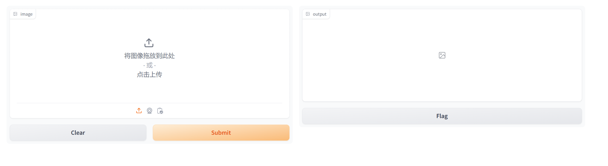
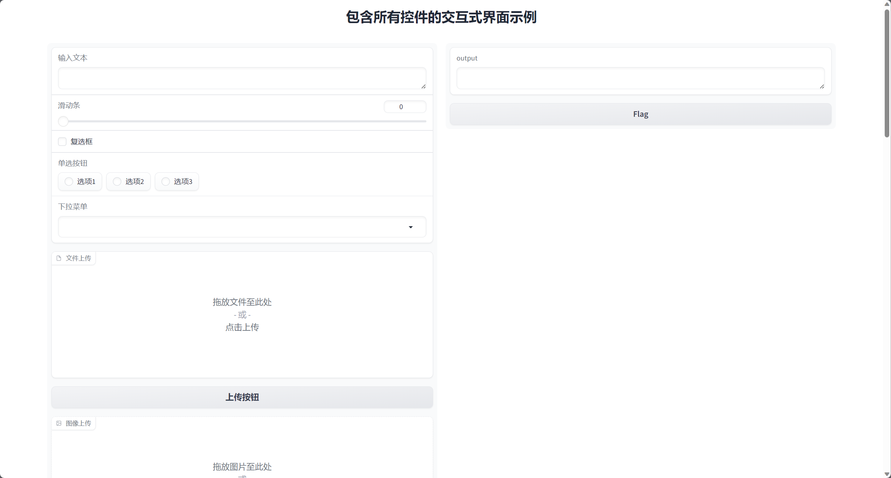
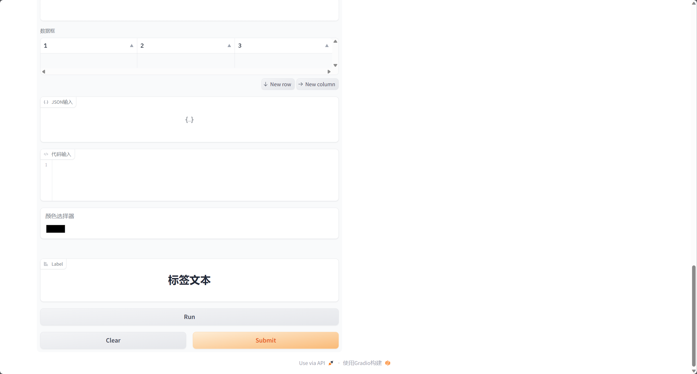
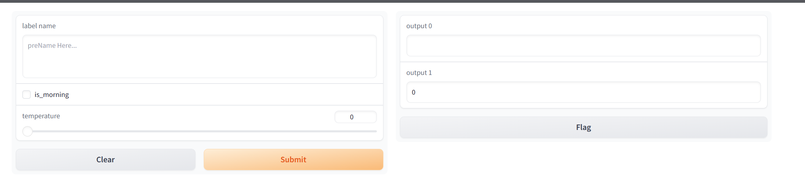
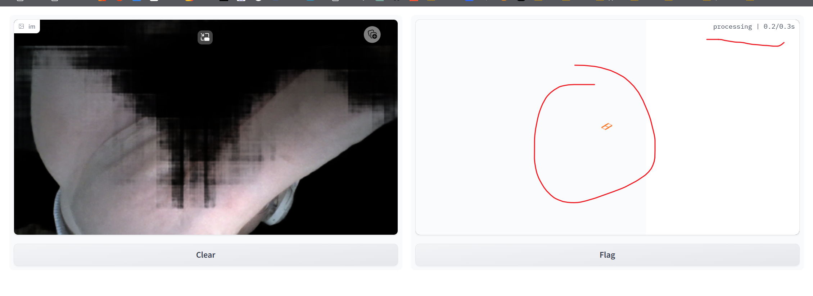
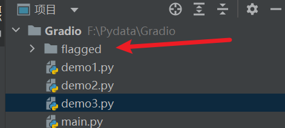
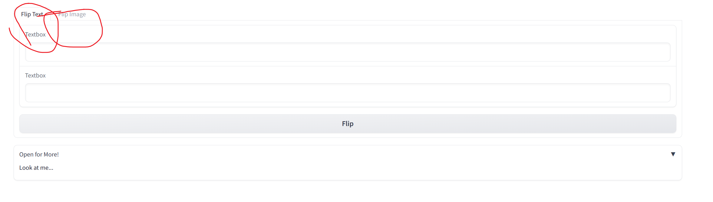

# Gradio 实践


## demo1  

### **1.测试运行**

gradio的核心是它的`gr.Interface`函数，用来构建可视化界面。

- fn：放你用来处理的函数

- inputs：写你的输入类型，这里输入的是图像，所以是"image"

- outputs：写你的输出类型，这里输出的是图像，所以是"image"

  

```
# 作者：Weakliy
# 创建日期：2024/1/27 0027 下午 22:42
# 描述：测试运行

import gradio as gr
import cv2

def to_black(image):
    output = cv2.cvtColor(image, cv2.COLOR_BGR2GRAY)
    return output
interface = gr.Interface(fn=to_black, inputs="image", outputs="image")
interface.launch()
```





### **2.增加example**

我们可以在页面下方添加供用户选择的测试样例。

在`gr.Interface`里的`examples`中放入图片路径

`examples=[["test.png"] `or 1examples="path"1

```
import gradio as gr
import cv2
​
def to_black(image):
    output = cv2.cvtColor(image, cv2.COLOR_BGR2GRAY)
    return output
​
interface = gr.Interface(fn=to_black, inputs="image", outputs="image",
                        examples=[["test.png"]])
interface.launch()
```

### **3.创建一个外部访问链接**

创建外部访问链接非常简单，只需要`launch(share=True)`即可，在打印信息中会看到你的外部访问链接。

**免费用户的链接可以使用24小时，想要长期的话需要在gradio官方购买云服务**


## demo2 文本输入

### 1 同理

```

import gradio as gr
#输入文本处理程序
def greet(name):
    return "Hello " + name + "!"
demo = gr.Interface(fn=greet, inputs="text", outputs="text")
demo.launch()

```


## demo3 Interface类

### 1.基础入门

#### 1.1 **interface需要通过以下三个参数进行初始化：**

- fn：包装的函数
- inputs：输入组件类型，（例如：“text”、"image）
- ouputs：输出组件类型，（例如：“text”、"image）

#### 1.2 控件列表

- **输入输出**：gr.Image(图像), gr.Textbox(文本框), gr.DataFrame(数据框), gr.Dropdown(下拉选项), gr.Number(数字), gr.Markdown, gr.Files

- **控制组件**：gr.Button(按钮)
- **布局组件**：gr.Tab(标签页), gr.Row(行布局), gr.Column(列布局)

```
__all__ = [
    "Audio",
    "BarPlot",
    "Button",
    "Chatbot",
    "ClearButton",
    "Component",
    "component",
    "get_component_instance",
    "_Keywords",
    "Checkbox",
    "CheckboxGroup",
    "Code",
    "ColorPicker",
    "Dataframe",
    "DataFrame",
    "Dataset",
    "DuplicateButton",
    "Fallback",
    "Form",
    "FormComponent",
    "Gallery",
    "HTML",
    "FileExplorer",
    "Image",
    "JSON",
    "Json",
    "Label",
    "LinePlot",
    "LoginButton",
    "LogoutButton",
    "Markdown",
    "Textbox",
    "Dropdown",
    "Model3D",
    "File",
    "HighlightedText",
    "AnnotatedImage",
    "CheckboxGroup",
    "Text",
    "Highlightedtext",
    "Annotatedimage",
    "Highlight",
    "Checkboxgroup",
    "Number",
    "Plot",
    "Radio",
    "ScatterPlot",
    "Slider",
    "State",
    "UploadButton",
    "Video",
    "StreamingInput",
    "StreamingOutput",
    "ImageEditor",
    "ParamViewer",
]
```

##### 1.2.1 控件参数

​	Todo

##### 1.2.2 控件效果展示

```python
import gradio as gr

# 创建控件
textbox = gr.Textbox(label="输入文本")
slider = gr.Slider(minimum=0, maximum=100, label="滑动条")
checkbox = gr.Checkbox(label="复选框")
radio = gr.Radio(["选项1", "选项2", "选项3"], label="单选按钮")
button = gr.Button(label="提交")
dropdown = gr.Dropdown(["选项A", "选项B", "选项C"], label="下拉菜单")
file = gr.File(label="文件上传")
upload_button = gr.UploadButton(label="上传按钮")
image = gr.Image(label="图像上传")
video = gr.Video(label="视频上传")
audio = gr.Audio(label="音频上传")
number = gr.Number(label="数字输入")
checkboxgroup = gr.CheckboxGroup(["选项1", "选项2", "选项3"], label="复选框组")
highlightedtext = gr.HighlightedText(label="高亮文本")
annotatedimage = gr.AnnotatedImage(label="标注图像")
timeseries = gr.Timeseries(label="时间序列")
dataframe = gr.Dataframe(label="数据框")
json = gr.JSON(label="JSON输入")
code = gr.Code(label="代码输入")
colorpicker = gr.ColorPicker(label="颜色选择器")
markdown = gr.Markdown(label="Markdown文本")
html = gr.HTML(label="HTML文本")
label = gr.Label("标签文本")

# 定义回调函数
def submit_values(text, slider_val, checkbox_val, radio_val, dropdown_val, file_val, image_val, video_val, audio_val, number_val, checkboxgroup_val, highlightedtext_val, annotatedimage_val, timeseries_val, dataframe_val, json_val, code_val, colorpicker_val, markdown_val, html_val):
    print("文本:", text)
    print("滑动条值:", slider_val)
    print("复选框选中:", checkbox_val)
    print("单选按钮选择:", radio_val)
    print("下拉菜单选择:", dropdown_val)
    print("上传的文件:", file_val.name if file_val else None)
    print("上传的图像:", image_val.name if image_val else None)
    print("上传的视频:", video_val.name if video_val else None)
    print("上传的音频:", audio_val.name if audio_val else None)
    print("数字输入:", number_val)
    print("复选框组选中:", checkboxgroup_val)
    print("高亮文本:", highlightedtext_val)
    print("标注图像:", annotatedimage_val)
    print("时间序列:", timeseries_val)
    print("数据框:", dataframe_val)
    print("JSON输入:", json_val)
    print("代码输入:", code_val)
    print("颜色选择器选择:", colorpicker_val)
    print("Markdown文本:", markdown_val)
    print("HTML文本:", html_val)
# 创建界面
interface = gr.Interface(
    fn=submit_values,
    inputs=[textbox, slider, checkbox, radio, dropdown, file, upload_button, image, video, audio, number, checkboxgroup, highlightedtext, annotatedimage, timeseries, dataframe, json, code, colorpicker, markdown, html, label, button],
    outputs="text",
    title="包含所有控件的交互式界面示例",
)
# 启动应用
interface.launch()
```



#### 1.3 **Interface.launch()方法返回三个值**

- app，为 Gradio 演示提供支持的 FastAPI 应用程序
- local_url，本地地址
- share_url，公共地址，当share=True时生成

#### 1.4 多输入输出

```
import gradio as gr
#该函数有3个输入参数和2个输出参数
def greet(name, is_morning, temperature):
    salutation = "Good morning" if is_morning else "Good evening"
    greeting = f"{salutation} {name}. It is {temperature} degrees today"
    celsius = (temperature - 32) * 5 / 9
    return greeting, round(celsius, 2)
demo = gr.Interface(
    fn=greet,
    #按照处理程序设置输入组件
    inputs=[gr.Textbox(lines=3, placeholder="preName Here...",label="your name"),
            gr.Checkbox(min_width=100), gr.Slider(0, 100)],
    #按照处理程序设置输出组件
    outputs=["text", "number"],
)
demo.launch()
```



### 2 进阶

#### 2.1 interface状态

##### 全局变量

pass

##### state状态保留

Gradio支持的另一种数据持久性是会话状态，数据在一个页面会话中的多次提交中持久存在

#### 2.2 interface交互

##### 实时变化

在Interface中设置live=True，则输出会跟随输入实时变化。这个时候界面不会有submit按钮，因为不需要手动提交输入。

##### 流模式

在许多情形下，我们的输入是实时视频流或者音频流，那么意味这数据不停地发送到后端，这是可以采用streaming模式处理数据。

添加`(streaming=True)`and ` live=True`即可

```
# import gradio as gr
# import numpy as np
# def flip(im):
#     return np.flipud(im)
# demo = gr.Interface(
#     flip,
#     gr.Image(streaming=True),
#     "image",
#     live=True
# )
# demo.launch()
```




### 3 Flagging标记

输出框下有个Flag按钮。

当测试您的模型的用户看到某个输入导致输出错误或意外的模型行为，他们可以标记这个输入让开发者知道。这个文件夹由Interface的flagging_dir参数指定，默认为’flagged’



### 4 样式、队列、生成器

- 样式

在Gradio官方文档，搜索不同的组件加.style（如image.style），可以获取该组件的样式参数设置样例。例如image组件的设置如下：

```text
img = gr.Image("lion.jpg").style(height='24', rounded=False)
```

- 队列 如果函数推理时间较长，比如目标检测；或者应用程序处理流量过大，则需要使用queue方法进行排队。queue方法使用websockets，可以防止网络超时。使用方式如下：

```text
demo = gr.Interface(...).queue()
demo.launch()
#或
with gr.Blocks() as demo:
    #...
demo.queue()
demo.launch()
```

- 生成器

在某些情况下，你可能想显示一连串的输出，而不是单一的输出。例如，你可能有一个图像生成模型，如果你想显示在每个步骤中生成的图像，从而得到最终的图像。在这种情况下，你可以向Gradio提供一个生成器函数，而不是一个常规函数。下面是一个生成器的例子，每隔1秒返回1张图片。

```text
import gradio as gr
import numpy as np
import time
#生成steps张图片，每隔1秒钟返回
def fake_diffusion(steps):
    for _ in range(steps):
        time.sleep(1)
        image = np.random.randint(255, size=(300, 600, 3))
        yield image
demo = gr.Interface(fake_diffusion,
                    #设置滑窗，最小值为1，最大值为10，初始值为3，每次改动增减1位
                    inputs=gr.Slider(1, 10, value=3, step=1),
                    outputs="image")
#生成器必须要queue函数
demo.queue()
demo.launch()
```

## demo4 自定义Blocks使用

## 1.1 基础入门

Blocks提供了一个低级别的API，用于设计具有更灵活布局和数据流的网络应用。Blocks允许控制组件在页面上出现的位置，处理复杂的数据流（例如，输出可以作为其他函数的输入），并根据用户交互更新组件的属性可见性。

```
import gradio as gr
def greet(name):
    return "Hello " + name + "!"
with gr.Blocks() as demo:
    #设置输入组件
    name = gr.Textbox(label="Name")
    # 设置输出组件
    output = gr.Textbox(label="Output Box")
    #设置按钮
    greet_btn = gr.Button("Greet")
    #设置按钮点击事件
    greet_btn.click(fn=greet, inputs=name, outputs=output)
demo.launch()
```


## 1.2 tab 

通过自定义实现不同的标签页内容

```
import numpy as np
import gradio as gr
def flip_text(x):
    return x[::-1]
def flip_image(x):
    return np.fliplr(x)
with gr.Blocks() as demo:
    #用markdown语法编辑输出一段话
    gr.Markdown("Flip text or image files using this demo.")
    # 设置tab选项卡
    with gr.Tab("Flip Text"):
        #Blocks特有组件，设置所有子组件按垂直排列
        #垂直排列是默认情况，不加也没关系
        with gr.Column():
            text_input = gr.Textbox()
            text_output = gr.Textbox()
            text_button = gr.Button("Flip")
    with gr.Tab("Flip Image"):
        #Blocks特有组件，设置所有子组件按水平排列
        with gr.Row():
            image_input = gr.Image()
            image_output = gr.Image()
        image_button = gr.Button("Flip")
    #设置折叠内容
    with gr.Accordion("Open for More!"):
        gr.Markdown("Look at me...")
    text_button.click(flip_text, inputs=text_input, outputs=text_output)
    image_button.click(flip_image, inputs=image_input, outputs=image_output)
demo.launch()
```




## 1.3 进阶

### 可交互设置

任何输入的组件内容都是可编辑的，而输出组件默认是不能编辑的。如果想要使得输出组件内容可编辑，设置interactive=True即可。

```text
import gradio as gr
def greet(name):
    return "Hello " + name + "!"
with gr.Blocks() as demo:
    name = gr.Textbox(label="Name")
    # 不可交互
    # output = gr.Textbox(label="Output Box")
    # 可交互
    output = gr.Textbox(label="Output", interactive=True)
    greet_btn = gr.Button("Greet")
    greet_btn.click(fn=greet, inputs=name, outputs=output)
demo.launch()
```
