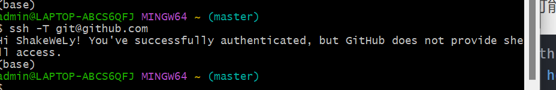
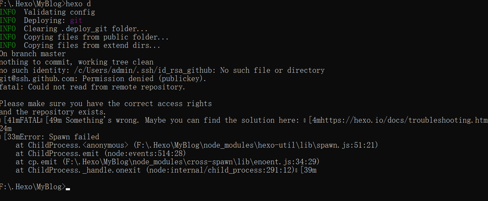
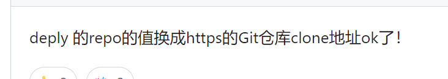
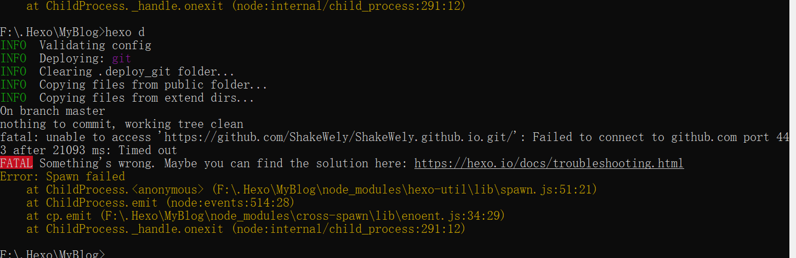
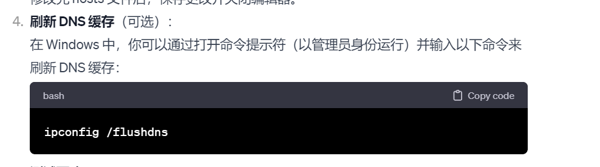
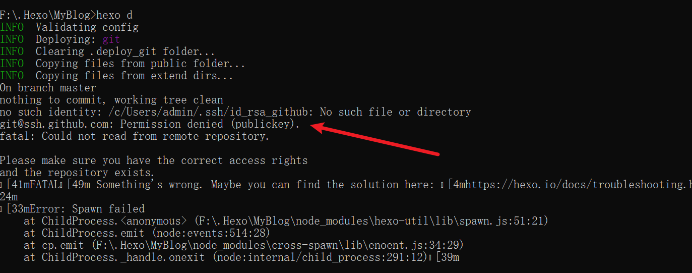
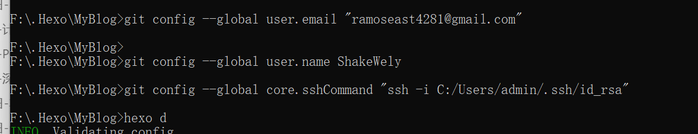
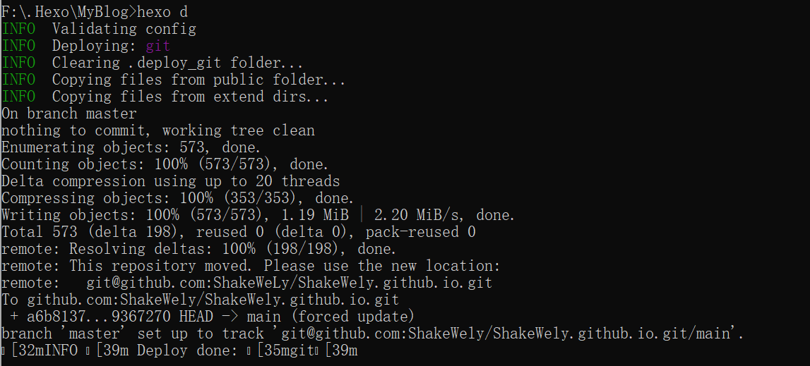
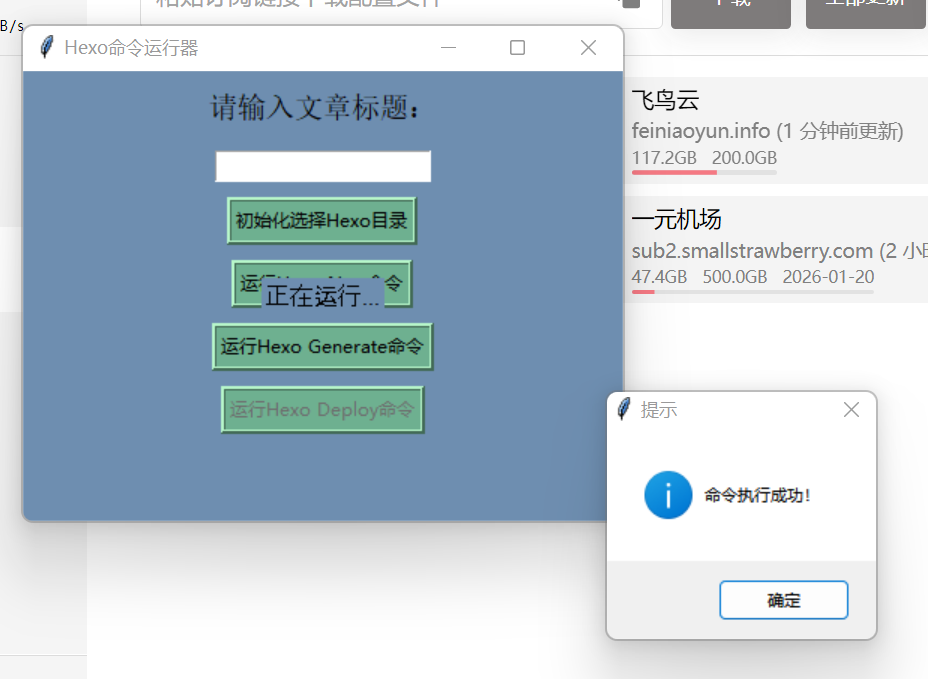

# Git**连接出错** + hexo d出错

## 问题前置：

- github 被盗， 选重新登录
- 更改google账号密码 同时重新登录github

## 问题描述：

- 发现 `Hexo d`命令运行失败
- 报错发现是github 连接失败
- 排查后是**git连接失败**
- 之后之git出错，无法正常连接github

## 解决过程：

## 参考hexo官方代码发现一样地问题

参考：https://github.com/hexojs/hexo/issues/2767

```
ssh -T git@github.com
```

### 1.1中途报错ssh -T git@github.com`·命令运行失败

解决办法：

参考：https://blog.csdn.net/the__future/article/details/130038818

#### 1.1.1 途出现报错：

$ git clone git@github.com:ShakeWeLy/ShakeWely.github.io.git
Cloning into 'ShakeWely.github.io'...
ssh: Could not resolve hostname github.com: Name or service not known
fatal: Could not read from remote repository.

Please make sure you have the correct access rights
and the repository exists.
(base)

$ ssh-add ~/.ssh/id_rsa

Could not open a connection to your authentication agent.

**分析问题发现：**

git 无法连接 GitHub

**解决办法：**

运行如下命令

```
eval "$(ssh-agent -s)"
ssh-add ~/.ssh/id_rsa
```

#### 1.1.2 问题2成功解决

同时能够git GitHub上的文件



### 1.2 又出现新的报错

ssh: Could not resolve hostname ssh.github.com: Name or service not known
fatal: Could not read from remote repository.

Please make sure you have the correct access rights
and the repository exists.

```cmd
ssh: Could not resolve hostname ssh.github.com: Name or service not known
fatal: Could not read from remote repository.

Please make sure you have the correct access rights
and the repository exists.
FATAL Something's wrong. Maybe you can find the solution here: https://hexo.io/docs/troubleshooting.html
Error: Spawn failed
    at ChildProcess.<anonymous> (F:\.Hexo\MyBlog\node_modules\hexo-util\lib\spawn.js:51:21)
    at ChildProcess.emit (node:events:514:28)
    at cp.emit (F:\.Hexo\MyBlog\node_modules\cross-spawn\lib\enoent.js:34:29)
    at ChildProcess._handle.onexit (node:internal/child_process:291:12)
```



#### 1.2.1 尝试解决

**失败！**





换回来

检查发现

ssh: Could not resolve hostname ssh.github.com: Name or service not known
**fatal: Could not read from remote repository.不一样**

#### 1.2.2 成功解决



### 1.3 运行hexo d 仍然报错

permission denied



#### 1.3.1 解决办法

重现配置**git 连接密钥**



### 1.4 成功运行

重新运行hexo d




