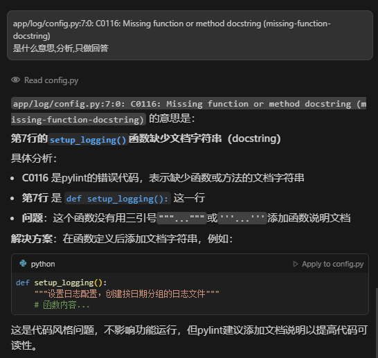
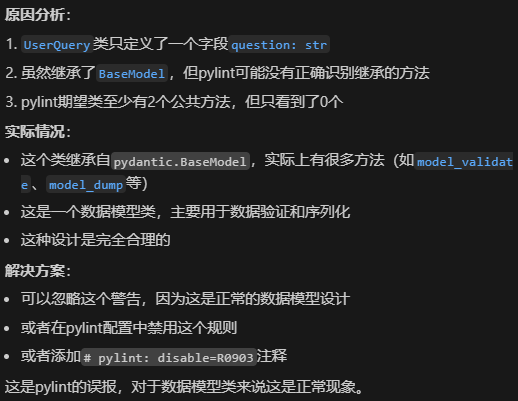
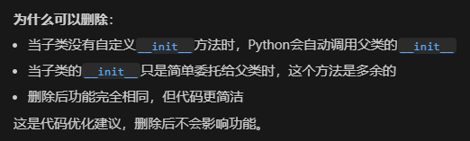
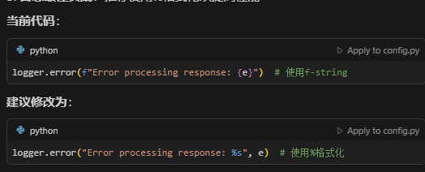

#  python之项目总结


# **SemVer（Semantic Versioning）**

## 🧩 语法格式

标准格式是：

```
复制编辑
MAJOR.MINOR.PATCH
```

例如：

```
复制编辑
1.4.2
```

表示：

- **MAJOR（主版本号）**: 有破坏性更新（不向后兼容）
- **MINOR（次版本号）**: 添加了新功能，但向后兼容
- **PATCH（修订号）**: 修复了 bug，完全向后兼容


# .env

> python-dotenv

**没有类型！**
 环境变量 **本质上都是字符串**，不管你写的是数字、布尔值、URL，读取出来都是字符串。


# UV

### uv.lock 

> uv.lock 是 UV 包管理器的锁定文件，它的作用是：
>
> 1. 锁定依赖版本：记录项目所有依赖包的确切版本号，确保在不同环境下安装相同的依赖版本
>
> 1. 确保一致性：防止因为依赖版本变化导致的兼容性问题
>
> 1. 加速安装：UV 可以直接从锁定文件安装，无需重新解析依赖关系
>
> 为什么需要更改：
>
> 当我们添加了新的依赖包（如 python-jose、passlib、aiomysql 等）到 pyproject.toml 时，UV 会自动更新 uv.lock 文件来记录这些新依赖的确切版本信息，确保项目依赖的完整性和一致性。


# Pylint


### Warning

 `C0116: Missing function or method docstring (missing-function-docstring)`

 


`C0103: Method name "test_SqlModelResponse" doesn't conform to snake_case naming style (invalid-name)`

> 原因：Python的命名约定要求：
>
> - 函数和方法名使用小写字母和下划线（snake_case）
>
> - 类名使用驼峰命名法（CamelCase）
>
> - 常量使用大写字母和下划线（UPPER_SNAKE_CASE）


``




```python
class Settings(BaseSettings):
    app_name: str = os.getenv("APP_NAME", "FastAPI App")
    model_name: str = os.getenv("MODEL_NAME", "qwen-latest")
    def __init__(self, **data):
        super().__init__(**data)
settings = Settings()
```




`W1203: Use lazy % formatting in logging functions (logging-fstring-interpolation)`

这是性能优化建议，使用%格式化可以提高日志记录的性能。




[](https://mermaid-live.nodejs.cn/edit#pako:eNpVkU1PwkAQhv_KZk6YIFCkLfRgIh9yMprISeuhsQs00pYs20QlHLwYPxASIxKjqImaGA9owsEDMfwZW_BfuLuI0T3N7PvMO7szddh2TQwalIhRLaNCVncQWtrUIRg8-4dNFFpbXS-gKMElq0YxmdNhC83PL6I0Q8ZXQ_-jM0Oou4MdrnOHtIAyDJq03v32pRB_tIzQslzrj766fb_d_Rz1gpPHoPXktx9QKJ9jdhbFdi0688uKmhxvOhiOh3dfL83J68Ff1xwjUHBzHHSOBLvM_UcX_vVt0HkLzvr_sO79DMvzr56ej4e96WNQKBGTeFcIs5FYJmiUeDgMNia2wVOocxsdaBnbWAeNhSYuGl6F6qA7DVZWNZwN17VnlcT1SmXQikalxjKvahoUZy2Dzdv-vSXYMTHJuJ5DQZMU4QFaHXZZJskRWVWTKVlioaLEEmHYA02VI6kkOwmFKXE52QjDvmgai6jygiTFFXVBlVMJwWPToi5ZmS5a7LvxDTsutSo)


# 打包

## 0 源码包与二进制包什么区别？

Python 包的分发可以分为两种：

1、以源码包的方式发布

源码包安装的过程，是先解压，再编译，最后才安装，所以它是跨平台的，由于每次安装都要进行编译，相对二进包安装方式来说安装速度较慢。

2、以二进制包形式发布

二进制包的安装过程省去了编译的过程，直接进行解压安装，所以安装速度较源码包来说更快。

由于不同平台的编译出来的包无法通用，所以在发布时，需事先编译好多个平台的包。


##  1 Python 中的 requirements.txt 与 setup.py区别

1. **requirements.txt**:

   - **作用**: `requirements.txt`文件通常用于列出项目所依赖的第三方库及其版本信息。

   - 格式

     : 每行一个依赖项，通常包括库的名称和版本号，例如：

     ```
     requests==2.26.0
     numpy==1.21.5
     ```

   - **安装依赖**: 通过运行`pip install -r requirements.txt`命令，可以一次性安装所有列出的依赖项。

2. **setup.py**: 

   ------

   ```html
   待解决
   ```

   - **我们常见的运行命令**，“pip install  模块名”或者“python setup.py install”，前者是在线安装，会安装该包的相关依赖包；后者是下载源码包然后在本地安装，不会安装该包的相关依赖包。

   -  **在编写相关系统时，如何实现连同依赖包一起打包发布**？ 

     假如我在本机开发一个程序，需要用到python的redis、mysql模块以及自己编写的redis_run.py模块。我怎么实现在**服务器**上去发布该系统，如何实现依赖模块和自己编写的模块redis_run.py一起打包，实现一键安装呢？同时将自己编写的redis_run.py模块以exe文件格式安装到python的全局执行路径~/Python27/Scripts下呢？

   ```text
   python setup.py install
   ```

   - **作用**: `setup.py`文件是一个 Python 脚本，用于定义项目的元数据和其他相关配置，例如项目名称、版本、作者信息、依赖关系等。

   - **如何编写**

     ```
     from setuptools import setup, find_packages
     
     setup(
         name="example",
         version="0.1",
         packages=find_packages(),
         install_requires=[
             'requests>=2.26.0',
             'numpy>=1.21.5'
         ],
         author="Your Name",
         author_email="your@email.com",
         description="Description of your project",
         ...
     )
     ```

   - **安装依赖**: 通过在`install_requires`参数中指定依赖项，可以告诉 `setuptools` 安装项目所需的依赖项。当用户运行`python setup.py install`时，`setuptools`会自动处理依赖项的安装。

     

