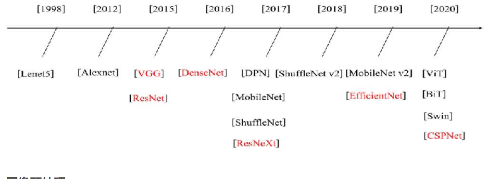
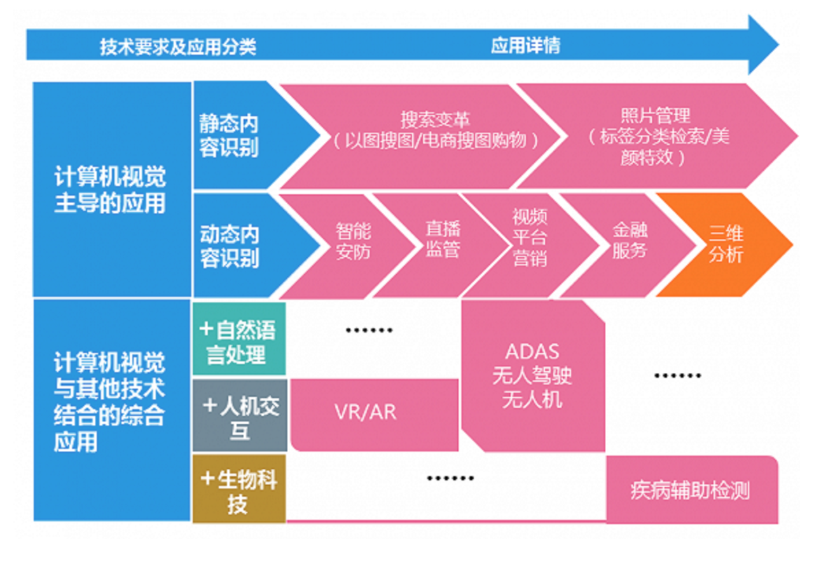
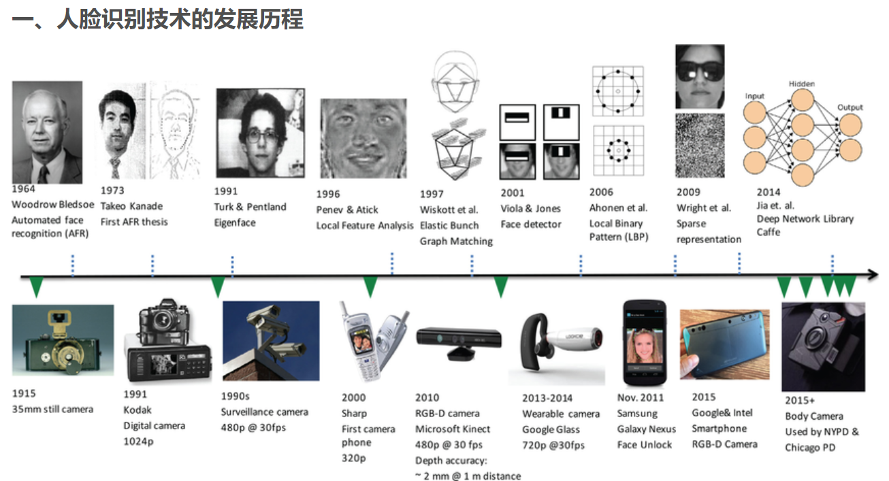
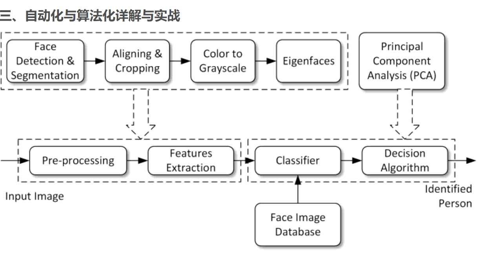
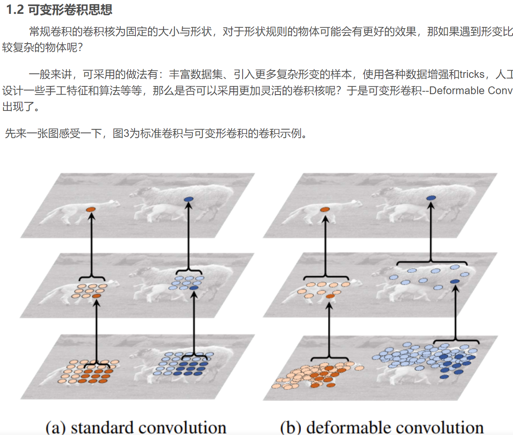

# 转载AI文章

## python

### **100 个 Python 练手项目**

1、【Python 图片转字符画】

2、【200行Python代码实现2048】

3、【Python3 实现火车票查询工具】

4、【高德API+Python解决租房问题】

5、【Python3色情图片识别】

6、【Python 破解验证码】

7、【Python实现简单的Web服务器】

8、【pygame开发打飞机游戏】

9、【Django 搭建简易博客】

10、【Python基于共现提取《釜山行》人物关系】

11、【基于scrapy爬虫的天气数据采集（python）】

12、【Flask 开发轻博客】

13、【Python3图片隐写术】

14、【Python 实现简易Shell】

15、【使用Python解数学方程】

16、【PyQt 实现简易浏览器】

17、【神经网络实现手写字符识别系统】

18、【Python 实现简单画板】

19、【Python实现3D建模工具】

20、【NBA常规寒结果预测——利用Python进行比赛数据分析】

21、【神经网络实现人脸识别任务】

22、【Python文本解析器】

23、【Python3&；amp；OpenCV 视频转字符动画】

24、【Python3 实现淘女郎照片爬虫】

25、【Python3实现简单的FTP认证服务器】

26、【基于Flask 与MySQL 实现番剧推荐系统】

27、【Python 实现端口扫描器】

28、【使用Python3编写系列实用脚本】

29、【Python 实现康威生命游戏】

30、【川普撞脸希拉里（基于OpenCV的面部特征交换）】

31、【Python 3实现Markdown 解析器】

32、【Python气象数据分析--《Python 数据分析实战》】

33、【Python实现键值数据库】

34、【k-近邻算法实现手写数字识别系统】

35、【ebay在线拍卖数据分析】

36、【Python 实现英文新闻摘要自动提取】

37、【Python实现简易局域网视频聊天工具】

38、【基于Flask及爬虫实现微信娱乐机器人】

39、【Python实现Python解释器】

40、【Python3基于Scapy实现DDos】

41、【Python 实现密码强度检测器】

42、【使用Python 实现深度神经网络】

43、【Python实现从excel读取数据并绘制成精美图像】

44、【人机对战初体验：Python基于Pygame实现四子棋游戏】

45、【Python3实现可控制肉鸡的反向Shell】

46、【Python打造漏洞扫描器】

47、【Python应用马尔可夫链算法实现随机文本生成】

48、【数独游戏的Python实现与破解】

49、【使用Python定制词云】

50、【Python开发简单计算器】

50、【Python开发简单计算器】

51、【Python 实现FTP弱口令扫描器】

52、【Python实现Huffman编码解压缩文件】

53、【Python实现Zip文件的暴力破解】

54、【Python3智能裁切图片】

55、【Python实现网站模拟登陆】

56、【给Python3爬虫做一个界面.妹子图网实战】

57、【Python3实现图片转彩色字符】

58、【自联想器的Python 实现】

59、【Python 实现简单流镜】

60、【Flask实现简单聊天室】

61、【基于PyQt5实现地图中定位相片拍摄位置】

62、【Python实现模板引擎】

63、【Python实现遗传算法求解n-queens问题】

64、【Python3实现命令行动态进度条】

65、【Python获取挂号信息并邮件通知】

66、【Python实现java web项目远端自动化更新部署】

67、【使用Python3编写Github 自动周报生成器】

68、【使用Python生成分形图片】

69、【Python 实现Redis 异步客户端】

70、【Python 实现中文错别字高亮系统】

71、【Python自动获取小说工具】

72、【python自动获取酷狗音乐工具】

73、【python自动获取海量IP工具】

74、【Python自动化开发-制作名片卡】

75、【Python自动化开发-微信统计】

76、【Python自动化开发-批量发邮件通知】

77、【Python自动化开发-考勒处理】

78、【Python双色球系统】

79、【Python批量获取王者荣耀皮肤】

80、【Python获取阴阳师壁纸】

81、【Python获取小说数据并分析】

82、【python获取拉钩工具】

83、【Python获取房天下数据】

84、【Python获取彩票信息】

85、【Python获取NBA数据】

86、【Python合成女神图片】

87、【Python法拍网数据】

88、【Python操作Excel自动化开发】

89、【python百行制作登录系统】

90、【python百行制作查询工具】

91、【Python百行代码实现点赞系统】

92、【Python百行代码实现抽奖系统】

93、【python自动工资条】

94、【python抓取相亲网数据

95、【python抓取百合网数据

96、【python制作12306查票工具

97、【python游戏开发公开课

98、【python协程详解公开课

99、【python吧中30行拿LOL皮肤

100、【python快速获取斗图表情

### [数据分析](https://blog.csdn.net/qazwsxpy/article/details/128192090?spm=1001.2100.3001.7377&utm_medium=distribute.pc_feed_blog_category.none-task-blog-classify_tag-6-128192090-null-null.nonecase&depth_1-utm_source=distribute.pc_feed_blog_category.none-task-blog-classify_tag-6-128192090-null-null.nonecase)

## 机器学习

### [机器学习-梯度下降](https://techlead.blog.csdn.net/article/details/133819132?spm=1001.2014.3001.5502)

目录
一、简介
什么是梯度下降？
为什么梯度下降重要？
二、梯度下降的数学原理
代价函数（Cost Function）
梯度（Gradient）
更新规则
代码示例：基础的梯度下降更新规则
三、批量梯度下降（Batch Gradient Descent）
基础算法
代码示例
四、随机梯度下降（Stochastic Gradient Descent）
基础算法
代码示例
优缺点
五、小批量梯度下降（Mini-batch Gradient Descent）
基础算法
代码示例
优缺点
————————————————

原文链接：https://blog.csdn.net/magicyangjay111/article/details/133819132

### 

### 遗传算法（可选）

## [深度学习](https://blog.csdn.net/chenlycly/article/details/134043297?spm=1001.2100.3001.7377&utm_medium=distribute.pc_feed_blog_category.none-task-blog-classify_tag-3-134043297-null-null.nonecase&depth_1-utm_source=distribute.pc_feed_blog_category.none-task-blog-classify_tag-3-134043297-null-null.nonecase)

### [前馈神经网络](https://techlead.blog.csdn.net/article/details/132421817?spm=1001.2014.3001.5502)

目录
一、前馈神经网络概述
什么是前馈神经网络
前馈神经网络的工作原理
应用场景及优缺点
二、前馈神经网络的基本结构
输入层、隐藏层和输出层
激活函数的选择与作用
网络权重和偏置
三、前馈神经网络的训练方法
损失函数与优化算法
反向传播算法详解
避免过拟合的策略
四、使用Python和PyTorch实现FNN
4.1 准备数据集
选择合适的数据集
数据预处理
PyTorch数据加载器
4.2 构建模型结构
定义网络架构
选择激活函数
权重初始化
构建与任务相匹配的损失函数
4.3 训练模型
选择优化器
训练循环
模型验证
调整学习率
保存和加载模型
可视化训练过程
4.4 模型评估与可视化
评估指标
模型验证
混淆矩阵
ROC和AUC
特征重要性和模型解释
可视化隐藏层
五、前馈神经网络的先进变体与应用
多层感知器（MLP）
卷积神经网络（CNN）
循环神经网络（RNN）
Transformer结构
强化学习中的FNN
生成对抗网络（GAN）
FNN在医学图像分析中的应用
六、总结与未来展望
总结
未来展望
结语
————————————————

原文链接：https://blog.csdn.net/magicyangjay111/article/details/132421817

损失函数和优化算法是神经网络训练的基石，决定了网络如何学习和调整其权重。

- **损失函数：** 用于衡量网络预测与实际目标之间的差异，常见的损失函数包括均方误差（MSE）、交叉熵损失等。
- **优化算法：** 通过最小化损失函数来更新网络权重，常见的优化算法包括随机梯度下降（SGD）、Adam、RMSProp等。

### [长短时记忆网络（LSTM）](https://techlead.blog.csdn.net/article/details/132480035)

目录
1. LSTM的背景
人工神经网络的进化
循环神经网络（RNN）的局限性
LSTM的提出背景
2. LSTM的基础理论
2.1 LSTM的数学原理
遗忘门（Forget Gate）
输入门（Input Gate）
记忆单元（Cell State）
输出门（Output Gate）
2.2 LSTM的结构逻辑
遗忘门：决定丢弃的信息
输入门：选择性更新记忆单元
更新单元状态
输出门：决定输出的隐藏状态
门的相互作用
逻辑结构的实际应用
总结
2.3 LSTM与GRU的对比
1. 结构
LSTM
GRU
2. 数学表达
LSTM
GRU
3. 性能和应用
小结
3. LSTM在实际应用中的优势
处理长期依赖问题
遗忘门机制
梯度消失问题的缓解
广泛的应用领域
灵活的架构选项
成熟的开源实现
小结
4. LSTM的实战演示
4.1 使用PyTorch构建LSTM模型
定义LSTM模型
训练模型
评估和预测
5. LSTM总结
**解决长期依赖问题**
**广泛的应用领域**
**灵活与强大**
**开源支持**
**持战与展望**
总结反思
————————————————

原文链接：https://blog.csdn.net/magicyangjay111/article/details/132480035

#### LSTM的提出背景

长短时记忆网络（LSTM）是一种特殊类型的RNN，由Hochreiter和Schmidhuber于1997年提出，目的是解决传统RNN的问题。

- **解决梯度消失问题**: 通过引入“记忆单元”，LSTM能够在长序列中保持信息的流动。
- **捕捉长依赖性**: LSTM结构允许网络捕捉和理解长序列中的复杂依赖关系。
- **广泛应用**: 由于其强大的性能和灵活性，LSTM已经被广泛应用于许多序列学习任务，如语音识别、机器翻译和时间序列分析等。

#### “记忆单元”的结构

### [深度信念网络（DBN）](https://techlead.blog.csdn.net/article/details/132531255?spm=1001.2014.3001.5502)

一、概述
1.1 深度信念网络的概述
1.2 深度信念网络与其他深度学习模型的比较
结构层次
学习方式
训练和优化
应用领域
1.3 应用领域
图像识别与处理
自然语言处理
推荐系统
语音识别
无监督学习与异常检测
药物发现与生物信息学
二、结构
2.1 受限玻尔兹曼机（RBM）
结构与组成
工作原理
学习算法
应用
2.2 DBN的结构和组成
层次结构
网络连接
训练过程
应用领域
2.3 训练和学习算法
预训练
微调
优化方法
评估和验证
三、实战
3.1 DBN模型的构建
定义RBM层
构建DBN模型
定义DBN的超参数
3.2 预训练
RBM的逐层训练
对比散度（CD）算法
3.3 微调
监督训练
微调训练
模型验证和测试
3.4 应用
分类或回归任务
特征学习
转移学习
在线应用
四、总结
————————————————

原文链接：https://blog.csdn.net/magicyangjay111/article/details/132531255

## 项目实战

### [图像分类：发展历史、技术全解与实战](https://blog.csdn.net/magicyangjay111/article/details/134698103)

- 自动化的神经网络架构搜索（NAS）技术
- 轻量级模型和少样本学习也成为研究的热点
- 图像分类有望实现更复杂的应用，如情感分析、自动化标注等

### [计算机视觉五大核心研究任务：分类识别、检测分割、人体分析、三维视觉、视频分析](https://techlead.blog.csdn.net/article/details/132321843?spm=1001.2014.3001.5502)

目录
一、引言
1.1 计算机视觉的定义
1.1.1 核心技术
1.1.2 应用场景
1.2 历史背景及发展
1.2.1 1960s-1980s: 初期阶段
1.2.2 1990s-2000s: 机器学习时代
1.2.3 2010s-现在: 深度学习的革命
1.3 应用领域概览
1.3.1 工业自动化
1.3.2 医疗图像分析
1.3.3 自动驾驶
1.3.4 虚拟现实与增强现实
二、计算机视觉五大核心任务
2.1 图像分类与识别
2.1.1 图像分类与识别的基本概念
2.1.2 早期方法与技术演进
2.1.3 深度学习的引入与革新
卷积神经网络在图像分类中的应用
总结
2.2 物体检测与分割
2.2.1 物体检测
早期方法
深度学习方法
2.2.2 物体分割
语义分割
实例分割
总结
2.3 人体分析
2.3.1 人脸识别
2.3.2 人体姿态估计
2.3.3 动作识别
2.3.4 人体分割
2.4 三维计算机视觉
2.4.1 三维重建
立体视觉
多视图几何
点云生成和融合
2.4.2 3D物体检测和识别
基于2D图像的方法
基于点云的方法
2.4.3 三维语义分割
基于体素的方法
基于点云的方法
2.4.4 三维姿态估计
单视图方法
多视图方法
总结
2.5 视频理解与分析
2.5.1 视频分类
2.5.2 动作识别
2.5.3 视频物体检测与分割
2.5.4 视频摘要与高亮检测
2.5.5 视频生成和编辑
总结
三、无监督学习与自监督学习在计算机视觉中的应用
3.1 无监督学习
聚类
降维与表示学习
3.2 自监督学习
对比学习
预训练任务设计
3.3 跨模态学习

4. 总结

原文链接：https://blog.csdn.net/magicyangjay111/article/details/132321843

### [人脸识别](https://techlead.blog.csdn.net/article/details/134762161)：

目录
一、人脸识别技术的发展历程
早期探索：20世纪60至80年代
技术价值点：
自动化与算法化：20世纪90年代
技术价值点：
深度学习的革命：21世纪初至今
技术价值点：
二、几何特征方法详解与实战
几何特征方法的原理
几何特征方法的局限性
实战案例：简单的几何特征人脸识别
环境配置
代码实现
代码说明
三、自动化与算法化详解与实战
自动化与算法化的进展
技术创新点：
实战案例：基于特征匹配的人脸识别
环境配置
代码实现
代码说明
四、深度学习方法
深度学习方法的核心概念
技术创新点
实战案例：使用深度学习进行人脸识别
环境配置
代码实现
代码说明
总结
————————————————

原文链接：https://blog.csdn.net/magicyangjay111/article/details/134762161

### [时间序列预测：](https://snu77.blog.csdn.net/article/details/133272874?spm=1001.2014.3001.5502)

## 深度学习 前沿

### [可变形卷积(Deformable Conv)](https://blog.csdn.net/panghuzhenbang/article/details/129816869?spm=1001.2100.3001.7377&utm_medium=distribute.pc_feed_blog_category.none-task-blog-classify_tag-13-129816869-null-null.nonecase&depth_1-utm_source=distribute.pc_feed_blog_category.none-task-blog-classify_tag-13-129816869-null-null.nonecase)

### LLM

### SD

## 深度学习 项目优化

### 量化

### CUDA

#### [C++ CUDA手搓一个简单的神经网络推理](https://blog.csdn.net/Bartender_VA11/article/details/135999169)

### TRT

