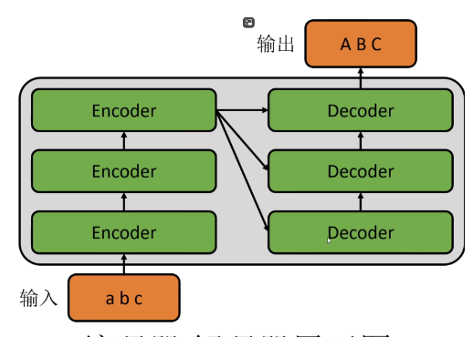
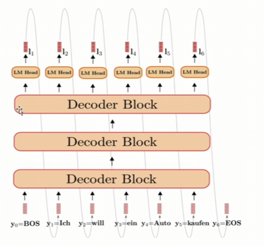
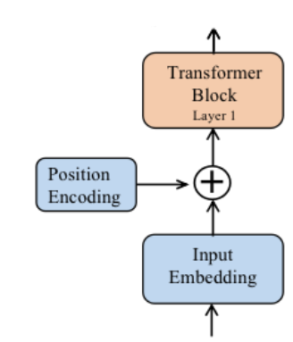
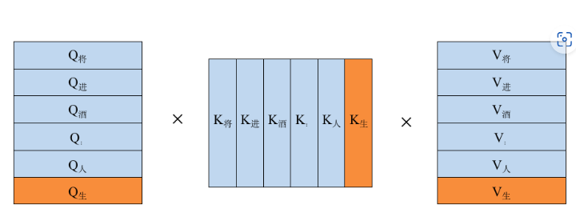
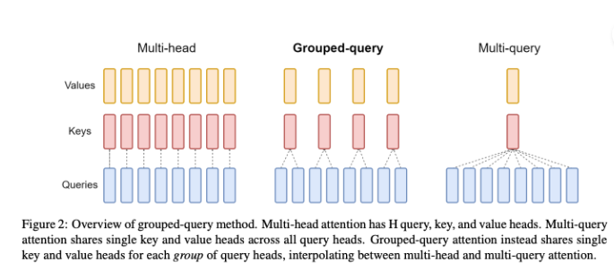

# 2 LLM2

## 2.1处理流程


### **输入数据**：

LLM的输入数据是一段文本，可以是一个句子或一段话。文本通常被表示成单词或字符的序列。


### **Tokenization**：

将文本进行Tokenization，将其切分成单词或字符，形成Token序列。

再将文本映射成模型可理解的输入形式，将文本序列转换为整数索引序列

```
序列化-> 
['BOS','君','不','见','黄','河','之','水','天','上','来','，' ,'奔','流','到'...'与','尔','同','销','万','古','愁','EOS']

假设语料库索引化->
['BOS','10','3','67','89','21','45','55','61','4','324','565' ,'789','6567','786'...'7869','9','3452','563','56','66','77','EOS']
```


### **Embedding**：

将每个Token映射为一个实数向量，为Embeding Vector

```
'BOS'-> [p_{00},p_{01},p_{02},...,p_{0d-1}]
'10' -> [p_{10},p_{11},p_{12},...,p_{1d-1}]
'3'  -> [p_{20},p_{21},p_{22},...,p_{2d-1}]
...
'EOS'-> [p_{n0},p_{n1},p_{n2},...,p_{nd-1}]


```


### **位置编码**：

对于Token序列中的每个位置，添加位置编码（Positional Encoding）向量，以提供关于Token在序列中位置的信息。

位置编码是为了区分不同位置的Token，并为模型提供上下文关系的信息。

```
[p_{00},p_{01},p_{02},...,p_{0d-1}]       [pe_{00},pe_{01},pe_{02},...,pe_{0d-1}]
[p_{10},p_{11},p_{12},...,p_{1d-1}]       [pe_{10},pe_{11},pe_{12},...,pe_{1d-1}]
[p_{20},p_{21},p_{22},...,p_{2d-1}]    +  [pe_{20},pe_{21},pe_{22},...,pe_{2d-1}]
...                                       ...  
[p_{n0},p_{n1},p_{n2},...,p_{nd-1}]       [pe_{n0},pe_{n1},pe_{n2} ,...,pe_{nd-1}]
```


### **Transformer** ：

在生成任务中，模型只需要用到Transformer 的decoder阶段，即Decoder-Only，比如GPT、LLaMA 都是。




### **自回归生成**：

在生成任务中，使用自回归（Autoregressive）方式，逐个生成输出序列中的每个Token。

在解码过程中，每次生成一个Token时，使用前面已生成的内容作为上下文，来帮助预测下一个Token。




## 2.2 相关技术


### **RoPE**

[RoPE位置编码](https://link.zhihu.com/?target=https%3A//arxiv.org/pdf/2104.09864.pdf)




### **KV Cache & GQA**

Attention计算时的KV  

通过将每次计算的K和V缓存下来，之后新的序列进来时只需要从KV Cache中读取之前的KV值即可，就不需要再去重复计算之前的KV了。



至于为什么不用缓存Q？


**GQA**



