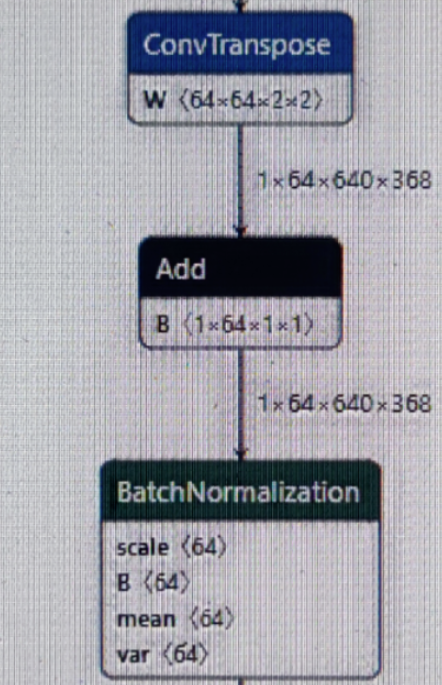
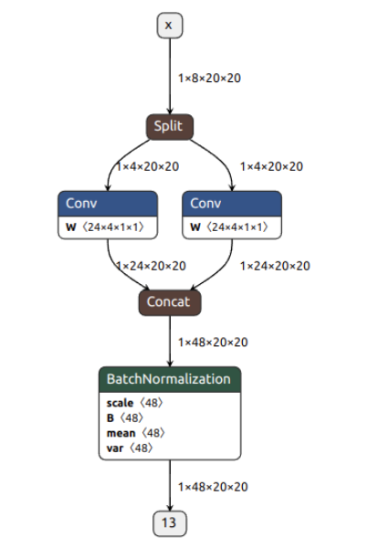
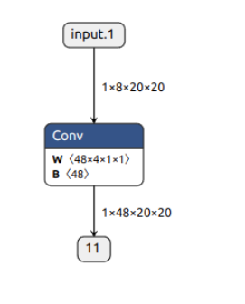
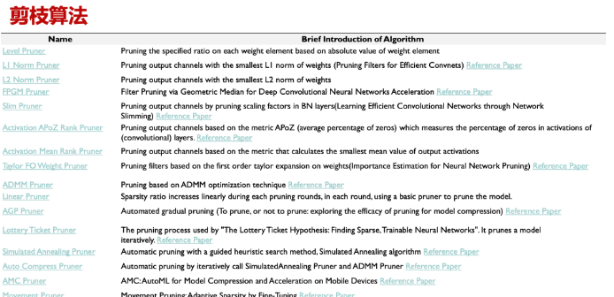

# 代码模型

 

## 模型加密

模型加密的几个方式：

- 模型文件直接加密，把模型的二进制文件直接加密，一般都会有加密算法，对模型的前xx字节进行加密，解密的时候对前xx字节进行解密即可，这种加密只在load时候做，会影响模型加载速度，但是不影响运行速度
- 模型结构不加密，模型权重加密，有的可以采用类似于模型压缩的方法把权重压缩了，推理时以自定义协议读取加载推理
- 也需要对解密模型的代码进行加密，代码混淆要做，不过这样会影响解密代码也就是load模型过程，会变慢，就看你代码混淆做到什么程度

## 模型转换

模型可能是各种格式的：

- Caffe
- ONNX
- Pytorch
- TFLITE
- NCNN、MNN

#### 模型转换后一般要做

- 转换后看一下模型的输入输出类型、维度、名称、数量啥的是否和之前一致
- 转换后首先跑一张训练时的图（或者一批图），看下新模型的输出和旧模型差多少，一定要保证最终输入到模型的tensor一致（也可以使用random输入或者ones输入测试，不过对于模型权重分布特殊的模型来说，对于这种输入可能评测不是很准确）
- 批量跑测试集测一下精度是否一致
- benchmark转换后模型的速度是否符合预期

#### 常见的问题

- 转换后模型精度问题，输出为nan、精度完全错乱
- 转换后模型batch=1正常，多batch结果错乱
- 转换后输入/输出类型维度啥的错误
- 转换后模型速度未达到预期
- 未完待续

## 模型优化

小到优化一个[**op**](https://blog.csdn.net/agq358/article/details/125095432)（Op就是Kernel的集合，一个Op代表的是有一定共性的多个Kernel便于在[计算图和图优化](https://cloud.tencent.com/developer/article/2306404)中进行表示），大概优化整个推理pipeline，可以干的事情很多。

### 合并、替换op算子

很多框架在导出的时候就会**自动合并一些操作**，比如torch.onnx在导出**conv+bn**的时候会将bn吸到前面的conv中，比较常见了。
但也有一些**可以合并的操作，**假如框架代码还没有实现该pattern则不会合并，不过我们也可以自己合并，这里需要经验了，需要我们熟知各种op的合并方式。
可以自己合并一些操作，比如下图中的**convTranspose+Add+BN**，是不常见的Squence(序列)的pattern，如果自己愿意的话，可以直接在ONNX中进行合并，把权重关系搞对就行

列举一些合并的例子，总之就是将多个op合成大op，节省计算量以及数据搬运的时间：

- conv/transposeConv+bn
- 多个支路的conv合并为group conv
- gemm + bias -> conv

多路合并

既可以融合一些算子，当然也可以替换一些算子：

- relu6替换为max(0,6)

### 蒸馏、剪枝

剪枝后的模型比未剪枝的同等size大小精度更高。
具体的可以参考这篇：https://arxiv.org/abs/1710.01878

剪枝的方法可以看zomi总结的ppt(来自 https://github.com/chenzomi12/DeepLearningSystem)：

​	

蒸馏可以使同结构的小模型精度提升接近大模型的精度。

#### 总结

剪枝类似于模型搜索，如果直接[NAS](https://zhuanlan.zhihu.com/p/127194745)的话，就没有必要剪枝了。

#### 参考

- to prune or not to prune exploring the efficacy of pruning for model compression
- DAMO-YOLO

### 量化

量化目前比较成熟，也有很好的教程（PPQ），很成熟的库（PPQ）

- 量化基本概念，与硬件的关系
- PTQ量化和QAT量化，两种量化还有很多方法。PTQ有  EasyQuant（EQ）、；QAT有LSQ(Learned Step Size Quantization)、DSQ(Differentiable Soft Quantization)

不是所有模型、所有op都适合量化：

- 重参数量化 https://tech.meituan.com/2022/09/22/yolov6-quantization-in-meituan.html
- 量化模型直接输入int8 进行测试

注意点：

- 有些模型量化后，虽然整体指标没有变化（某个评价标准，比如coco的mAP），但是实际使用中，发现之前的一些效果变差了，这种情况大多是调用模型的策略效果与这个模型的耦合度比较高了。举个例子，比如之前这个模型对小目标检测效果好，但是量化后，小目标检测效果差了（然而中目标效果好了）所以导致与小目标耦合度比较高的策略兼容度不高，导致算法的整体精度下降。这种情况就比较尴尬，你可以调整策略，或者重新量化模型，加上一些约束使其在某些场景下尽可能和原始模型表现一致，但这个需要时间去优化了，有较高的时间成本。

#### 参考

- [必看部署系列~懂你的神经网络量化教程：第一讲！](https://mp.weixin.qq.com/s?__biz=Mzg3ODU2MzY5MA==&mid=2247488318&idx=1&sn=048c1b78f3b2cb25c05abb115f20d6c6&chksm=cf108b3bf867022d1b214928102d65ed691c81955b59ca02bccdee92584ad9aa8e390e1d2978&token=1097456929&lang=zh_CN&scene=21#wechat_redirect)
- [量化番外篇——TensorRT-8的量化细节](https://mp.weixin.qq.com/s?__biz=Mzg3ODU2MzY5MA==&mid=2247488838&idx=1&sn=56107c468d5b683a574e6046af3a541f&chksm=cf108d43f8670455736a83546eb5ed81abc9194d7d4c2359af393f26e3bddd1379f777e35f35&token=1097456929&lang=zh_CN&scene=21#wechat_redirect)
- [实践torch.fx第二篇——基于FX的PTQ量化实操](https://mp.weixin.qq.com/s?__biz=Mzg3ODU2MzY5MA==&mid=2247489317&idx=1&sn=797e32276bd4f55948d992f455415943&chksm=cf108f20f8670636b27be2431d5a4fdef1689eaa672e59ffc7d6181d2afb13a9a050d9b6b4a5&token=1097456929&lang=zh_CN&scene=21#wechat_redirect)
- https://github.com/openppl-public/ppq

### 算子op优化

性能计算的一些入门问题，可以看下这个的回答：

- 想进大厂的高性能计算岗位需要做哪些准备？

大部分优化op的场景，很多原因是**原生op的实现可能不是最优**的，有很大的优化空间。
比如LayerNorm这个操作，Pytorch原生的实现比较慢，于是就有了优化空间：

- CUDA优化之LayerNorm性能优化实践

同理，很多CUDA实现的OP可能不是最优的，只有你有精力，就可以进行优化。也要考虑是这个优化值不值，在整个模型中的占比大不大，投入产出比怎么样blabla。

对于CUDA还好些，资料很多，很多op网上都有开源的不错的实现（尤其是gemm），抄抄改改就可以了。

不过对于一些没有CUDA那么火的平台或者语言，比如arm平台的neon或者npu，这些开源的算子实现少一些，大部分需要自己手写。分析模型哪些op慢之后，手动优化一下。

知乎上也有很多优化系列的教程，跟着一步一步来吧：

- [cuda 入门的正确姿势：how-to-optimize-gemm](https://zhuanlan.zhihu.com/p/478846788)
- 深入浅出GPU优化系列：elementwise优化及CUDA工具链介绍
- [[施工中] CUDA GEMM 理论性能分析与 kernel 优化](https://zhuanlan.zhihu.com/p/441146275)
- 深入浅出GPU优化系列：reduce优化

有几种可以自动生成op的框架：

- TVM
- triton（此triton非彼triton）

### 调优可视化工具

可视化工具

- 画模型图的工具，graphvis
- NVIDIA的nsight system和nsight compute
- pytorch的profiler

## 更多推理框架/AI编译器

https://github.com/merrymercy/awesome-tensor-compilers

### ONNX

#### 相关文章：

- https://github.com/daquexian/onnx-simplifier
- https://github.com/ZhangGe6/onnx-modifier
- https://github.com/NVIDIA/TensorRT/tree/master/tools/onnx-graphsurgeon
- https://github.com/onnx/onnx
- 模型部署入门教程（五）：ONNX 模型的修改与调试
- https://github.com/onnx/onnx/blob/main/docs/Operators.md

### TVM

- 如何评测模型的速度
- 如何benchmark模型各层的错误
- 解析trtexec中的benchmark
- 解析TVM中的graph和VM

### TensorRT

- python端口调用
- C++端口调用
- 多线程调用
- 各种模型转换TensorRT（ONNX、Pytorch、TensorFLow）
- 各种和TensorRT相关的转换库

#### 自定义插件

如果模型中保存TensorRT不支持的算子，就需要自己实现cuda操作并且集成到TensorRT中。
现在也有很多可以生成插件的工具：

- https://github.com/NVIDIA-AI-IOT/tensorrt_plugin_generator

相关资料：

- https://github.com/NVIDIA/trt-samples-for-hackathon-cn

### libtorch

简单好用的对Pytorch模型友好的C++推理库。

- torch.jit.trace
- torch.jit.script
- python导出libtorch模型，C++加载libtorch模型

### AITemplate

AITemplate 加速Stable Diffusion的效果比TensorRT要好不少。
测试了一个res50的模型，利用`TensorRT-8.5.1.7`和`AITemplate-0.1dev`转化后简单测试了下速度，精度都是FP16，显卡是A4000。

|            | 4x3x224x224 | 8x3x224x224 |
| :--------- | :---------- | :---------- |
| TensorRT   | 2.07885 ms  | 3.49877 ms  |
| AITemplate | 1.36401 ms  | 2.38946 ms  |

## 高性能计算

