b

本书结构

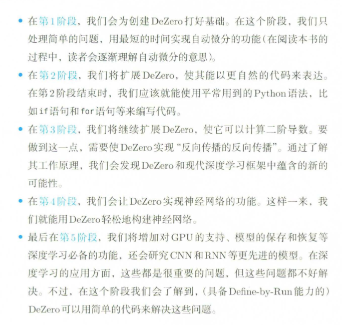

# 第一阶段 自动微分

## 1 变量

pass

## 2 函数

pass

## 3 函数连续调用

pass

## 4 数值微分

### 1 导数

导数表示

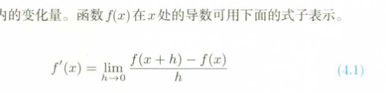

### 2 数值微分

计算机不能处理极限值 。 因此，这里的 h 表示一个近似值来计算 式 4. 1 就叫做数值微分

#### 2.1前向差分近似

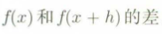

#### 2.2中心差分近似

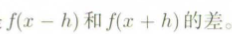

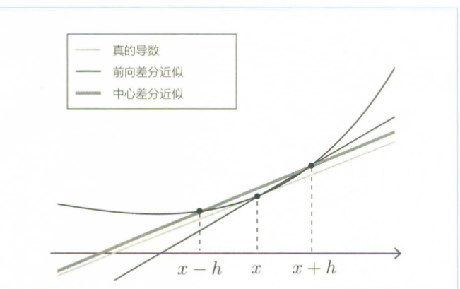

## 5 反向传播

y 对 z 的导数 11J 以用式子 5.1 表示：

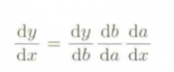

也可写成：

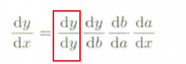

求导流程

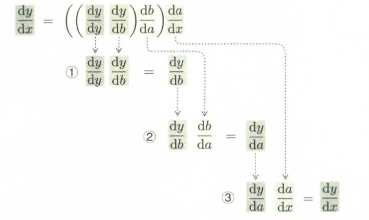

求导过程：

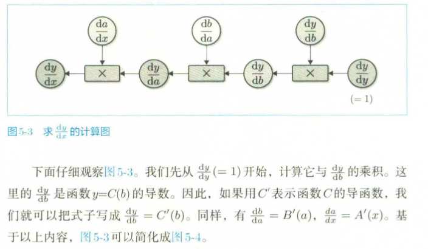

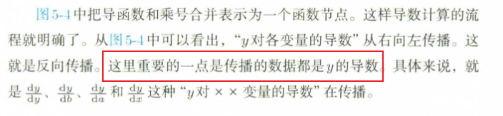

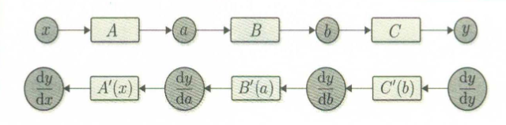

正向传播

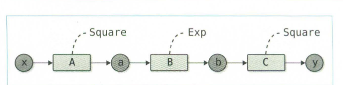

反向传播

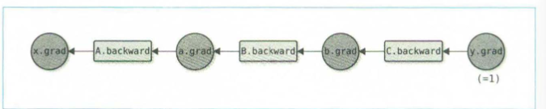

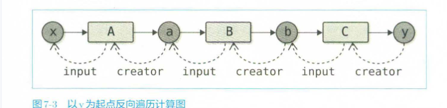

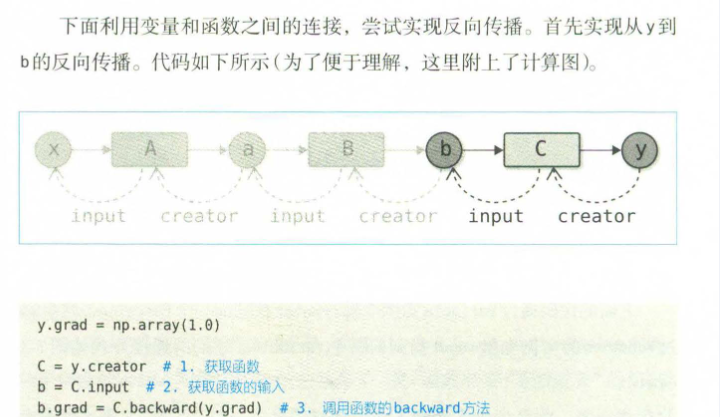

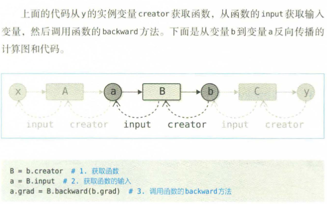

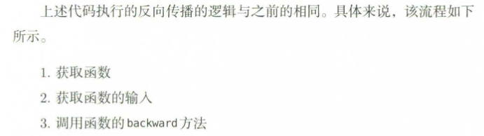

\

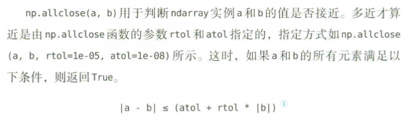

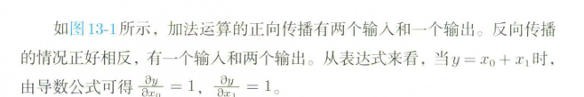

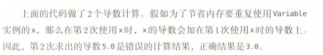

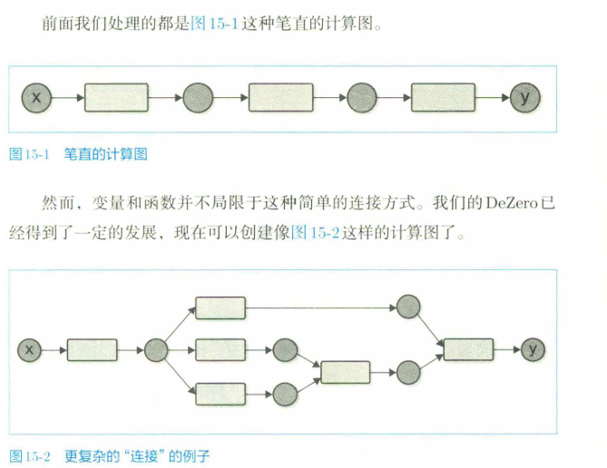

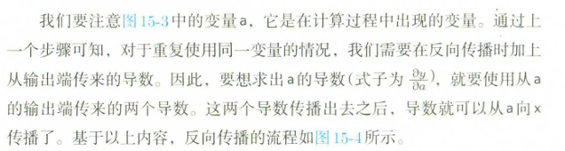

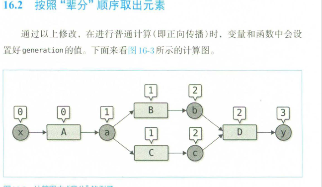

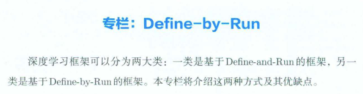

# 2 

## 2.17 内存管理和循环引用

### 1 内存管理

- 一种是引用计数

- 一种是分代垃圾凹收

### 2 计数方式

​	每个对象在被创建时的引用计数为0，当它被另一个对象引用时引用计数加1，当引用停止时，引用计数减1。最终，当引用计数变为0时 python解释器会回收该对象。

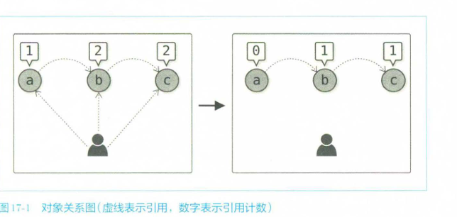

当a = b = c = None时，对象之间的关系发生变化 此时a的引用计数变为O(b和c的引用计数为1) 对此. a立即被删除 删除 a 导致b的引用计数从1变成O. 所以b也被删除。 

### 3 循环引用

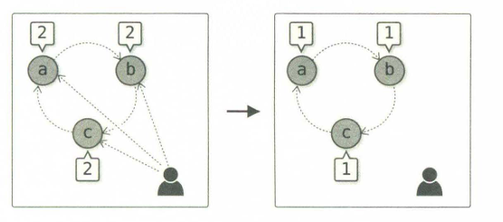

采用 `分代垃圾回收`处理

### 4 弱引用

​	用weakref.ref函数来创建弱引用 

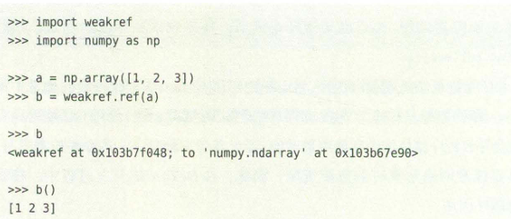

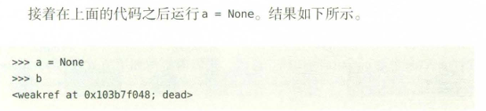

a=None 时，b虽然用了这个对象，但由于是弱引用，所以对引用计数没有影响

### 5修改

**对比：**

之前：

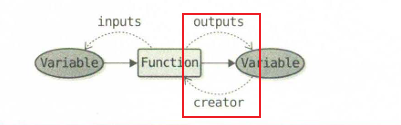

之后：

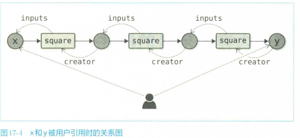

## 2.18减少内存使用量的模式

第1项改进是减少反向传播消耗的内存使用址， 这项改进提供了立即清除元用导数的机制。 

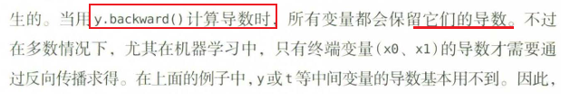

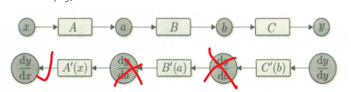

第2项改进是提供"不需要反向 传播时的模式"

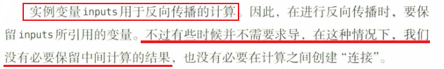

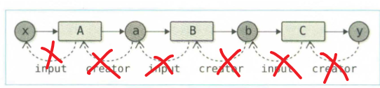

是否 `creator`也不需要了呢？

Constant

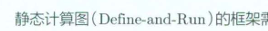

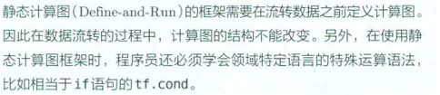

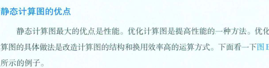

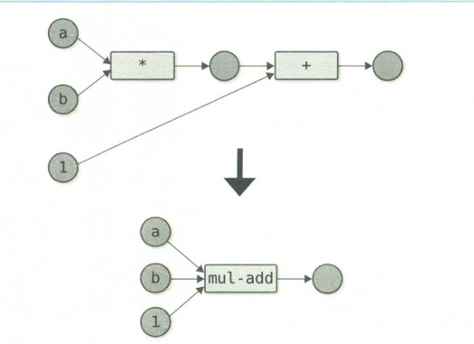

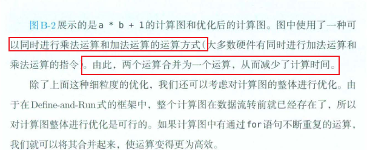

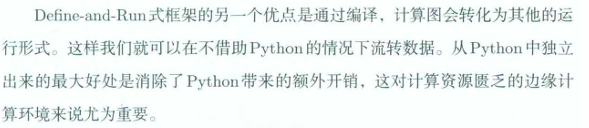

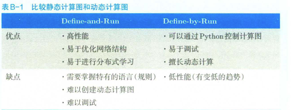

# 3 高阶导数

