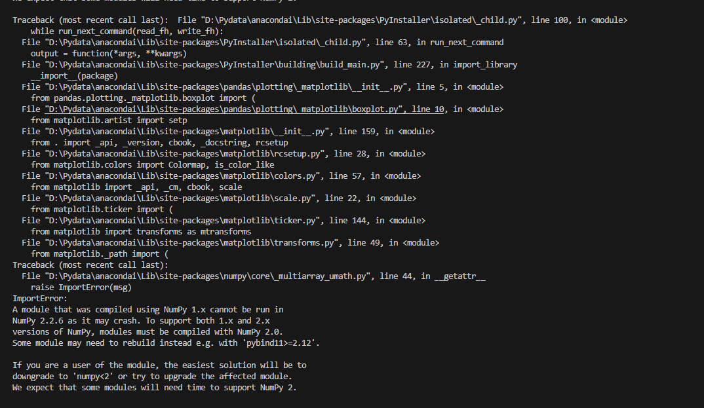
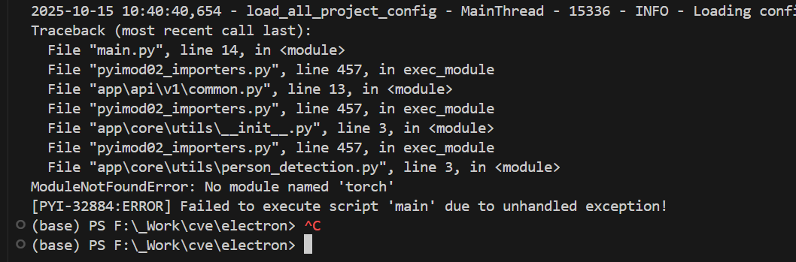
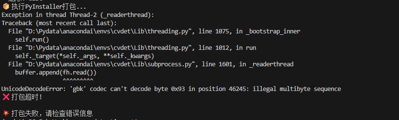
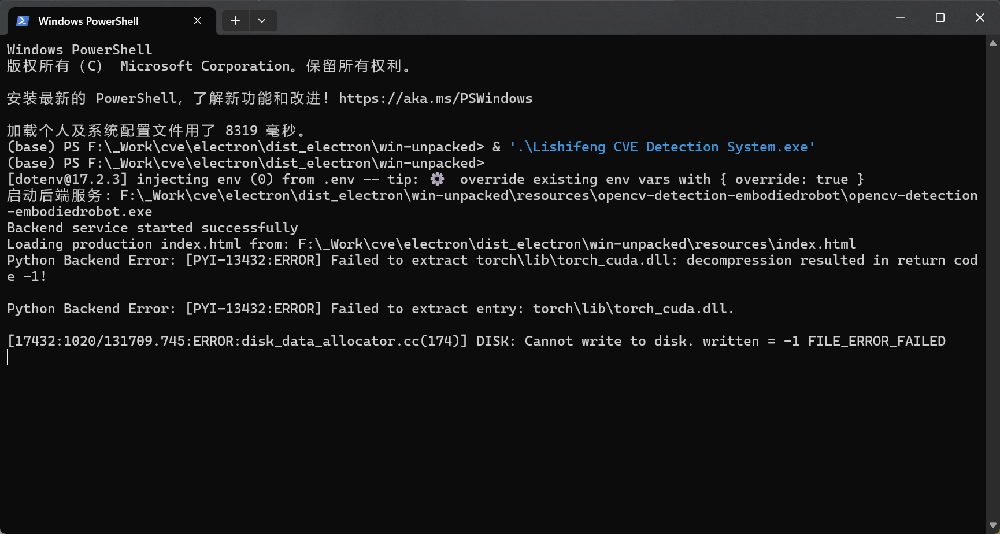
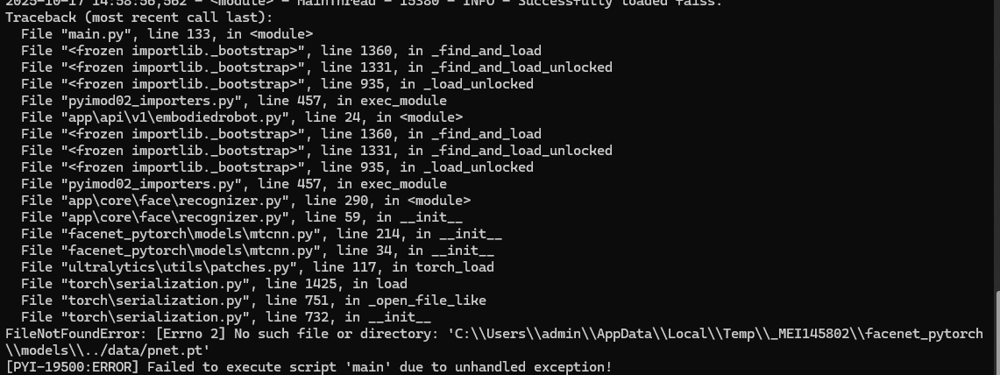
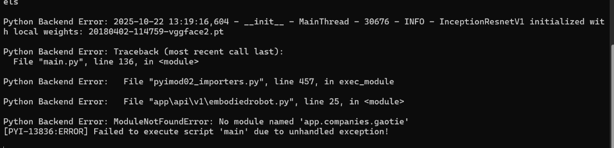
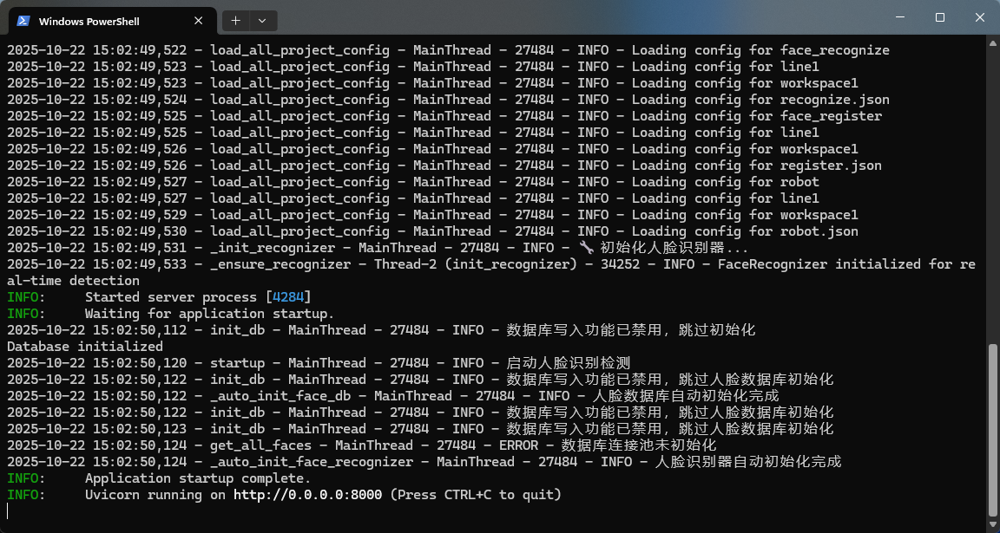

# python环境打包构建

在 Electron + Python 项目中，为了在无 Python 环境的客户端运行，需要实现 **Python 环境自包含打包**。
 实践过程中共尝试三种方案：

1. **方式 A**：复制本地 Python + venv
2. **方式 B**：PyInstaller 打包成独立 EXE
3. **方式 C**：Embeddable Python（嵌入式解释器）

最终发现仅方案 B 可行，A、C 在兼容性和安装层面存在根本性限制。

## 方式 A：copy环境: Electron 启动独立 Python 进程

### 1. venv 的原理

`venv` 并不是完全**自包含**的 Python，它依赖创建时 **系统 Python** 的文件来构建：

- `Scripts/python.exe` → 指向 venv 内的可执行文件（**拷贝或软链接**）
- `Lib/` → 包含标准库
- `pyvenv.cfg` → 记录 `home`（原系统 Python 位置）和 `executable`

关键是：

```json
home = <创建 venv 时的系统 Python 安装路径>
executable = <创建 venv 时的 python.exe>
```

当你在其他机器运行 venv：

- **只要 venv 内的 python.exe 和 Lib 完整**，路径不同一般不会报错。
- **如果 venv 内缺少标准库或 DLL**，就会报错 `ModuleNotFoundError: encodings` 或启动失败。

####  vеnv 依赖系统 Python 的路径（pyvenv.cfg 指向打包路径）

-  `home` 指向你本地的系统 打包的Python路径
-  客户机上路径不同 → venv 找不到标准库 → 报错 `ModuleNotFoundError: encodings`
-  ⚠️ 这是之前遇到的错误的根本原因 → 安装新环境并修改对应的path文件


### 2.问题分析:  

> 原因: cursor 给我错的步骤, 以为做了形象工程: **copy和pip了新的环境, 但是运行的确实本地的环境的**python, 导致后续一直在错的分支上修改(不了解本质, 一直以为是python copy的错误, 见下面分析). 

#### 2.1 自包含方式python错误

> ```js
> execSync(`${pythonCmd} -m venv "${pythonDir}"`, { 
>   stdio: 'inherit',
>   cwd: path.join(__dirname, '..')
> });
> ```
>
> 这样运行会依赖创建venv的python
>
> **本质上依赖于系统 Python**，因为 venv 只是拷贝/软链接系统 Python 的部分文件（可执行文件 + 标准库）。所以：
>
> 1. 如果用户机器没有 Python，或者版本不对，Electron 打包后的程序 **无法独立运行**。
> 2. 同时, 打包的pyvenv.cfg 指向了本地机的python导致客户机的python找不到,

 **核心问题 : **

- **venv 本身不是自包含的**，它只是一个「隔离的环境」，依赖底层 Python。
- **要想 Electron 完全自包含**，你必须用 **Embedded Python** 或 **完整 Python 安装 + Lib**，而不是 venv。之前手动 copy python.exe + DLL + venv，这本质就是想绕开系统 Python，但做法容易出错（缺标准库，导致 `encodings` 不存在）

**尝试解决1:** 

​	手动 copy python.exe + DLL + venv，这本质就是想绕开系统 Python，但做法容易出错（缺标准库，导致 `encodings` 不存在）。

> 真正的解决办法是在客户机安装python并修改路径和使用打包的环境

**尝试解决2**

​	方案 C：Embedded Python（推荐）


#### 2.2 环境迁移出错: **自包含的 Python runtime**，人为地「融合」了解释器 + 库 + 虚拟环境, 手动 copy python.exe + DLL + venv

> 本质就是意识到其实venv是python的软连接, 而不是真正的python解释器

1:python的pyvenv.cfg路径错误(修改build的配置为相对路径), 

> 一直以为是venv的`Scripts/python.exe` 就是python

2: 构建脚本没有复制Python核心DLL文件 

> copy了一个python运行exe

3: copy python 不完整, 无法完全copy-->embed 

> copy了半个python环境

~~4: pip 安装慢~~

~~5: pip似乎一直安装失败了...=>重构放弃了~~


##  方式 B： PyInstaller 打包成独立 EXE✅（推荐）

> 创建新环境并打包成exe

### 1. 备选方案

之前尝试遇到很多问题, 有点主动规避了, 所以作为备选


### 2. 问题分析

 **0:config绝对路径 加载失败**  

> 需修改代码路径引用

```
ProjectConfig 在打包态用的是 exe 目录作为基准：base_path = Path(sys.executable).parent，然后拼 app/config/<PROJECT_NAME>
```

因此需要修改为相对于exe的运行路径 +app/config/

**1:numpy包版本报错, 运行失败,** 

> 经典版本不对



 **2:运行时动态导入问题**

```
# app/main.py 第120行（你的项目）
if project_name.lower() == "biyi":
    from app.api.v1 import biyi  # ← 运行时才导入
    app.include_router(biyi.router, tags=["biyi"])
```

> OpenCV (cv2)：依赖大量 .so/.dll 和子模块，静态分析可能漏掉
>
> Ultralytics (YOLO)：内部动态加载模型、后端引擎（如 TensorRT、ONNX），需要手动收集

**3: torch 库版本问题,** 

> 没装上torch ->改用cpu版本



### 3. 实现可热更新的

```
extra_trees = []
if os.path.exists('app/companies/biyi'):
    extra_trees.append(Tree('app/companies/biyi', prefix='app/companies/biyi'))
if os.path.exists('app/config/Biyi'):
    extra_trees.append(Tree('app/config/Biyi', prefix='app/config/Biyi'))
```

通过extra_tree递归查找+ COLLECT



### 4. 成功运行exe 功能待测试..

测试注意事项

#### 4.1路径问题

> 相对路径问题

> 原本是写在`opencv-detection-embodiedrobot\_internal/app`; 但是读取不到
>
> 后修改cd到后端路径 `opencv-detection-embodiedrobot`再启动`opencv-detection-embodiedrobot\app\config`

#### 4.2 大小写问题

> 导致一直读取不到config

> 全部改为小写

#### 4.3  C盘内存不足




#### 4.4 模型路径问题



> 继承model 重写代码 使用项目下的model.pt


#### 4.5 .env问题


> 添加 .env.sample和手动添加.env

#### 4.6 导入问题



> Python Backend Error: ModuleNotFoundError: No module named 'app.companies.gaotiePYI-13836:ERRORl Failed to execute script'main'due to unhandled exception!

代码错误导入`from app.companies.gaotie.detector import GaotieVideoDetector`

```
  \# Before:

  from app.companies.gaotie.detector import GaotieVideoDetector

  \# After:

  from app.companies.embodiedrobot.detector import EmbodiedVideoDetector
```


#### 4.7成功




> # PyInstaller打包Biyi项目准备工作计划
>
> ## 1. 清理和准备项目文件
>
> ### 1.1 创建打包配置文件
>
> - 创建 `.spec` 文件配置PyInstaller打包参数
> - 配置包含Biyi项目相关的数据文件（模型、配置、模板）
> - 排除其他公司项目的文件以减小体积
>
> ### 1.2 整理依赖项
>
> - 修改 `requirements.txt` 创建CPU版本依赖清单
> - 移除GPU相关依赖：`tensorrt`
> - 确保使用CPU版本的torch/ultralytics
>
> ### 1.3 清理不必要文件
>
> - 排除其他公司项目文件夹（保留biyi）
> - 排除测试文件、文档、日志
> - 排除开发环境配置文件
>
> ## 2. 处理动态加载和资源文件
>
> ### 2.1 模型文件处理
>
> - 确认 `app/companies/biyi/` 下的 `.pt` 模型文件
> - 确认 `app/core/angle/`, `app/core/object/` 等核心模块的模型文件
> - 在.spec中配置为数据文件
>
> ### 2.2 配置文件处理
>
> - 包含 `app/config/Biyi/` 下所有JSON配置文件
> - 处理 `.env` 文件（创建示例配置）
>
> ### 2.3 模板文件处理
>
> - 包含 `app/templates/Biyi/` HTML模板
> - 包含 `app/templates/shared/` 共享模板
> - 包含 `app/templates/js/` JavaScript文件
>
> ### 2.4 修复动态导入
>
> - 检查 `app/main.py` 中的项目名称动态导入逻辑
> - 确保PyInstaller能正确打包Biyi相关模块
>
> ## 3. 创建PyInstaller spec文件
>
> ### 3.1 核心配置
>
> - 入口点：`app/main.py`
> - 单文件/单目录模式选择
> - 隐藏导入配置（ultralytics、cv2等）
>
> ### 3.2 数据文件配置
>
> ```
> datas = [    ('app/companies/biyi', 'app/companies/biyi'),    ('app/config/Biyi', 'app/config/Biyi'),    ('app/templates', 'app/templates'),    ('.env.example', '.'),]
> ```
>
> ### 3.3 排除项配置
>
> - 排除其他公司项目模块
> - 排除测试、文档相关包
>
> ## 4. 环境配置文件
>
> ### 4.1 创建环境配置模板
>
> - 创建 `.env.example` 包含必要配置项
> - 创建 `config_template.txt` 说明配置方法
>
> ### 4.2 创建启动脚本
>
> - Windows批处理文件 `start_biyi.bat`
> - 包含环境变量设置和启动逻辑
>
> ## 5. 打包测试准备
>
> ### 5.1 创建打包脚本
>
> - `build_biyi.bat` - Windows打包脚本
> - 包含清理旧构建、执行打包、验证输出
>
> ### 5.2 创建部署文档
>
> - `DEPLOYMENT.md` - 部署说明文档
> - 包含：系统要求、安装步骤、配置说明、故障排除
>
> ## 6. 验证检查清单
>
> - [ ] 确认requirements.txt无GPU依赖
> - [ ] 确认.spec文件包含所有必要资源
> - [ ] 确认只包含Biyi相关代码和配置
> - [ ] 确认动态导入已处理
> - [ ] 准备好.env配置示例
> - [ ] 准备好部署文档
>
> ## 关键文件说明
>
> - `opencv_detection_biyi.spec` - PyInstaller配置文件
> - `requirements_cpu.txt` - CPU版本依赖清单
> - `build_biyi.bat` - 打包执行脚本
> - `.env.example` - 环境配置示例
> - `DEPLOYMENT_BIYI.md` - 部署说明文档


## 方式 C：**Embeddable Python（嵌入式） ❌**

> ❌❌很多库都安装不了

>  Cursor 分步安装的原因 跳过了包的安装导致缺少库, 运行不了

### 1. pip 安装问题

> embeddable python不带pip需要手动下载和修改

需要删除import site在python312._pth文件中

### 2. embeddable python特性:

#### 2.1 库编译问题

1. **依赖**
   - `opencv-python` 本身提供了预编译 wheel，但有些依赖（如 matplotlib）可能需要 **源代码编译**，尤其在缺少 wheel 或版本不匹配的情况下
   - `matplotlib` 依赖 `cycler`、`kiwisolver`、`pillow` 等，某些组件可能需要 **C/C++ 编译工具**
   - `mesonpy` 是最近 matplotlib 构建系统的一部分，用于编译扩展
2. **嵌入式 Python 不包含编译环境**
   - 没有 Visual Studio C++ Build Tools
   - 没有 `python-config`、`make`、`ninja` 等工具

所以在 **嵌入式 Python 下 pip install opencv-python 或 matplotlib** 就会失败，因为它需要编译环境，嵌入式 Python 只能提供一个纯净的解释器和标准库。

------

#### **2.2可行解决方案**

1. **使用预编译 wheel**（

   - 下载适合你 Python 版本和架构的 `.whl` 文件，直接安装：

     ```
     python\python.exe -m pip install opencv_python‑4.9.0‑cp312‑cp312‑win_amd64.whl
     ```

   - 这样就不用本地编译了。

   - 你可以在 [PyPI opencv-python](https://pypi.org/project/opencv-python/#files) 找到对应 wheel。

2. **下载相关编译工具集**

   

------

### 3. 问题分析：

#### 3.1 matplotlib 编译失败

1. matplotlib 编译失败：matplotlib==3.10.1 需要从源码编译，但缺少 mesonpy 构建工具

1. mesonpy 后端不可用：Cannot import 'mesonpy' - 构建工具链不完整

1. 依赖解析失败：pip 无法找到兼容的包版本

**解决方案：**

1. 特殊处理 matplotlib：

- 优先使用预编译的 wheel 包：--only-binary=:all: --prefer-binary

- 如果指定版本失败，尝试不指定版本的最新版本

#### 3.2 工具链安装失败

```
ERROR: Could not find a version that satisfies the requirement mesonpy (from versions: none)
ERROR: No matching distribution found for mesonpy
⚠️  Warning: some build tools failed: Command failed: "F:\_Work\cve\electron\python\python.exe" -m pip install setuptools>>=65.0.0 wheel>=0.38.0 Cython>=3.0.0 meson>=1.0.0 ninja>=1.10.0 mesonpy>=0.15.0 pyproject-hooks>=1.0.0 build>=0.10.0 packaging>=21.0 tomli>=2.0.0 pyparsing>=3.0.0 installer>=0.7.0 -i https://pypi.tuna.tsinghua.edu.cn/simple --trusted-host pypi.tuna.tsinghua.edu.cn
```


#### 3.3 torch 安装失败

```
ERROR: Could not find a version that satisfies the requirement torch (from versions: none)ERROR: No matching distribution found for torch
```

这是因为**嵌入式Python环境可能缺少某些系统库，导致torch无法安装。**

- 需要手动编译!!
- 

#### 3.2. 依赖matplotlib的opencv, ultralytics安装失败

1. 下载相关编译工具
2. ultralytics 8.0.2 depends on matplotlib>=3.2.2

#### 3. ultralytics版本高要求新版本的matplotlib

内部库依赖版本冲突无交集

1. 不指定版本
2. 使用更宽松的安装策略
3. torch要求

#### 3.av库版本问题(webrtc)

无法找到合适版本

```
ERROR: Could not find a version that satisfies the requirement av==16.8.8 (from versions: none)ERROR: No matching distribution found for av==16.0.00 Warning: some dependencies failed to install: command failed: "F:\_Work\cvelelectron\python\python.exe""-m pip install -r "F:\ Work\cvelopencv-detection\requirements.txt" -i https://pypi.tuna.tsinghua.edu.cn/simple --trusted-host pypi.tuna.tsinghua.edu.cn --prefer-binary --only-binary=:all: --no-build-isolation
```

1. 修改版本
2. 不指定版本
3. 暂时不安装了

### 4.总结

 嵌入式 Python 自带python, 但是很多包和库基本上pipy都不支持, 导致无法安装完整的环境, 这反而失去了python的优势, 所以放弃改方案


## Electron打包阶段 - 部分完成 ⚠️

1. NSIS安装程序生成阶段 ❌

- 错误：failed creating mmap of "cve-electron-1.0.0-x64.nsis.7z"

- 问题：NSIS无法创建内存映射文件来处理7z压缩包


后端逻辑未修改, 还是用的python 


## 打包总结

### 1. venv 并非独立环境

- `venv` 本质上是系统 Python 的隔离副本；
- `pyvenv.cfg` 中的 `home` 和 `executable` 会绑定本地 Python；
- 换机后路径失效导致运行错误；
- **结论**：venv 不适合打包分发。


## 后续计划

-  完善 `.spec` 文件模板
-  使用了单文件的pyinstaller 生产`_internal`文件夹
