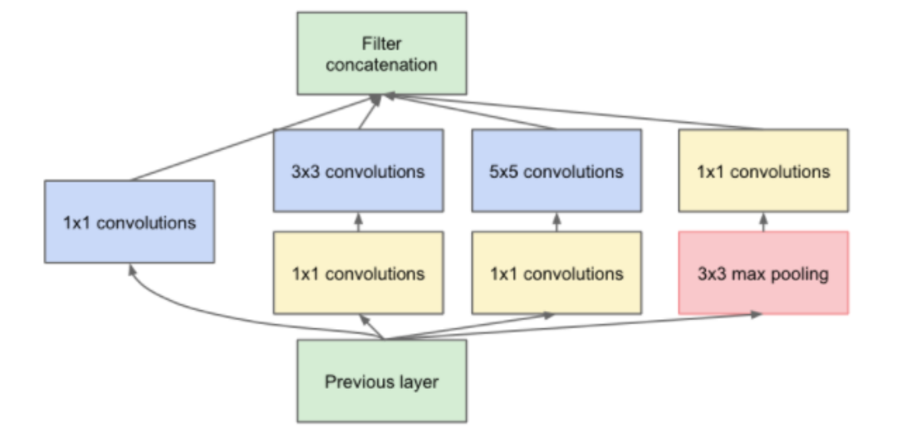
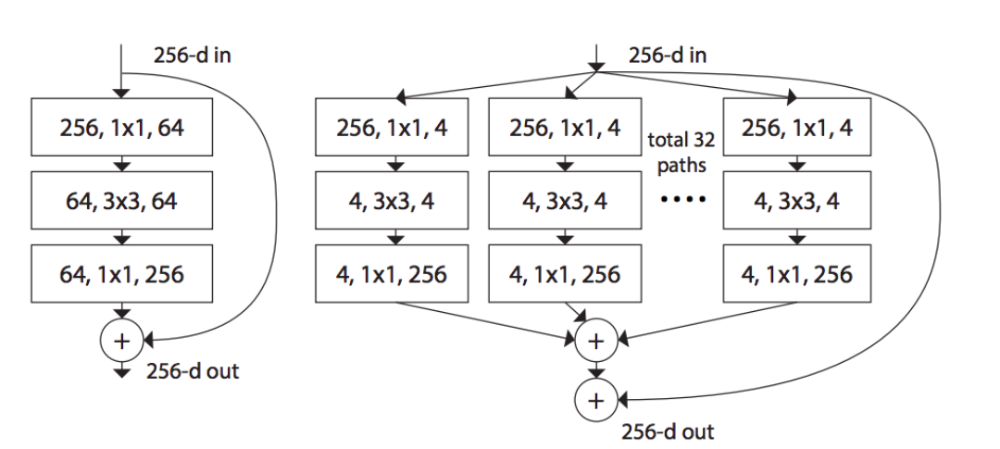
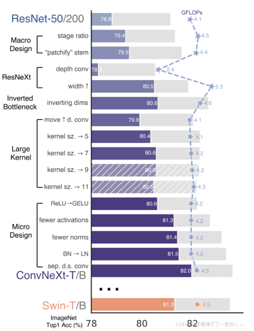
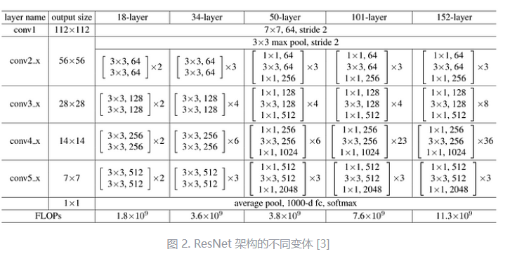
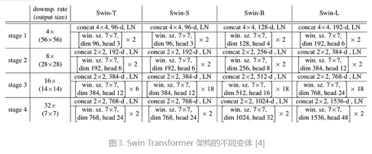
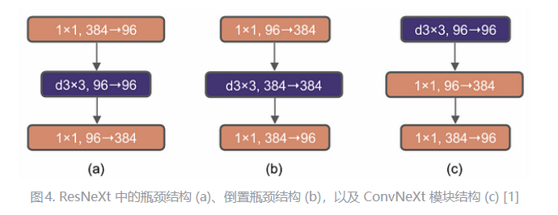
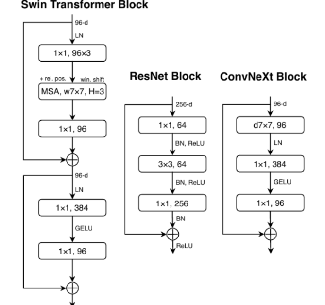
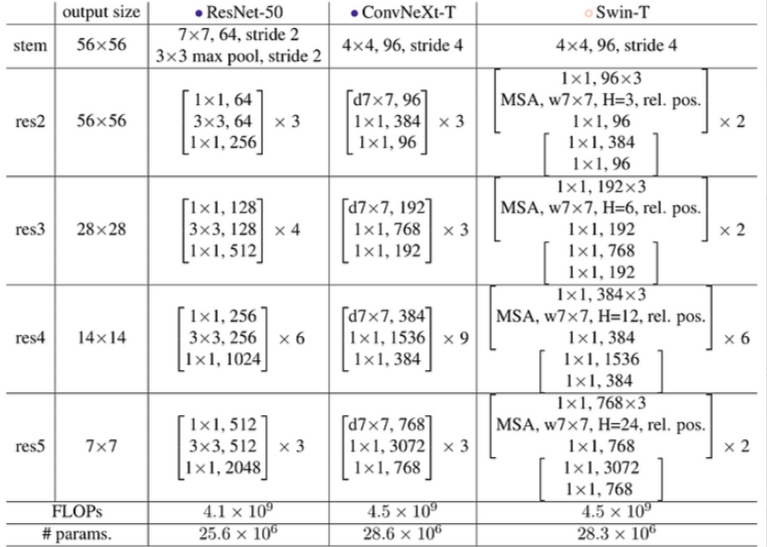

# ResNeXt

Inception那边把ResNet拿来搞了Inception-ResNet，这头ResNet也**把Inception拿来搞了一个ResNeXt**，主要就是单路卷积变成多个支路的多路卷积，不过分组很多，结构一致，进行分组卷积。

> https://zhuanlan.zhihu.com/p/32913695

## Inception

左边是ResNet的基本结构，右边是ResNeXt的基本结构：

# ConvNeXt

从传统 ResNet 逐渐演变到具有Transformer特点的卷积神经网络的演变路径，仍然基于卷积神经网络架构，但它在**设计上融入了一些Transformer的元素或特性**，使得它在某种程度上与Transformer相似，但仍然保持了ConvNet的基本性质。

> https://zhuanlan.zhihu.com/p/1928810982915941594

## 1 超参数调优：重塑 ResNet

ConvNeXt 的核心思想其实就是：对 ResNet 架构进行系统性的超参数调优。具体来说，作者主要从五个方面进行了实验探索：

1. **宏观结构设计（Macro Design）**
2. **引入 ResNeXt 模块（ResNeXt）**
3. **反向瓶颈结构（Inverted Bottleneck）**
4. **使用大卷积核（Large Kernel）**
5. **微观结构设计（Micro Design）**

### 宏观设计（Macro Design）

将 ResNet 的阶段比例（stage ratio）调整为与 Swin-T 架构一致，也就是 1:1:3:1。

### ResNeXt 化（ResNeXt-ification）

主要是在 ResNet 的 bottleneck 模块中引入了**组卷积（group convolution）**

### 倒置瓶颈结构（Inverted Bottleneck）

ResNet属于 “宽 → 窄 → 宽” 的布局，因此被称为“瓶颈结构”。但 ConvNeXt 并没有采用这个经典设计，而是引入了“倒置瓶颈”（Inverted Bottleneck），也就是 “窄 → 宽 → 窄”，这个结构灵感来自 Transformer 架构中的前馈网络层。

### 卷积核大小

让深度卷积（depthwise convolution）放到了模块的开头，这一设计灵感来源于 Transformer 结构，在 Transformer 中多头自注意力层（MSA）会放在前面，后面才是前馈网络层（MLP）。

### 微观设计

论文中调优的最后一个方面是“微观设计”，主要是网络细节层面的调整。和之前一样，这些参数大多借鉴了 Transformer 的设计。首先，作者用 GELU 激活函数替代了 ReLU。虽然替换后准确率保持不变（仍是 80.6%），但他们决定在后续实验中采用 GELU。

之后，他们发现减少激活函数的使用次数能提升准确率。具体做法是，不再在 ConvNeXt 块中的每个卷积层后都使用 GELU，而只在两个点卷积层之间使用一次。这样一改，准确率提升到了 81.3%，已经追平了 Swin-T 架构，而且计算复杂度更低（4.2 vs 4.5 GFLOPS）。

接下来是批量归一化（Batch Normalization，BN）层的调整。传统 CNN 架构常用 Conv-BN-ReLU 结构，ResNet 也沿用了这个设计。但作者们选择只用一层 BN，放在第一个点卷积层之前。这个改动使准确率微升至 81.4%，略微超过了 Swin-T。

尽管如此，参数调优还没结束，接着用层归一化（Layer Normalization）替代了 BN，准确率再次提升了 0.1%，达到 81.5%。

所有这些微观设计的改动最终汇总成了图 5（最右侧）的架构示意图。从图中可以清楚看出 ConvNeXt 块与 Swin Transformer 及 ResNet 块的不同之处。

## ConvNeXt 实现

