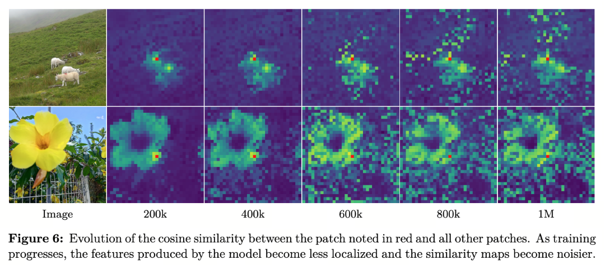
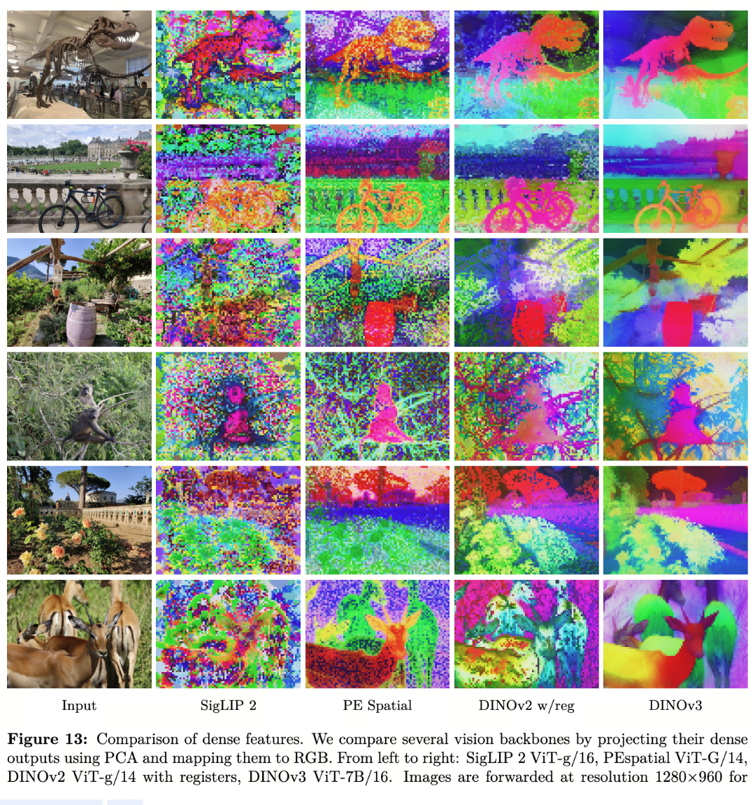

>  https://zhuanlan.zhihu.com/p/1986387271688139358
>
> https://github.com/facebookresearch/dinov3?tab=readme-ov-file

# v2

# V3

>  DINOv2 让我们看到了自监督学习（SSL）超越弱监督学习的希望，那么 DINOv3 则是一种**降维打击**。它不仅把模型参数量推到了 7B 的大语言模型级别

**1. 自监督与弱监督**

**自监督**：
 👉 *监督信号从数据本身自动构造*，**不需要人工标签**

**弱监督**：
 👉 *有标签，但标签不精确 / 不完整 / 有噪声*

> #### 常见弱监督形式
>
> ##### 1️⃣ 标签不精确（最常见）
>
> - 只有图像级标签，没有 bbox / mask
> - 如：这张图“有猫”，但不知道猫在哪
>
> 📌 弱监督目标检测、弱监督分割
>
> ------
>
> ##### 2️⃣ 标签不完整
>
> - 只标一部分样本
> - 如：数据集中只有 10% 有标注
>
> ------
>
> ##### 3️⃣ 标签有噪声
>
> - 自动生成标签
> - 爬虫数据、规则生成标签
>
> 📌 工业场景、日志规则系统（你现在做的 SQL 规则也很像）
>
> ------
>
> #### 典型方法
>
> | 方法        | 说明                       |
> | ----------- | -------------------------- |
> | MIL         | Multiple Instance Learning |
> | CAM         | Class Activation Map       |
> | 伪标签      | 模型预测 → 当新标签        |
> | 规则 + 学习 | 人工规则生成弱标签         |

**1.1 自监督 ≠ 传统无监督**

**自监督 = 用无标签数据 + 人为设计的监督目标**
 **无监督 = 没有监督目标，主要做结构发现**

> 👉 **自监督是“披着无监督外衣的监督学习”**
>
> #### 关键差别在「有没有监督信号」
>
> | 方式   | 有无标签 | 有无明确目标 |
> | ------ | -------- | ------------ |
> | 无监督 | ❌        | ❌            |
> | 自监督 | ❌        | ✅（伪标签）  |
> | 有监督 | ✅        | ✅            |
>
> #### 举个直观例子（视觉）
>
> - **无监督**：
>   - K-means 聚类
>   - PCA / ICA
>   - 只是“发现结构”
> - **自监督**：
>   - 预测旋转角度
>   - 图像遮挡 → 复原
>   - 对比学习（谁和谁是同一张）

在过去，我们认为：**通用模型（Generalist）不如专用模型（Specialist）。** 你想做语义分割？用 [Mask2Former](https://zhida.zhihu.com/search?content_id=267986257&content_type=Article&match_order=1&q=Mask2Former&zhida_source=entity) 微调。想做深度估计？用 [Depth Anything](https://zhida.zhihu.com/search?content_id=267986257&content_type=Article&match_order=1&q=Depth+Anything&zhida_source=entity)。想做视频跟踪？设计专门的时序模块。

但 DINOv3 告诉你：**不需要。**直接**冻结**了 DINOv3 的骨干网络，仅在后面接一个简单的线性解码器（Linear Decoder）

## 二、 核心痛点：Scaling 的“特征坍塌”悖论

把 ViT 模型做大（比如从 Base 到 Giant），并用更多数据训练更久时：

1. **全局指标变好**：ImageNet 分类准确率上升（模型更懂语义了，知道这是“狗”）。
2. **局部指标变差**：像素级的稠密特征（Dense Features）开始退化，特征图变得杂乱无章，丢失了物体边界信息

这就是**“语义增强与几何丢失”的博弈**。模型为了追求极致的分类能力，倾向于把特征抽象化，从而牺牲了空间上的结构一致性。

DINOv2 通过引入 Register Tokens 缓解了高频噪声，但在 7B 这个参数量级下，特征依然会崩塌。

## 三、 技术解密：Gram Anchoring（格拉姆锚定）

DINOv3 的核心贡献，就是用一种极其优雅（甚至有点简单）的方法解决了上述悖论。这个方法叫 **Gram Anchoring**。

### 1. 思想实验：保持队形

想象一群士兵（Patch tokens）在训练。

- **普通的 SSL**：教官说“跑到那个高地上（学习高级语义）”。结果士兵们跑是跑到了，但队形散了，乱成一团。
- **Gram Anchoring**：教官说“你们去高地，但必须**保持现在的相对队形不变**”。

### 2. 数学原理

作者引入了一个**“Gram Teacher”**。这通常是一个训练早期（Early Stage）的模型副本，或者是经过高分辨率处理后的模型。

**关键点在于：** 它不强求学生模型的特征 与老师一模一样（那样就学不到新东西了），而是强求**特征之间的关系结构（Gram Matrix）** 与老师保持一致。

这使得 DINOv3 可以在任意高维的语义空间里遨游，同时被“锚定”住坚实的几何结构。结果就是，DINOv3 的特征图（PCA可视化）干净得像是有监督分割模型的 Ground Truth。

## 四、工程能力

1. **恐怖的数据清洗**： 构建了一个 **LVD-1689M** 数据集（16.89亿张图）。但这不仅仅是爬虫，他们使用了极其复杂的聚类（Clustering）和检索（Retrieval）管道，确保数据的多样性和质量。这再次证明：**Data is the new code.**
2. **7B 参数的 ViT**： 这不是简单的堆叠层数。他们使用了 **RoPE（旋转位置编码）**，并改进了注意力机制中的偏置策略，使得模型可以天然适应多尺度分辨率（从 224 到 4096 甚至更高）。
3. **蒸馏（Distillation）的艺术**： “天塌了”的另一个原因是算力焦虑。但好消息是，Meta 将 7B 巨无霸的能力**蒸馏**到了一系列小模型（ViT-S, ViT-B, ViT-L）上。 **重点来了：** 蒸馏后的 DINOv3-ViT-L，性能已经吊打了之前的 DINOv2-ViT-Giant。这意味着我们普通开发者也能用上 SOTA 级别的特征。

### **冻结的骨干网络（Frozen Backbone）**

