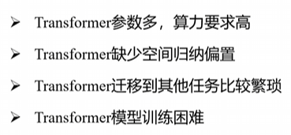
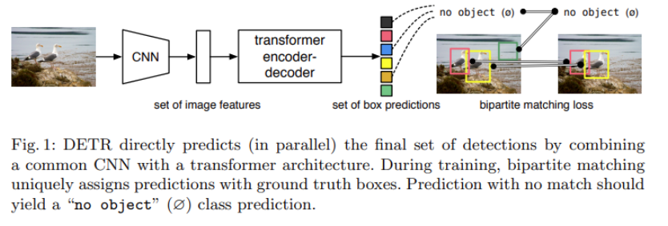
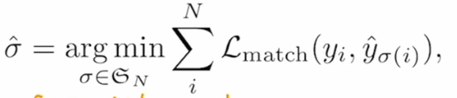
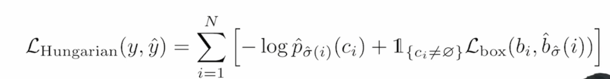
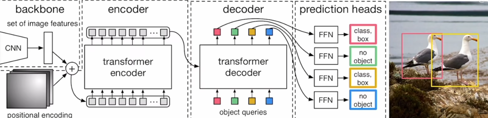
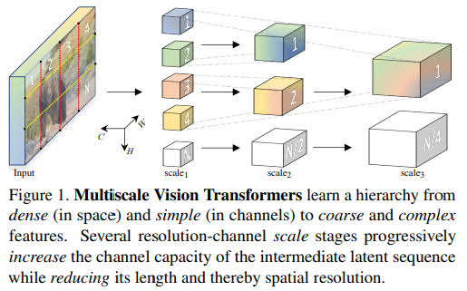

# VIT

## 原理

**图像分块**：

小块16*16

**线性嵌入**：
使用线性投影将每个图像块映射到固定长度的向量（称为 Patch Embedding），然后通过添加位置编码（Positional Encoding）表示块的位置信息。

**Transformer 编码器**：
利用标准的 Transformer 编码器（多头自注意力和前馈网络）对这些嵌入进行处理，学习全局的图像特征

**分类头**：
引入一个特殊的 [CLS] token，用于整合所有块的信息。最后通过 MLP（多层感知机）对 [CLS] token 进行分类。

 

# Swin Transformer

## 核心原理：

1. **分层架构**：
   Swin Transformer 的结构是分层的，类似于卷积神经网络（CNN）的金字塔设计。随着层数的增加，特征图的分辨率逐渐降低，通道数逐渐增加。
2. **滑动窗口注意力 (Shifted Window Attention)**：
   - 将图像划分为多个固定大小的窗口（如 7×77 \times 77×7），在每个窗口内计算自注意力，降低计算复杂度。
   - 在不同层之间引入“滑动窗口”机制，使窗口之间的信息可以交互，增加全局建模能力。
3. **线性复杂度**：
   通过限制注意力计算在窗口内完成，避免了 ViT 的全局注意力计算带来的高时间和空间复杂度问题。
4. **Patch 合并**：
   在分层过程中，通过 Patch 合并操作减少特征图分辨率，同时增加通道维度。

## 滑动窗口注意力 

### **Patch Merging**

### W-MSA

### SW-MSA

# MAE

## 核心原理：

1. **随机掩码（Masking）**：
   - 将输入图像划分为一系列 Patch（例如 16×1616 \times 1616×16），并随机**遮掩**一定比例的 Patch（如 75%）。
   - 遮掩的部分从输入中移除，剩余的 Patch 作为输入特征。
2. **编码器（Encoder）**：
   - 使用 ViT（Vision Transformer）作为编码器，仅处理未被遮掩的 Patch，提取高效的全局特征。
3. **解码器（Decoder）**：
   - 一个轻量级的解码器负责重建被遮掩的 Patch。
   - 解码器接受编码器的输出和位置编码，并尝试还原完整的图像。
4. **重建目标（Reconstruction Loss）**：
   - 模型通过最小化重建误差（通常是均方误差，MSE）来优化，从而学习有意义的图像特征。

# IGPT

## 核心原理：

1. **图像像素序列化**：
   - 将二维图像**展平为一维像素序列**，类似于自然语言处理中的文本序列。
   - 每个像素值被表示为一个离散的类别（如颜色索引或灰度值）。
2. **Transformer 架构**：
   - **使用标准的 Transformer 模型，将图像像素序列作为输入**，学习序列中各像素值之间的依赖关系。
   - 通过**自回归方式**预测下一个像素值，实现图像生成任务。
3. **无监督学习**：
   - 模型通过最大化训练数据的对数似然估计进行优化，学习如何生成与训练图像分布一致的新图像。

# MobileViT 

## 空间归纳偏置

# SimCLR

# DETR

## 概述

- 最大的特点就是：不需要预定义的先验anchor，也不需要NMS的后处理策略，就可以实现**端到端**的目标检测。

- 但是，DETR大目标检测上性能是最好的，而小目标上稍差，而且基于match的loss导致学习很难收敛（即难以学习到最优的情况）。
- DETR的总体框架如下，先通过CNN提取图像的特征；再送入到transformer encoder-decoder中，该编码器解码器的结构基本与transformer相同，主要是在输入部分和输出部分的修改；最后得到类别和bbox的预测，并通过二分匹配计算损失来优化网络。
- 利用全局特征之间的关系，来消除冗余的框

1. 第一步，用卷积神经网络抽取图像特征。
2. 第二步，通过transformer获取图片全特征。
3. 第三步。用transformer decoder来生成很多个框。
4. 第四步。将预测出的框与ground truth的框进行matching 匹配的框计算loss。 Or在推理阶段第四部将是设置一个阀值。高于阀值则为目标，低于则为背景。

## 目标函数

n个输出

### 二分图匹配

输出的一百个框移Ground truth。进行匹配。而不需要nms

#### 匈牙利算法

> 对应最擅长的任务(框的准确度和分类准确度)

## 网络

### object quiry

embedding

# Hiera (Hierarchical Vision Transformer)

