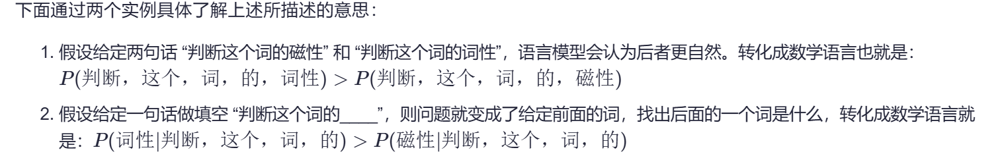
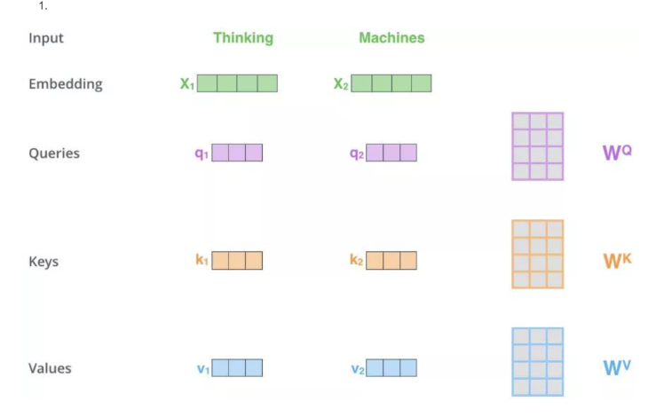
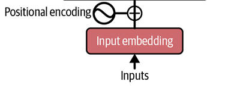
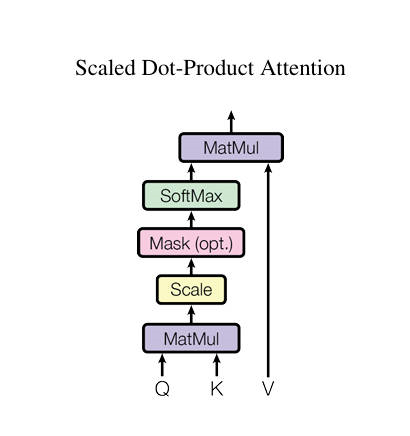
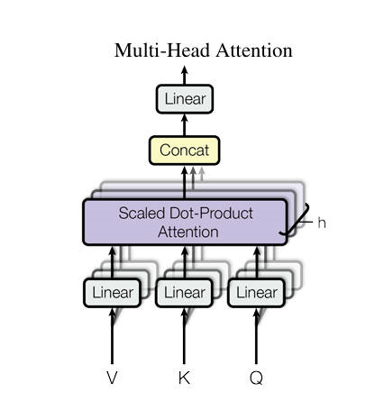
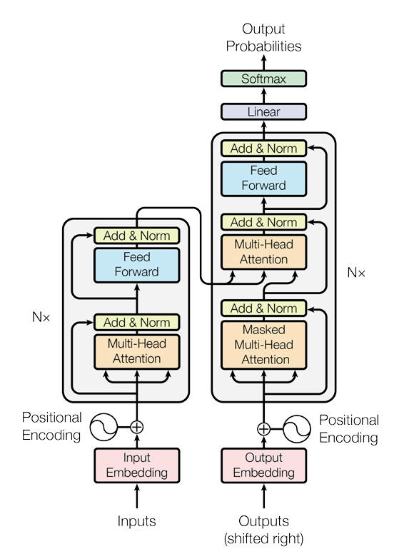

1. 预训练 浅层特征不变 高层改变
   1. 冻结 
   2. fine-tuning


## 统计语言模型



1.  马尔科夫链
2.  


## 神经网络语言模型

word embedding 例子

```

```


word embedding 就是 预训练的frozen








## 改进的注意力机制


### 

### 1 LORA 低秩近似在 Transformer 中的应用

在 Transformer 中，低秩近似主要应用于自注意力计算，特别是通过优化注意力矩阵的存储和计算来提高效率。以下是两种常见的实现方式：

1. **Linformer**：Linformer 是一种基于低秩近似的优化方法。Linformer 的核心思想是将标准自注意力中的注意力矩阵近似为低秩矩阵。Linformer 假设注意力矩阵可以用低秩矩阵来近似，因此将其从一个全连接矩阵（n×n）降为一个n×k  的矩阵（其中 kkk 是较小的值，通常比 nnn 小得多）。通过这种低秩近似，计算复杂度从 
   $$
   O(n^2)
   $$
   降低为 
   $$
   O(n \cdot k)
   $$
   大大减少了计算量，特别是在长序列时效果显著。

2. **Performer**：Performer 是另一种采用低秩近似的 Transformer 变种，它通过引入一种叫做 **线性注意力** 的方法，采用**随机特征来近似注意力矩阵**的乘积。这种方法能够将原本的
   $$
   O(n^2)
   $$
    计算复杂度降低为 
   $$
   O(n)
   $$
   ，使得 Transformer 可以处理非常长的序列。

#### 低秩近似的优点

- **减少计算复杂度**：通过将高秩矩阵分解为低秩矩阵，降低了计算复杂度，从而加快了训练和推理速度。
- **节省内存**：低秩矩阵的存储通常比原始矩阵所需的内存少，因此节省了计算过程中的内存消耗。
- **适用于长序列**：对于长序列，低秩近似可以大大提高 Transformer 的效率，使其能够处理更长的输入序列而不遇到内存瓶颈。

#### 低秩近似的缺点

- **性能损失**：低秩近似虽然可以减少计算复杂度，但可能会带来一定的性能损失，尤其是在近似效果不佳时。较低的秩可能无法捕捉到原矩阵中的复杂关系，因此可能影响模型的精度。
- **近似精度问题**：低秩近似依赖于如何选择低秩矩阵的秩（rank）。如果选择的秩过小，可能会导致较大的误差，从而影响模型的效果。

、

### LoRA 的应用步骤

#### 1. **选择适当的层**

- 通常，LoRA 应用在 Transformer 中的关键层，如注意力层和前馈层。选择这些层是因为它们通常是最有影响力的层，影响模型的表达能力。

#### 2. **添加低秩矩阵**

- 对于每个需要修改的层（如注意力层中的权重矩阵），LoRA 在其上加上低秩矩阵。通常，这些低秩矩阵的秩较小，因此不会显著增加模型的复杂度。

#### 3. **训练低秩矩阵**

- 在微调过程中，仅训练低秩矩阵的参数，而保持原始的预训练权重不变。这意味着只有少量参数需要更新，从而加速训练并降低存储需求。

#### 4. **合成模型**

- 在微调结束后，最终的模型将包括原始的预训练权重和经过 LoRA 微调的低秩矩阵


### 代码实现

```


```


## Adapter


适


