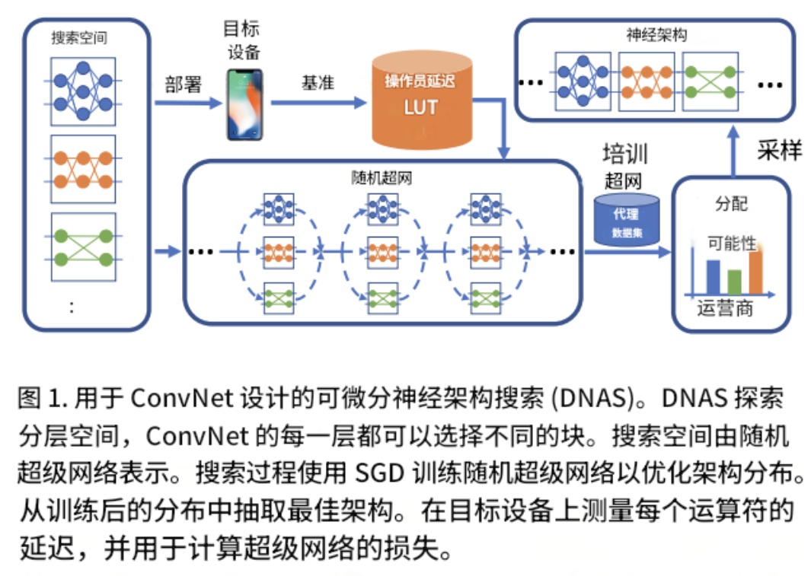

# **Introduction**

  近期卷积网络的设计除了注重准确率之外，还需要兼顾运行性能，特别是在移动设备上的运行性能，这使得卷积神经网络的设计变得更加难，主要有以下难点：

- Intractable design space，由于卷积网络参数很多，导致设计空间十分复杂，目前很多方法提出自动化搜索，能够简化人工设计的流程，但这种方法一般需要大量的算力。
- Nontransferable optimality，卷积网络的性能取决于很多因素，比如输入分辨率和目标设备，不同的分辨率需要调整不同的网络参数，而相同block在不同的设备上的效率也可能大不相同，所以需要对网络在特定的条件下进行特定的调优。
- Inconsistent efficiency metrics，大多数效率指标不仅与网络结构相关，也和目标设备上的软硬件设置有关。为了简化，很多研究都采用硬件无关的指标来表示卷积的效率，比如FLOPs，但FLOPs并不能总等同于性能，还跟block的实现方式相关，这使得网络的设计更加困难。

# NAS

## **总结：NAS 发展历程**

| 阶段             | 方法          | 主要创新点                         | 计算成本 | 代表性模型               |
| ---------------- | ------------- | ---------------------------------- | -------- | ------------------------ |
| **早期 NAS**     | 强化学习 NAS  | RNN 控制器搜索网络结构             | 高       | NASNet                   |
| **进化 NAS**     | 进化算法 NAS  | 变异 + 交叉进化优化网络            | 高       | AmoebaNet                |
| **梯度优化 NAS** | DARTS         | 采用梯度下降进行高效搜索           | 低       | DARTS、ProxylessNAS      |
| **高效 NAS**     | Efficient NAS | 共享参数 + 复合缩放 + 硬件感知搜索 | 低       | EfficientNet、FBNet、OFA |

# FBNet

将 **硬件性能约束**（如浮点运算量 FLOPs、内存使用量、计算延迟等）引入到 NAS 的搜索过程，使得网络架构不仅能够实现高精度，还能在指定硬件上具有良好的执行效率。

BNet 的工作流程可以分为以下几个步骤：

1. **硬件感知的目标函数**：
   在设计过程中，FBNet 将目标硬件（如移动设备、嵌入式设备等）的约束（如内存、计算量等）纳入考虑。FBNet 的目标是最小化 **计算资源的消耗**，同时保证较高的 **分类精度**。这个目标函数是硬件感知的，旨在寻找在硬件上性能最优的网络架构。
2. **可微分架构搜索**：
   FBNet 使用了一种基于梯度优化的搜索方法，即将 NAS 搜索过程转化为可微分的优化问题。这使得 FBNet 可以在较少的计算资源下快速找到高效的网络架构。具体来说，FBNet 在 **超网络（SuperNet）** 中进行架构搜索，超网络包含了多种候选网络结构，通过训练和优化选择最优的架构。
3. **选择模块**：
   在 FBNet 中，网络结构的选择是模块化的，每个模块（如卷积、深度可分离卷积等）都有多个候选结构，而这些候选结构的选择在搜索过程中是通过**可微分的路径选择**来实现的。最终，FBNet 在候选模块中选择一个最优的结构。
4. **搜索策略**：
   为了加速搜索过程，FBNet 使用了 **混合搜索策略**，即结合了 **强化学习** 和 **梯度优化** 两种方法。强化学习用于生成架构的候选方案，而梯度优化则用于对这些方案进行优化。通过这种方式，FBNet 能够在复杂的搜索空间中找到最优的架构。

