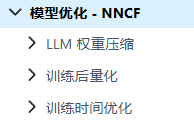
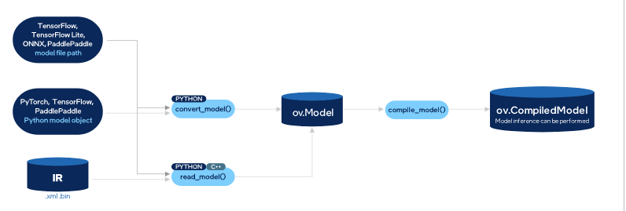
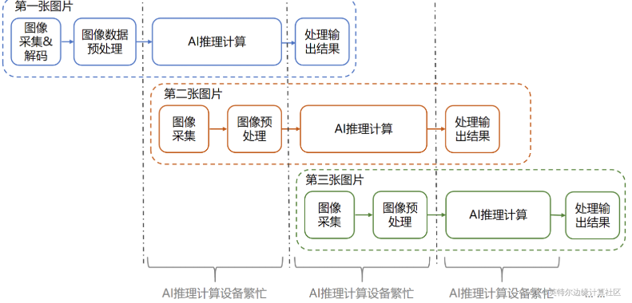

## OpenVINO

## Introduce


### OpenVINO 工具

- [神经网络压缩框架 （NNCF）](https://github.com/openvinotoolkit/nncf) - 高级模型优化技术，包括量化、滤波器修剪、二值化和稀疏性。
- [GenAI 存储库](https://github.com/openvinotoolkit/openvino.genai)和 [OpenVINO Tokenizers](https://github.com/openvinotoolkit/openvino_tokenizers) - 用于开发和优化生成式 AI 应用程序的资源和工具。
- [OpenVINO™ 模型服务器 （OVMS）](https://github.com/openvinotoolkit/model_server) - 一种可扩展的高性能解决方案，用于为针对 Intel 架构优化的模型提供服务。
- [Intel® Geti™](https://geti.intel.com/) - 适用于计算机视觉用例的交互式视频和图像注释工具。


### 如何优化的

 

1. 模型压缩、层融合（Layer Fusion）、量化（Quantization）等技术优化模型
2. 自动利用硬件加速特性


## Workflow



```
训练模型 (TF/PyTorch) → 转换为 IR → 优化 → 部署到 CPU/GPU/VPU → 推理 → 性能调优
```

Openvino整体框架为：**Openvino前端→ Plugin中间层→ Backend后端**





## Code

Python：https://blog.csdn.net/weixin_44613415/article/details/143507060

​	https://blog.csdn.net/weixin_38739735/article/details/137099211=

C：https://blog.csdn.net/bjbz_cxy/article/details/130318904

​	https://blog.csdn.net/qq_44732054/article/details/140971622


# ncnn

https://blog.csdn.net/PHILICS7/article/details/125430079

ncnn是腾讯优图推出的在手机端极致优化的高性能神经网络前向计架框架，适用于手机端的CPU计算且无需依赖第三方计算库，ncnn只用作推理而非边训练边推理。


