 


# OCR

## 前言

CRNN主要是**CNN（卷积神经网络）+ RNN（循环神经网络）+ CTC（连接时序分类）** 的组合，广泛用于 **场景文本识别（STR, Scene Text Recognition）**


在早期，OCR任务通常分为两个步骤：单字切割和分类任务。首先，使用投影法等技术将文本文件中的连续文字切割成单个字符，然后将这些字符输入到卷积神经网络（CNN）中进行分类。然而，这种方法现在已经有些过时。

目前更流行的方法是基于深度学习的端到端的文本识别，这种方法不需要显式地进行文字切割。而是将文字识别转化为序列学习问题。尽管输入的图像尺度和文本长度可能不同，但是通过深度卷积神经网络（DCNN）和循环神经网络（RNN）的处理，以及在输出阶段应用一定的连接时序分类（CTC）翻译转录后，就可以对整个文本图像进行识别。这意味着文字的切割过程已经被融入到深度学习模型中，从而简化了整个OCR流程。


深度学习在端到端OCR（光学字符识别）技术中的应用，特别是CRNN OCR和attention OCR两种技术。这两种技术都使用了CNN+RNN的网络结构进行特征学习，但在最后的输出层（翻译层）有所不同。CRNN OCR使用CTC（连接时序分类）算法进行序列对齐，而attention OCR则采用attention机制来进行序列对齐。文件中提到，CRNN算法应用更为广泛，因此主要介绍的是CRNN算法。


## CRNN

### 网络结构

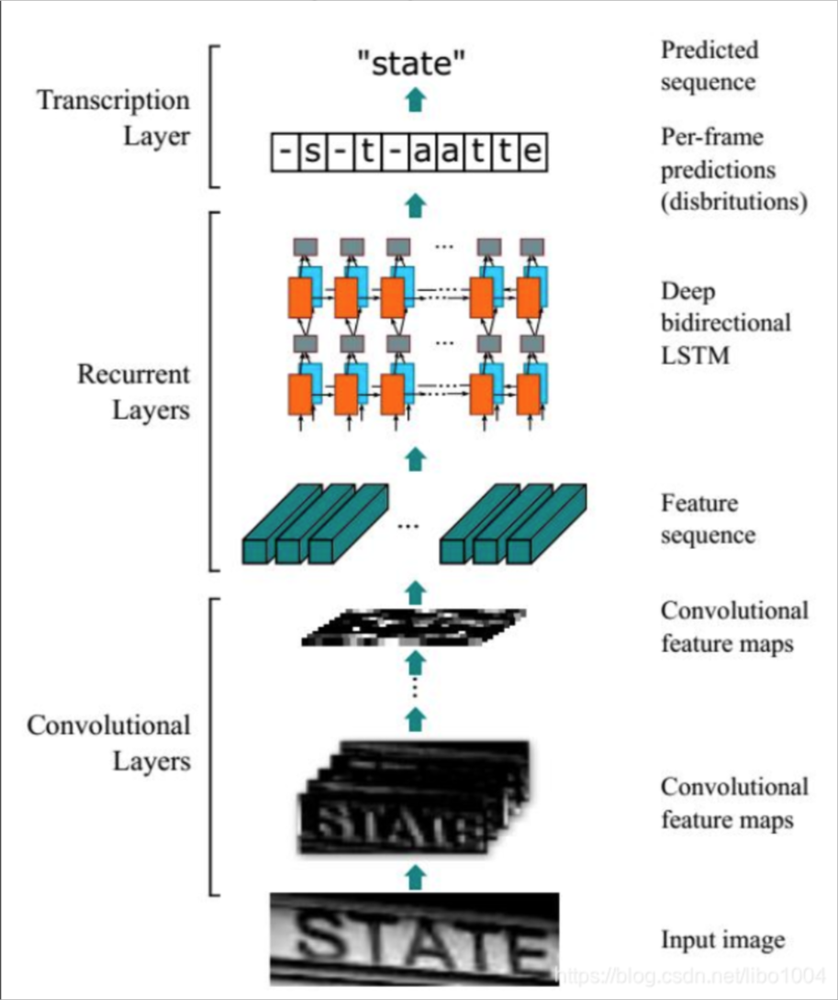

#### 1.CNN

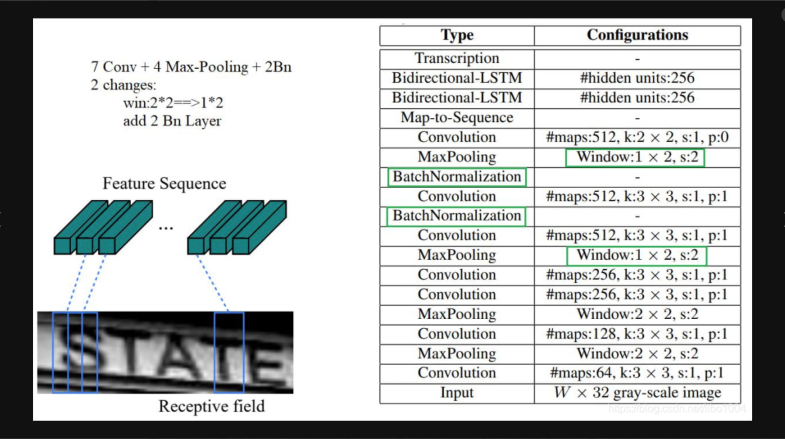

##### 1x2 池化


#### 2.Map2Feature sequence

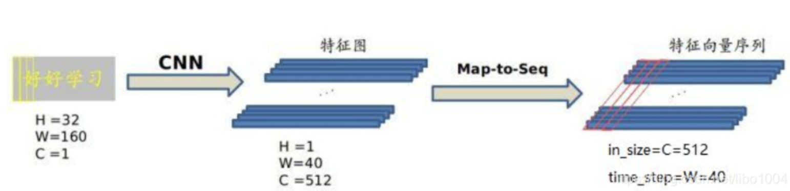


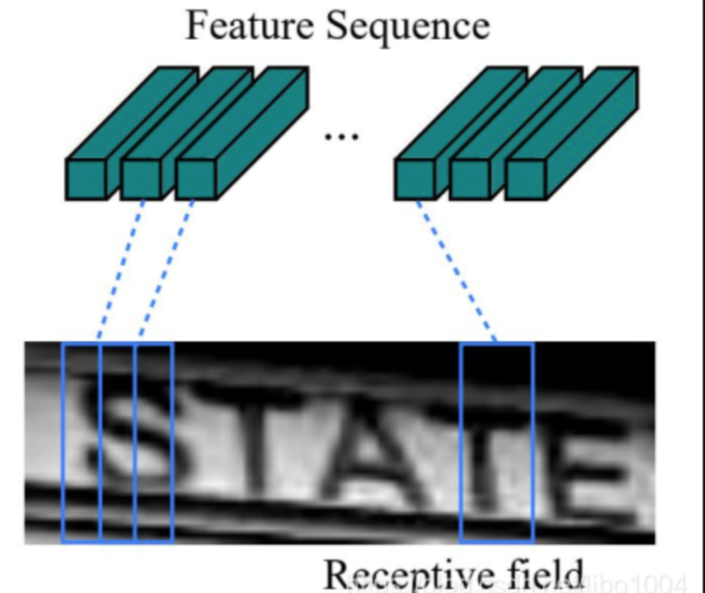

#### 3.RNN


##### LSTM

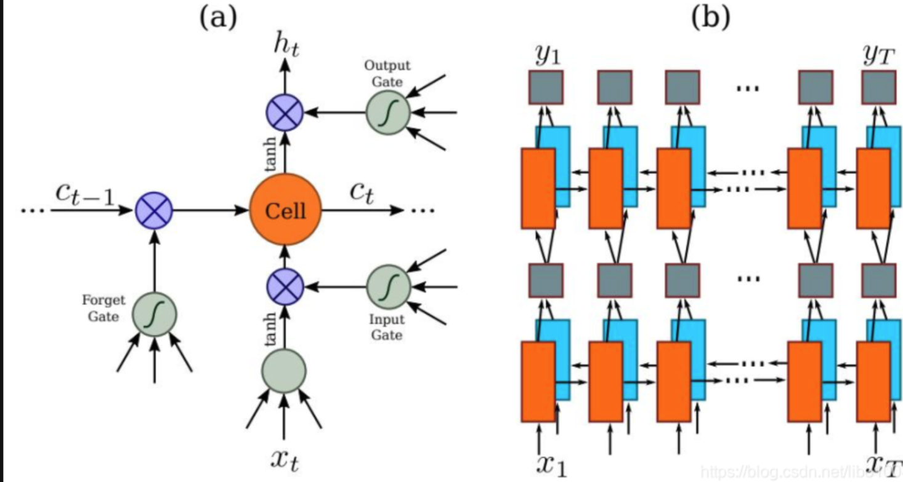

##### 双向LSTM

##### 


#### 4.CTCLoss


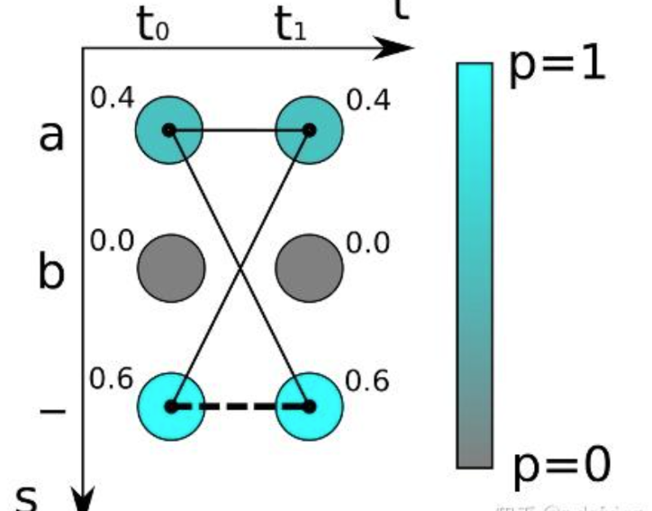

如上图，对于最简单的时序为 2 的字符识别，有两个时间步长(t0，t1)和三个可能的字符为“ａ”，“ｂ”和“-”，我们得到两个概率分布向量，如果采取最大概率路径解码的方法，则“--”的概率最大，即真实字符为空的概率为0.6*0.6=0.36。

但是为字符“ａ”的情况有多种对齐组合，“aa”, “a-“和“-a”都是代表“ａ”，所以，输出“ａ”的概率应该为三种之和：

```text
0.4 * 0.4 + 0.4 * 0.6 + 0.6 * 0.4 = 0.16 + 0.24 + 0.24 = 0.64
```


#### 5.Attention

基于Attention的OCR解码算法，把OCR文字识别当成文字翻译任务，即通过Attention Decoder出文字序列。


##### **RNN -> Seq2Seq**

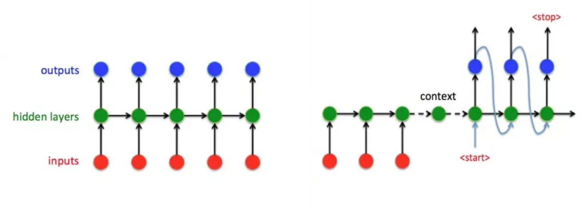

左图是经典的RNN结构，右图是Seq2Seq结构。RNN的输入序列和输出序列必须有相同的时间长度，而机器翻译以及文字识别任务都是输入输出不对齐的，不能直接使用RNN结构进行解码。于是在Seq2Seq结构中，将输入序列进行Encoder编码成一个统一的语义向量Context，然后送入Decoder中一个一个解码出输出序列。在Decoder解码过程中，第一个输入字符为<start>，然后不断将前一个时刻的输出作为下一个时刻的输入，循环解码，直到输出<stop>字符为止


**Seq2Seq -> Attention Decoder**

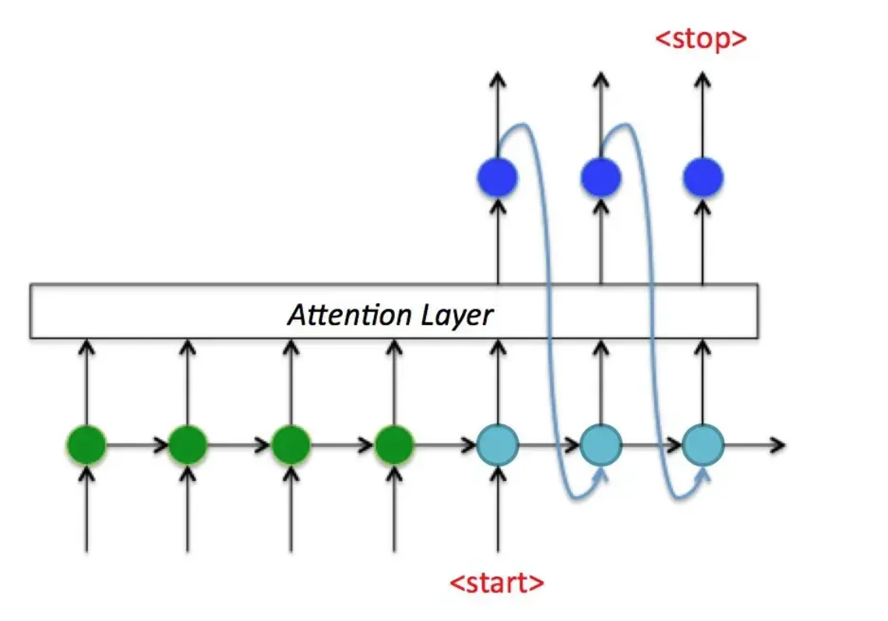

Seq2Seq把所有的输入序列都编码成一个统一的语义向量Context，然后再由Decoder解码。由于context包含原始序列中的所有信息，它的长度就成了限制模型性能的瓶颈。


所以如果要改进Seq2Seq结构，最好的切入角度就是：**利用Encoder所有隐藏层状态解决Context长度限制问题。**于是Attention Decoder在Seq2Seq的基础上，增加了一个Attention Layer，如上图所示。

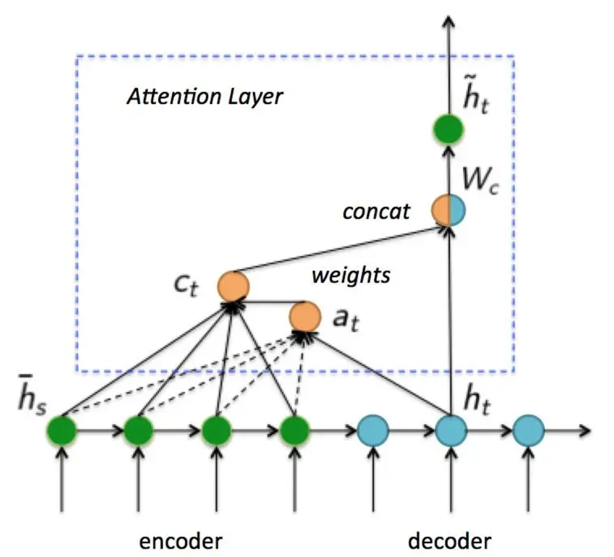

在Decoder时，每个时刻的解码状态跟Encoder的所有隐藏层状态进行cross-attention计算，cross-attention将当前解码的隐藏层状态和encoder的所有隐藏层状态做相关性计算，然后对encoder的所有隐藏层加权求和，最后和当前解码的隐藏层状态concat得到最终的状态。


#### 6.ACE

基于ACE的解码方法不同于CTC和Attention，ACE的监督信号实际上是一种弱监督(**输入输出没有做形式上的对齐，没有先后顺序信息，倾向于学习表征**)，并且可以用于多行文字识别。

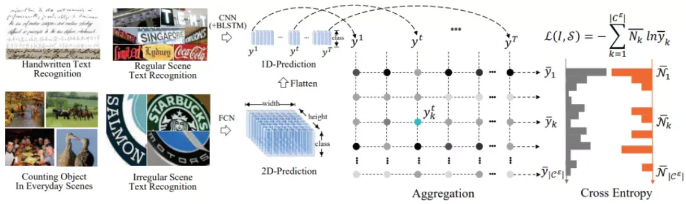

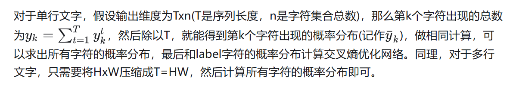


从模型设计上来看，可以采用结合上面3种方法的**多任务文本识别模型。在训练时，以CTC为主，Attention Decoder和ACE辅助训练。在预测时，考虑到速度和性能，只采用CTC进行解码预测。**多任务可以提高模型的泛化性，同时如果对预测时间要求不高，多结果也可以提供更多的选择和对比。


```python
'''
    Encoder+Decoder+Attention is implemented from:
    https://pytorch.org/tutorials/intermediate/seq2seq_translation_tutorial.html
'''
import torch
import torch.nn as nn
import torch.nn.functional as F


class CNN(nn.Module):

    def __init__(self, channel_size):
        super(CNN, self).__init__()
        self.cnn = nn.Sequential(
                      nn.Conv2d(channel_size, 64, 3, 1, 1), nn.ReLU(True), nn.MaxPool2d(2, 2),
                      nn.Conv2d(64, 128, 3, 1, 1), nn.ReLU(True), nn.MaxPool2d(2, 2),
                      nn.Conv2d(128, 256, 3, 1, 1), nn.BatchNorm2d(256), nn.ReLU(True),
                      nn.Conv2d(256, 256, 3, 1, 1), nn.ReLU(True), nn.MaxPool2d((2,2), (2,1), (0,1)),
                      nn.Conv2d(256, 512, 3, 1, 1), nn.BatchNorm2d(512), nn.ReLU(True),
                      nn.Conv2d(512, 512, 3, 1, 1), nn.ReLU(True), nn.MaxPool2d((2,2), (2,1), (0,1)),
                      nn.Conv2d(512, 512, 2, 1, 0), nn.BatchNorm2d(512), nn.ReLU(True))

    def forward(self, input):
        # [n, channel_size, 32, 280] -> [n, 512, 1, 71]
        conv = self.cnn(input)
        return conv


class BidirectionalLSTM(nn.Module):

    def __init__(self, input_size, hidden_size, output_size):
        super(BidirectionalLSTM, self).__init__()

        self.rnn = nn.LSTM(input_size, hidden_size, bidirectional=True)
        self.embedding = nn.Linear(hidden_size * 2, output_size)

    def forward(self, input):
        recurrent, _ = self.rnn(input)
        T, b, h = recurrent.size()
        t_rec = recurrent.view(T * b, h)

        output = self.embedding(t_rec)  # [T * b, output_size]
        output = output.view(T, b, -1)
        return output


class AttnDecoderRNN(nn.Module):

    def __init__(self, hidden_size, output_size, dropout_p=0.1, max_length=71):
        super(AttnDecoderRNN, self).__init__()
        self.hidden_size = hidden_size
        self.output_size = output_size
        self.dropout_p = dropout_p
        self.max_length = max_length

        self.embedding = nn.Embedding(self.output_size, self.hidden_size)
        self.attn = nn.Linear(self.hidden_size * 2, self.max_length)
        self.attn_combine = nn.Linear(self.hidden_size * 2, self.hidden_size)
        self.dropout = nn.Dropout(self.dropout_p)
        self.gru = nn.GRU(self.hidden_size, self.hidden_size)
        self.out = nn.Linear(self.hidden_size, self.output_size)


    def forward(self, input, hidden, encoder_outputs):
        embedded = self.embedding(input)
        embedded = self.dropout(embedded)

        attn_weights = F.softmax(self.attn(torch.cat((embedded, hidden[0]), 1)), dim=1)
        attn_applied = torch.bmm(attn_weights.unsqueeze(1), encoder_outputs.permute(1, 0, 2))

        output = torch.cat((embedded, attn_applied.squeeze(1)), 1)
        output = self.attn_combine(output).unsqueeze(0)

        output = F.relu(output)
        output, hidden = self.gru(output, hidden)

        output = F.log_softmax(self.out(output[0]), dim=1)
        return output, hidden, attn_weights

    def initHidden(self):
        return torch.zeros(1, 1, self.hidden_size, device=device)


class Encoder(nn.Module):
    def __init__(self, channel_size, hidden_size):
        super(Encoder, self).__init__()
        self.cnn = CNN(channel_size)
        self.rnn = nn.Sequential(
            BidirectionalLSTM(512, hidden_size, hidden_size),
            BidirectionalLSTM(hidden_size, hidden_size, hidden_size))

    def forward(self, input):
        # conv features
        conv = self.cnn(input)
        b, c, h, w = conv.size()
        assert h == 1, "the height of conv must be 1"

        # rnn feature
        conv = conv.squeeze(2)        # [b, c, 1, w] -> [b, c, w]
        conv = conv.permute(2, 0, 1)  # [b, c, w] -> [w, b, c]
        output = self.rnn(conv)
        return output


class Decoder(nn.Module):

    def __init__(self, hidden_size, output_size, dropout_p=0.1, max_length=71):
        super(Decoder, self).__init__()
        self.hidden_size = hidden_size
        self.decoder = AttnDecoderRNN(hidden_size, output_size, dropout_p, max_length)

    def forward(self, input, hidden, encoder_outputs):
        return self.decoder(input, hidden, encoder_outputs)

    def initHidden(self, batch_size):
        result = torch.autograd.Variable(torch.zeros(1, batch_size, self.hidden_size))
        return result


```


## Model改进


