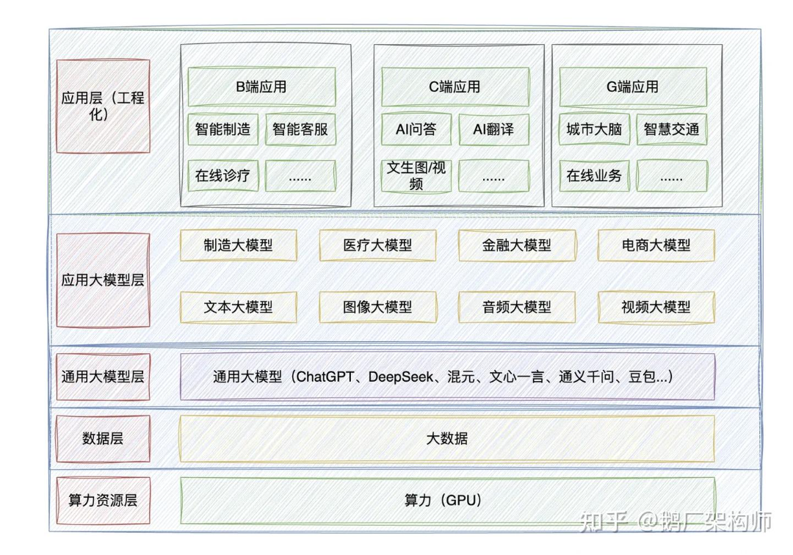
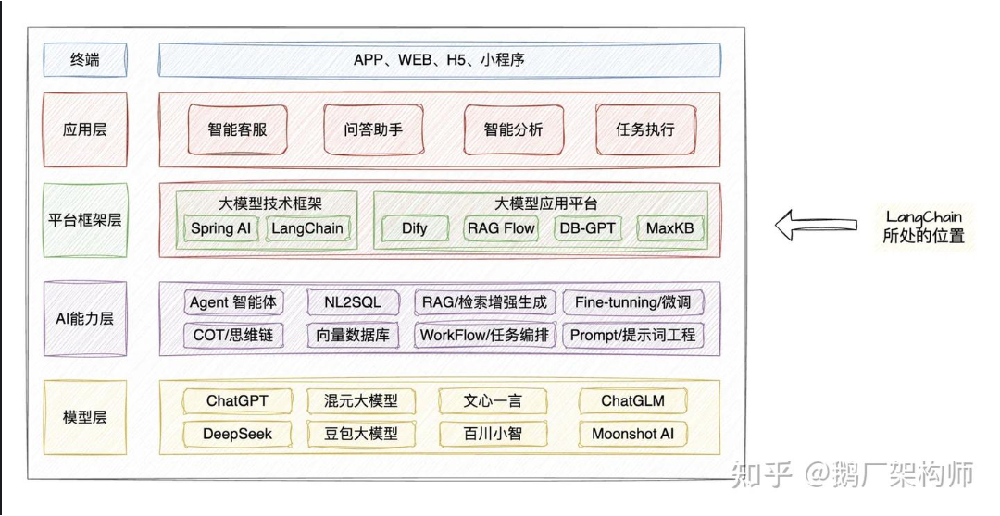
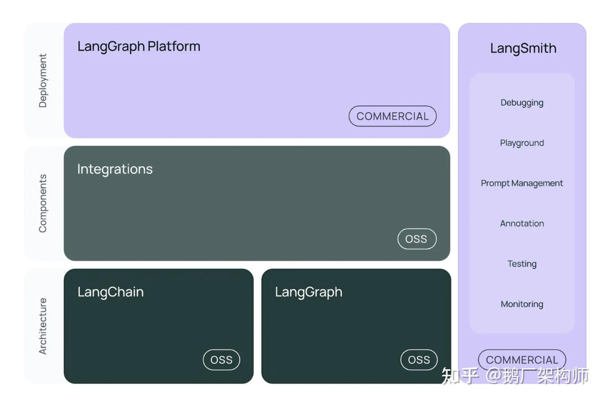
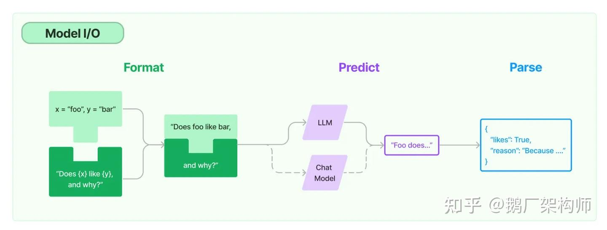
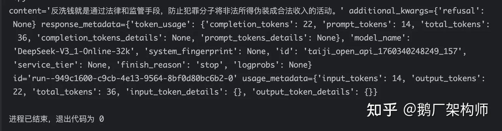
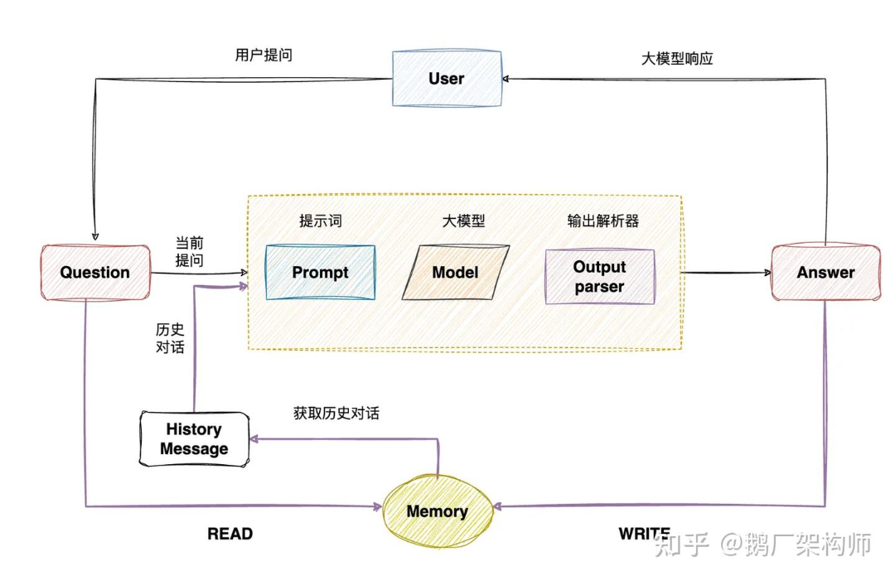

> 1

# 1 初步认识

## 1.1 什么是LangChain

LangChain是2022年10月（ChatGPT在2022年11月30问世，比ChatGPT还早），由哈佛大学的Harrison Chase（哈里森·蔡斯）发起研发的一个**用于开发基于大语言模型（LLM） 应用程序的开源框架**，它的核心目标是简化AI应用的构建过程，让开发者能像搭积木一样，快速组合各种模块来实现复杂功能，如：搭建智能体（Agent）、问答系统（QA）、对话机器人、知识库等。





## 1.2 为什么使用LangChain

接对接大模型和使用LangChain的对比：

| 对比维度       | 直接调用大模型API                          | 使用 LangChain 开发                                          |
| -------------- | ------------------------------------------ | ------------------------------------------------------------ |
| 开发模式       | 相对直接，但复杂功能需大量自定义代码       | 模块化组装，提供大量预制组件和链，简化复杂逻辑               |
| 多模型支持     | 通常需为不同供应商的API编写适配代码        | 统一接口，轻松切换或组合不同模型（如OpenA)等）               |
| 外部数据集成   | 需自行实现数据加载、处理、向量化与检索逻辑 | 内置RAG（检索增强生成） 等强大支持，可轻松连接PDF、数据库、API等外部数据源 |
| 上下文管理     | 需手动管理对话历史，易超出Token限制        | 内置Memory组件，灵活管理短期和长期记忆，维持连贯对话         |
| 复杂任务自动化 | 实现多步骤推理或工具调用逻辑复杂           | 通过Agents，让模型能自主决策、调用工具（如计算器、搜索引擎）完成任务 |
| 生产部署与调试 | 缺乏标准化工具，监控和调试较困难           | 提供LangSmith等平台，用于监控、追踪和调试应用性能            |

## 1.3 LangChain架构设计（宏观）



# 二、LangChain使用

### 2.1 简单demo

```

```


# 三、LangChain核心组件之Model I/O

## 3.1 Model I/O

Model I/O 是应用程序与大模型进行交互的组件，**它与大模型的关系类似于JDBC与数据库的关系**，本质上都是**为了解耦应用逻辑与底层实现，提供标准化的交互接口**，使应用程序无需关注大模型底层的实现，可与各种大模型进行交互。Model I/O 包括输入**提示(Format)、调用模型(Predict)、输出解析(Parse)**。分别对应着Prompt Template（提示词模版），Model （大模型）和Output Parser（输出解析器）。



说白了，Model I/O 就是LangChain 提供了一系列与大模型交互的API。

## 3.2 大模型分类（按功能）

**1、LLMs（大语言模型）**

也叫非对话模型，**是许多语言模型应用程序的支柱**，通用的文本生成，能够完成一次性的文本生成任务，如写作、翻译等

```text
llm_model = OpenAI()
llm_model.invoke("什么是LangChain?")
```

**2、Chat Models（对话模型）**

专门为**多轮对话场景**优化的语言模型。与LLMs处理纯字符串不同，Chat Models的输入和输出都是**结构化的消息对象**，能更好地理解和维护对话的上下文

```text
# 创建ChatOpenAI模型实例
chat_model = ChatOpenAI(
    model_name="DeepSeek-R1-Online-0120",   # 模型名称
    base_url="http://xxx/openapi/",  # 与模型交互的地址
    api_key="xxxxxxxxxxxxxx"  #秘钥，在太极上申请的，生产环境需要放在配置文件中
)

# 调用模型
response = chat_model.invoke("用简单一句话概括一下什么是反洗钱？")
# 打印模型响应内容
print(response)
```



**3、Embedding Model（嵌入模型）**

它的核心任务是**将文字、图片等非结构化数据，转换成高维空间中的数值向量**。并且能够将**语义相近的内容在向量空间中的位置也映射得更近**

```text
# 我这里使用的嵌入模型是自己本地部署的，OpenAI的类为OpenAIEmbeddings
embeddings_model = OllamaEmbeddings(
    model="nomic-embed-text",
    base_url="http://xxx",
)

vector = embeddings_model.embed_query("hello world")
print(f"嵌入向量长度: {len(vector)}")
print(f"前20个值: {vector[:20]}")
```


## 3.3 Message（消息）

## 3.4 Prompt Template（提示词模版）


# 四、LangChain核心组件之Chains

**3、LCEL（LangChain Expression Language）：**是 LangChain 框架中用于构建和组合Chain的一种声明式、模块化且高效的语言。类似于Linux中的管道符 | ，将提示模板、语言模型、输出解析器等组件灵活地组合成可执行的工作流。

```python
json_parser = JsonOutputParser()
prompt_template = PromptTemplate(
    template="用简单的一句话描述一下什么是{name}？请按照以下格式输出：{format_instructions}",
    input_variables=["name"],
    # 告诉大模型，按照json格式输出
    partial_variables={"format_instructions": json_parser.get_format_instructions()}
)
# 使用管道符构建chain
chain = prompt_template | chat_model | json_parser
response = chain.invoke({"name": "反洗钱"})
print(response)
```

除了上述的chain之外，LangChain还提供了以下类型的chain，大家感兴趣可以参考：[Chains](https://link.zhihu.com/?target=https%3A//python.langchain.com.cn/docs/modules/chains/)

1. **LLMMathChain（数学链）**：将用户问题转换为数学问题，然后再转换为可以使用Python的numexpr库执行的表达式。
2. **RouterChain（路由链）**：根据输入内容分析并决定调用哪个专用的子链处理。可以自动分析用户的需求，然后路由到最适合的链中执行，并返回最终结果。
3. **StuffDocumentsChain（文档链）**：将多个文档内容合并 （“填充”或“塞入”）到单个提示词中，然后调用大模型进行处理。

# 五、LangChain核心组件之Memory

## 5.1 Memory（记忆）概述 

我们知道，**大模型本身都不会记忆任何上下文信息**，那为什么我们常用的大模型应用能够清楚的知道我们之前的对话内容（与AI应用可以进行多轮对话）？并且有一定的记忆能力，这就需要额外的模块去保存我们和大模型进行对话的上下文信息，然后在下一次对话前将历史的记录全部发送给大模型，提供给大模型参考以便能够更准确的回答当前的提问。
在LangChain中，这个用于存储用户和模型交互的历史信息的组件叫Memory，它能够让应用记住用户之前说了什么，从而实现对话的上下文感知能力，为构建真正智能和上下文感知的链式对话系统提供了基础。

## 5.2 Memory的原理



STEP 1：用户输入问题
STEP2：从Memory中读取历史消息
STEP3：构建新的提示词，包含历史消息和当前的提问
STEP4：发送给大模型处理
STEP5：解析大模型输出，并返回用户
STEP6：将历史对话和当前对话一起保存在Memory中，以便下一次使用

## 5.3 Memory组件使用

LangChain中提供了一系列的Memory用于保存历史上下文，不同的Memory保存的内容也不一样，常用的使用方式如下：

**1、ChatMessageHistory：**用于存储和管理对话消息的基础类，它直接操作消息对象（如HumanMessage, AIMessage 等），是其它记忆组件的底层存储工具。特点：轻量、无需额外依赖、数据不会持久化（程序重启后丢失）

```python
# 创建Memory
history = ChatMessageHistory()
# 添加用户消息
history.add_user_message("你好，我是RiskHelper")
# 添加AI消息
history.add_ai_message("我是DeepSeek大模型")
# 添加用户消息
history.add_user_message("我是谁？")
# 通过将history.messages 直接传入大模型，大模型能够看到完整的对话上下文，从而实现有记忆的连续对话
response = chat_model.invoke(history.messages)
print(response.content)
```

**2、ConversationBufferMemory**：是LangChain中最基础、最直接的记忆组件，**按顺序完整地记录用户与AI之间的每一轮对话**，并将这些历史信息提供给模型，以实现连贯的多轮对话。**他能保存全部的上下文信息，对话连贯性最强，但是会消耗大量的Token，且随着对话的进行，会占用大量的内存资源**。它适用于短对话，需要保存完整的上下文信息的复杂任务。

**3、ConversationBufferWindowMemory：只保留最近 K 轮对话，解决ConversationBufferMemory占用内存多、tokken消耗大问题**，平衡连贯性与资源消耗。随之带来的问题是会丢失早期上下文，不适合复杂场景

**4、ConversationSummaryMemory：**它是 LangChain 中一种智能的记忆管理组件，它通过自动生成对话摘要来解决长对话上下文管理的问题。与简单截断历史的记忆类型不同，**它使用大模型来提炼对话精髓，实现长期记忆**。核心思想是：**不存储原始对话记录，而是存储对话的智能摘要**。当新的对话发生时，系统会将现有摘要与最新对话结合，生成更新的摘要。

**5、ConversationSummaryBufferMemory：**是LangChain中一种非常实用的混合型记忆组件，它巧妙地**将对话摘要与原始对话缓冲区结合起来，旨在解决长对话场景下既要保持上下文连贯性又要控制资源消耗的核心矛盾**。其核心创新在于采用了分层记忆管理策略，在对话连贯性和资源消耗之间找到平衡点

**6、ConversationEntityMemory：**一种基于实体的对话记忆机制，它能够智能地识别、存储和利用对话中出现的实体信息（如人名、地点、产品等）及其属性/关系，并结构化存储，使 AI 具备更强的上下文理解和记忆能力，能够解决信息过载问题。
**7、ConversationKGMemory：** 一种基于知识图谱的先进记忆组件，它将对话内容组织成结构化的知识图谱，实现更加语义化和关联性的记忆管理。
**8、VectorStoreRetrieverMemory：**一种基于向量数据库的先进记忆组件，它利用语义相似度检索技术，从大量历史对话中智能召回与当前对话最相关的记忆片段。

# 六、LangChain核心组件之Tools

## 6.1 Tools概述


# 七、LangChain核心组件之Agent

## 7.1 Agent（智能体）


# 八、LangChain核心组件之Retrieval

## 8.1 Retrieval（检索）


# 2 进阶

> s

## 提问

### 为什么使用管道操作符？

1. 代码更简洁：链式调用，易读

1. 自动处理数据传递：组件间自动传递数据

1. 支持异步和流式处理：可统一处理异步调用

1. 易于组合：可灵活组合不同组件


## 函数


`create_agent`

```python
docs_agent = create_agent(
    model=configurable_model,
    tools=[
        SearchDocsByLangChain,
        search_support_articles,
        get_article_content,
        check_links,
    ],
    system_prompt=docs_agent_prompt,
    middleware=[
        guardrails_middleware,
        model_fallback_middleware,
    ],
)
```

- `middleware`：为智能体的运行流程添加 “拦截 / 处理逻辑”，是这段代码的核心关注点。


**middleware**: 

1. 


`init_chat_model`


`AgentState`


`@tool`


#### MessagesPlaceholder

 是 LangChain 中的占位符，用于在提示词模板中动态插入消息历史（对话历史）。它允许在运行时将消息列表插入到提示词中。
