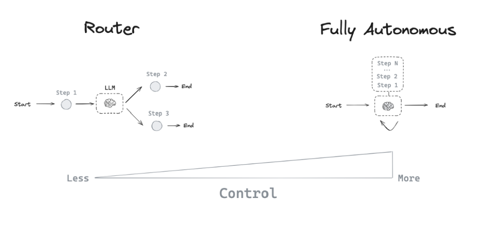
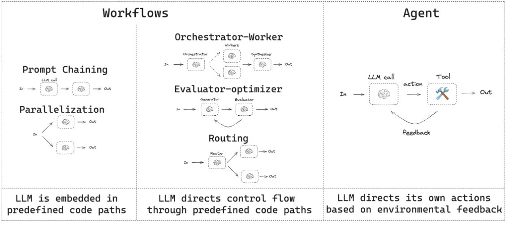
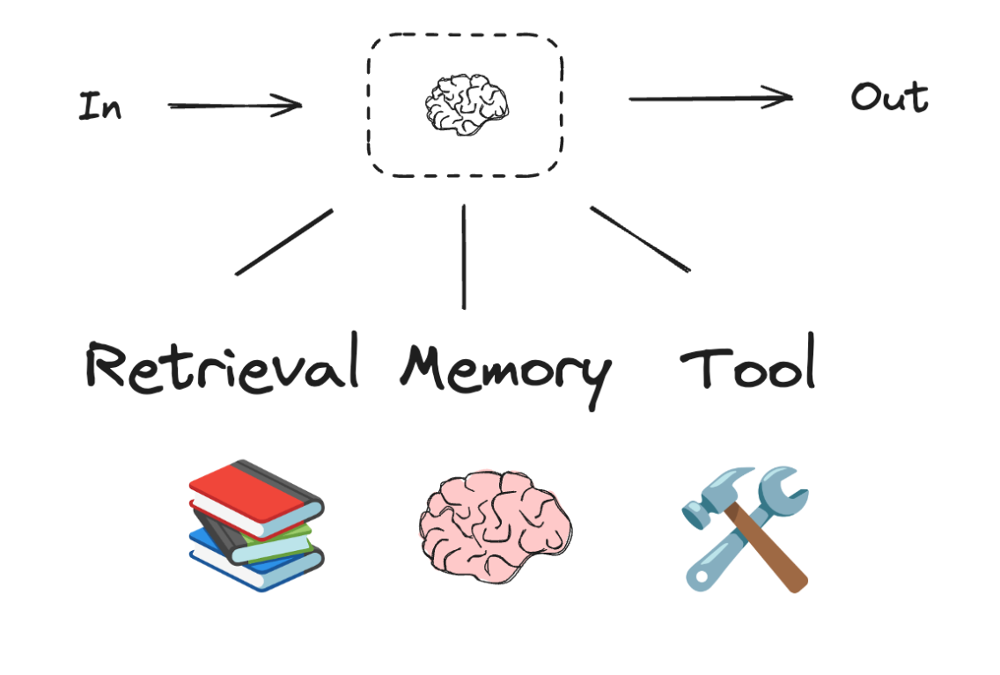
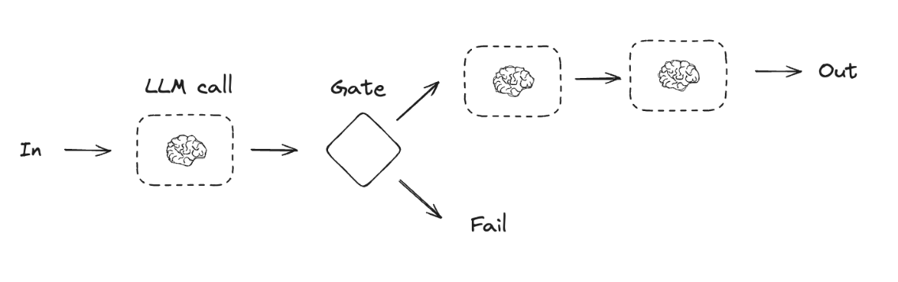
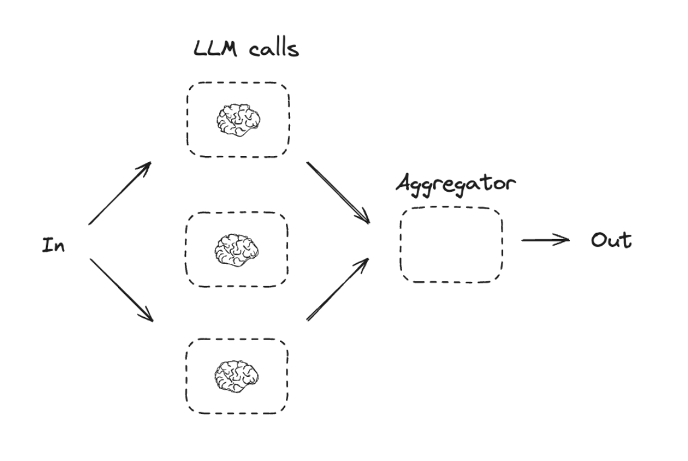
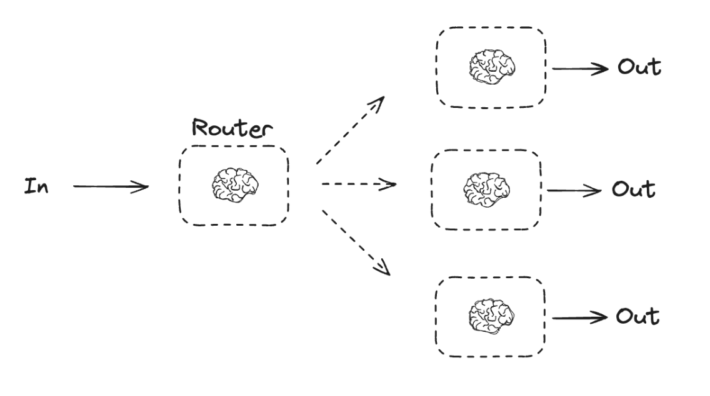
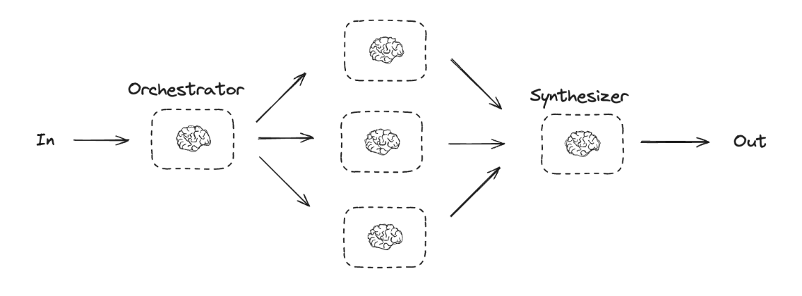
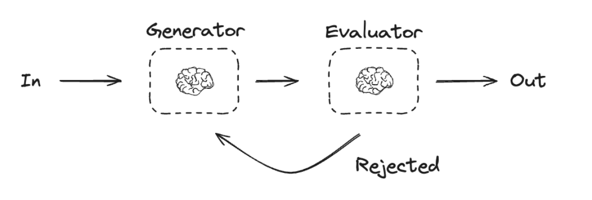
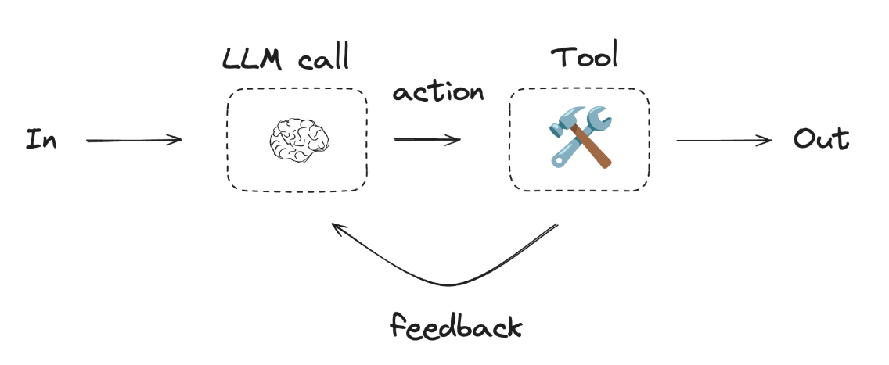

> https://zhuanlan.zhihu.com/p/1934589308813156455

> 带着反感的心态去学, 还真是, 为什么报错也不知道, 这个方法功能也不知道, 
>
> 一个chat封装成stream? 还有invoke, 还有human_message? 还有template?
>
> 那么多概念方法函数, 却都那么相似, 很明显很重复冗余啊


# **LangGraph 框架**

# 一 Agent架构介绍

## 1 概述



> router其实就是我代码写的workflow
>
> full 相当于panner?


### 1.1 工具调用agent

[ReAct](https://arxiv.org/abs/2210.03629) 是一种流行的通用代理架构，它结合了这些扩展，并整合了三个核心概念。

1. [工具调用](https://langgraph.com.cn/concepts/agentic_concepts.1.html#tool-calling)：允许 LLM 根据需要选择和使用各种工具。
2. [记忆](https://langgraph.com.cn/concepts/agentic_concepts.1.html#memory)：使代理能够保留和使用来自先前步骤的信息。
3. [规划](https://langgraph.com.cn/concepts/agentic_concepts.1.html#planning)：使 LLM 能够创建并遵循多步计划以实现目标。

#### 工具调用[¶](https://langgraph.com.cn/concepts/agentic_concepts.1.html#tool-calling)

#### 记忆

LangGraph 提供对记忆实现的完全控制：

- [`状态（State）`](https://langgraph.com.cn/concepts/low_level.1.html#state)：用户定义的模式，指定要保留的记忆的确切结构。
- [`检查点（Checkpointer）`](https://langgraph.com.cn/concepts/persistence.1.html#checkpoints)：一种机制，用于在会话内不同交互的每一步存储状态。
- [`存储（Store）`](https://langgraph.com.cn/concepts/persistence.1.html#memory-store)：一种机制，用于跨会话存储用户特定或应用程序级别的数据。


#### 规划[¶](https://langgraph.com.cn/concepts/agentic_concepts.1.html#planning)

在工具调用[代理](https://langgraph.com.cn/agents/overview.1.html#what-is-an-agent)中，LLM 在一个 while 循环中被重复调用。在每一步，代理决定要调用哪些工具以及这些工具的输入应该是什么。然后执行这些工具，并将输出作为观察结果反馈给 LLM。当代理决定它有足够的信息来解决用户请求并且不值得再调用任何工具时，while 循环终止。


### 1.2 自定义Agent架构[¶](https://langgraph.com.cn/concepts/agentic_concepts.1.html#custom-agent-architectures)

虽然路由器和工具调用代理（如 ReAct）很常见，但[定制代理架构](https://blog.langchain.ac.cn/why-you-should-outsource-your-agentic-infrastructure-but-own-your-cognitive-architecture/)通常能为特定任务带来更好的性能。LangGraph 提供了几个强大的功能来构建定制的代理系统：

#### 人机协作[¶](https://langgraph.com.cn/concepts/agentic_concepts.1.html#human-in-the-loop)

人工介入可以显著提高代理的可靠性，特别是对于敏感任务。这可能涉及：

- **批准特定行动**
- 提供反馈以更新代理状态
- 在复杂决策过程中提供指导

当完全自动化不可行或不可取时，人机协作模式至关重要。在我们的[人机协作指南](https://langgraph.com.cn/concepts/human_in_the_loop.1.html)中了解更多信息。

#### 并行化[¶](https://langgraph.com.cn/concepts/agentic_concepts.1.html#parallelization)

并行处理对于高效的多代理系统和复杂任务至关重要。LangGraph 通过其[Send](https://langgraph.com.cn/concepts/low_level.1.html#send) API 支持并行化，从而实现：

- 并发处理多个状态
- 实现类似 MapReduce 的操作
- 高效处理独立的子任务

有关实际实现，请参阅我们的[MapReduce 教程](https://langgraph.com.cn/how-tos/graph-api.1.html#map-reduce-and-the-send-api)。

#### 子图[¶](https://langgraph.com.cn/concepts/agentic_concepts.1.html#subgraphs)

[子图](https://langgraph.com.cn/concepts/subgraphs.1.html)对于管理复杂的代理架构至关重要，特别是在[多代理系统](https://langgraph.com.cn/concepts/multi_agent.1.html)中。它们允许：

- **对单个代理进行隔离的状态管理**
- 代理团队的分层组织
- 代理与主系统之间的受控通信

子图通过状态模式中的重叠键与父图进行通信。这使得灵活的模块化代理设计成为可能。有关实现细节，请参阅我们的[子图操作指南](https://langgraph.com.cn/how-tos/subgraph/index.html)。

#### 反思[¶](https://langgraph.com.cn/concepts/agentic_concepts.1.html#reflection)

反思机制可以通过以下方式显著提高代理的可靠性：

1. 评估任务完成情况和正确性
2. 提供反馈以进行迭代改进
3. 实现自我纠正和学习

虽然反思通常基于 LLM，但也可以使用确定性方法。例如，在编码任务中，编译错误可以作为反馈。这种方法在[这个使用 LangGraph 进行自我纠正代码生成的视频](https://www.youtube.com/watch?v=MvNdgmM7uyc)中得到了演示。

通过利用这些功能，LangGraph 能够创建复杂的、特定于任务的代理架构，这些架构可以处理复杂的工作流，有效协作，并持续提高其性能。


## 2 (例子)工作流与智能体[¶](https://langgraph.com.cn/tutorials/workflows/index.html#workflows-and-agents)



### 2.1 增强型RAG



### 2.2 提示链



> 提示链将任务分解为一系列步骤，其中每个 LLM 调用都会处理前一个调用的输出。


### 2.3 并行化

通过并行化，LLM 可以同时处理任务

> LLM 有时可以同时处理一个任务，并通过编程方式聚合其输出。这种工作流，即并行化，体现在两种关键变体中：**分段**：将任务分解为并行运行的独立子任务。**投票**：多次运行同一任务以获取多样化输出。



```python
# Graph state
class State(TypedDict):
    topic: str
    joke: str
    story: str
    poem: str
    combined_output: str


# Nodes
def call_llm_1(state: State):
    """First LLM call to generate initial joke"""

    msg = llm.invoke(f"Write a joke about {state['topic']}")
    return {"joke": msg.content}


def call_llm_2(state: State):
    """Second LLM call to generate story"""

    msg = llm.invoke(f"Write a story about {state['topic']}")
    return {"story": msg.content}


def call_llm_3(state: State):
    """Third LLM call to generate poem"""

    msg = llm.invoke(f"Write a poem about {state['topic']}")
    return {"poem": msg.content}


def aggregator(state: State):
    """Combine the joke and story into a single output"""

    combined = f"Here's a story, joke, and poem about {state['topic']}!\n\n"
    combined += f"STORY:\n{state['story']}\n\n"
    combined += f"JOKE:\n{state['joke']}\n\n"
    combined += f"POEM:\n{state['poem']}"
    return {"combined_output": combined}


# Build workflow
parallel_builder = StateGraph(State)

# Add nodes
parallel_builder.add_node("call_llm_1", call_llm_1)
parallel_builder.add_node("call_llm_2", call_llm_2)
parallel_builder.add_node("call_llm_3", call_llm_3)
parallel_builder.add_node("aggregator", aggregator)

# Add edges to connect nodes
parallel_builder.add_edge(START, "call_llm_1")
parallel_builder.add_edge(START, "call_llm_2")
parallel_builder.add_edge(START, "call_llm_3")
parallel_builder.add_edge("call_llm_1", "aggregator")
parallel_builder.add_edge("call_llm_2", "aggregator")
parallel_builder.add_edge("call_llm_3", "aggregator")
parallel_builder.add_edge("aggregator", END)
parallel_workflow = parallel_builder.compile()

# Show workflow
display(Image(parallel_workflow.get_graph().draw_mermaid_png()))

# Invoke
state = parallel_workflow.invoke({"topic": "cats"})
print(state["combined_output"]
```


### 2.4 路由

路由对输入进行分类，并将其导向后续任务

> 路由对输入进行分类，并将其导向专门的后续任务。此工作流允许关注点分离，并构建更专业的提示。



### 2.5 编排器-工作器

在编排器-工作器模式下，编排器将任务分解并委托给工作器。



### 2.6 评估器-优化器

在评估器-优化器工作流中，一个 LLM 调用生成响应，而另一个在循环中提供评估和反馈



### 2.7 智能体

智能体通常被实现为 LLM，它在循环中根据环境反馈执行操作（通过工具调用）。



# 二 核心概念

## 0 快速开始

### 0.1 chat


### 0.2 tools


### 0.3 memory


### 0.4 interrupt

interrupt tool

### 0.5 自定义states


### 0.6 state_history


### 0.7 完整代码

```
from typing import Annotated

from langchain_tavily import TavilySearch
from langchain_core.messages import ToolMessage
from langchain_core.tools import InjectedToolCallId, tool
from typing_extensions import TypedDict

from langgraph.checkpoint.memory import MemorySaver
from langgraph.graph import StateGraph, START, END
from langgraph.graph.message import add_messages
from langgraph.prebuilt import ToolNode, tools_condition
from langgraph.types import Command, interrupt
from langchain_openai import ChatOpenAI
import os
from dotenv import load_dotenv
load_dotenv()
TAVILY_API_KEY = os.getenv("TAVILY_API_KEY")
QWEN_API_KEY = os.getenv("QWEN_API_KEY")
BASE_URL = os.getenv("BASE_URL")
MODEL_NAME = os.getenv("MODEL_NAME")
os.environ["TAVILY_API_KEY"] = TAVILY_API_KEY
llm = ChatOpenAI(
    model=MODEL_NAME,
    api_key=QWEN_API_KEY,
    base_url=BASE_URL,
)
class State(TypedDict):
    messages: Annotated[list, add_messages]
    name: str
    birthday: str

@tool
def human_assistance(
    name: str, birthday: str, tool_call_id: Annotated[str, InjectedToolCallId]
) -> str:
    """Request assistance from a human."""
    human_response = interrupt(
        {
            "question": "Is this correct?",
            "name": name,
            "birthday": birthday,
        },
    )
    if human_response.get("correct", "").lower().startswith("y"):
        verified_name = name
        verified_birthday = birthday
        response = "Correct"
    else:
        verified_name = human_response.get("name", name)
        verified_birthday = human_response.get("birthday", birthday)
        response = f"Made a correction: {human_response}"

    state_update = {
        "name": verified_name,
        "birthday": verified_birthday,
        "messages": [ToolMessage(response, tool_call_id=tool_call_id)],
    }
    return Command(update=state_update)


tool = TavilySearch(max_results=2)
tools = [tool, human_assistance]
llm_with_tools = llm.bind_tools(tools)

def chatbot(state: State):
    message = llm_with_tools.invoke(state["messages"])
    assert(len(message.tool_calls) <= 1)
    return {"messages": [message]}

graph_builder = StateGraph(State)
graph_builder.add_node("chatbot", chatbot)

tool_node = ToolNode(tools=tools)
graph_builder.add_node("tools", tool_node)

graph_builder.add_conditional_edges(
    "chatbot",
    tools_condition,
)
graph_builder.add_edge("tools", "chatbot")
graph_builder.add_edge(START, "chatbot")

memory = MemorySaver()
graph = graph_builder.compile(checkpointer=memory)
human_command = Command(
    resume={
        "name": "LangGraph",
        "birthday": "Jan 17, 2024",
    },
)
# stream graph updates
def stream_graph_updates(user_input: str):
    config = {"configurable": {"thread_id": "cli-session"}}
    events = graph.stream(human_command, config, stream_mode="values")
    for event in events:
        if "messages" in event:
            print("Assistant:", event["messages"][-1].content)
```


## 1 图

LangGraph 的核心是将代理工作流建模为图。您可以使用三个关键组件来定义代理的行为：

1. [`State`](https://langgraph.com.cn/concepts/low_level.1.html#state)：一个共享数据结构，表示应用程序的当前快照。它可以是任何 Python 类型，但通常是 `TypedDict` 或 Pydantic `BaseModel`。
2. [`Nodes`](https://langgraph.com.cn/concepts/low_level.1.html#nodes)：编码代理逻辑的 Python 函数。它们接收当前的 `State` 作为输入，执行一些计算或副作用，并返回一个更新的 `State`。
3. [`Edges`](https://langgraph.com.cn/concepts/low_level.1.html#edges)：Python 函数，根据当前的 `State` 决定接下来执行哪个 `Node`。它们可以是条件分支或固定转换。


**`StateGraph`** : 类是主要的图类。它通过用户定义的 `State` 对象进行参数化。

**compile**: 进行一些基本检查（例如，没有孤立节点）。

### 1.1 State

State 包含图的模式以及指定如何应用状态更新的reducer 函数。

State 的模式将是**图中所有 Nodes 和 Edges 的输入模式**，可以是 TypedDict 或 Pydantic 模型。所有 Nodes 都将发出对 State 的更新，然后使用指定的 reducer 函数应用这些更新。


### 图（Graph）

LangGraph的核心是基于有向图的工作流模型。图由节点（Nodes）和边（Edges）组成，定义了工作流的结构和执行路径。

```python
from langgraph.graph import StateGraph

# 创建一个状态图
graph = StateGraph()
```

### 节点（Nodes）

节点代表工作流中的处理单元，可以是函数、LangChain组件或其他可调用对象。每个节点接收状态作为输入，并返回更新后的状态。

```python
def process_input(state):
    # 处理输入并更新状态
    return {"messages": state["messages"] + ["处理后的消息"]}

# 添加节点到图中
graph.add_node("process_input", process_input)
```

### 边（Edges）

边定义了节点之间的连接和数据流向。LangGraph支持条件边，使工作流能够根据状态动态选择执行路径。

```python
# 添加简单边
graph.add_edge("start", "process_input")

# 添加条件边
def router(state):
    if "error" in state:
        return "error_handler"
    return "normal_process"

graph.add_conditional_edges("process_input", router, {"error_handler": error_handler, "normal_process": normal_process})
```

### 状态（State）

状态是工作流执行过程中的数据容器，包含了节点间传递的所有信息。LangGraph提供了多种状态类型，支持不同的数据管理需求。

```python
from langgraph.graph import StateGraph, State

# 定义状态类型
class ChatState(State):
    messages: list
    context: dict = {}

# 使用类型化状态创建图
graph = StateGraph(ChatState)
```

### 基本工作流构建


