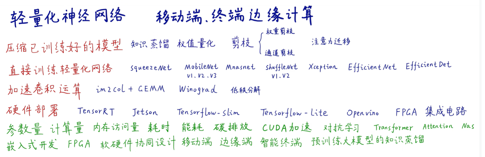
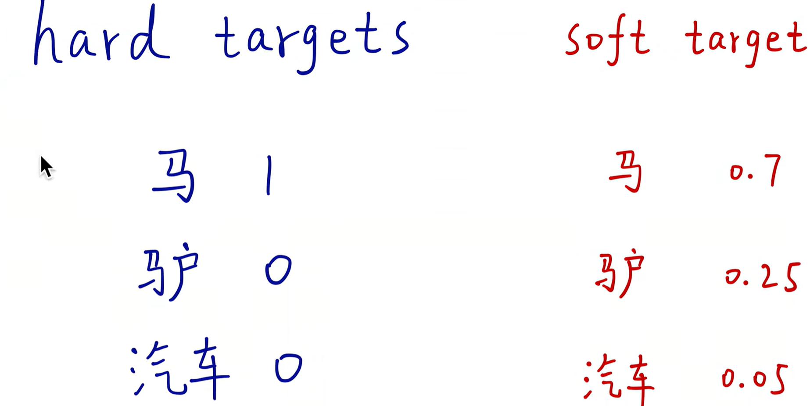
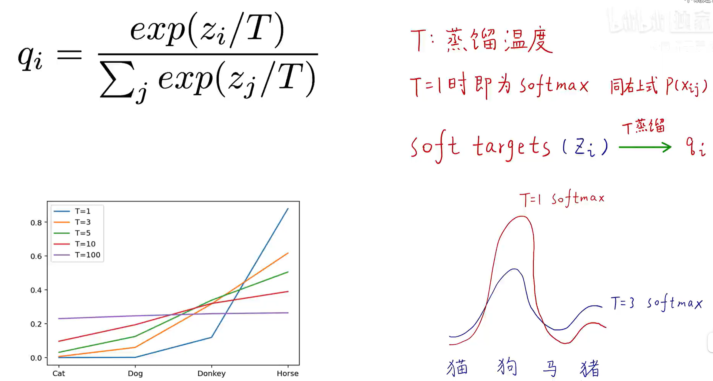
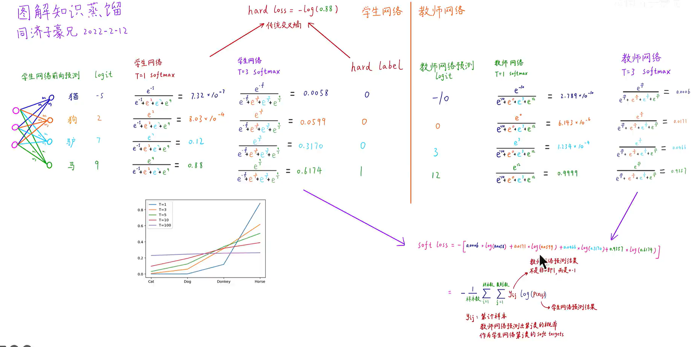
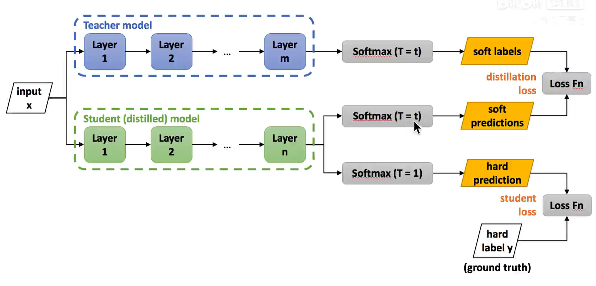

# 简介



#  知识蒸馏

## soft target



> 更多信息+ 


#### 蒸馏温度






#### 训练



# 量化


# 剪枝

## 定义

### **剪枝方法总结表**

| 剪枝方法                                       | 主要剪枝对象         | 优点                       | 缺点                             | 示例方法/应用                                                |
| ---------------------------------------------- | -------------------- | -------------------------- | -------------------------------- | ------------------------------------------------------------ |
| **权重剪枝（Weight Pruning）**                 | 单个权重             | 剪枝率高，可应用于各种网络 | 需要稀疏矩阵优化，不适合硬件加速 | TensorFlow `tf.sparsity`, PyTorch `torch.nn.utils.prune`     |
| **结构化剪枝（Structured Pruning）**           | 神经元、通道、卷积核 | 适合硬件加速               | 剪枝率受限，可能影响模型结构     | `Channel Pruning`, `Filter Pruning`                          |
| **低秩分解剪枝（Low-Rank Approximation）**     | 整体权重矩阵         | 计算加速明显               | 需要额外的分解计算               | SVD 分解, CP 分解, Tensor Train 分解                         |
| **剪枝 + 训练（Prune and Fine-tune）**         | 结合剪枝和微调       | 可恢复精度                 | 训练时间增加                     | 迭代剪枝（Iterative Pruning）, 一次性剪枝（One-shot Pruning） |
| **软剪枝（Soft Pruning）**                     | 权重                 | 更温和的剪枝方式           | 需要更多训练步骤                 | 逐步缩小权重（Weight Decay），平滑剪枝（Gradual Magnitude Pruning） |
| **剪枝 + 蒸馏（Pruning with Distillation）**   | 剪枝后蒸馏           | 精度损失小                 | 需要额外教师模型                 | `Knowledge Distillation (KD)`, MobileBERT, TinyBERT          |
| **幸运票剪枝（Lottery Ticket Hypothesis）**    | 子网络               | 保留重要子结构             | 训练步骤复杂                     | 训练大模型后剪枝，重新初始化训练                             |
| **正则化剪枝（Regularization-based Pruning）** | L1/L2 约束           | 无需额外剪枝步骤           | 训练需额外超参数                 | `L1 Regularization`, `Group Lasso Pruning`                   |
| **动态剪枝（Movement Pruning）**               | Transformer 模型     | 适合 NLP                   | 计算复杂度高                     | `BERT Pruning`, `MobileBERT`                                 |
| **自动剪枝（AutoML Pruning）**                 | NAS/强化学习         | 自动优化                   | 计算成本高                       | `AMC (AutoML for Model Compression)`, `Meta-Pruning`         |


- **非结构化剪枝（Unstructured Pruning）**：直接删除模型中的某些参数，通常基于参数的绝对值大小。这种方法可以实现较高的压缩比，但可能会破坏模型的整体结构。

```
# 应用权重剪枝
def apply_pruning(model, amount=0.2):
    for name, module in model.named_modules():
        if isinstance(module, nn.Conv2d) or isinstance(module, nn.Linear):
            prune.l1_unstructured(module, name='weight', amount=amount)
            print(f"Applied pruning on {name}")
```

- **结构化剪枝（Structured Pruning）**：删除模型中的特定结构单元，如滤波器、通道或层。这种方法不会破坏模型的整体结构，更适合硬件加速。

```
threshold = 0.01
for name, module in model.named_modules():
    if isinstance(module, nn.Conv2d):
        # 计算每个卷积核的L2范数
        kernel_norms = torch.norm(module.weight, dim=(1, 2, 3))
        # 找到小于阈值的卷积核索引
        prune_indices = torch.where(kernel_norms < threshold)[0]
        # 将这些卷积核的权重置零
        module.weight[prune_indices] = 0
```

- ####  **基于梯度的剪枝**

```
import torch

def gradient_magnitude_pruning(weight, gradient, percentile=0.5):
    """基于梯度幅值剪枝权重"""
    num_zeros = round(weight.numel() * percentile)  # 计算剪枝元素数量
    threshold = gradient.abs().view(-1).kthvalue(num_zeros).values  # 计算剪枝阈值
    mask = gradient.abs() > threshold  # 生成掩码
    weight.mul_(mask.to(weight.device))  # 应用掩码剪枝
    return weight

```


# 注意力迁移

 https://github.com/szagoruyko/attention-transfer?tab=readme-ov-file

## 定义

- 注意力迁移的思想来源于知识蒸馏，但与**传统知识蒸馏主要关注最后层的知识不同，注意力迁移关注训练过程中特征图中的知识**。
- 其目的是通过将教师网络的注意力图迁移到学生网络，提升学生网络的性能，同时实现模型的轻量化。

## 注意力机制

- **空间域（Spatial Domain）**：关注特征空间信息，决定空间中哪些区域重要。例如，通过动态注意力机制来选择性地关注图像中的特定区域。
- **通道域（Channel Domain）**：关注通道信息，如Squeeze-and-Excitation Networks（SENet）。SENet通过全局平均池化、降维再升维的方式为通道分配权重，增强重要通道的特征。
- **混合域（Mixed Domain）**：同时关注空间域和通道域，如CBAM等注意力机制，综合考虑特征空间和通道信息来生成注意力图。

## 算法部分

- **基于激活的注意力迁移（Activation-based Attention Transfer）**：
  - 在前馈过程中，通过教师网络的激活特征图来引导学生网络的学习。
  - 教师网络的激活特征图反映了输入数据在不同区域的重要性，**学生网络通过模仿这些激活特征图**来学习关注重要的区域。
- **基于梯度的注意力迁移（Gradient-based Attention Transfer）**：
  - 在反馈过程中，对教师网络和学生网络的交叉熵损失函数分别求梯度，**将教师网络的梯度作为注意力图转移到学生网络**。
  - 关注那些对输出影响大的区域，通过构造损失函数，使得学生网络的梯度注意力图与教师网络的梯度注意力图接近，从而实现知识的迁移。


# 低秩分解


# 轻量化网络结构


