# LCNet

> CPU端的最强轻量型架构

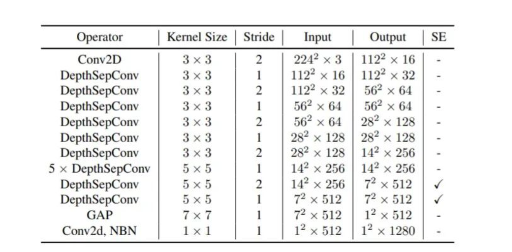

### 主要解决方案：

1. 采用H-Swish作为激活函数，性能大幅提升，而推理速度几乎不变。
2. 在网络合适的位置添加少量的SE模块可以进一步提升模型性能；实验表明：当把SE置于模型的尾部时，它具有更好的效果。因此，我们仅将SE模块添加到接近网络尾部的模块即可, 这种处理方式具有更好的精度-速度平衡。
3. 根据MixNet的实验论证结果:在一定范围内大的卷积核可以提升模型的性能，但是超过这个范围会有损模型的性能。本文通过实验总结了一些更大的卷积核在不同位置的作用，类似SE模块的位置，更大的卷积核在网络的中后部作用更明显。比如5x5卷积。
4. GAP后使用更大的1x1卷积层；在GoogLeNet之后，GAP（Global-Average-Pooling）后往往直接接分类层，但是在轻量级网络中，这样会导致GAP后提取的特征没有得到进一步的融合和加工。如果在此后使用一个更大的1x1卷积层（等同于FC层），GAP后的特征便不会直接经过分类层，而是先进行了融合，并将融合的特征进行分类。这样可以在不影响模型推理速度的同时大大提升准确率。
5. 使用dropout技术可以进一步提升模型的精度。

**低秩卷积的引入**：

- 低秩卷积的引入是 LCNet 的最大创新之一。通过矩阵低秩分解，LCNet 能够将卷积操作的计算复杂度降到最低，从而显著减少了卷积神经网络的计算负担和内存消耗。

**高效的通道剪枝**：

- LCNet 提出了通道剪枝的概念，即对卷积层中的不重要通道进行剪枝，减少冗余计算。这个过程通过分析每个通道的贡献，剔除那些对最终输出没有显著影响的通道，从而大幅减小模型的规模。

**集成深度可分离卷积**：

- 深度可分离卷积已经被证明是提升计算效率的一种有效手段，LCNet 将其应用到各个卷积层中，通过拆解卷积操作来减少计算量和参数量，提高了模型的运行效率。

**硬件友好设计**：

- LCNet 强调了硬件友好的设计理念，特别是在移动设备和嵌入式设备上。网络架构通过采用低计算量的卷积和模块化设计，使得 LCNet 在计算资源受限的设备上表现更好。

**优化的注意力机制**：

- LCNet 在设计中还结合了高效的注意力机制，通过优化网络对输入信息的加权方式，使得网络能够更好地关注到重要特征，从而提升分类性能，同时保持较低的计算开销。


# SqueezeNet

## Fire Module

**Fire Module**：每个 Fire Module 由两个主要部分组成：

- **Squeeze层**：一个1x1的卷积层，用来减少特征图的深度。
- **Expand层**：两个分支，一个是1x1卷积，另一个是3x3卷积，用来增加特征图的深度。

通过这种结构，SqueezeNet能够有效地减少参数量，而不牺牲太多的准确度。

**减少全连接层的参数**：SqueezeNet中没有传统的全连接层，而是使用全局平均池化（Global Average Pooling）来替代。这样大大减少了参数数量，且仍然保留了模型的表现力。

```
torch.cat([x1, x2], 1)
```


# [MobileNet][https://blog.csdn.net/qq_37555071/article/details/108393809]

## 深度可分离卷积(Depthwise Separable Convolutions)

（Depthwise Separable Convolutions）

**深度卷积（Depthwise Convolution）**：对每个输入通道独立进行卷积操作，而不是像传统卷积那样对所有通道进行卷积。这大大减少了计算量。

**逐点卷积（Pointwise Convolution）**：即1x1卷积，用于将深度卷积的输出进行线性组合，融合通道信息。


**宽度和分辨率的可调性**： MobileNet引入了两个超参数，分别是**宽度系数（Width Multiplier）\**和\**分辨率系数（Resolution Multiplier）**，使得网络的大小和计算量可以根据实际需求进行调整。

- **宽度系数（α）**：用于控制网络每一层的通道数。通过减小α的值，可以降低网络的复杂度和参数数量。
- **分辨率系数（ρ）**：用于控制输入图像的分辨率，通过减小分辨率来减少计算量。


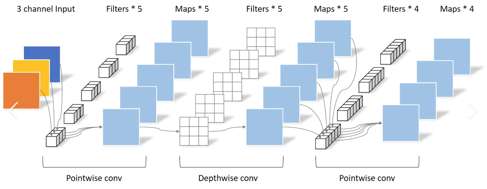


```python
self.depthwise = nn.Conv2d(in_channels, in_channels, kernel_size=3, stride=stride, padding=1, groups=in_channels, bias=False)
// groups=in_channels
```


# ShuffleNet 

 **深度可分离卷积（Depthwise Separable Convolution） 和**

##  **通道混洗（Channel Shuffle）**

通道混洗技术会在**每个卷积层的输出中打乱通道的顺序**，使得不同通道的特征能够进行更好的融合，从而提高模型的表达能力和准确率。

## **分组卷积（Grouped Convolution）**

为了进一步提高网络的计算效率，ShuffleNet 采用了 **分组卷积（Grouped Convolution）**。分组卷积将输入通道分成多个组，每个组内的通道与一个独立的卷积核进行卷积，从而减少了卷积运算的计算量。


# GoogLeNet 

## Inception块

各种模块全都要

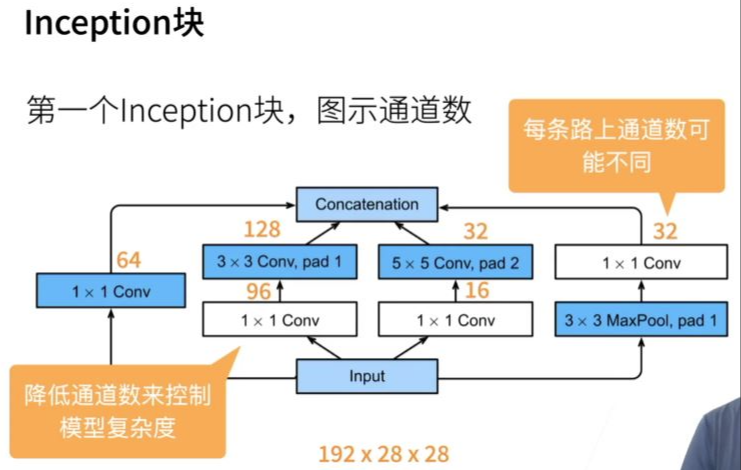

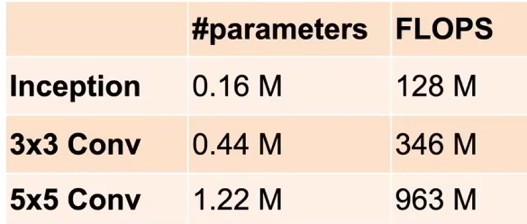

##  **Xception 块**

极限情况


# EfficientNet 

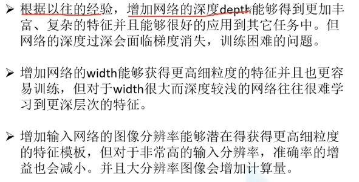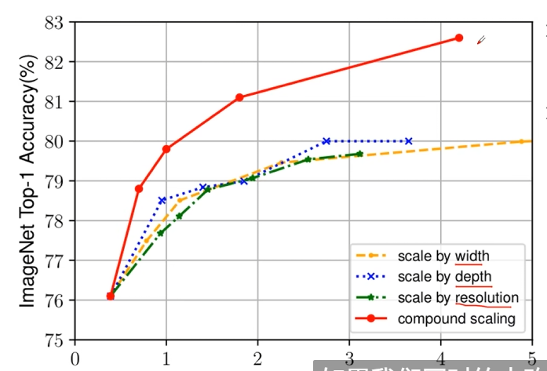

## 原理

### **网络架构搜索（NAS）**：

- EfficientNet 使用了 **神经架构搜索**（NAS）来自动化地找到最适合的卷积神经网络架构。在这个过程中，作者通过 NAS 来寻找一个 **基础架构**，该架构在计算效率和性能之间取得了最佳的平衡。

### **优化网络的宽度、深度和分辨率**：

- EfficientNet 在进行网络扩展时，并不是简单地增加网络的层数或通道数，而是采用了更加 **均衡的增长策略**。通过在深度、宽度和输入图像分辨率上都进行扩展，模型能够获得更强的表达能力，同时保持较低的计算成本。

### **高效的卷积操作**：

- EfficientNet 采用了高效的卷积操作，如 **Depthwise Separable Convolution**，以进一步减少计算量。


通过结构搜索（NAS, Neural Architecture Search）和优化策略，在精度和计算效率之间找到最好的平衡。


## MBConv/EfficientNet块

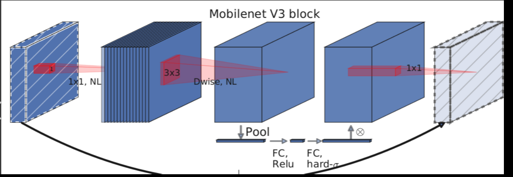

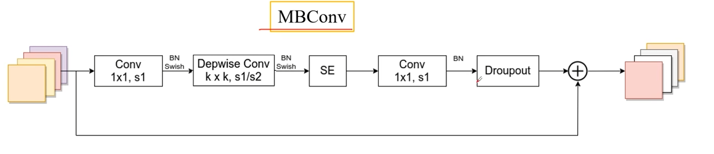


### 倒残差结构（Inverted Residuals)


>  使用逐通道卷积和逐点卷积来提高计算效率。


## 注意力机制

### SE模块（Squeeze-and-Excitation Block）

来源于人类视觉系统中的注意机制：大脑会根据不同的视觉刺激，**自动聚焦于最重要的信息，并忽略不相关的部分**。SE模块通过类似的机制，**自动为每个通道分配不同的重要性**，从而增强模型对重要特征的敏感度。

- **queeze-and-Excitation**（SE）模块，提升了特征通道之间的依赖关系.仅在 **通道维度** 上进行加权

- 通过一个 **“Squeeze”** 操作来压缩空间维度信息，再通过 **“Excitation”** 操作生成通道权重

**Squeeze（压缩）**：

- 输入是一个 **H×W×C** 的特征图，其中 H和 W 分别是空间维度的高度和宽度，C 是通道数。
- **通过全局平均池化**（Global Average Pooling）对每个通道进行压缩。即对每个通道的空间维度（H×W）求平均，得到一个 **C** 维的向量，表示每个通道的“全局特征”。

**Excitation（激励）**：

- 对通道的全局特征向量进行**两层全连接层操作**，其中第二层是激活函数（通常是 **Sigmoid**），生成每个通道的 **注意力系数**。
- 第一个全连接层是 **瓶颈层（bottleneck layer）**，通常通过降低维度来减少计算量。然后通过第二个全连接层，将输出恢复到原始通道数，得到每个通道的权重。

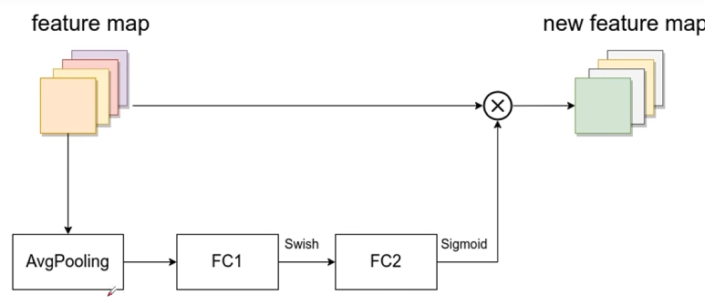

```python
def _make_se_block(self, channels, se_ratio):
        reduction = int(channels * se_ratio)
        return nn.Sequential(
            nn.AdaptiveAvgPool2d(1),
            nn.Conv2d(channels, reduction, kernel_size=1),
            nn.ReLU(),
            nn.Conv2d(reduction, channels, kernel_size=1),
            nn.Sigmoid()
        )
```


#### 空间注意力机制

对特征图的**每个位置**分配一个权重来决定哪些空间区域应该被网络更多关注

> 人类的视觉注意力更多的是**空间注意力**，也就是对图片上不同区域赋予不同的权重

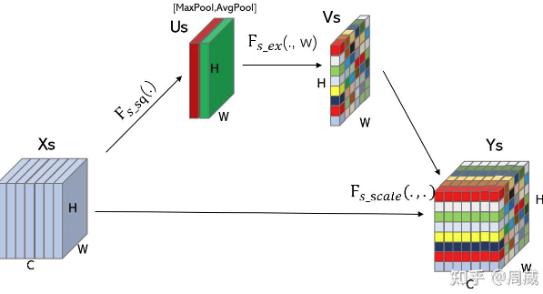

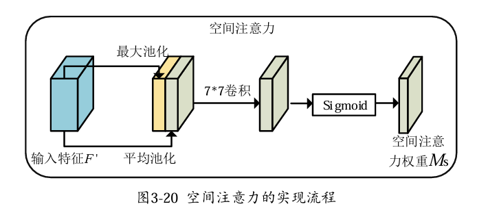


#### 通道注意力机制

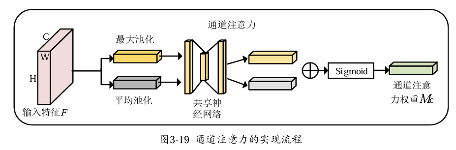


####  CBAM注意力

CBAM 通过融合 **通道注意力机制** 和 **空间注意力机制**


#### 视觉自注意力(Non Local))

用来在不引入过多计算量的基础上提高CNN网络的**远程依赖**


> 我可能先识别到篮球，然后在其周围找到人和篮筐，并根据他们的位置我们才能判断这个图是不是表达人在灌篮这个动作。其中，篮球位置可以理解为**查询点**，周边（可能离得较远）的人和篮筐就是**查询点对应的关联区域**。

查询点到关联区域的对应可以加深CNN网络对场景**从局部到整体**的理解，因此可以有效提高CNN网络在视觉任务的效率。

- 该模块建立了图像中**每个像素/区域之间的关联**，有效提升了CNN网络的感受野

- 对每个空间位置生成与所有其他位置的**相似度**。

- 基于**相似度进行加权**，使得每个位置可以融合其他位置的信息。

  

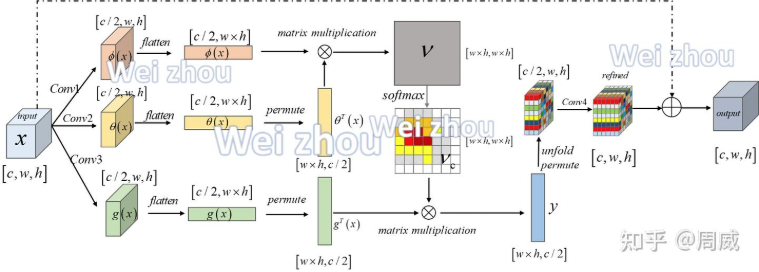

> 其大概的运算过程是：
>
> （1）为了降低运算量，采用三个不同1x1卷积层进行维度减半，即图上的 x→ϕ(x),θ(x),g(x) ;
>
> （2）为 ϕ(x),θ(x),g(x) 按照w,h维度进行铺平，即图上三个flatten；
>
> （3）利用铺平的 ϕ(x),θ(x) 进行矩阵乘法运算，并通过softmax获得各空间位置之间的**关联图**（即图中的 vc ），很明显这个关联图的大小为 (w×h,w×h) ，表征着各个像素点（区域）之间的联系；
>
> （4）将铺平转置的 g(x) 与vc进行矩阵乘法，获得 y ；
>
> （5）对y进行展开与特征提取（Conv4），获得注意力（refined）;
>
> （6）利用注意力调整原始输入的分布，Over!!!
>
> https://zhuanlan.zhihu.com/p/350760243


#### Non Local改进版 — GCNet

原因:**不同查询点（区域）居然对应相同的attention map**


与查询（点）无关的依赖（query-independent dependency）。那么这是否意味着原始Non Local中**query分支可以剪去不要**呢


### DFC 注意力模块

利用固定权重的全连接层来创建具有全局感受野的注意力图，以捕 获长距离空间位置的依赖关系


# EfficientDet 

## **结构概述**

### 1 Backbone（EfficientNet）

- EfficientDet 的 backbone 使用了 EfficientNet 作为特征提取器。EfficientNet 是一种使用**复合缩放**策略的高效网络，在目标检测任务中，EfficientDet 对 EfficientNet 进行调整和优化，使得其能更好地适应目标检测的要求。

BiFPN（双向特征金字塔网络）**
- BiFPN 通过对低层和高层特征的加权融合，使得低层和高层的特征能够互相补充，提升了多尺度特征的利用率。


### 2 Head

- **分类头**：用于对目标进行分类，预测每个框的类别。
- **回归头**：用于回归目标的边界框坐标。


### 3 复合缩放

- EfficientDet 通过复合缩放策略调整模型的深度、宽度和输入分辨率，使得模型可以在不同的硬件环境下进行灵活的调整，同时提升了精度和效率。


## FPN.到BiFPN

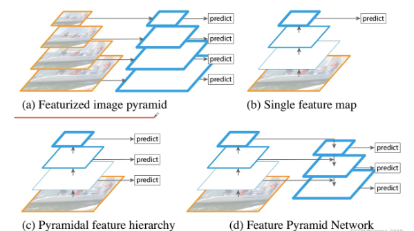

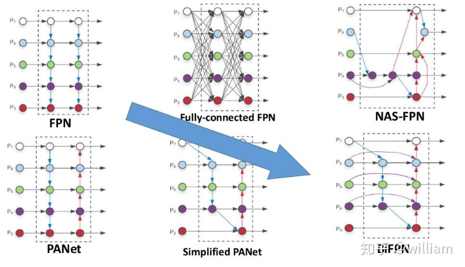


> a. 网络只是针对某一特点的分辨率进行训练, 如果只是在测试和推理阶段使用图像金字塔的话, 可能导致训练和测试推理过程不匹配
>
> b. 利用单个高层特征图(主干网络产生)进行物体的分类和bounding box的回归
>
> c. 在 **多个不同尺度的特征图（如 38×38、19×19、10×10）** 上直接预测目标框。
>
> d 尽管在SSD中我们已经使用了特征金字塔, 但该金字塔中的所有要素都处于不同的比例, 并且由于网络中层的深度不同而存在巨大的语义鸿沟. 高分辨率地图具有低级语义特征, 而低分辨率地图具有较高的语义特征, 这会损害其对象识别的表示能力.


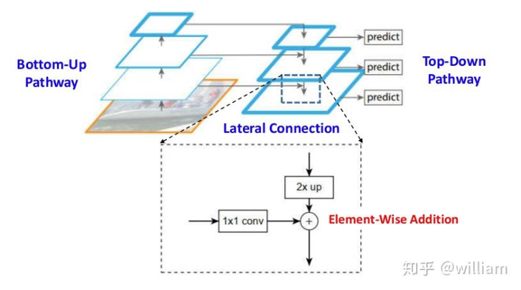

> 先对高阶特征进行上采样, 然后使用横向连接将其与低阶特征进行组合, 该横向连接基本上是1x1卷积, 然后进行求和,


### Fully connected FPN and NAS-FPN

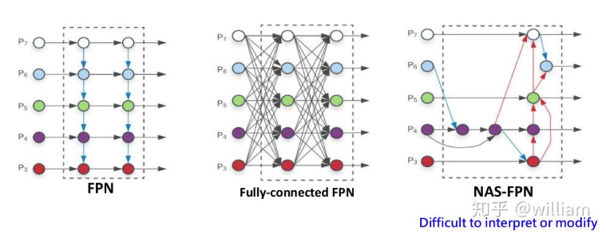

> a. 传统fpn
>
> b. 全连接网络
>
> c. NAS


### PANet

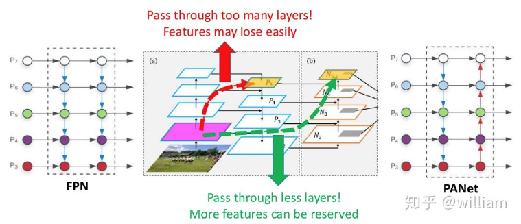

>添加**自下而上的路径**以增强FPN中的自上而下的路径


### Simplified FPN and BiFPN


> a. 如果一个节点只有一个输入边并且没有特征融合, 那么它对特征网络的融合贡献较小, 这个节点可以删除(Simplified PANET)
>
> b. 添加一条额外的连接路径,融合更多功能(BiFPN). 这点其实跟skip connection很相似
>
> c. 重复叠加相同的特征网络层 复合缩放


## 权重计算

快速归一化融合特征网络.计算路径,计算出不同特征节点的输入最合适的权值


## Compound Scaling

复合缩放的目标是在任何给定的资源约束下最大化模型精度, 因此可以表述为优化问题.

**对网络深度、宽度和分辨率中的任何尺度进行缩放都可以提高精度, 但是当模型足够大时, 这种放大的收益会减弱。**


**FLOPS**是floating point operations per second的缩写, 意指每秒浮点运算次数, 理解为计算速度. 是一个衡量硬件性能的指标. 我们假设我们能使用的FLOPS是2.


> a. 对于网络模型depth来说, 加倍深度会使得FLOPS加倍.


> b. 对于网络模型width来说, 由于width(#channel)的增加导致卷积计算的路径平方级增加, 因此加倍宽度会使得FLOPS加4倍.


> c. 对于网络模型resolution来说, 和width的情况一样, 由于resolution的增加会导致feather map呈现平方级扩张, 因此加倍图像分辨率也会使得FLOPS加4倍.


**复合缩放公式:**

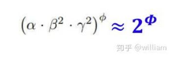

**网格搜索**

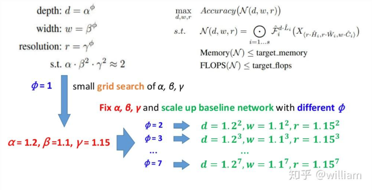

**复合缩放的总结图:**

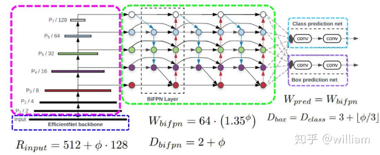


# GhostNet

特征图存在**冗余性** 廉价操作 生成 Ghost 特征图


## 原理


## Ghost 卷积

利用计算量较低的线性操作来增加特征图的数量， 从而在保持输出特征图不变的同时，显著地降低了计算复杂度

1. 使用1×1卷积对输入特征进行压缩，以获取少量特征图
2. 这部分特征图通过线性变换生成另一部分特征图
3. 将两部分特征图进行拼接，形 成最终的输出特征图

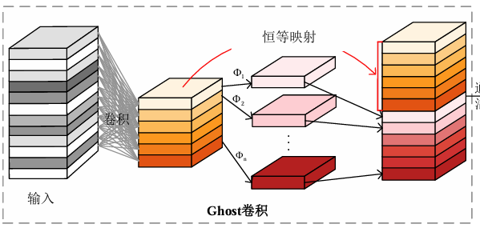


# MobileViT

**融合 CNN 和 Transformer**：通过将卷积操作与 Transformer 结合，模型能够同时捕捉局部和全局特征，提高了特征表达能力。

**高效的特征处理**：通过**展开和折叠操作**(unfold )，将特征映射到序列空间进行处理，然后再映射回原始空间，实现了高效的特征处理。


**模型图：**

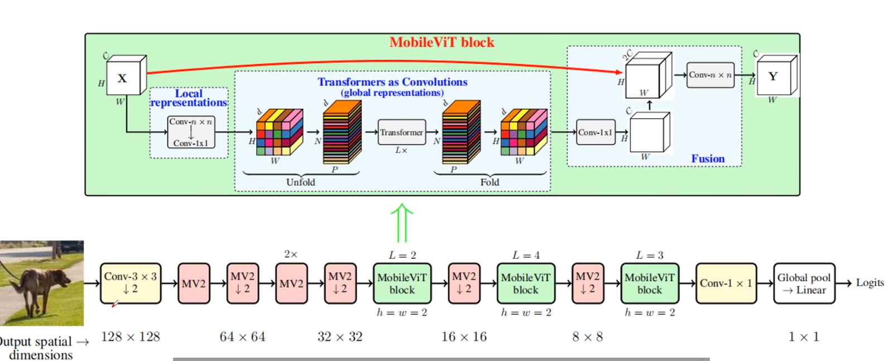


## Mobile ViT 块

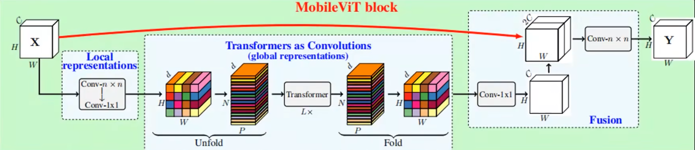

> ..


减少self-attention

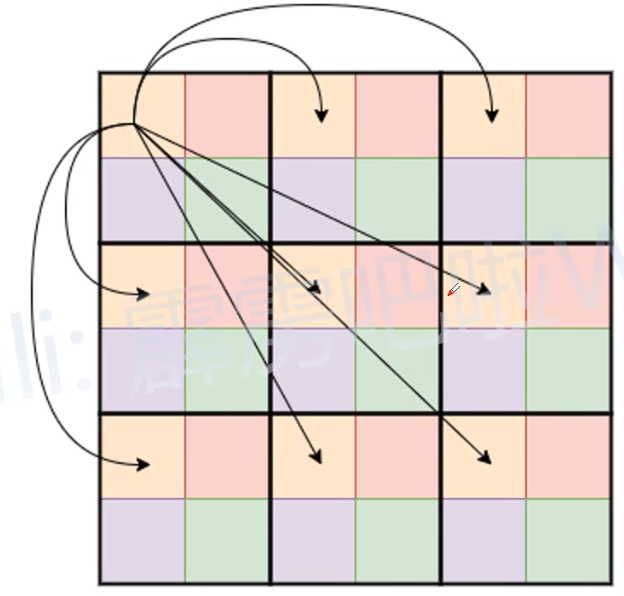 

> 冗余信息多,相邻token信息差异小


### fold

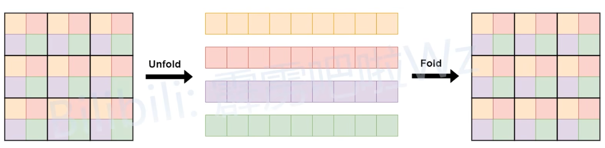


# [EMO：结合 CNN 和 Transformer][https://developer.aliyun.com/article/1210407]


### 1. 特征提取网络（SD-Ghostnet）

- **输入图像**：原始图像作为输入。
- **Conv(64,6,2,2)**：首先通过一个卷积层，输出通道数为64，核大小为6x6，步长为2，填充为2。
- **S-GhostConv (128,3,2)** 和 **SD-Ghost(128)**：经过一系列的S-GhostConv和SD-Ghost模块，逐步增加通道数到128。
- **S-GhostConv (256,3,2)** 和 **SD-Ghost(256)**：进一步通过S-GhostConv和SD-Ghost模块，通道数增加到256。
- **S-GhostConv (512,3,2)** 和 **SD-Ghost(512)**：继续通过S-GhostConv和SD-Ghost模块，通道数增加到512。
- **S-GhostConv (1024,3,2)** 和 **SD-Ghost(1024)**：最后通过S-GhostConv和SD-Ghost模块，通道数增加到1024。
- **SPPF(1024,5)**：空间金字塔池化模块，进一步增强特征表示。

### 2. 特征融合网络（FFN）

- **Concat(512)**：将特征提取网络中不同层次的特征进行拼接，形成512通道的特征图。
- **Upsample(256)**：对特征图进行上采样，通道数减少到256。
- **GSCovn (256,1,1)**：通过一个1x1的卷积层调整通道数。
- **VOVGSCSP (256)**：通过VOVGSCSP模块进一步处理特征。
- **GSCovn (256,3,2)**：通过一个1x1的卷积层调整通道数。
- **Concat(512)**：再次拼接特征，形成512通道的特征图。
- **VOVGSCSP (512)**：通过VOVGSCSP模块进一步处理特征。
- **GSCovn (512,3,2)**：通过一个1x1的卷积层调整通道数。
- **Concat(1024)**：再次拼接特征，形成1024通道的特征图。
- **VOVGSCSP (1024)**：通过VOVGSCSP模块进一步处理特征。

### 3. 多尺度检测网络（MDN）

- **CBAM (256)**：通过CBAM注意力机制模块，增强特征表示。
- **Conv2d (256)**：通过一个卷积层，输出通道数为256。
- **CBAM (512)**：通过CBAM注意力机制模块，增强特征表示。
- **Conv2d (512)**：通过一个卷积层，输出通道数为512。
- **CBAM (1024)**：通过CBAM注意力机制模块，增强特征表示。
- **Conv2d (1024)**：通过一个卷积层，输出通道数为1024。
- **输出图像**：最终生成输出图像。
