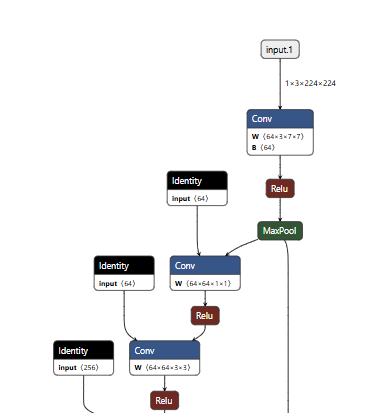

- 


## 导出报错

Unsupported: ONNX export of convolution for kernel of unknown shape”，这通常与动态形状或无法推断的卷积核尺寸有

1. 静态化Reshape操作

2. 修复多级融合的TracerWarning fused_cls = sum(w * c for w, c in zip(weights_cls, preds_cls)) 

   `sum(w * c for w, c in zip(...))`中的迭代操作会被PyTorch的JIT Tracer识别为动态控制流，导致ONNX导出时无法生成静态计算图。这种Python层的迭代操作在模型跟踪阶段会被视为潜在动态行为，从而触发TracerWarning


### 2 ImportError: DLL load failed while importing onnx_cpp2py_export: 动态链接库(DLL)初始化例程失败。

> 重新安装 onnx


## 结构报错

```

```

### 1 为什么导出的onnx会有那么多Identity，这是什么，怎么消除



1. **数据传递占位符** Identity节点的核心功能是将输入张量原样输出，不进行任何计算 
2. **框架转换机制缺陷** 
3. **自定义算子副作用**
