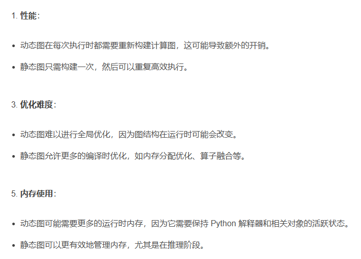
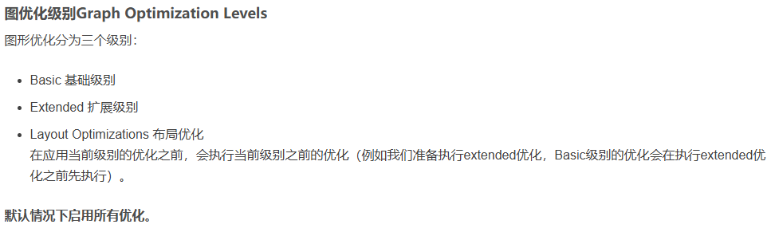
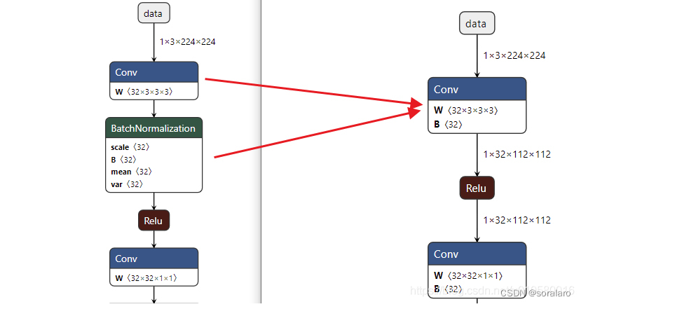

# 图优化

### 1 

**引擎能够针对特定硬件进行深度优化，实现最佳的性能和效率**

### 3 查看netron节点

 ONNX的optimizer模块提供部分图优化的功能，例如最常用的：fuse_bn_into_conv，fuse_pad_into_conv等等。

### 2. 为什么需要forward_fuse？

- forward_fuse通常用于把卷积和BN层合并，或者把多个卷积分支合并，减少计算量，提高推理速度。

- 如果你的模块没有BN层，或者结构很简单，不需要合并，也应该定义一个forward_fuse，让它和forward一样。

### `4 onnxslim` 模块未安装，简化失败

#### ✅ 简化 ONNX 的主要作用：

| 好处             | 描述                                                     |
| ---------------- | -------------------------------------------------------- |
| 📦 减少模型大小   | 去除冗余算子与中间变量，减小 `.onnx` 文件大小            |
| 🚀 加速推理速度   | 简化计算图后，ONNX Runtime / TensorRT 推理更快           |
| 🔧 提高兼容性     | 某些部署平台（如 OpenVINO、MNN）对简化后的模型兼容性更强 |
| 🧩 易于可视化分析 | 模型结构更清晰，利于在 Netron 中查看和理解               |
