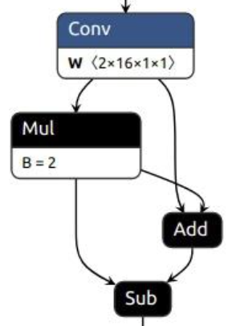

参考：https://blog.csdn.net/zhaoyqcsdn/article/details/135512992、


# 1 算子不兼容

onnx算子是否支持
https://github.com/onnx/onnx/blob/main/docs/Operators.md

## 1.1 pytorch中有，onnx中也有的算子


## 1.2 pytorch中有，onnx中无的算子

继承`torch.autograd.Function`实现自定义算子

### **1 案例示例**： `Focus`层的切片操作

>  通过其他变换来改成兼容的算子

在目标检测项目中，将PyTorch训练的YOLOv5模型转换为ONNX时，需处理`Focus`层的切片操作兼容性问题，通过重构为`Conv`层解决，将size减少一半通道数增加一倍


### 2 **实际案例：动态切片问题**	

静态图无法处理随机性

```
# 原始PyTorch代码（无法导出）
x_slice = x[:, :, start_idx:start_idx+10]

# 修改为ONNX兼容方式
indices = torch.arange(start_idx, start_idx+10, device=x.device)
x_slice = torch.index_select(x, dim=2, index=indices)
```


### 3 案例示例：创建新的算子 手动实现

> 使用支持的操作来手动实现算子

- ****：部分框架特定操作（如PyTorch自定义层）需替换为ONNX标准算子或自定义实现。

  ```python
  import torch
  import torch.onnx
  from torch.onnx import register_custom_op_symbolic
  
  # 1. 定义自定义算子
  class CustomRelu(torch.autograd.Function):
      @staticmethod
      def forward(ctx, input):
          """前向传播：自定义的ReLU操作"""
          ctx.save_for_backward(input)
          return torch.maximum(input, torch.tensor(0.5))  # 比普通ReLU多了一个偏移
  
      @staticmethod
      def backward(ctx, grad_output):
          """反向传播：ReLU的梯度计算"""
          input, = ctx.saved_tensors
          grad_input = grad_output.clone()
          grad_input[input < 0.5] = 0  # 低于0.5的部分梯度置零
          return grad_input
  
  # 2. 创建 ONNX 计算图中的算子
  def symbolic_custom_relu(g, input):
      """定义 ONNX 计算图中的 custom_relu"""
      return g.op("custom_domain::CustomRelu", input)
  
  # 3. 绑定 ONNX 导出
  register_custom_op_symbolic("::CustomRelu", symbolic_custom_relu, 11)
  
  # 4. 使用自定义算子
  class CustomModel(torch.nn.Module):
      def forward(self, x):
          return CustomRelu.apply(x)
  
  # 5. 实例化模型
  model = CustomModel()
  x = torch.randn(1, 3, 224, 224)
  
  # 6. 导出为 ONNX（确保 opset 版本支持）
  torch.onnx.export(
      model, x, "custom_relu.onnx",
      opset_version=11,
      verbose=True,
      operator_export_type=torch.onnx.OperatorExportTypes.ONNX
  )
  ```


## **问题**：动态Batch或可变输入尺寸导致转换失败。

```
torch.onnx.export(
    model, dummy_input, "yolov5_dynamic.onnx",
    opset_version=11,
    input_names=["input"], output_names=["output"],
    dynamic_axes={
        "input": {0: "batch_size"},   # 让 input 的 batch 维度 (dim=0) 变为动态
        "output": {0: "batch_size"}   # 让 output 的 batch 维度 (dim=0) 变为动态
    }
)
```


# 2 写占位符号替换乱七八糟的算子


 


## 代码怎么写

### TODO
