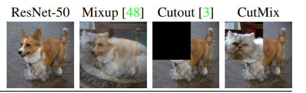
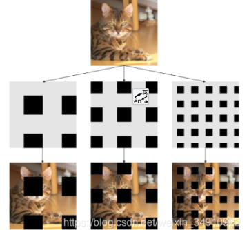
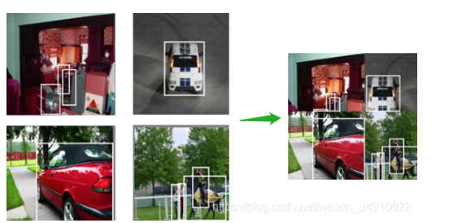
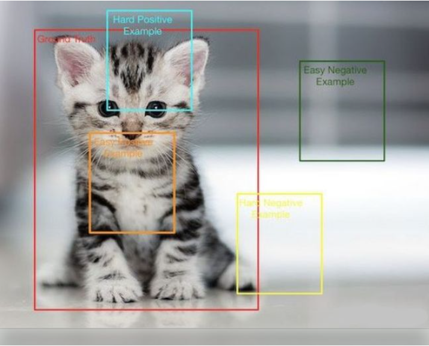

# 数据预处理

## 数据增强方法

### 1 数据增强的作用

 1） 避免过拟合。当数据集具有某种明显的特征，例如数据集中图片基本在同一个场景中拍摄，使用Cutout方法和风格迁移变化等相关方法可避免模型学到跟目标无关的信息。

2）提升模型鲁棒性，降低模型对图像的敏感度。当训练数据都属于比较理想的状态，碰到一些特殊情况，如遮挡，亮度，模糊等情况容易识别错误，对训练数据加上噪声，掩码等方法可提升模型鲁棒性。

3）增加训练数据，提高模型泛化能力。

4）避免样本不均衡。在工业缺陷检测方面，医疗疾病识别方面，容易出现正负样本极度不平衡的情况，通过对少样本进行一些数据增强方法，降低样本不均衡比例。


———————————————

### 2 哪些数据增强方法

#### 几何变换

随机旋转（±15°）、

翻转

裁剪，

缩放，

平移，

#### 像素变换

高斯噪声、

运动模糊模拟

调整HSV对比度

调节亮度，饱和度，直方图均衡化，调整白平衡


### 3 特殊任务

#### 适合分类任务

 

>  Mixup, Cutmix只用于分类任务

#### 适合检测任务

GridMask

 


#### mosaic数据增强

 


## 4 Transforms.Compose

```python
transform = transforms.Compose([
    transforms.Resize(256),          # 调整图像尺寸
    transforms.RandomCrop(224),      # 随机裁剪为224x224
    transforms.RandomHorizontalFlip(), # 随机水平翻转（概率0.5）
    transforms.ToTensor(),           # 转为张量并归一化至[0,1]
    transforms.Normalize(            # 标准化（均值、标准差）
        mean=[0.485, 0.456, 0.406], 
        std=[0.229, 0.224, 0.225]
    )
])
```


### 5 复杂场景的特殊处理

复杂场景如图像可能包含以下问题：

1. **遮挡与局部模糊**（如交通监控中的车辆遮挡）
2. **光照不均**（如夜间低光照或强反光区域）
3. **动态模糊**（如快速移动目标）
4. **背景干扰**（如医疗图像中器官重叠


```
transform = Compose([
    RandomPerspective(distortion_scale=0.5),  # 透视变形模拟遮挡  
    AdjustGamma(gamma=0.5),                   # 调整伽马值应对低光照  
    GaussianBlur(kernel_size=5)               # 模拟运动模糊  
])
```


## **数据不平衡问题**

参考:https://zhuanlan.zhihu.com/p/296632599\

### 1 数据不平衡

不同类别的样本量差异非常大，或者少数样本代表了业务的关键数据

### 2 **如何处理**

1. 欠采样：**在少量样本数量不影响模型训练的情况下**，可通过对**多数类样本欠采样**，实现少数样本和多数样本均衡。

2. 过采样：在少量样本数量**不支持**模型训练的情况下，可以通过对**少数类样本过采样**，实现少数样本和多数样本的均衡。

3. 模型算法：通过引入有权重的模型算法，**针对少量样本着重拟合**，以提升对少量样本特征的学习。

   

#### 1.欠采样

​	减少大样本数量的采集

##### **随机法**删除

> 随机的删除一些多数类样本


#### 2.过采样


##### **随机复制**

> 对少量样本进行复制后达到样本均衡的效果以提升模型的效果。

**样本生成**

> SMOTE方法为例，对于任意选取的少类样本，它用K近邻选取相似样本，并通过对样本线性插值得到新样本。


#### 3.模型算法

​	从算法层面

##### **Focal Loss**

> Focal loss 在标准交叉熵损失的基础上修改得到的，通过减少易分类样本的权重，使得模型在训练时更专注于难分类的样本

**解耦特征和分类器** 


### 3 目标检测中

**定义**

- 正样本：**标签区域内**的图像区域，即目标图像块
- 负样本：**标签区域以外**的图像区域，即图像背景区域
- 易分正样本：容易正确分类的正样本，在实际训练过程中，**该类占总体样本的比重非常高，单个样本的损失函数较小**，但是累计的损失函数会主导损失函数
- 易分负样本：容易正确分类的负样本，在实际训练过程中，**该类占的比重非常高**，单个样本的损失函数较小，但是累计的损失函数会主导损失函数
- 难分正样本：错分成负样本的正样本，这部分样本在训练过程中单个样本的损失函数较高，但是**该类占总体样本的比例较小**
- 难分负样本：错分成正样本的负样本，这部分样本在训练过程中单个样本的损失函数教高，但是该类占总体样本的比例教小



> 和grand true 的框重叠部分


#### **1.正负样本不均衡**

以Faster RCNN为例，在RPN部分会生成20000个左右的Anchor，由于一张图中通常有10个左右的物体，**导致可能只有100个左右的Anchor会是正样本，正负样本比例约为1∶200，存在严重的不均衡。**

#### **2.难易样本不均衡**

1. 难样本指的是**分类不太明确的边框，处在前景与背景的过渡区域上**
2. 然而，大量的样本并非处在前景与背景的过渡区，而是**与真实物体没有重叠区域的负样本，或者与真实物体重叠程度很高的正样本，**这部分被称为**简单样本，**单个损失会较小，对参数收敛的作用有限。

#### **3.类别间样本不均衡**

机器学习中，样本不均衡问题的解决方法


# 多进程

## 几种方法实现：

### 多进程创建模型推理

**多进程并行推理**

1. 创建多个进程：每个进程加载一个YOLOv8模型实例，将待推理的图像或视频流分配给不同的进程并行处理。
2. 进程间通信：使用队列、管道等机制实现进程间的通信和数据交换。例如，可以使用multiprocessing.Queue来传递待处理的图像数据和推理结果。
3. 合理分配任务：根据硬件资源和任务特性，合理分配每个进程的推理任务量，避免资源浪费和性能瓶颈。

**硬件加速与优化**

1. 使用GPU加速：将YOLOv8模型部署在GPU上，利用GPU的并行计算能力加速模型推理。可以使用TensorRT等工具对模型进行优化，进一步提升推理效率。
2. 模型优化：对YOLOv8模型进行量化、剪枝等优化操作，减少模型的计算复杂度和参数量，从而提高推理速度。
3. 前后处理加速：优化图像的预处理和后处理步骤，例如使用内存0拷贝技术、快速的解码和编码算法等，减少数据传输和处理的时间。

**多线程辅助**

1. 多线程数据读写：在多进程推理的基础上，可以使用多线程来辅助数据的读写操作，提高数据处理的效率。例如，使用线程池来维护多个线程，每个线程负责读取或写入一部分数据。
2. 界面与推理分离：如果需要在GUI界面中进行YOLOv8推理，可以将推理任务放在单独的线程中执行，避免阻塞界面线程，提高用户体验。

原文链接：https://blog.csdn.net/zhiqingAI/article/details/145017566


```python
from multiprocessing import Process, Queue
from ultralytics import YOLO
import cv2

def worker(q, model_path):
    model = YOLO(model_path)
    while True:
        img = q.get()
        if img is None:
            break
        results = model.predict(source=img)
        # 处理推理结果
        print(results)

if __name__ == '__main__':
    q = Queue()
    model_path = 'yolov8n.pt'
    num_processes = 4

    # 创建多个进程
    processes = []
    for _ in range(num_processes):
        p = Process(target=worker, args=(q, model_path))
        p.start()
        processes.append(p)

    # 将图像数据放入队列
    for i in range(10):
        img_path = f'image_{i}.jpg'
        img = cv2.imread(img_path)
        q.put(img)

    # 结束进程
    for _ in range(num_processes):
        q.put(None)

    for p in processes:
        p.join()

```


### 多线程同时访问相同模型

多线程推理函数

#### 1. 解决图像接收端与推理端速度不匹配的问题

当出现生产者生产太快，而消费太慢时：会让图片发生堆积，一张图片可能有2MB，如果长期运行，就会发现，程序可能在某一刻发生崩溃（内存消耗殆尽）


### 检测与识别并行

#### 一张图片，经多个模型推理的异步模式设计

参考:https://blog.csdn.net/hh1357102/article/details/127586846\


