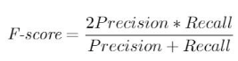

# 计算量与参数量

## 1 定义

1. 计算量-时间复杂度  **乘法和加发的操作次数**
2. 参数量-空间复杂度

### 卷积层

**计算量**: (KxKxWxH) x C_in x C_out

> W\H: 输出feature map 的size
>
> 回忆卷积操作过程

**参数量**: KxKxC_inxC_out

> 卷积核的weight

### 池化层

**计算量**: 不同池化操作不同 Cin x Cout x W x H x K xK

> 

**参数量**  无

### 全连接层

参数量 weight_in*weight_out

计算量＝ 2 x Cin x Cout

### BatchNorm

计算量: 4WHC

> 

参数量: 2C

> (y=ax+b) xC

### 激活函数

计算量: H×W×C 

> path个数


##  硬件需求

计算量的要求是在于芯片的__（指的是gpu的运算能力）

参数量取决于__大小


### 计算量和参数量查看

https://blog.csdn.net/qq_40507857/article/details/118764782


### 输入数据对模型的参数量和计算量的影响


# TF FP FN TN

https://blog.csdn.net/wzk4869/article/details/127879761


## 1 准确率（Precision）

```

```

## 2 召回率 (Recall)

```

```


# 目标检测的评价指标

## 1: IoU

```c++

```


## 2: F1 Score

**定义**: F Score 是 Precision 和 Recall 的调和平均数 (harmonic mean)



>  Precision 与 Recall 看起来很相似，实际上这两个是“冤家”。为什么这么说呢？因为在大多数情况下，这两者有一定的互斥性。****

**作用:**

## 平均准确度 (Average Precision，AP) 
