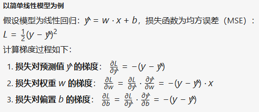
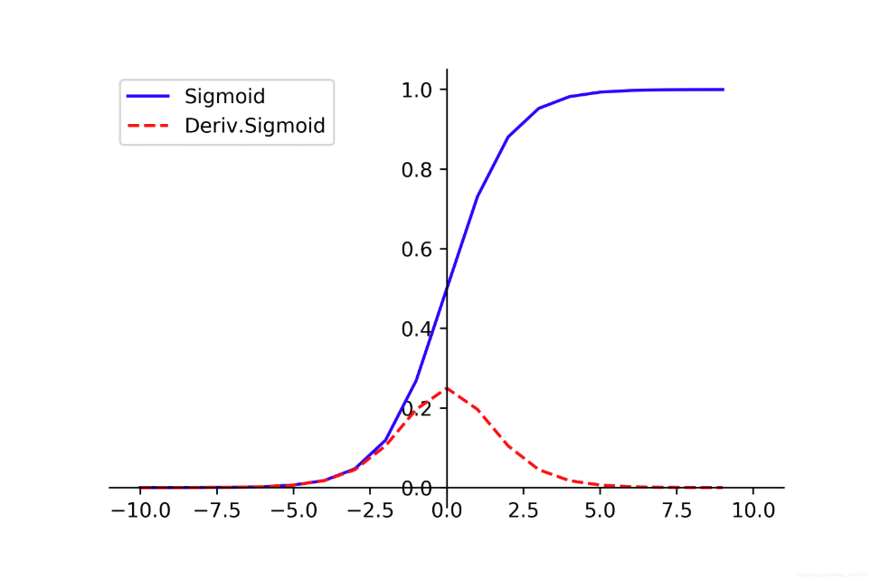
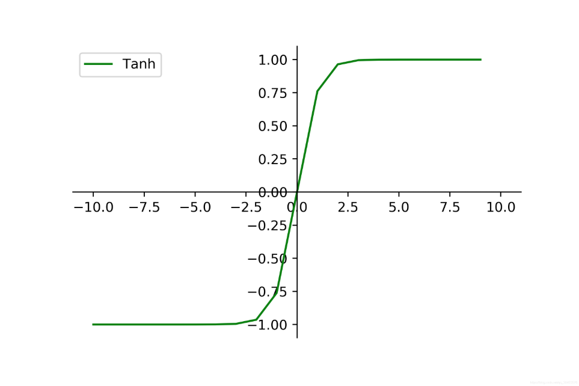
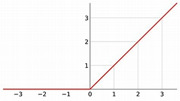
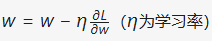

> 记录一些学了又忘或是没学的DL八股文知识

# DL八股文

# 原理

一种基于深层神经网络的机器学习方法，通过多层次的非线性变换自动提取数据特征，实现复杂模式的识别与预测。核心是模仿人脑神经元的连接方式，构建“输入-隐藏-输出”层级的计算模型，从数据中学习从简单到抽象的特征表示 


# 训练

> 模型训练的核心是通过调整参数（如权重 *w* 和偏置 *b*） 最小化损失函数 L
>
> 

## 过拟合

### 1 什么是过拟合

指模型在训练集上表现优异，但在测试集或新数据上泛化能力显著下降的现象。其核心矛盾是模型过度**学习了训练数据中的噪声和非全局性特征**，而非数据背后的真实规律 。

### 2 原因

1. 数据层面：**数据量不足**，导致没有学到全局特征。**噪声干扰**，数据中存在异常值或错误标签，模型误将其作为学习目标 
2. 模型层面：模型过于复杂，**过度适应训练数据细节**
3. 训练层面：迭代次数过多（未早停）或学习率未优化/

### 3 如何解决

1. ：数据增强与数据清洗

2. ：选用简单模型。添加正则化策略，**Dropout**、**批量归一化**BatchNorm、**池化**

3. ：早停法、动态学习率、

4. **集成方法**：结合多个模型的预测结果（如随机森林投票），减少单个模型方差

   **迁移学习等**

### 4 欠拟合呢？


## 训练方法


训练方法

### 1 监督学习


### 3 自监督学习

> 参考：https://developer.aliyun.com/article/1257862?spm=a2c6h.24874632.expert-profile.15.45a63181v37e02\

#### 定义

​	它利用未标记的数据来训练模型，而无需人工标注的标签

​	利用数据中的自动生成的标签或任务来训练模型

#### 自监督学习方法


### 4 Zero-Shot, One-Shot, and Few-Shot Learning概念

1. Zero-Shot是指训练一个模型来对其从未见过的对象进行分类。其核心思想是利用另一个模型的现有知识，以获得新类别的有意义的表示。
2. One-Shot是确定图像A是否等同于图像B。这是通过将模型从先前任务的经验中获得的信息进行概括来实现的。
3. Few-Shot Learning它是元学习的一个子领域，旨在开发能够从少量有标签示例中学习的算法


## 迁移学习+微调 ☑️

### 1 迁移学习

在大型数据集上训练好的模型可以被“迁移”到新的任务中，从而避免从零开始训练。大地缩短训练时间，并显著提高性能

```python
# 加载预训练的ResNet模型
resnet = models.resnet50(pretrained=True)
```


### 2 微调

- 通过对预训练模型**进行部分或全部参数的微调**，模型可以适应新任务中的特定数据。微调的程度取决于新任务的相似性和目标。
- 通常会冻结模型的部分层，以保留通用的特征提取能力，针对新任务**只对高层**进行微调。

```python
# 冻结所有层的参数，以便只微调最后的全连接层
for param in resnet.parameters():
    param.requires_grad = False

# 解冻部分层，允许更多层进行训练
for name, param in resnet.named_parameters():
    if "layer4" in name:  # 假设只解冻ResNet的最后一层
        param.requires_grad = True
    else:
        param.requires_grad = False
```


## 梯度



### 2 梯度稀疏化问题

#### 定义

在深度学习中，梯度是指损失函数对模型参数的偏导数。通过反向传播算法，我们可以计算得到每个参数的梯度，并使用优化算法（如随机梯度下降）来更新参数。然而，在深层神经网络中，梯度通常具有很高的维度，**其中大部分元素都是接近于零或者非常小的值**。这些接近于零的梯度元素对参数更新几乎没有贡献，并且会占用大量内存空间和计算资源。

- 模型更新偏差：仅部分参数被有效更新，可能偏离全局最优解

- 训练不稳定：梯度分布不均加剧收敛震荡

  

#### **成因**

1. **模型结构与激活函数**
   - 局部激活稀疏性：ReLU等激活函数在输入为负时输出零梯度，导致大量神经元处于“死亡”状态
   - 深度网络层间依赖：深层网络中矩阵连乘导致梯度衰减或爆炸，加剧稀疏性
2. **优化策略与正则化**
   - L1正则化：通过惩罚权重绝对值，强制稀疏参数分布，间接导致梯度稀疏
   - 梯度裁剪：限制梯度幅值，抑制小梯度更新
3. **训练数据分布**
   - 数据不均衡：长尾数据导致部分类别梯度贡献微弱
   - 特征冗余：输入数据中存在大量无关特征，相关梯度趋近于零


#### **处理方法**

**优化算法改进**

- **动量修正与误差补偿**：如DGC中的Momentum Correction，缓解因稀疏化导致的梯度滞后问题
- **自适应优化器**：Adam等算法动态调整学习率，避免小梯度参数被完全抑制

**数据与训练策略调整**

- **数据增强与重采样**：平衡类别分布，提升尾部数据的梯度贡献
- **渐进式稀疏训练**：初期保留更多梯度，逐步增加稀疏率以避免过早信息丢失

#### 应用

1. 剪枝与梯度量化
2. 


## 激活函数


### 1 定义

引入**非线性因素**,处理复杂的问题

### 2 常见激活函数

#### 1 Sigmoid

 

#### 2 Tanh

  

>  存在梯度消失的问题，因为它们的导数（连乘）在两端会趋近于零，导致深层网络训练困难

#### 3 relu

 

##### 优势

1. **缓解梯度消失**：
   - Sigmoid/Tanh的饱和区：导数在输入绝对值较大时趋近于0（如Sigmoid导数值最大仅0.25），导致深层网络梯度链式相乘后指数级衰减
   - ReLU的非饱和性：**正区间的导数为1**，保证梯度稳定传递，支持深层网络训练
2. **计算高效**：ReLU仅需判断输入是否大于0（**无指数运算**），比Sigmoid/Tanh快6倍以上，适合大规模数据和复杂模型
3. **稀疏激活**：ReLU将负输入强制置零，使网络**稀疏化**（约50%神经元激活），降低参数依赖性和过拟合风险，增强模型鲁棒性

##### 不足

1.  为负时，ReLU输出恒为0，梯度为0，导致对应权重无法更新（“**死亡**”）

##### 改进

> 改进ReLU的方法，比如Leaky ReLU、Parametric ReLU（PReLU）和ELU，


## 损失函数

> 解释什么是损失函数，它的作用，常见的损失函数类型，以及如何根据不同的任务选择合适的损失函数，还有在训练过程中如何优化损失。

### **1 定义**：

损失函数是衡量模型预测值与真实值**差异的量化指标**，

**用于指导模型参数优化**。反向传播更新梯度




### 2 常见

1. **均方误差** 绝对误差等等
2. 交叉熵


# 模型

## CNN

### 0 图像性质

1. **平移不变性**：池化与卷积核滑动使模型对目标位置变化不敏感。


### 1 定义

 核心思想是通过**局部感受野**和**参数共享**，高效提取空间或时序特征。
从原始像素中学习到“边缘→纹理→物体部件→完整物体”的层次化特征表示


### 2 组成

#### **卷积层**       


**卷积层堆叠**：

- 浅层卷积核提取边缘、颜色等低级特征。
- 深层卷积核组合低级特征，形成高级语义（如车轮、车窗

#### **池化层**

> 减少计算量并增强平移不变性。


## resnet

### 1**思想**

> **学习残差而非直接学习目标映射**   通过（跳跃连接）实现残差学习

### 2 解决问题

##### 1. **深层网络退化（Degradation）**

- **现象**：传统CNN（如VGG）随着层数增加（如20层以上），训练误差和测试误差反而上升，**这不是过拟合，而是模型难以优化**。
- **原因**：叠加非线性层导致信息传递效率下降，深层网络难以学习有效的恒等映射（Identity Mapping）。
- **解决**：跳跃连接强制网络学习残差 F(x)*F*(*x*)，当最优解接近恒等映射时，F(x)*F*(*x*) 只需逼近0，比直接拟合 H(x)=x*H*(*x*)=*x* 更简单。

##### 2. **梯度消失（Vanishing Gradient）**

- **现象**：反向传播时，梯度在深层网络中逐层连乘，导致浅层权重更新缓慢甚至停滞。
- **解决**：跳跃连接提供**梯度高速公路**，梯度可通过加法操作直接回传至浅层（如公式 ∂L∂x=∂L∂H(x)⋅(1+∂F(x)∂x)∂*x*∂*L*=∂*H*(*x*)∂*L*⋅(1+∂*x*∂*F*(*x*))），避免梯度被多次非线性变换稀释。


## **模型难以优化**


