# 一、介绍

参考:https://blog.csdn.net/Lison_Zhu/article/details/100772541\https://blog.csdn.net/Yaoyao2024/article/details/136625461

## 1.方法

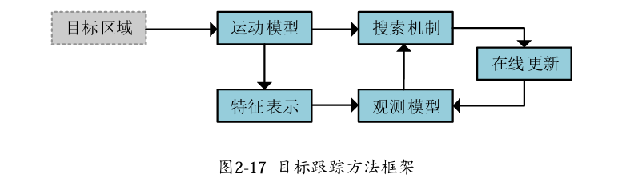

（1）运动模型：如何产生众多的候选样本。

（2）特征提取：利用何种特征表示目标。

（3）观测模型：如何为众多候选样本进行评分。

（4）模型更新：如何更新观测模型使其适应目标的变化。

（5）集成方法：如何融合多个决策获得一个更优的决策结果。

**运动模型（Motion Model）：**生成候选样本的速度与质量直接决定了跟踪系统表现的优劣。常用的有两种方法：粒子滤波（Particle Filter）和滑动窗口（Sliding Window）。粒子滤波是一种序贯贝叶斯推断方法，通过递归的方式推断目标的隐含状态。而滑动窗口是一种穷举搜索方法，它列出目标附近的所有可能的样本作为候选样本。

**特征提取（Feature Extractor）:** 鉴别性的特征表示是目标跟踪的关键之一。常用的特征被分为两种类型：手工设计的特征（Hand-crafted feature）和深度特征（Deep feature）。常用的手工设计的特征有灰度特征（Gray），方向梯度直方图（HOG），哈尔特征（Haar-like），尺度不变特征（SIFT）等。与人为设计的特征不同，深度特征是通过大量的训练样本学习出来的特征，它比手工设计的特征更具有鉴别性。因此，利用深度特征的跟踪方法通常很轻松就能获得一个不错的效果。

**观测模型（Observation Model）:**大多数的跟踪方法主要集中在这一块的设计上。根据不同的思路，观测模型可分为两类：生成式模型（Generative Model）和判别式模型（Discriminative Model）. 生成式模型通常寻找与目标模板最相似的候选作为跟踪结果，这一过程可以视为模板匹配。常用的理论方法包括：子空间，稀疏表示，字典学习等。而判别式模型通过训练一个分类器去区分目标与背景，选择置信度最高的候选样本作为预测结果。判别式方法已经成为目标跟踪中的主流方法，因为有大量的机器学习方法可以利用。常用的理论方法包括：逻辑回归，岭回归，支持向量机，多示例学习，相关滤波等。

**模型更新（Model Update）:** 模型更新主要是更新观测模型，以适应目标表观的变化，防止跟踪过程发生漂移。模型更新没有一个统一的标准，通常认为目标的表观连续变化，所以常常会每一帧都更新一次模型。但也有人认为目标过去的表观对跟踪很重要，连续更新可能会丢失过去的表观信息，引入过多的噪音，因此利用长短期更新相结合的方式来解决这一问题。

**集成方法（Ensemble Method）:** 集成方法有利于提高模型的预测精度，也常常被视为一种提高跟踪准确率的有效手段。可以把集成方法笼统的划分为两类：在多个预测结果中选一个最好的，或是利用所有的预测加权平均。


## 2.挑战

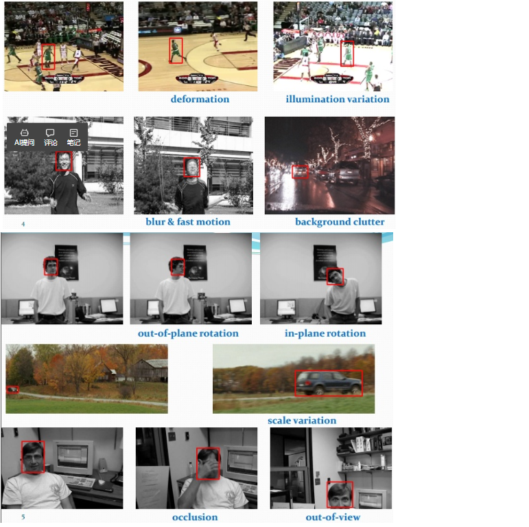


## 3.评估

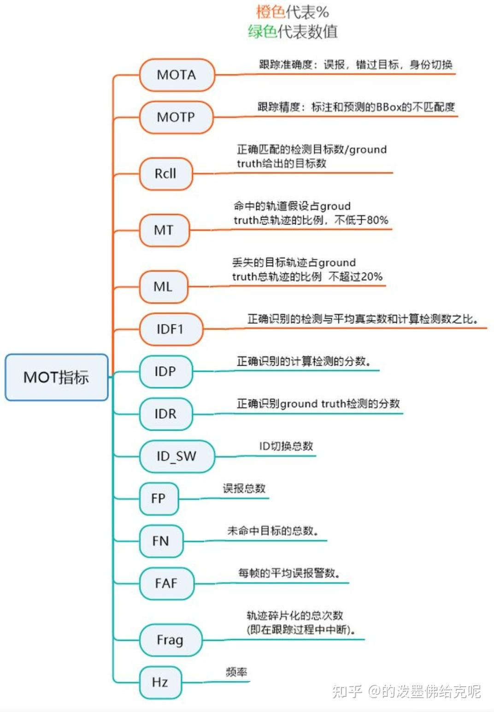


## 4.**视觉目标跟踪方法**

 视觉目标跟踪方法根据观测模型是生成式模型或判别式模型可以被分为生成式方法（Generative Method）和判别式方法（Discriminative Method）。

前几年最火的生成式跟踪方法大概是稀疏编码（Sparse Coding）了, 而近来判别式跟踪方法逐渐占据了主流地位，以相关滤波（Correlation Filter）和深度学习（Deep Learning）为代表的判别式方法也取得了令人满意的效果。

### 生成式模型

在当前帧对目标区域建模，下一帧寻找与模型最相似的区域就是预测位置，与传统的盲搜不同，它利用**相邻帧之间目标位置变化不大**的特点，采用**迭代逼近**的方式提高算法的搜索速度

### 判别式模型

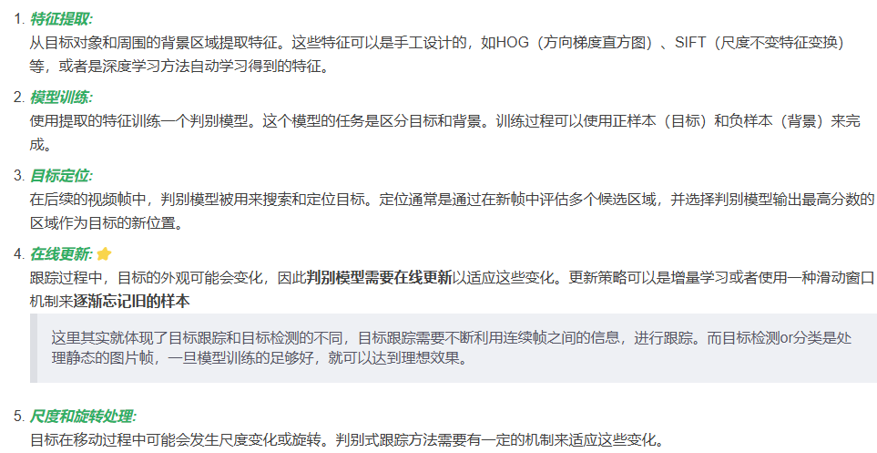


### 深度学习方法

如基于卷积神经网络（CNN）和**孪生网络**的跟踪器，其实也可以归类为判别式方法，因为它们通常涉及到**训练一个能够区分目标和背景的网络**。


## 发展

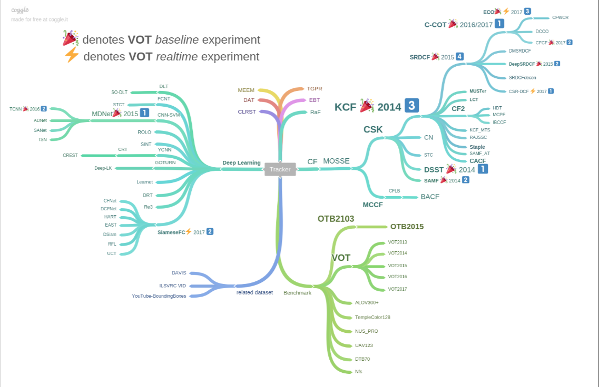


# 二、基于孪生网络的单目标跟踪[2026年11月3日补充]

参考:https://blog.csdn.net/weixin_43913124/article/details/123403727 \https://github.com/rafellerc/Pytorch-SiamFC https://blog.csdn.net/weixin_43913124/article/details/123545157


## 0 SiamFC

Siamese跟踪器**将视觉目标跟踪问题表述为通过学习目标模板和搜索区域的特征表示之间的相互关联来学习通用的相似性映射**

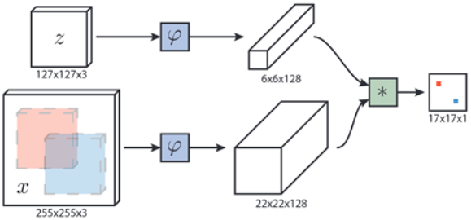


**AlexNet**

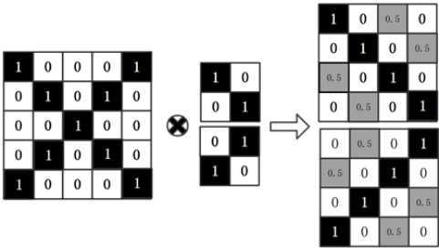

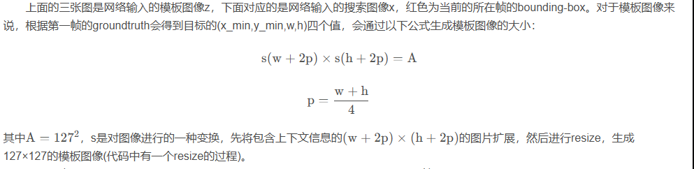


Logistic**损失函数**


## 1 SiamRPN

参考:https://blog.csdn.net/fzp95/article/details/80982201

### 1.1**RPN**

RPN即Region Proposal Network,一个用于分类前景和背景，一个用于边界框回归, 类似yolo, 输出class 和边界框回归

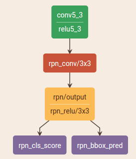

### 1.2 **网络结构**

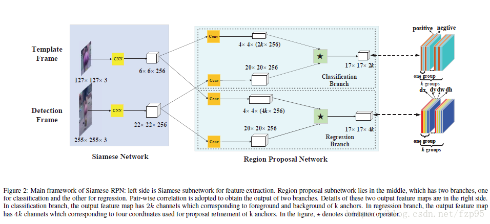

模型输入: 
模版帧, 裁剪得到的patch被resize到127 × 127 大小。检测帧其大小是模板帧的两倍，同时resize到255 × 255 


模型输出:
**4×4×(4k×256)** 和**4×4×(4k×256)**  
表示: 4x4的特征图中K个anchor, 每个anchor对应class(前景和背景)和xywh(四个)

### 1.3 **损失函数**

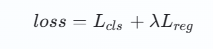

使用**cross-entropy loss（交叉熵损失）**作为分类分支的损失函数，使用**smooth L1 loss**作为回归分支的损失函数。

**正负样本选择**
使用**IOU**作为判断正负样本的标准，设置高（**0.6**）和低（**0.3**）两个阈值，正样本为IOU>0.6的anchor和其对应的ground truth


### 1.4  跟踪部分

以**上一帧**目标位置为中心，在**当前帧**上裁剪搜索区域 → 在当前帧的搜索区域里做“目标检测” → 得到**当前帧**的预测框 → 再以它为心裁剪**下一帧**的搜索区域……


### 1.5 其他变体

#### 1 [DaSiamRPN](https://zhuanlan.zhihu.com/p/56254712/bo-li.info/DaSiamRPN)

- 基于SiamRPN，主要是提出更好的使用数据，利用更好的训练方式让tracker变得更鲁邦
- 有了更好的分数作为指导后，算法可以扩展到Long-term

#### 2 [VOT2018](https://zhida.zhihu.com/search?content_id=100630994&content_type=Article&match_order=1&q=VOT2018&zhida_source=entity) entry SiamRPN

- 基于DaSiamRPN，想通过增强backbone来提升性能，但没能实现，最终通过加厚alexnet提升性能。加厚虽然临时的提升了网络的性能，但网络依然很浅，同时还极大的增加了模型参数量以及计算量。（模型加厚一倍，实际上模型和计算量增加四倍）


## 2 SiamRPN++

> 参考:https://blog.csdn.net/m0_63294504/article/details/145073446\https://zhuanlan.zhihu.com/p/56254712
>

**打破了 Siamese 网络在目标跟踪时无法使用深度复杂网络（VGG、ResNet、MobileNet）的限制**，原因在于深度网络中的 padding 破坏了严格的平移不变性，而 Siamese 跟踪器的互相关匹配恰恰依赖这种平移不变性。

**核心手段**：引入一种简单有效的采样策略（训练时对模板图像施加随机平移 shift）来打破空间不变性限制；并提出分层特征聚合结构用于互相关操作。

### 0.主要贡献

1. 对 Siamese 跟踪器进行深入分析，证明了当使用深度网络时，精度下降的根源在于**深度网络中的 padding 破坏了严格的平移不变性**，与 Siamese 匹配假设冲突。

2. 提出一种简单有效的采样策略——训练时对模板图像施加**均匀随机平移**，打破网络对“目标恒在中心”的隐含假设，成功训练了由 ResNet 架构驱动的 Siamese 跟踪器。

3. 提出**分层特征聚合结构**（layer-wise feature aggregation），用于互相关操作，帮助跟踪器从多层特征中预测相似映射。

4. 提出**深度互相关结构**（depth-wise cross correlation），增强互相关操作，产生与不同语义相关的多个相似图（multiple similarity maps）。


### 1.模型结果

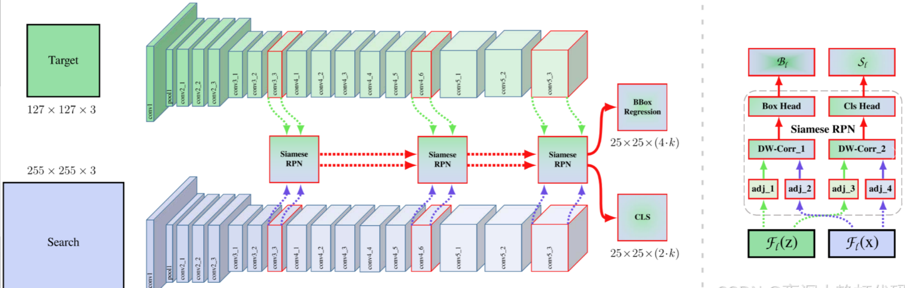


### 2.互相关

传统互相关（如 SiamRPN 所用）将模板特征直接作为卷积核，在搜索特征上做卷积。这种方式参数量大，且输出通常是单通道响应图。

DW-XCorr 则**对每个通道独立进行互相关**，模板和搜索特征的通道一一对应，互不混合。既减少了参数量，又保留了不同语义维度的匹配信息

```python
import torch.nn.functional as F

def depthwise_correlation(x, kernel):
    """Depthwise cross correlation.
    
    Args:
        x (Tensor): 搜索区域特征, shape (N, C, H_x, W_x)
        kernel (Tensor): 模板特征, shape (N, C, H_k, W_k)
    
    Returns:
        Tensor: shape (N, C, H_o, W_o), H_o = H_x - H_k + 1
    """
    batch = kernel.size(0)
    channel = kernel.size(1)
    # 将 batch 和 channel 维度合并，便于分组卷积
    x = x.view(1, batch * channel, x.size(2), x.size(3))
    kernel = kernel.view(batch * channel, 1, kernel.size(2), kernel.size(3))
    # groups = batch * channel，即每个通道独立卷积
    out = F.conv2d(x, kernel, groups=batch * channel)
    out = out.view(batch, channel, out.size(2), out.size(3))
    return out
```

> 就是**逐通道卷积**, 只是卷积核来自**模板分支提取的特征**, 用于**模板与搜索区域的相似度匹配**


****

# **三、基于深度学习的目标检测与再识别**

这类

## 1 原理

### 核心流程：检测 → 特征提取 → 关联匹配

以典型的 Re-ID 辅助跟踪流程为例，每一帧的处理大致如下：

1. **目标检测**：用 YOLO、Faster R-CNN、CenterNet 等检测器在当前帧找出所有目标，输出边界框和类别。
2. **Re-ID 特征提取**：对每个检测框裁剪出的图像区域，用 Re-ID 模型（如 SiameseNetwork、Triplet Network、注意力模型）提取一个**身份特征向量**。这个向量代表“这个目标长什么样”。
3. **关联匹配**：将当前帧检测目标的 Re-ID 特征，与已有的跟踪轨迹（上一帧及历史帧中已确认的目标）进行相似度比较（常用余弦距离）。同时结合**运动预测**（卡尔曼滤波预测轨迹在当前帧的大致位置）和**空间重叠**（IoU），综合计算匹配代价。
4. **匹配与更新**：用匈牙利算法等求得最优匹配。成功匹配的检测框用于更新对应轨迹的状态；未匹配的检测可能初始化为新轨迹；未匹配的轨迹暂时保留，等待后续帧重新关联


### 1.2 Re-IDentification（Re-ID）

模型来解决目标ID的确定问题，Re-ID模型通过计算目标在多个帧图像中的相似度来确定目标的唯一ID。


# 四、纯运动模型驱动

| 场景需求                             | 更合适的选择                             |
| :----------------------------------- | :--------------------------------------- |
| 边缘部署、实时视频分析、算力受限     | 纯运动模型（ByteTrack/OC-SORT）          |
| 拥挤场景、相似外观目标频繁交叉       | 需要 Re-ID 辅助（BoT-SORT/Deep OC-SORT） |
| 极端非线性运动、严重遮挡后的长期恢复 | 可考虑端到端方法，但需接受较高算力成本   |

## **卡尔曼滤波器预测位置**

使用卡尔曼滤波器来预测目标在当前帧的位置。（轨迹框）


## **匈牙利算法**

使用 **匈牙利算法**（Hungarian Algorithm）来完成最优匹配，将匹配的检测框关联到轨迹。


## 3 追踪方法[见MOT.md]

### 3.1 **ByteTrack**[2026年11月5日补充]

> https://blog.csdn.net/gaoyi928/article/details/144572721

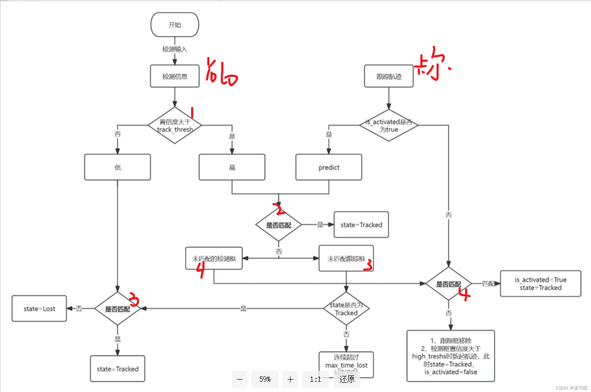


### **DeepSort**

DeepSORT基于目标检测 器（如YOLO、Faster R-CNN等）检测每一帧图像中的目标，并使用多特征融合（Muti-feature Fusion）技术对目标进行表示和描述，然后使用SORT算法对目标进行跟踪。


**TrackTrack**


**BoT-SORT**


**OC-SORT**


****

# 五、**基于视觉Transformer（ViT, Vision Transformer）**

MOTR

MOTRv2 


# 六、基于相关滤波[pass]

滤波跟踪的核心思想是：**学习一个滤波器，让它对目标区域产生高响应，对背景产生低响应，然后在下一帧中寻找响应最高的位置作为目标新位置**。
