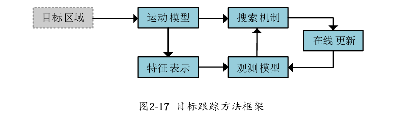
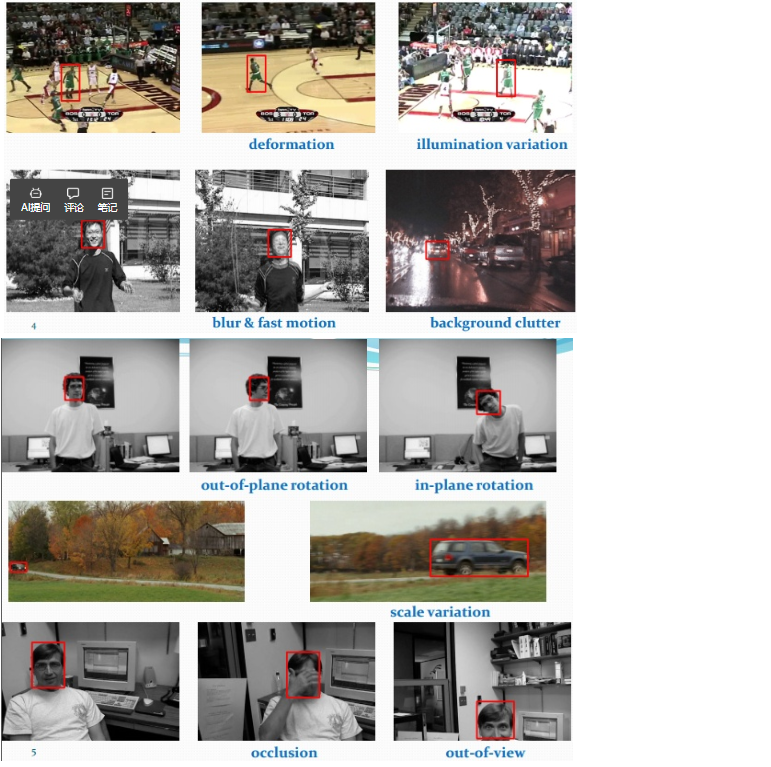
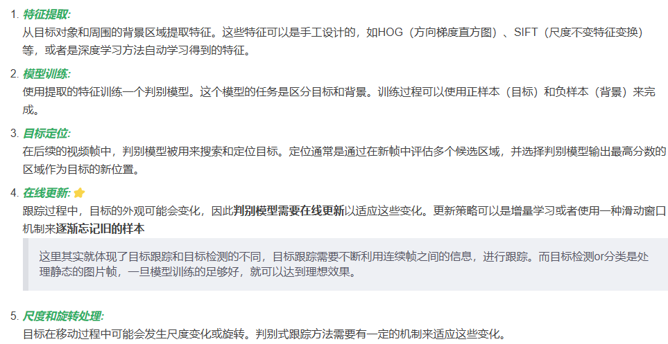
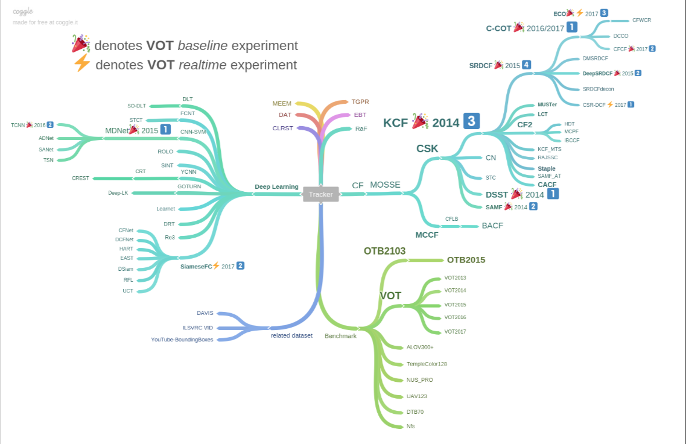
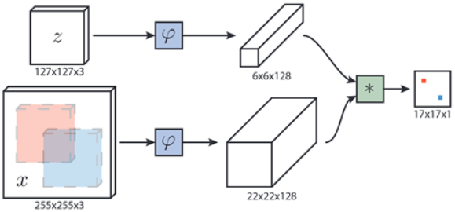
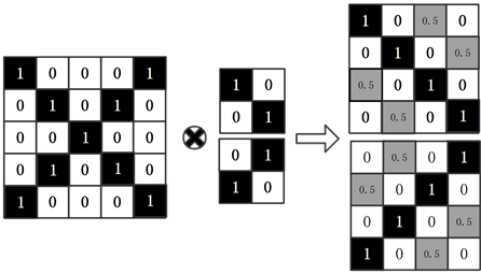
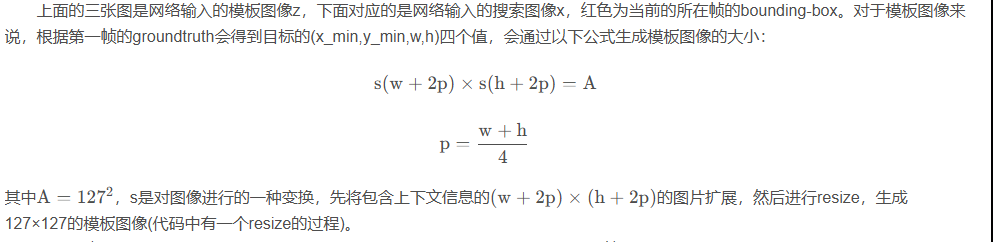
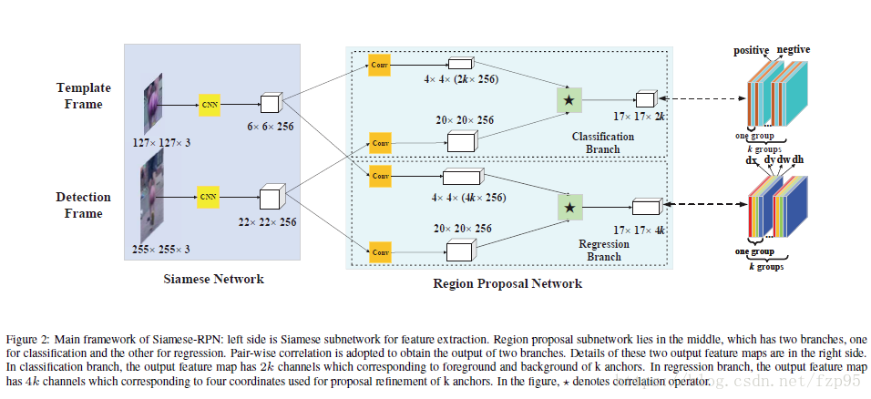
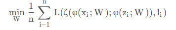
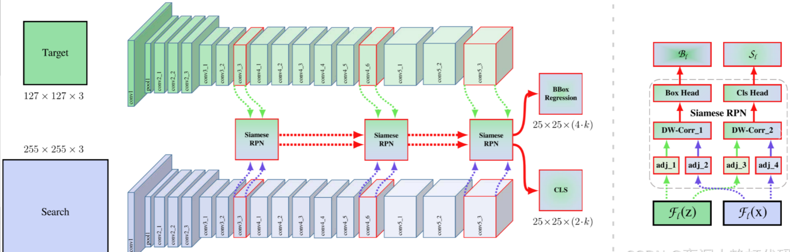

# 介绍

参考:https://blog.csdn.net/Lison_Zhu/article/details/100772541\https://blog.csdn.net/Yaoyao2024/article/details/136625461

## 方法

（1）运动模型：如何产生众多的候选样本。

（2）特征提取：利用何种特征表示目标。

（3）观测模型：如何为众多候选样本进行评分。

（4）模型更新：如何更新观测模型使其适应目标的变化。

（5）集成方法：如何融合多个决策获得一个更优的决策结果。

**运动模型（Motion Model）：**生成候选样本的速度与质量直接决定了跟踪系统表现的优劣。常用的有两种方法：粒子滤波（Particle Filter）和滑动窗口（Sliding Window）。粒子滤波是一种序贯贝叶斯推断方法，通过递归的方式推断目标的隐含状态。而滑动窗口是一种穷举搜索方法，它列出目标附近的所有可能的样本作为候选样本。

**特征提取（Feature Extractor）:** 鉴别性的特征表示是目标跟踪的关键之一。常用的特征被分为两种类型：手工设计的特征（Hand-crafted feature）和深度特征（Deep feature）。常用的手工设计的特征有灰度特征（Gray），方向梯度直方图（HOG），哈尔特征（Haar-like），尺度不变特征（SIFT）等。与人为设计的特征不同，深度特征是通过大量的训练样本学习出来的特征，它比手工设计的特征更具有鉴别性。因此，利用深度特征的跟踪方法通常很轻松就能获得一个不错的效果。

**观测模型（Observation Model）:**大多数的跟踪方法主要集中在这一块的设计上。根据不同的思路，观测模型可分为两类：生成式模型（Generative Model）和判别式模型（Discriminative Model）. 生成式模型通常寻找与目标模板最相似的候选作为跟踪结果，这一过程可以视为模板匹配。常用的理论方法包括：子空间，稀疏表示，字典学习等。而判别式模型通过训练一个分类器去区分目标与背景，选择置信度最高的候选样本作为预测结果。判别式方法已经成为目标跟踪中的主流方法，因为有大量的机器学习方法可以利用。常用的理论方法包括：逻辑回归，岭回归，支持向量机，多示例学习，相关滤波等。

**模型更新（Model Update）:** 模型更新主要是更新观测模型，以适应目标表观的变化，防止跟踪过程发生漂移。模型更新没有一个统一的标准，通常认为目标的表观连续变化，所以常常会每一帧都更新一次模型。但也有人认为目标过去的表观对跟踪很重要，连续更新可能会丢失过去的表观信息，引入过多的噪音，因此利用长短期更新相结合的方式来解决这一问题。

**集成方法（Ensemble Method）:** 集成方法有利于提高模型的预测精度，也常常被视为一种提高跟踪准确率的有效手段。可以把集成方法笼统的划分为两类：在多个预测结果中选一个最好的，或是利用所有的预测加权平均。

## 分类

## 挑战

## **视觉目标跟踪方法**

 视觉目标跟踪方法根据观测模型是生成式模型或判别式模型可以被分为生成式方法（Generative Method）和判别式方法（Discriminative Method）。

前几年最火的生成式跟踪方法大概是稀疏编码（Sparse Coding）了, 而近来判别式跟踪方法逐渐占据了主流地位，以相关滤波（Correlation Filter）和深度学习（Deep Learning）为代表的判别式方法也取得了令人满意的效果。

### 生成式模型

在当前帧对目标区域建模，下一帧寻找与模型最相似的区域就是预测位置，与传统的盲搜不同，它利用**相邻帧之间目标位置变化不大**的特点，采用**迭代逼近**的方式提高算法的搜索速度

### 判别式模型

### 深度学习方法

如基于卷积神经网络（CNN）和**孪生网络**的跟踪器，其实也可以归类为判别式方法，因为它们通常涉及到**训练一个能够区分目标和背景的网络**。

## 发展

# 基于孪生网络的单目标跟踪SiamFC

参考:https://blog.csdn.net/weixin_43913124/article/details/123403727 \https://github.com/rafellerc/Pytorch-SiamFC https://blog.csdn.net/weixin_43913124/article/details/123545157

## 0 SiamFC

Siamese跟踪器**将视觉目标跟踪问题表述为通过学习目标模板和搜索区域的特征表示之间的相互关联来学习通用的相似性映射**

**AlexNet**

Logistic**损失函数**

## 1 SiamRPN

参考:https://blog.csdn.net/fzp95/article/details/80982201

**RPN**

网络只需要把这些可能含有物体的区域选取出来就可以了，这些被选取出来的区域又叫做ROI （Region of Interests），即感兴趣的区域

RPN同时也会在feature map上框定这些ROI感兴趣区域的大致位置

**网络结构**

**损失函数**

### 1.1 [DaSiamRPN](https://zhuanlan.zhihu.com/p/56254712/bo-li.info/DaSiamRPN)

- 基于SiamRPN，主要是提出更好的使用数据，利用更好的训练方式让tracker变得更鲁邦
- 有了更好的分数作为指导后，算法可以扩展到Long-term

### 1.2 [VOT2018](https://zhida.zhihu.com/search?content_id=100630994&content_type=Article&match_order=1&q=VOT2018&zhida_source=entity) entry SiamRPN

- 基于DaSiamRPN，想通过增强backbone来提升性能，但没能实现，最终通过加厚alexnet提升性能。加厚虽然临时的提升了网络的性能，但网络依然很浅，同时还极大的增加了模型参数量以及计算量。（模型加厚一倍，实际上模型和计算量增加四倍）

## 2 SiamRPN++

参考:https://blog.csdn.net/m0_63294504/article/details/145073446\https://zhuanlan.zhihu.com/p/56254712

**打破了****Siamese****网络在目标跟踪时无法使用深度复杂网络****(VGG****、****ResNet****、****MobileNet)****的限制****原因来自于对严格平移不变性的破坏**

入了一种**简单而有效的采样策略****(****说白了就是增加了随机平移****shft)**来打破Siamese跟踪器的空间不变性限制 [什么是卷积网络中的平移不变性？平移shft在数据增强中的意义-CSDN博客](https://blog.csdn.net/m0_63294504/article/details/145072710?spm=1001.2014.3001.5501)

提出了一种**分层特征强化结构**用于相互关联操作

要贡献如下:

1.我们对Siamese跟踪器进行了深入的分析，并证明了当使用深度网络时，准确性的降低来自于严格的平移不变性的破坏。

2.我们提出了一种简单而有效的采样策略来打破空间不变性的限制，成功地训练了由ResNet架构驱动的Siamese跟踪器。

3.我们提出了一种分层特征聚合结构，用于相互关联操作，这有助于跟踪器从多层学习的特征中预测相似的映射。

4.我们提出了一种深度可分离相关结构，以增强相互关联，从而产生与不同语义相关的多个相似映射。
————————————————

## 3 网络更新

## 4 模板更新

## 5 回归更新

# 基于相关滤波_pass

# **基于深度学习的目标检测与再识别（Detection-based Tracking）**

这类方法利用目标检测器（如Faster R-CNN、YOLO）在每一帧中检测目标，并使用Re-ID（再识别）模型或光流估计方法进行目标匹配。

# **基于视觉Transformer（ViT, Vision Transformer）**
