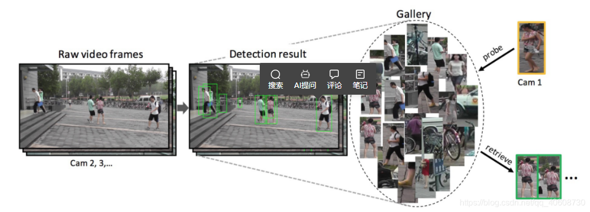

# 图像匹配

## 行人重识别

### 什么是ReID

参考：https://blog.csdn.net/qq_40608730/article/details/115431791、

判断在不同时间段、不同监控下出现的行人图像是否属于同一人员的技术。行人重识别是最近几年在视频分析领域下热门的研究领域，可以看做是人脸识别应用的拓展。

本质上可以看做是图像匹配任务，比如给你一张要匹配的行人的图，要你从数据库中搜索出此人的其他照片。

#### 发展

在行人重识别方向上，2005年到2013年间，传统算法一直都占据主要地位；

自2014年起，深度学习开始慢慢出现在人们的视线中，并在行人再识别研究中取得了显著性的突破，性能指标远超传统算法。

但是根据最近的发展来看，虽然最新的算法达到甚至超越了人类的水平，但是性能指标又到达了一个平台期，目前的研究方向主要是复杂环境、开放环境以及无监督学习领域。

#### **难点**

数据集
评价指标
实现思路
研究方式

未来方向

------

### 一般流程

### 实现思路

1. 先抽取特征再进行比对
2. 检索图经过网络抽取图片特征（Feature）
3. 检索库里的所有图片全部抽取图片特征（Feature）
4. 将检索图与检索库图的特征计算距离（例如欧式距离）
5. 根据计算距离进行排序，排序越靠前表示是相似率越高
