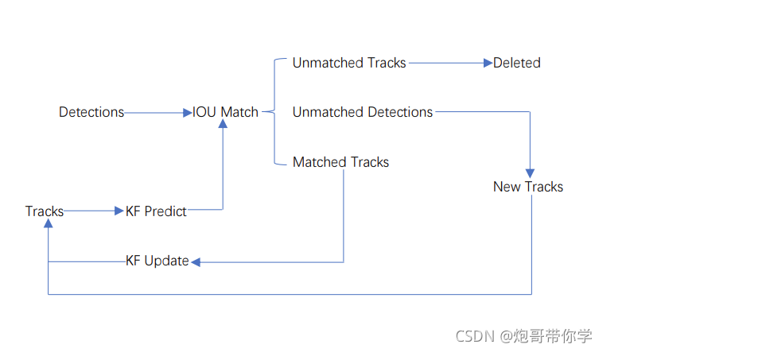
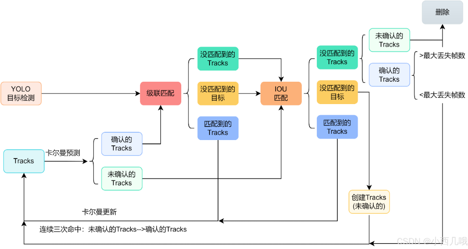
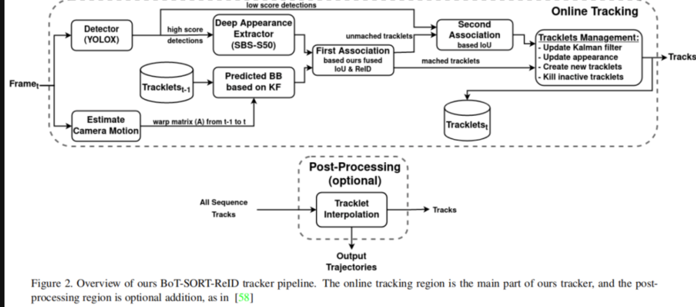
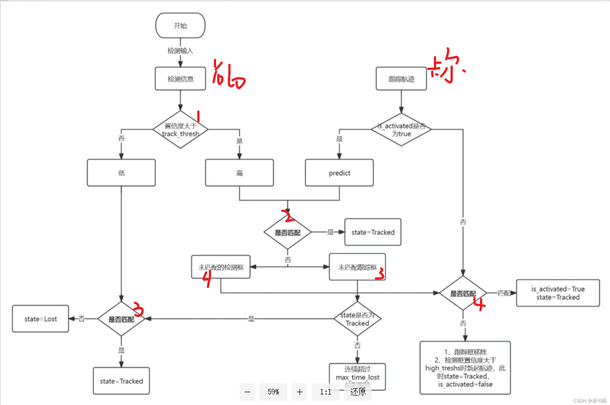

# SORT[2026年11月5日补充]

https://blog.csdn.net/weixin_45303602/article/details/132721845

# DeepSORT

查看：https://blog.csdn.net/qq_48764574/article/details/138816891、

### 1 原理

DeepSORT算法的核心在于其对目标的外观特征和运动特征的联合使用，以及对目标匹配问题的优化处理。该算法通过**融合目标检测的结果**，结合匈牙利算法和卡尔曼滤波等技术，实现对多个目标的持续跟踪。

### 2 特点

**目标检测：**DeepSORT算法依赖于目标检测器来确定视频中每一帧的目标位置。常用的目标检测器包括YOLO、Faster R-CNN等。检测器的输出通常包括目标的边界框（bounding box）和类别。

**特征提取：**DeepSORT使用深度学习模型来提取目标的外观特征。这些特征对于目标的再识别（re-identification，简称Re-ID）至关重要，因为即使目标在视频中被临时遮挡或丢失，这些特征也能帮助算法重新识别和关联目标。

**匹配和跟踪：**DeepSORT算法中的匹配过程涉及到计算检测框和预测框之间的相似度，并使用匈牙利算法来找到最优匹配。这个过程还包括卡尔曼滤波器的使用，它根据目标的历史运动信息来预测其在下一帧中的位置。

### 3 实现: 

***匹配之后会出现三个结果***：若预测的框没有和检测到的框匹配到，就对其删除；若检测框和我们预测的框没有匹配到，就对其分配一个新的轨迹（其实经常出现这种情况，前一帧的物体检测到了，后一帧又出现了新的检测到的物体，那我们就得使用卡尔曼滤波对它进行一个新的预测）；

1. 根据第一帧detections的检测结果创建相应的Tracks，并对卡尔曼滤波的运动变量进行***初始化***，通过卡尔曼滤波预测相应的框框。此时，***由于是第一帧，所以所有的Tracks都处于unconfirmed状态***。
2. 逐一比较该帧目标检测的框框和上一帧通过Tracks预测的框框，计算它们之间的***IOU匹配度***，并根据匹配度（1-IOU）计算代价矩阵。
3. 将（2）中得到的所有代价矩阵作为匈牙利算法的输入，得出线性匹配的结果。根据匹配情况，***可能有三种结果***：第一种是Tracks失配（Unmatched Tracks），直接删除这些失配的Tracks（如果Tracks是确认态，则需要连续达到一定次数（默认30次）才能删除）；第二种是Detections失配（Unmatched Detections），将这些失配的Detections初始化为新的Tracks；第三种是检测框和预测的框框成功配对，表示前一帧和后一帧的追踪成功，通过卡尔曼滤波更新相应的Tracks变量。
4. 循环执行（2）-（3）步骤，直到出现确认态（confirmed）的Tracks或者视频帧结束。
5. 利用卡尔曼滤波预测确认态（confirmed）的Tracks和不确定态的Tracks对应的框框。将确认态的Tracks的框框与Detections进行***级联匹配***（之前每次只要Tracks匹配上都会保存Detections的外观特征和运动信息，默认保存前100帧），利用外观特征和运动信息与Detections进行级联匹配，这样做是因为确认态（confirmed）的Tracks和Detections的匹配可能性更大。
6. 级联匹配后有三种可能的结果：第一种是Tracks匹配，通过卡尔曼滤波更新相应的Tracks变量；第二种和第三种是Detections和Tracks失配，将之前的不确定态的Tracks和失配的Tracks与Unmatched Detections逐一进行IOU匹配，再根据匹配度计算代价矩阵。
7. 将（6）中得到的所有代价矩阵作为匈牙利算法的输入，得到线性匹配的结果，此时又有三种情况：第一种是Tracks失配（Unmatched Tracks），直接删除这些失配的Tracks（如果Tracks是确认态，则需要连续达到一定次数（默认30次）才能删除）；第二种是Detections失配（Unmatched Detections），将这些失配的Detections初始化为新的Tracks；第三种是检测框和预测的框框成功配对，表示前一帧和后一帧的追踪成功，通过卡尔曼滤波更新相应的Tracks变量。
8. 循环执行（5）-（7）步骤，直到视频帧结束

# BoT-SOR

### 1 创新:

• 通过添加改进，例如**基于相机运动补偿的特征跟踪器**和合适的卡尔曼滤波器状态向量以实现更好的边界框定位，`Tracking-by-detection`跟踪器的性能也可以得到显著的改进。

• 为 `IoU` 和 `ReID` 的`余弦距离`融合提出了一种简单有效的方法，以便在检测和轨迹之间建立更强大的关联。

### 2 原理

#### 2.1 Kalman Filter

#### 2.2 追终器

#### 2.3 IoU-Re-ID Fusion

# **ByteTrack**[2026年11月5日补充]

> https://blog.csdn.net/gaoyi928/article/details/144572721

#### 项目代码:

https://github.com/NirAharon/BoT-SORT

## BOXMOT

https://github.com/mikel-brostrom/boxmot

https://blog.csdn.net/weixin_44238733/article/details/133782256
