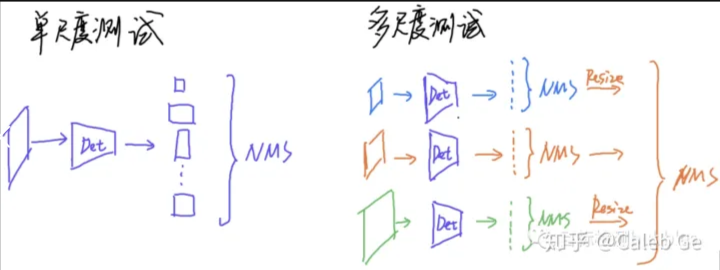

## 全卷积

除了最后的分类层是全连接层，而特征提取部分都是卷积或者池化操作，它们可以自适应各种尺寸的图像输入。


## SPP-Net


现有的（传统的） CNNs 由于有全连接层所以必须需要固定输入图片的尺寸，比如 224 × 224 。本文为传统的网络结构增加了一个池化策略，即空间金字塔池化，来突破全连接层对整个网络输入图像的约束。无论输入图像的尺寸是多少，SPP-Net 能够产生一个固定长度的特征向量，且能够适应形变，在分类和物体检测任务中都有很好的表现

### 空间金字塔池化 spatial pyramid pooling

用于解决传统卷积神经网络（CNN）中输入图像尺寸必须固定的问题。通过将特征图划分为不同粒度的区域，并对每个区域进行池化操作，SPP能够生成固定长度的特征向量，从而允许网络处理任意尺寸的输入图像

空间金字塔池化的加入，使得模型在预测/测试时可以不限定输入图像的大小，同时在训练阶段，也允许模型实现多尺度训练，这一点很有利于增强尺度不变性并降低过拟合的风险。

**输入特征图的尺寸无关，只与池化级别和通道数有关**

#### **原理**

SPP将特征图划分为多个不同大小的区域（如1×1、2×2、3×3、6×6等），并对每个区域进行最大池化或平均池化操作。这些池化后的特征被展平并拼接在一起，形成一个固定长度的特征向量


#### **实现**

```python
import torch
import torch.nn as nn
import torch.nn.functional as F

class SpatialPyramidPooling2d(nn.Module):
    def __init__(self, num_level, pool_type='max_pool'):
        """
        参数:
        num_level: 池化层的级别数量（例如，[1, 2, 4]表示3个级别）
        pool_type: 池化类型（'max_pool' 或 'avg_pool'）
        """
        super(SpatialPyramidPooling2d, self).__init__()
        self.num_level = num_level
        self.pool_type = pool_type

    def forward(self, x):
        N, C, H, W = x.size()
        for i in range(self.num_level):
            level = i + 1
            kernel_size = (math.ceil(H / level), math.ceil(W / level))
            stride = (math.ceil(H / level), math.ceil(W / level))
            padding = (
                math.floor((kernel_size[0] * level - H + 1) / 2),
                math.floor((kernel_size[1] * level - W + 1) / 2)
            )
            if self.pool_type == 'max_pool':
                tensor = F.max_pool2d(x, kernel_size=kernel_size, stride=stride, padding=padding).view(N, -1)
            else:
                tensor = F.avg_pool2d(x, kernel_size=kernel_size, stride=stride, padding=padding).view(N, -1)
            if i == 0:
                res = tensor
            else:
                res = torch.cat((res, tensor), 1)
        return res
```


### 2. **自适应池化（Adaptive Pooling）**

#### 原理

**自适应池化的目标是根据目标输出尺寸自动调整池化窗口和步长，使得输出尺寸保持一致，不依赖于输入的尺寸**。

#### 实现

`nn.AdaptiveAvgPool2d((32, 32))`

`nn.AdaptiveMaxPool2d((32, 32))`


### 3. **全局平均池化或全局最大池化（Global Pooling）**


