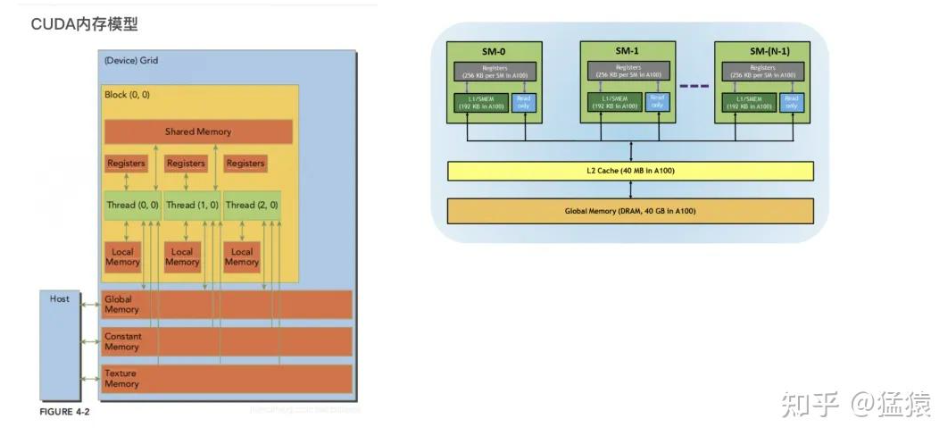
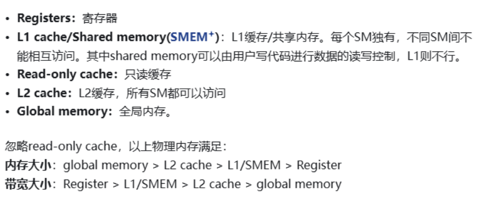
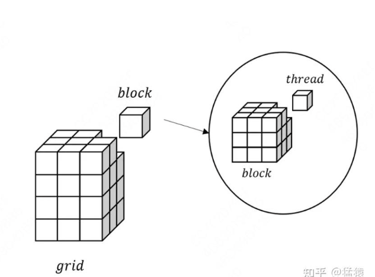

> https://zhuanlan.zhihu.com/p/12661298743?utm_campaign=shareopn&utm_medium=social&utm_psn=1907929443126707440&utm_source=wechat_session
>
> https://zhuanlan.zhihu.com/p/703256080?utm_campaign=shareopn&utm_medium=social&utm_psn=1886234892670572457&utm_source=wechat_session
>
> https://ubook.reader.qq.com/book-detail/45938055
>
> https://zhuanlan.zhihu.com/p/673046520?utm_campaign=shareopn&utm_medium=social&utm_psn=1766632559096975360&utm_source=wechat_session
>
> https://blog.csdn.net/Bartender_VA11/article/details/135999169
>
> file:///E:/Download/GPU%E7%BC%96%E7%A8%8B%E5%AE%9E%E6%88%98-%E5%9F%BA%E4%BA%8EPython%E5%92%8CCUDA.pdf
>
> https://docs.nvidia.com/cuda/cuda-quick-start-guide/index.html
>
> https://zhuanlan.zhihu.com/p/346910129

### 1.2 框架

**grid>block>thread**

 

**warp**

在1个SM上，block中的thread被划分成warp执行，每个warp中一般有32个thread。

>  是nvidia gpu上最小的调度单元

## 二、Naive GEMM 

> **每个thread负责读取A矩阵的一行和B矩阵的一列，去计算C矩阵的一个元素**。则一共需要M*N个thread。
> **矩阵A和矩阵B都存储在global memory，每个thread直接从global memory上进行读数**，完成计算

