# 1.Yolo版本

## [YOLOv1](https://blog.csdn.net/weixin_43334693/article/details/129011644?spm=1001.2014.3001.5501)

> - 端到端单阶段
> - 目标检测问题看作回归问题


### 1 bounding box

- x——框中心的横坐标
- y——框中心的纵坐标
- w——框的宽度
- h——框的高度
- 置信度（confidence）


​	在YOLOV1中S = 7 , B = 2即将每个输入图片通过卷积, 将最后特征图分成**7 × 7 个网格**，每个网格将生成**2 个预测框**，用来框出图片中的物体。 **每个框会预测出5个变量值**，所以一个网格生成两个框，一个框带有5个属性，所以一个格就需要预测出**5 × 2 = 10 个变量值**。
​	在YOLOv1中有**20个类别的物体的条件概率**，所以输出结果的后20个值就表示每一个小网格（grid cell）对应每一类物体的概率，即由该网格生产的两个预测框对应每一类物体的概率。 由此，输出的**7 × 7 × 30(10+20) 向量**的每一项含义便清楚了。
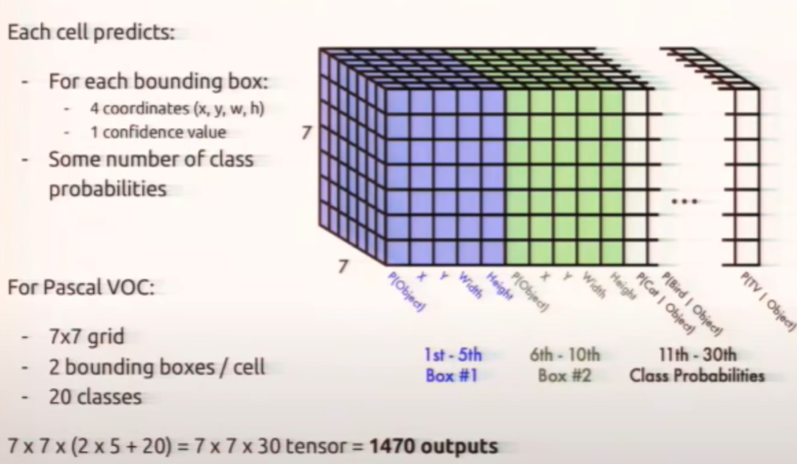

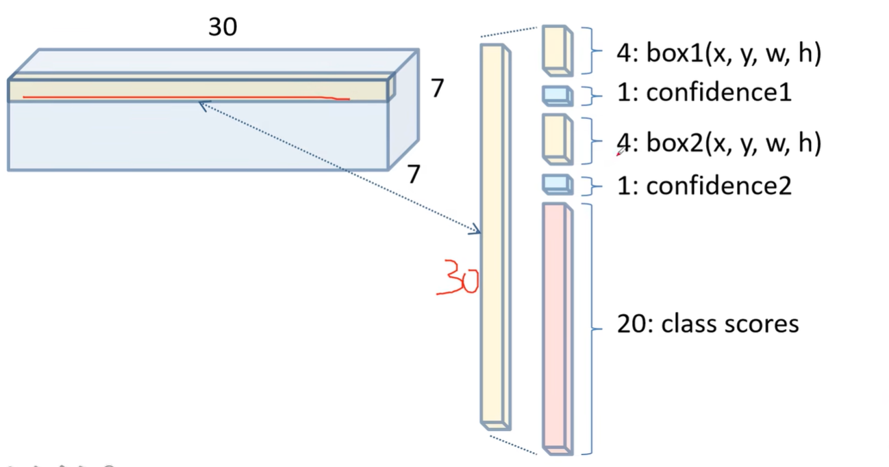

### 2 训练

#### 网络结构

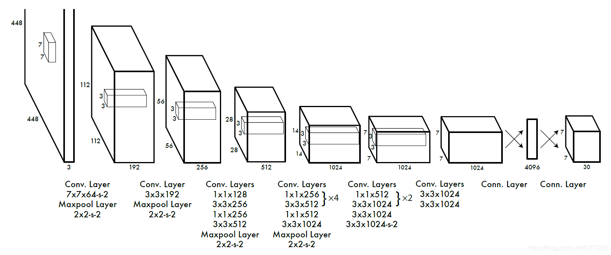

YOLOV1的输入为448 × 448 × 3 图像，输出大小为7 × 7 × 30 向量

在网络结构的最后一层使用的是线性激活函数，其他层使用的是**leaky ReLU\**激活函数，YOLOv1中采用的leaky ReLU定义公式如下

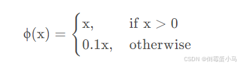

#### 数据处理


#### 损失计算

yolov1里将损失函数分为三部分,

1. 坐标损失（boudiing Loss）:用于优化预测边界框的坐标（位置和大小），确保预测框与真实框尽可能接近。
2. **置信度损失**（Confidence Loss）: 用于优化边界框的置信度分数，反映边界框是否包含目标以及框的准确性。
3. 分类损失（Classification Loss）: 用于优化每个网格的类别预测，确保模型正确识别目标的类别。

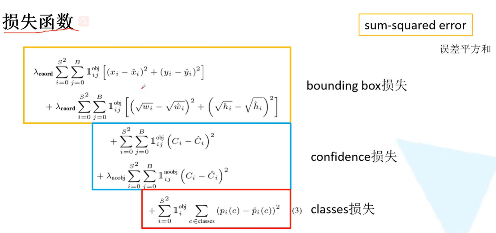

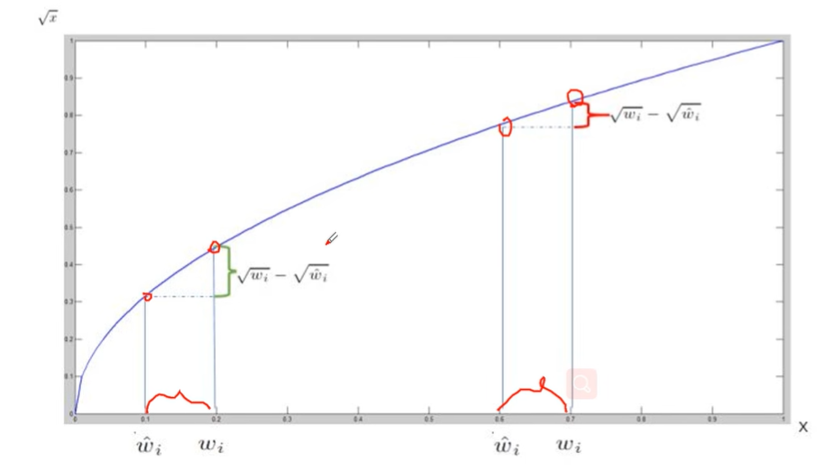

> 为什么用根号?   =>  大小目标对偏移影响不同


### 3 预测--极大值抑制

7X7X2个bounding box 进行 过滤与非极大值抑制

#### NMS 算法步骤

1. 收集所有预测框：

   - 从模型输出中提取所有边界框，包括坐标、置信度分数和类别。
   - 通常**只保留置信度高于某个阈值（例如 conf=0.25）的框，**以减少计算量。

2. 按置信度排序：

   - 对所有边界框按置信度分数从高到低排序。

3. 选择最高置信度框：

   - 从排序后的列表中选取置信度最高的边界框，**作为当前目标的代表框**。

4. 计算 IoU 并抑制重叠框：

   - 计算当前最高置信度框与其他框的 **交并比（IoU, Intersection over Union）**。

   - IoU 公式：
     $$
     IoU=\frac{\text{Intersection Area}}{\text{Union Area}}
     $$
     
   - 如果其他框与当前框的 IoU 高于某个阈值（例如 iou=0.45），则认为这些框检测的是同一目标，将它们从候选列表中移除。
   
5. 重复直到处理完所有框：

   - 从剩余框中再次选取置信度最高的框，重复步骤 3 和 4，直到列表为空或无框满足条件。

6. 输出最终结果：

   - 返回保留下来的边界框列表，作为最终检测结果。

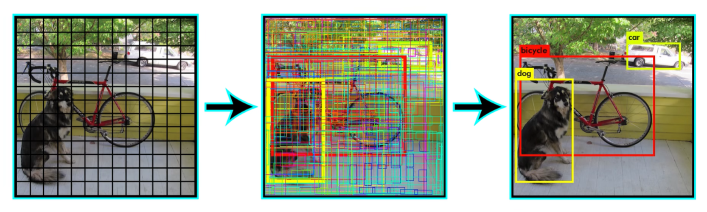

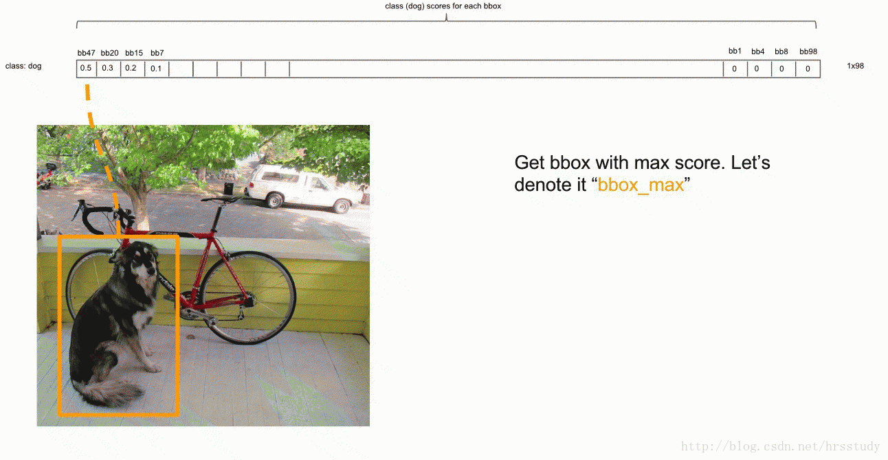

### 4 优缺

- 相比同时期算法, 简单统一, 实时性强,  
- 但是 无法很好地处理小目标和重叠目标,边界框定位精度较低对的,每个网格只能预测两个类别等等

### 5 QA

1. ##### 为什么两个bounding box

每个 bounding box 都有一组独立的参数，包括中心坐标、宽度、高度和置信度，能够分别拟合不同的目标。


## YOLOV2

> 引入了多种优化技术，解决了 YOLOv1 在小目标和重叠目标检测上的局限性

### 1.主要改进

#### 1.1 BN 加入

卷积层后添加批归一化（Batch Normalization）, 形成**CBL结构**

#### 1.2 anchor 

引入基于 Faster R-CNN 的 anchor box 机制，

>  什么是anchor ?
>
> 


1. 每个网格**预测多个预定义形状的锚框**, 而不是对每一个进行从0的回归
2. 每个网格预测 **5 个 anchor box**
3. 边界框坐标预测从直接回归 (x,y,w,h) 改为预测**相对于 anchor box 的偏移量**(t_x, t_y, t_w, t_h)
4. 

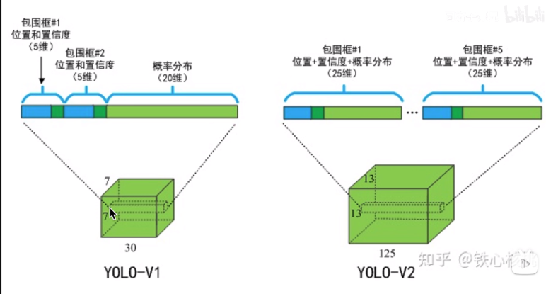

#### 1.3 维度聚类

通过K-mean聚类, 模型学习如何调整预定义的 anchor，而不是从零开始预测边界框的所有参数。


###  2. 训练

#### 2.1 Darknet-19


#### 2.2 pass through layer

将高分辨率特征图（例如 26x26）与低分辨率特征图（13x13）连接，保留更多细节信息. 


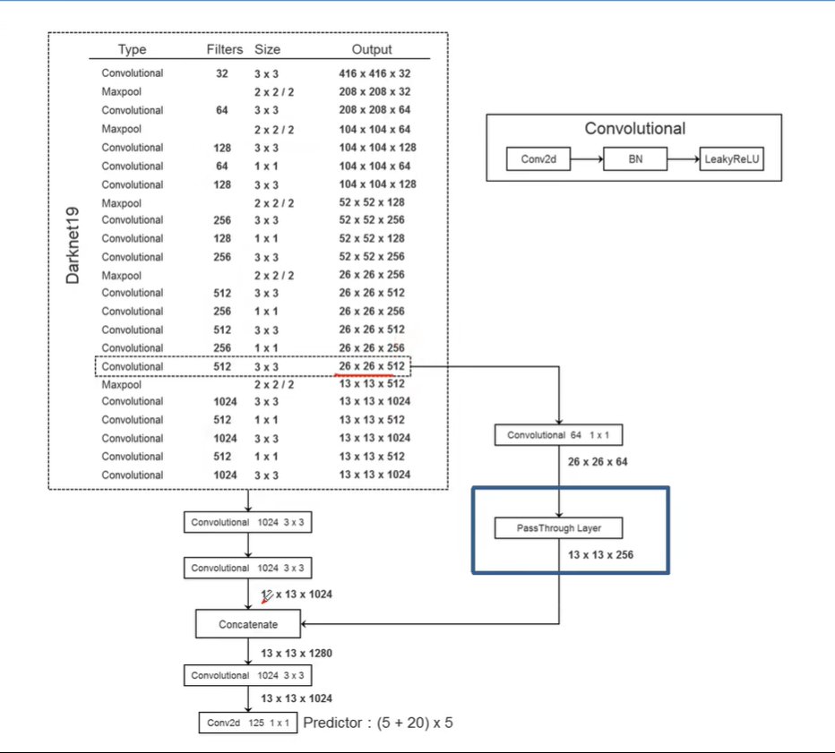 

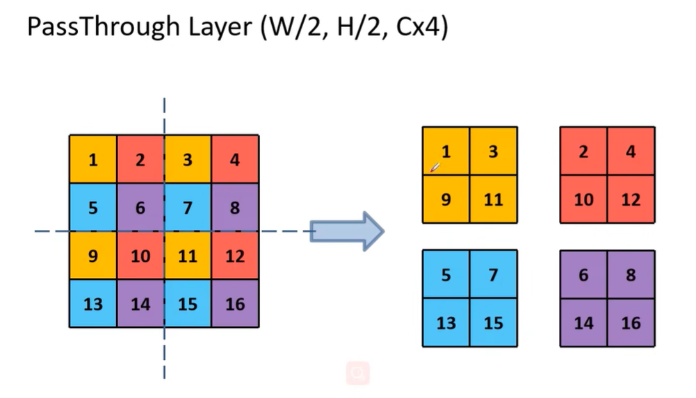 

#### 2.3 多尺度数据输入

在训练时随机调整输入图像分辨率（如 320x320、416x416、608x608 等），使模型适应不同尺度的输入。

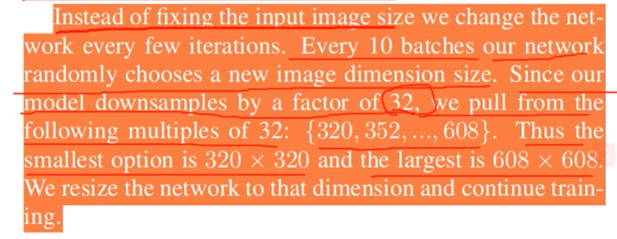 


#### 2.4 **损失函数优化**：

YOLOv2 延续了 YOLOv1 的三部分损失函数（坐标损失、置信度损失、分类损失），但对坐标预测进行了优化，使用 anchor box 的偏移量预测。


### 3. 优缺

- passthrough提高小目标检测, Darknet调高速度,9000 多种类别检测广泛性高
- 调整 anchor的复杂性, NMS重叠目标处理不足,


## YOLO V3

>从v2的darknet-19到v3的darknet-53
>
>https://zhuanlan.zhihu.com/p/564855770
>
>

### 1.主要改进

1. **backbone网络的提升**
2. **引入FPN进行多尺度预测**
3. **损失函数不再使用softmax(v2)，采用binary cross-entropy loss（二分类交叉损失熵）**

### 2 darknet-53

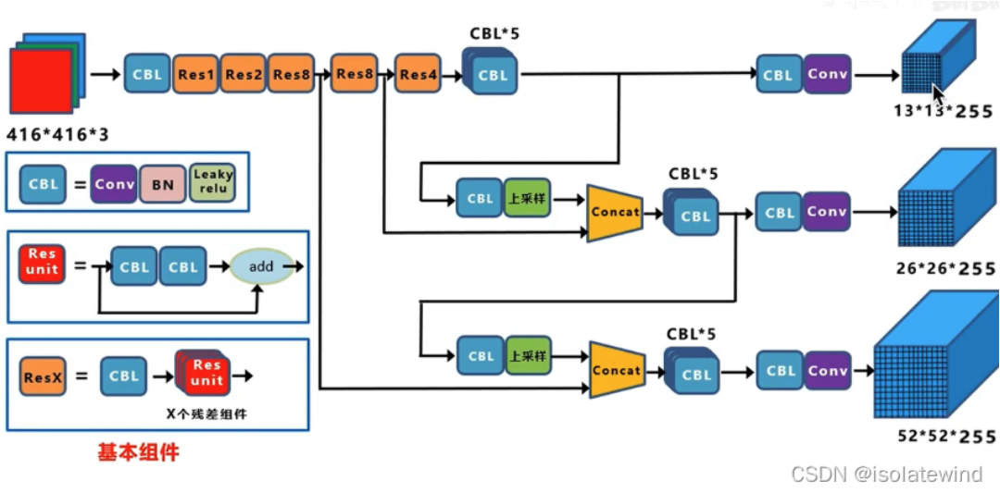

1. **CBL：**Yolov3网络结构中的最小组件，由**Conv+Bn+Leaky_relu**激活函数三者组成。
2. **Res unit：**借鉴**Resnet**网络中的残差结构，让网络可以构建的更深。
3. **ResX：**由一个**CBL**和**X**个残差组件构成，是Yolov3中的大组件。每个Res模块前面的CBL都起到下采样的作用，因此经过5次Res模块后，得到的特征图是**416->208->104->52->26->13大小**。

**三种尺度的特征图如下**：

- 尺度1: 在基础网络之后添加一些卷积层，输出13x13大小的特征图.
- 尺度2: 从尺度1中的倒数第二层的卷积层上采样(x2)再与darknet的最后一个26x26大小的特征图相加,再次通过多个卷积后，输出26 26大小的特征图.
- 尺度3: 从尺度2中的倒数第二层的卷积层上采样(x2)再与darknet的最后一个52x52大小的特征图相加,再次通过多个卷积后，输出52 52大小的特征图.

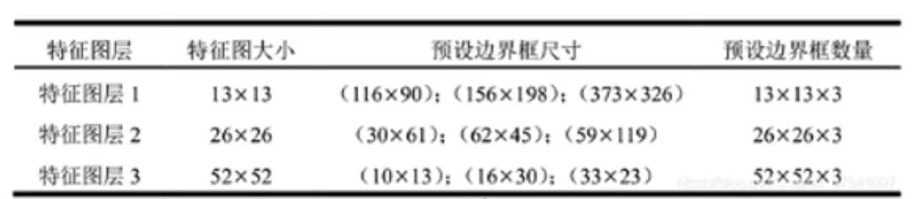


### 3 FPN

> https://arxiv.org/abs/1612.03144

FPN主要解决的是物体检测中的多尺度问题，通过简单的**网络连接改变**，在基本不增加原有模型计算量的情况下，大幅度**提升了小物体检测的性能。**

主要是因为: **低层的特征语义信息比较少，但是目标位置准确；高层的特征语义信息比较丰富，但是目标位置比较粗略**。

**FPN中, 自下向上就是深度卷积网络的前向提取特征的过程，自上而下则是对最后卷积层的特征图进行上采样的过程，横向的连接则是融合深层的卷积层特征和浅层卷积特征的过程**。

合了深层卷积层的高级别特征和浅层卷积层的低级别特征。

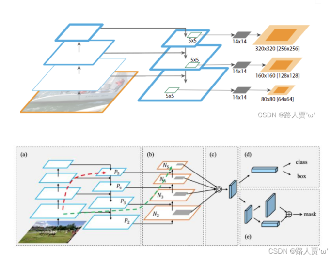


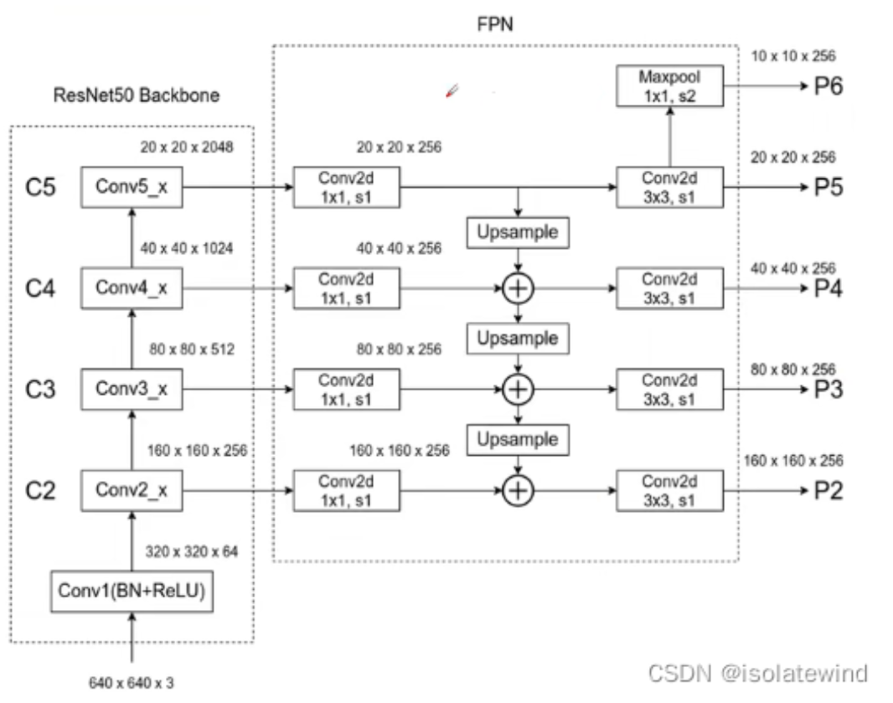

### 4. 损失改进

不使用Softmax而是改成使用logistic的输出进行预测。这样能够支持多标签对象


## YOLOV4

### 1 主要改进

1. 数据增强
2. 各种trick


### 2 数据增强

#### 1 SAT自对抗训练

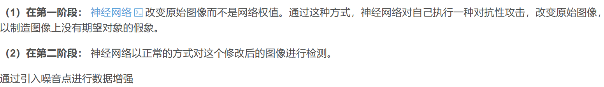

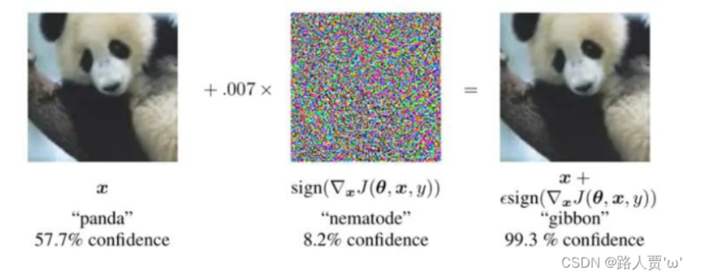

#### 2 Mosaic数据增强


#### 3. Label Smoothing类标签平滑


### 3 网络结构改进

#### 1 Backbone

##### 3.1.1 CSP

> 作用: 特征增强

##### 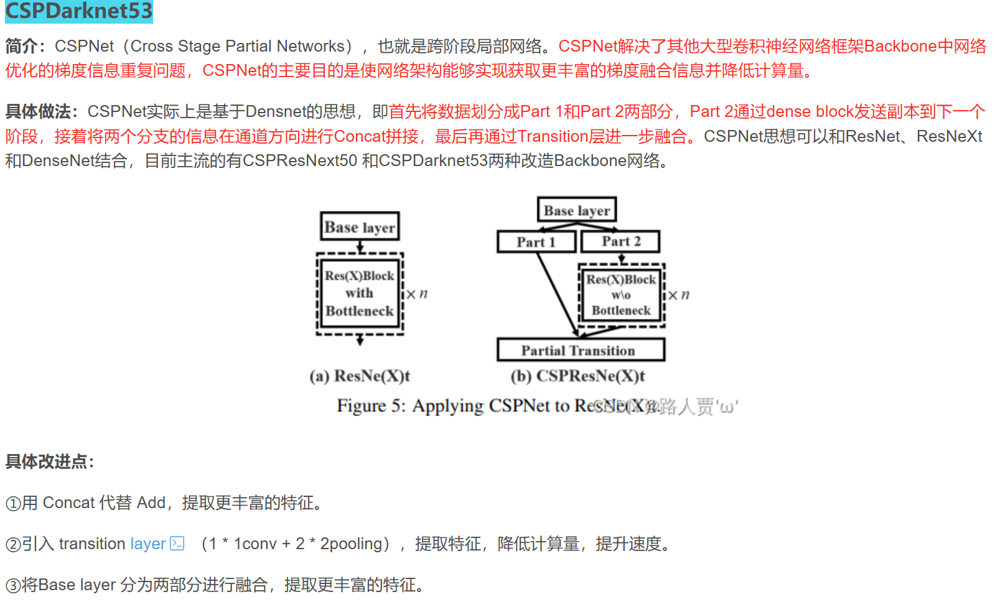 

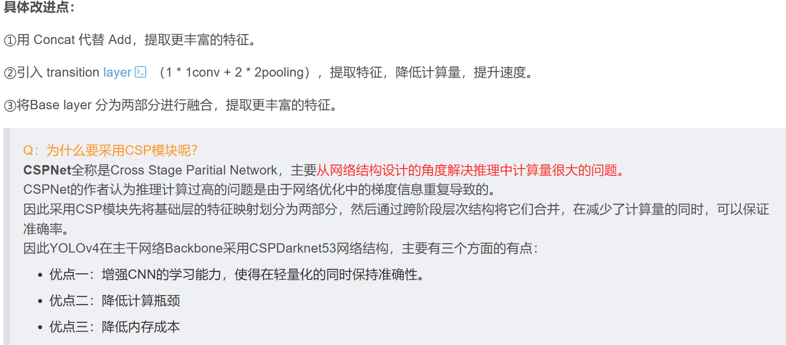 


#### 4 Neck

一个颈部neck由几个自下而上的路径和几个自上而下的路径组成。具有该机制的网络包括特征金字塔网络(FPN)、路径汇聚网络(PAN)、BiFPN和NAS-FPN。

##### 4.1 FPN

引入了自底向上的路径，使得底层信息更容易传到顶部

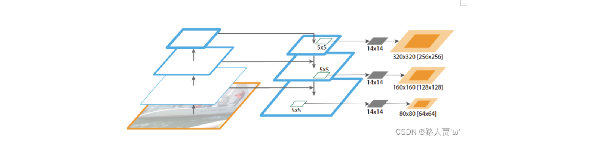

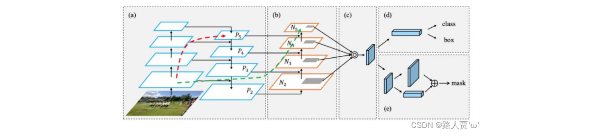

##### 4.2 PAN

特征层之间融合时是直接通过addition的方式进行融合的，而**Yolov4中则采用在通道方向concat拼接**操作融合的

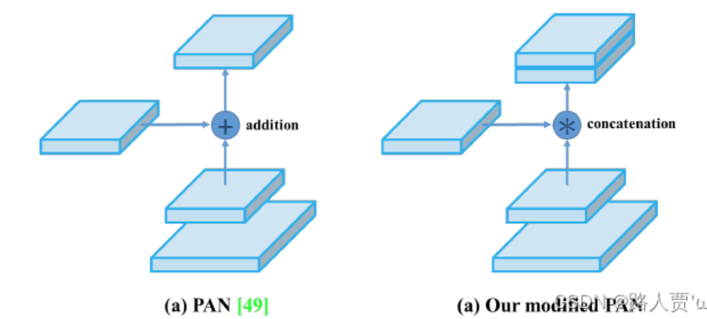

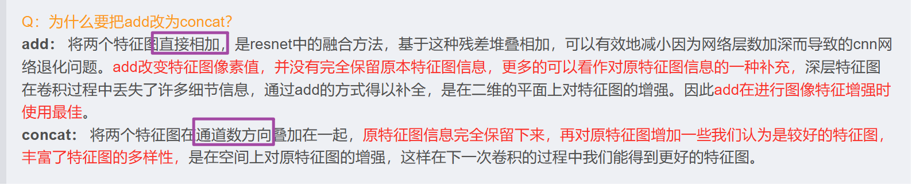


##### 4.3 SPP

> 作用: **特征增强+全局信息**

空间金字塔池化 特征提取池化 

通过在输入特征图上**采用不同尺度的池化窗口**（如1×1、2×2、4×4 等），SPP 能够从不同的空间范围内有效地捕获图像中不同大小和比例的目标特征

> 旨在解决卷积神经网络中固定大小输入的限制。它能够对任意大小的 输入特征图进行处理，并在不同尺度下提取特征，从而显著增强模型对不同大小目标的感 知能力

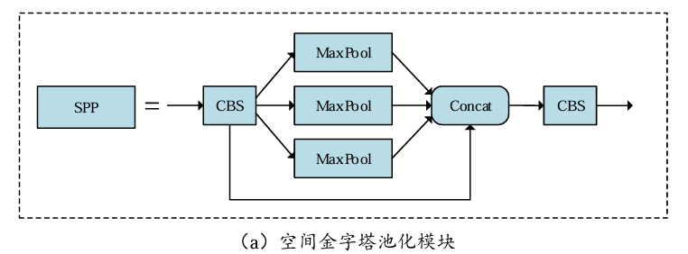

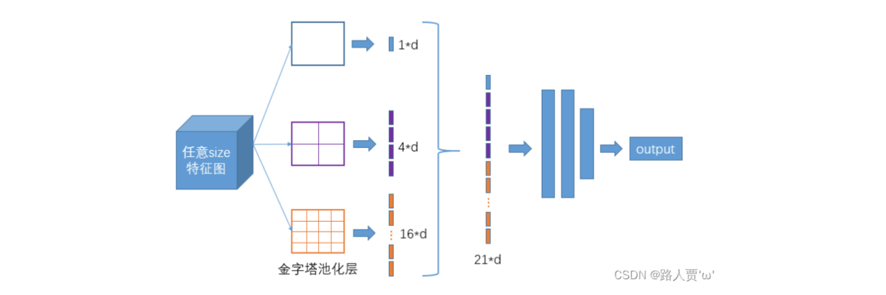


### 4 BoF

我们把这些只会**改变培训策略或只增加培训成本**的方法称为“bag of freebies”。

#### 1 数据增强


#### 2 解决数据集中语义分布偏差问题 

不同类之间存在数据不平衡的问题

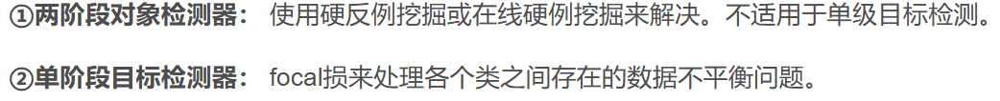 

#### 3 边界框(BBox)回归的目标函数 ??

直接估计BBox中每个点的坐标值是要将这些点作为自变量来处理，但实际上并没有考虑对象本身的完整性

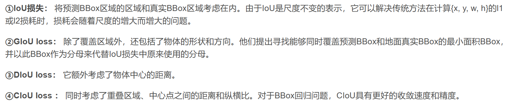


### 5 BoS

 对于那些只增加少量推理成本但又能显著提高目标检测精度的**插件模块和后处理方法**，我们称它们为“bag of specials"

#### 1 增强感受野

**①改进的SPP模块**

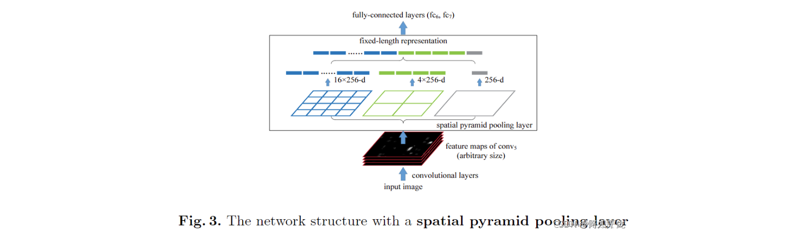

**②ASPP模块**

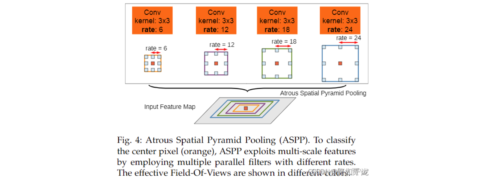

**③RFB模块**

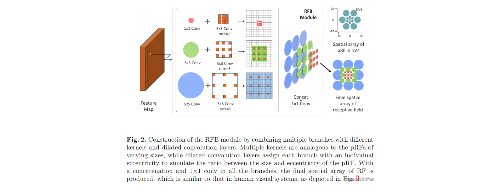

#### 2 注意力机制

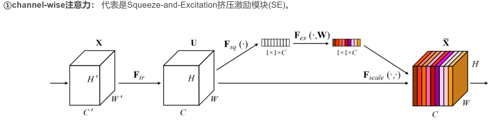 

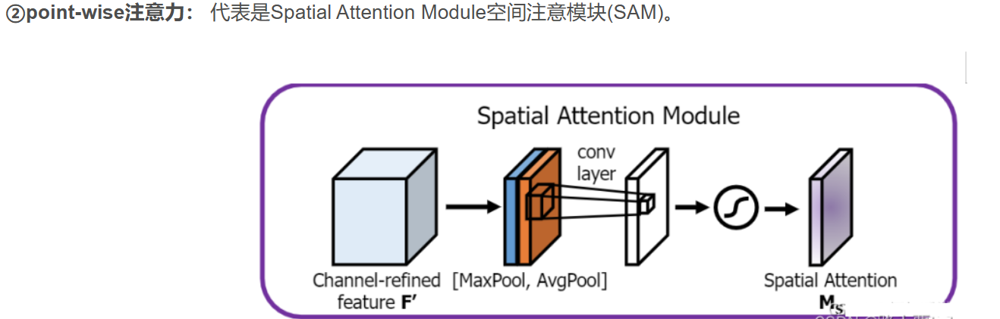 


#### 3 特征融合

**①SFAM：** 主要思想是利用SE模块在多尺度的拼接特征图上进行信道级重加权。

**②ASFF：** 使用softmax对多尺度拼接特征图在点维度进行加权。

**③BiFPN：** 提出了多输入加权剩余连接来执行按比例的水平重加权，然后添加不同比例的特征图。

#### 4 激活函数

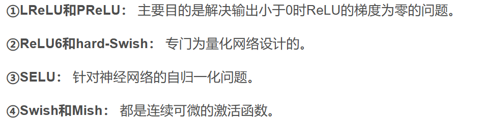 

#### 5 Dropblock正则化

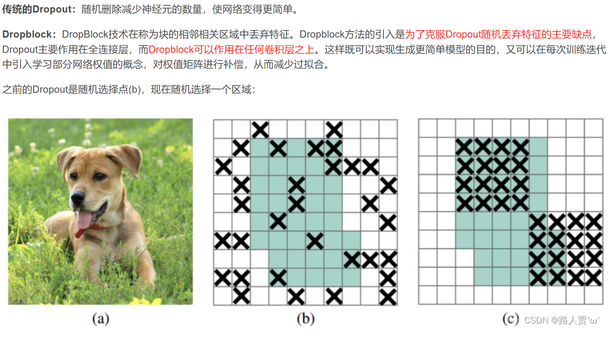 

> Q：全连接层上效果很好的Dropout在卷积层上效果并不好？
>
>  中间Dropout的方式会随机的删减丢弃一些信息，但Dropblock的研究者认为，卷积层对于这种随机丢弃并不敏感，因为卷积层通常是三层连用：卷积+激活+池化层，池化层本身就是对相邻单元起作用。
>
>  而且即使随机丢弃，卷积层仍然可以从相邻的激活单元学习到相同的信息。因此，在全连接层上效果很好的Dropout在卷积层上效果并不好。所以右图Dropblock的研究者则干脆整个局部区域进行删减丢弃。


## YOLO V5

> https://blog.csdn.net/weixin_43334693/article/details/129312409

### 1 主要改进

1. 增加不同size 从轻量级（YOLOv5n）到高精度（YOLOv5x）的多种模型变体
2. 自适应锚点计算
3. 训练优化


### 2. 自适应锚点计算

在Yolov3、Yolov4中，训练不同的数据集时，计算初始锚框的值是通过单独的程序运行的。

但Yolov5中将此功能嵌入到代码中，每次训练时，自适应的计算不同训练集中的最佳锚框值。

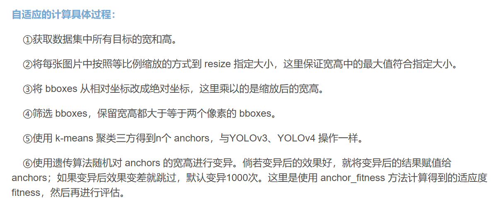

### 3.  网络结构改进

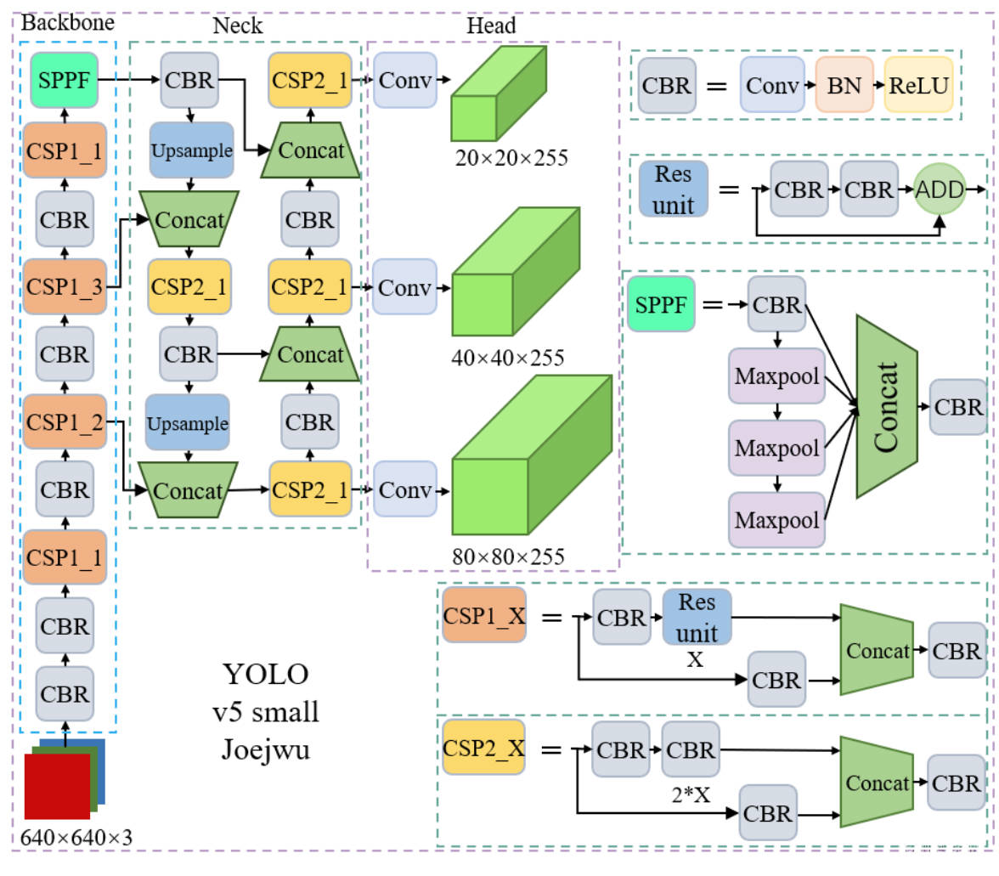

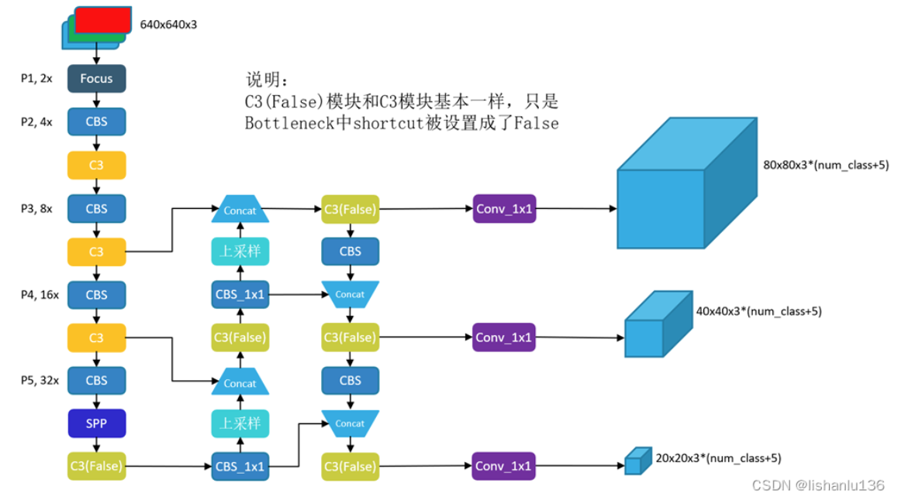

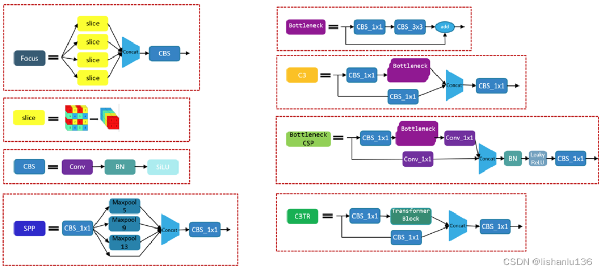

#### 3.1 Focus结构

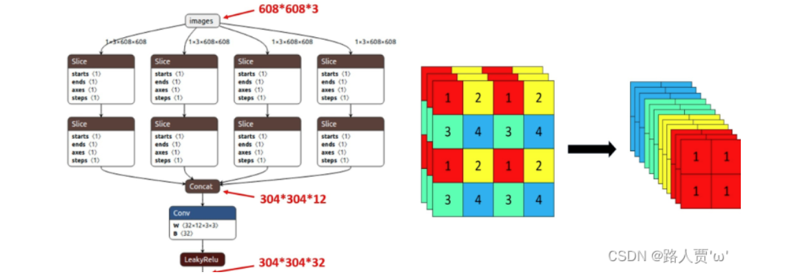

后改为6x6卷积操作


#### 3.2 CSP

定义: Conv + N个Res模块 + Conv

>  作用: 特征增强

在v5中, 出backbone加入CSP结构, **neck也加入了CSP结构**

### 4. 训练优化

#### 4.1 **数据增强**：

- **Mosaic 数据增强**：从 YOLOv4 继承，将 4 张图像拼接为一张，模拟复杂场景，提升小目标和遮挡目标的检测能力。
- **AutoAugment** 和 **MixUp**：自动增强和图像混合，进一步提高模型鲁棒性。
- **HSV 增强**：调整色调、饱和度和亮度，增强对光照变化的适应性。

#### 4.2 CIOU_LOSS

#### 4.3 SoftNMS


## YOLO V6

YOLOv6 是由美团改进版本

### 主要改进

YOLOv6 结合了最新的计算机视觉技术，针对 YOLOv5 的局限性进行了优化，以下是主要改进点（部分信息参考搜索结果）：

#### 1. 骨干网络：EfficientRep Backbone

- 设计

  ：

  - YOLOv6 引入了 **EfficientRep Backbone**，一个高效的特征提取器，基于 RepVGG 风格的重新参数化（Reparameterization）结构。
  - 在训练阶段使用 RepBlock（多分支结构），在推理阶段将其转换为单一的 3x3 卷积层（RepConv），减少计算量并提升推理速度。

- 优势

  ：

  - 高效的特征提取能力，参数量和计算量更少（例如 YOLOv6-N 参数量仅为 4.7M，FLOPs 为 11.4G）。
  - 适合移动设备和 CPU 部署，兼顾精度和速度。

#### 2. 特征融合：Rep-PAN Neck

- 设计：
  - YOLOv6 使用 **Rep-PAN Neck**（基于 PANet 的重新参数化版本），结合自底向上和自顶向下的特征融合路径。
  - 在训练阶段使用 CSPStackRep 模块（类似 YOLOv5 的 CSP 结构），推理阶段转换为高效卷积层。
- 优势：
  - 增强多尺度特征融合，尤其对小目标的特征提取更有效。
  - 提高对复杂场景的上下文理解能力。

#### 3. 双向连接模块（BiC Module）

- 设计：
  - 在 Neck 中引入 **Bidirectional Concatenation (BiC)** 模块，增强定位信号的传播。
- 优势：
  - 提高边界框定位精度，同时对推理速度影响微乎其微。
  - 特别适合工业场景中对精准定位的需求。

#### 4. Anchor-Aided Training（AAT）策略

- 设计：
  - YOLOv6 提出 **Anchor-Aided Training (AAT)**，结合 anchor-based 和 anchor-free 的优点。
  - 在训练阶段使用 anchor box 辅助定位，在**推理阶段移除 anchor 依赖，保持高效性。**
- 优势：
  - 提升训练稳定性，同时避免 anchor-free 模型的复杂性。
  - 推理效率更高，适合实时应用。

#### 5. 数据增强与训练优化

- Mosaic 数据增强：
  - 继承 YOLOv4/YOLOv5 的 Mosaic 增强，拼接多张图像模拟复杂场景，提升小目标和遮挡目标的检测能力。
- 自蒸馏（Self-Distillation）：
  - 在训练时引入辅助回归分支，提升小模型（如 YOLOv6-N/S）的性能，推理时移除该分支以保持速度。
- 损失函数：
  - **坐标损失**：使用 **Varifocal Loss** 或 **GIoU Loss**（根据模型变体），优化边界框定位。
  - **置信度损失**：使用二元交叉熵损失优化 objectness score。
  - **分类损失**：使用 **Varifocal Loss** 或 **Quality Focal Loss**，支持多标签分类，适应复杂场景。
- 量化优化：
  - 支持 **Post-Training Quantization (PTQ)** 和 **Quantization-Aware Training (QAT)**，生成 INT8 量化模型（如 YOLOv6Lite），适合移动设备部署。


## YOLO V7

专注于优化训练过程bo，在不增加推理成本的情况下显著提升精度。


## YOLO V8

> 特点: 改进

### 1. 主要改进

1. Anchor-Free 架构
2. C2f 模块
3. 特征融合, SPPF 和 FPN/PANet
4. 支持 对象检测、实例分割（YOLOv8-seg）、姿态估计（YOLOv8-pose）和 图像分类（YOLOv8-cls）。


### 2 Anchor-Free


### 3. 网络结构改进

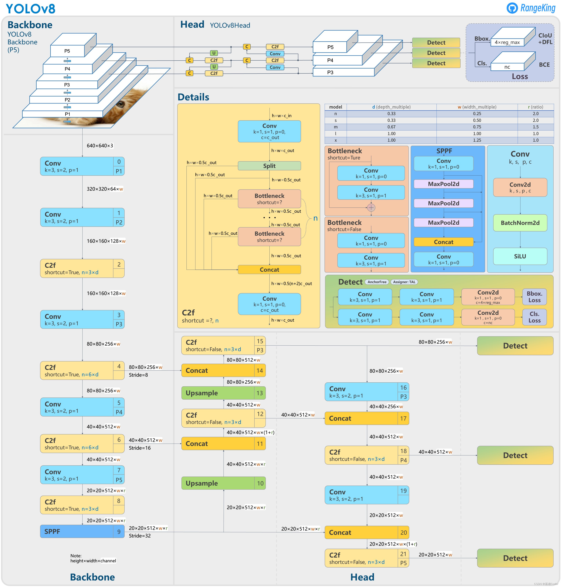

#### 3.1 C2F

定义:  Concatenate to fusion（可以理解为“融合后连接”）

>  作用:   **特征融合**和__**模型压缩**

组成:

1. Conv
2. n个Bottleneck
3. concat
4. Conv

**操作:**

每次bottleneck后取出半数通道, 最后进行concat


**优点:**

...

**区别:**

>  V5: bottleneck数据进行concat的方式不同(线性向前与分级向前)

细节:

1. 为什么开始和结束要使用1x1卷积

   > 1 开始: 升维
   >
   > 2  结束: 降维 

2. bottlenet为什么使用padding0和1的两个卷积

   >  1: **`1×1 conv` 没有 padding（padding=0）**只在通道维度做变换，不会改变空间大小
   >
   > 2:`3×3 conv`，空间特征提取，用 `padding=1` 是为了保持尺寸

#### 3.2 SPPF

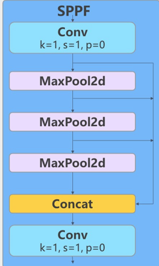

定义: 快速金字塔

>  作用: **特征增强模块** +**多尺度融合**

组成:

1.  将feature map 分为多个不同size的若干个path
1.  进行max pooling
1.  concat 

**操作**

SPPF 用连续多次 `kernel=5` 的池化，避免了并行不同 kernel，转为**串行相同 kernel** 

**优点:**

  不同大小的感受野

**区别:**

>  V5 使用了不同K的池化

1. 为什么要在backbone的最后才添加?

   > 1: 最后是高级语义 汇聚全局信息maxpooling
   >
   > 2: 最后size很小进行pooling 不会损失信息


#### 3.3 Detect

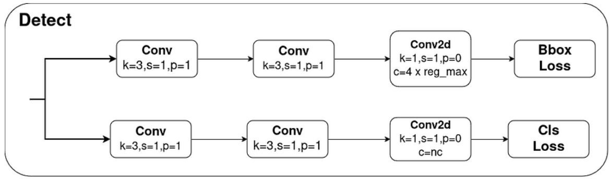

**组成:**

1. 边界框预测
2. 类别预测:

#### loss

**区别**: 无ancher

YOLOv8 head 输出 `[B, H, W, 4+cls+obj]` 

### 问题:

anchor-free ：如果多个目标落在 **同一个 cell（像素）中心**：

1. **center prior**（中心先验）:  

   > 只有 **中心点附近的 cell（通常限定一个 radius 区域）** 才有资格被分配为“正样本”

2. YOLOv8 的 **dynamic-k matching：**

   > 计算每个候选正样本（中心附近 cell）的 IoU
   >  按 IoU 排序
   >  通过 **ΣIoU 确定动态的 k（正样本数）**
   >  选择 top-k 作为正样本

3. 👉 如果两个目标中心点落在 **同一个 cell**：

   > 按照 **center prior → 同一个 cell 确实是两个目标都“想分配”的 cell**
   >
   > 但！**dynamic-k matching 会用 IoU 排序决定“更合适”分配给谁**
   >  → 更高 IoU 的目标会“赢” → 另一个目标需要“找附近 cell”作为正样本


## YOLO V9

## YOLO V10


## YOLO V11

> 特点: 改进

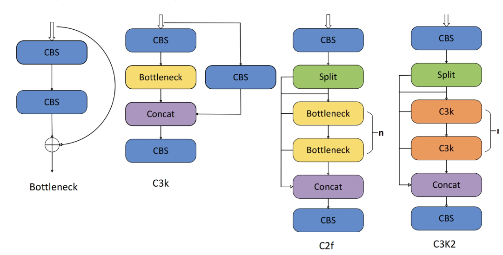

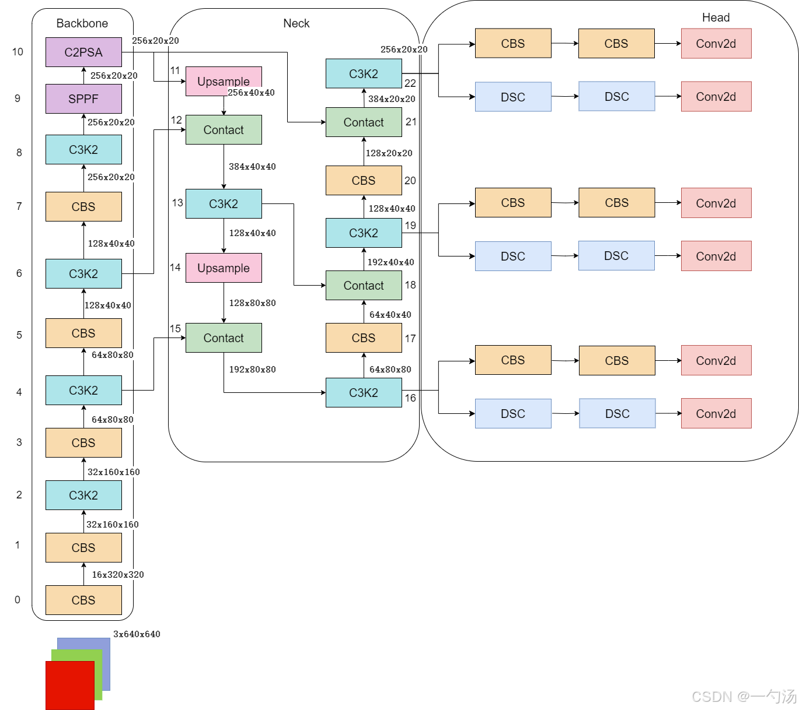

### 2.1 C3K2

**定义**:  将bottlenetck改为C3K

>  作用:   **特征融合**和__**模型压缩**

**组成:**

1. CBS
2. n个Bottleneck = **C3K**
3.  concat
4.  CBS

#### C3K: 

1. CBS
2. 1 bottleneck = CBSx2 + res 
3. concat: 12+ CBS
4. CBS

**优点:**

1️⃣ 增加网络的深度和非线性表达能力
 → 更深的路径可以学到更复杂的特征

2️⃣ 更高的参数复用效率
 → 通过残差和重复结构，避免纯深度带来的退化问题

3️⃣ 提高局部感受野
 → 套娃 bottleneck 可以让局部更“通透”，减少信息屏蔽

**区别:**

>  V8: 相当于套娃加了深度,多了一个bottleneck 

**细节:**


### 2.2 C2PSA

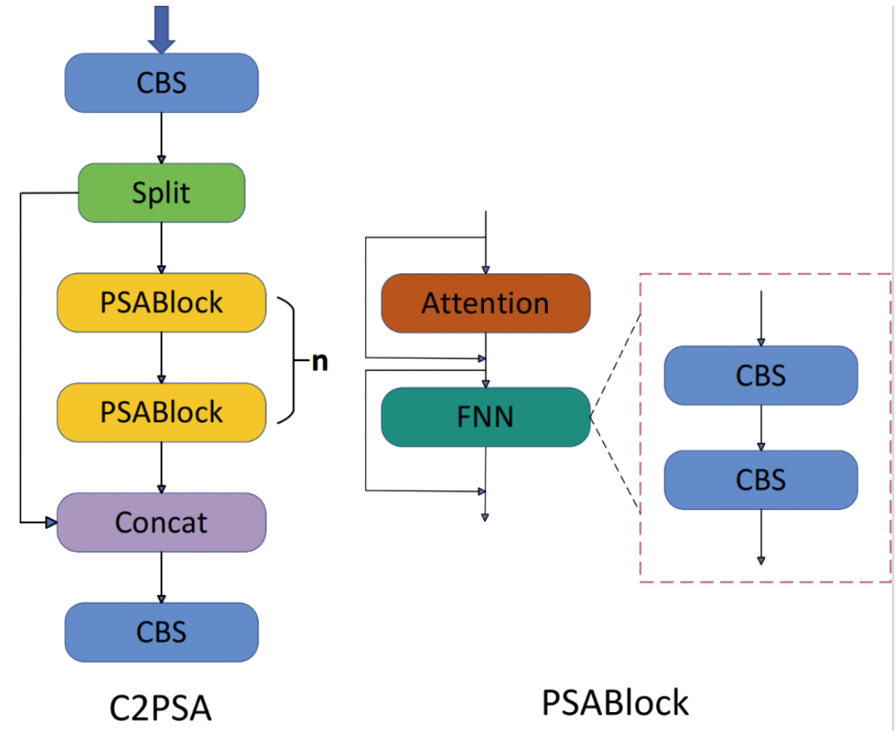

**定义:**

> 作用:**补充全局感知能力 **优化梯度传播和网络训练效果

**组成:**

1. 类似C2f模块
2. bottleneck=PSAbBlock

**PSA:**


### 2.3 head

**区别**:深度可分离的方法


## YOLOv12

> 将注意力机制直接融入目标检测框架的核心设计

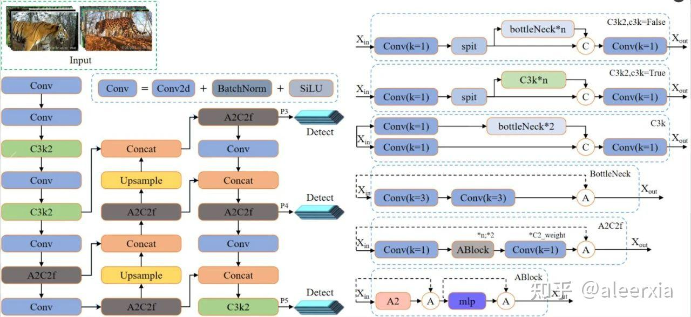


### 1 关键技术改进

> #### **1.1 区域注意力（Area Attention）**
>
> - **原理**：将特征图划分为相等区域（默认 4 部分）以降低计算复杂度，同时保持较大的感受野。  
> - **优势**：相比传统自注意力机制的 $O(n^2)$ 复杂度，区域注意力将计算成本降低 **50%**。
>
> ---
>
> #### 1.2 残差高效层聚合网络（R-ELAN）
>
> - **改进点**：在原始 ELAN 架构基础上，引入 **块级残差连接** 与 **缩放技术**（缩放因子 0.01）。  
> - **解决问题**：提升大规模模型训练的稳定性。  
> - **效果**：  
>   - 参数减少 **18%**  
>   - FLOPs 降低 **24%**
>
> ---
>
> #### 1.3 FlashAttention 集成
>
> - **优化**：改进内存访问模式，显著加速注意力计算。  
> - **硬件适配**：针对现代 GPU 架构（Turing / Ampere / Ada Lovelace / Hopper）优化。  
> - **实测结果**（RTX 3080）：加速 **0.3-0.4 ms**。

### 2 具体细节

#### 2.1 区域注意力（Area Attention）机制

YOLOv12 的核心创新之一，主要解决传统自注意力的两大瓶颈：

**1. 计算复杂度优化**

- **传统自注意力**：对 $H \times W$ 特征图的计算复杂度为 $O(H^2 W^2)$  
- **区域注意力**：将特征图按水平方向或垂直方向划分为 $l$ 个相等部分（默认 $l=4$），复杂度降至：
  - 水平划分：$O\left(\frac{H^2}{l^2} W^2\right)$
  - 垂直划分：$O\left(H^2 \frac{W^2}{l^2}\right)$  
- **优势**：无需复杂窗口划分，降低计算成本同时保持较大感受野。

**2. 内存访问效率提升**

- 结合 **FlashAttention** 技术，通过 I/O 优化减少内存访问次数，充分利用 GPU 内存层次结构。  
- 测试表明，**纯卷积实现** 比线性替代方案速度更快。

**实现方式**

1. 将特征图按指定方向划分为多个区域  
2. 在各区域内分别计算注意力  
3. 合并结果得到全局特征  
- 在固定分辨率（如 $n=640$）下可实现实时检测  
- 与 **轴向注意力** 对比：
  - 感受野扩大 **4 倍**
  - 速度下降（实测 YOLOv12 ≈ 180 FPS vs YOLOv11 ≈ 250 FPS）

---

#### 2.2 残差高效层聚合网络（R-ELAN）
R-ELAN 是对原始 ELAN 架构的重要改进，主要针对以下两个问题：

**1. 训练不稳定性**

- 在较大模型（YOLOv12-L / YOLOv12-X）中，原始 ELAN 容易出现 **梯度阻塞** 与 **优化困难**。  
- **改进方法**：
  - 添加 **输入到输出的残差连接（跳跃连接）**
  - 使用 **层缩放技术**（缩放因子 0.01）  
- **效果**：显著提升大规模模型训练稳定性。

**2. 特征聚合效率**

- **原始 ELAN**：输入 → 过渡层 → 拆分多路并行处理 → 拼接  
- **R-ELAN**：输入 → 过渡层调整通道 → 单一特征图 → 并行处理 → 拼接成瓶颈结构  
- **优势**：
  - 降低计算成本
  - 提升特征聚合效率

#### 2.3 其他架构优化
YOLOv12 在核心模块之外，还进行了多项精细化的结构改进：

**1. MLP 比例调整**

- 将典型 Transformer 中 MLP 扩展比例 **从 4 降至 1.2~2**  
- 目的：平衡 **注意力层** 与 **前馈层** 的计算量，减少冗余计算。

**2. 位置编码替代**

- 去除显式位置编码  
- 引入 **7×7 深度可分离卷积**（"位置感知器"）来隐式建模位置信息  
- **优势**：架构更简洁、速度更快。

**3. 块数量减少**

- 减少堆叠块的数量  
- 简化优化过程、降低推理时间。

**4. 卷积算子集成**

- 在适当位置保留高效卷积操作  
- 降低整体参数数量与计算成本。

---


## YOLOv13

> 属于社区开发的衍生版本（非 Ultralytics 官方版本）

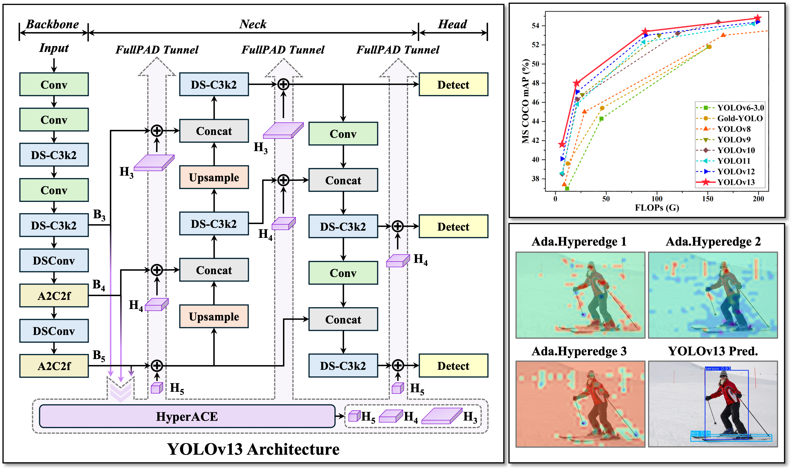


### 1 核心技术创新

> #### 1.1 HyperACE：基于超图的自适应关联增强
>
> - **技术原理**：  
>   将多尺度特征图中的像素视为超图顶点，通过可学习的超边构建模块自适应探索顶点间的高阶关联，  
>   并利用线性复杂度的消息传递模块聚合特征，提升复杂场景下的视觉感知能力。
>
> - **作用**：  
>   强化不同尺度特征间的语义关联，尤其对小目标和密集目标检测效果显著。
>
> ---
>
> #### 1.2 FullPAD：全流程聚合 - 分布范式
>
> - **技术原理**：  
>   通过 HyperACE 聚合骨干网络的多尺度特征，再通过三条独立“隧道”将增强后的特征分别传递到：  
>   - 骨干与颈部连接处  
>   - 颈部内部  
>   - 颈部与头部连接处  
>     实现全流程细粒度信息流协同。
>
> - **作用**：  
>   改善梯度传播效率，提升模型整体检测性能。
>
> ---
>
> #### 1.3 轻量级卷积替换
>
> - **技术原理**：  
>   使用深度可分离卷积（DSConv、DS-Bottleneck 等）替代大核卷积，  
>   在保持感受野的同时大幅减少参数和计算量。

### 2 HyperACE


## YOLO26

> （端到端版本, 对标yolov10, 无nms等后处理操作）
>
> https://docs.ultralytics.com/models/yolo26/

### 1 关键技术改进

- **DFL 移除**
  分布式焦点损失（DFL）模块虽然有效，但常常使导出复杂化并限制了硬件兼容性。YOLO26 完全移除了 DFL，简化了推理过程，并拓宽了对**边缘和低功耗设备**的支持。
- **端到端无NMS推理**
  与依赖NMS作为独立后处理步骤的传统检测器不同，YOLO26是**原生端到端**的。
- **ProgLoss + STAL**
  改进的损失函数提高了检测精度，在**小目标识别**方面有显著改进
- **MuSGD Optimizer**
  一种新型混合优化器，结合了[SGD](https://docs.pytorch.org/docs/stable/generated/torch.optim.SGD.html)和[Muon](https://arxiv.org/abs/2502.16982)。MuSGD 将 LLM 训练中的先进优化方法引入计算机视觉，从而实现更稳定的训练和更快的收敛。
- **CPU推理速度提升高达43%**
  YOLO26专为边缘计算优化，提供显著更快的CPU推理，确保在没有GPU的设备上实现实时性能。
- **实例分割增强**
  引入语义分割损失以改善模型收敛，以及升级的原型模块，该模块利用多尺度信息以获得卓越的掩膜质量。
- **精确姿势估计**
  集成[残差对数似然估计](https://arxiv.org/abs/2107.11291) (RLE)，以实现更精确的关键点定位，并优化解码过程以提高推理速度。
- **优化旋转框检测解码**
  引入专门的角度损失以提高方形物体的检测精度，并优化旋转框检测解码以解决边界不连续性问题。

## YOLO-World

> https://github.com/AILab-CVC/YOLO-World
>
> https://zhuanlan.zhihu.com/p/690233858
>
> https://blog.csdn.net/weixin_47151388/article/details/137424184

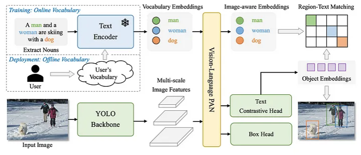

### 1 关键技术 ------开放词汇目标检测（OVD）

> 旨在识别超出预先建立类别范围之外的对象。

能够解释提示的上下文，以进行准确的检测，而**无需进行特定的类别训练**。它利用大量的图像-文本对和基础图像进行训练，以理解和响应各种提示，例如“穿着白色衬衫的人”。提升了YOLO系列检测器在**零样本场景中的泛化能力。**

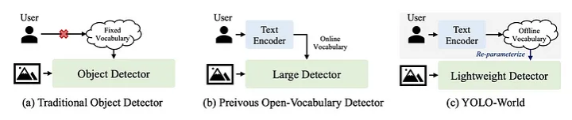

引入“提示-然后检测”的方法论，YOLO-World避开了即时文本编码的需要，而是利用用户提示生成的离线词汇来进行检测。

### 2 具体细节

#### 2.1 可重新参数化的视觉-语言路径聚合网络（RepVL-PAN）


通过多尺度图像特征{C3, C4, C5}建立特征金字塔{P3, P4, P5}。此外，我们提出了文本引导CSPLayer (T-CSPLayer)和图像池注意(I-Pooling Attention)，进一步增强图像特征和文本特征之间的交互，从而提高开放词汇的视觉语义表示能力。在推理过程中，离线词汇嵌入可以重新参数化为卷积层或线性层的权重，以便部署。

#### 2.2 区域-文本对比损失


## YOLO-segment

### 1 核心区别

模型输出的维度和含义与目标检测模型不一样

 ***\*`segment` 模型推理阶段\**，模型**原始输出（raw output）**并不是 polygon 或 mask，而是 **两个张量**：

1. detection head output
2. mask prototype output

**推理流程如下：**

```
image
  ↓
backbone + neck
  ↓
detection head ──────→ bbox + class + objectness + mask coefficients
  ↓
proto head ──────────→ mask prototypes
```


### 2 prototype mask

YOLO 不直接预测 mask, 而是利用prototype mask

模型先预测：

​	32 个基础 mask 模板

形状：

​	proto = (32, 160, 160)

可以理解成：

```
proto[0] → 边缘模板
proto[1] → 中心模板
proto[2] → 圆形模板
proto[3] → 细长模板
...
proto[31]
```

通过预测每个mask的**coeff**
例如:coeff = [0.4, -0.2, 0.7, ... , 0.1]

最终通过 **线性组合**生成mask

```
mask = sigmoid(np.sum(coeff[i] * proto[i] for i in range(32)))
```


### 3 模型输出

#### 3.1 Detection Head 输出

形状通常为：

```
(batch, num_anchors, 4 + num_classes + num_masks)
```

例如：

```
(1, 8400, 4 + 80 + 32)
```

解释：

| 部分        | 含义              |
| ----------- | ----------------- |
| 4           | bbox (x,y,w,h)    |
| num_classes | 类别概率          |
| 32          | mask coefficients |

------

#### 3.2 Mask Prototype 输出

第二个输出是 **mask prototype**：

```
(batch, num_protos, mask_h, mask_w)
```

例如：

```
(1, 32, 160, 160)
```

解释：

```
32 = mask basis
160x160 = mask feature map
```

可以理解为：

```
32 个基础 mask 模板
```


#### 3.3 mask生成

```
proto (32,160,160)
   ↓
coeff (32)
   ↓
matrix multiply
   ↓
mask (160,160)
   ↓
crop bbox
   ↓
final instance mask
```


## YOLOE

> https://zhuanlan.zhihu.com/p/29944215233


### 1 关键技术改进

传统模型YOLO系列虽以高效著称，却受限于预定义类别. YOLOE支持文本、视觉、无提示全场景的实时视觉全能模型。


- YOLOE的架构基于经典的YOLO系列模型，主要由以下几个部分组成：
  - **骨干网络（Backbone）**：负责提取图像的多尺度特征。
  - **PAN（Path Aggregation Network）**：用于进一步融合多尺度特征，增强特征表达能力。
  - **回归头（Regression Head）**：预测目标边界框的位置和大小。
  - **分割头（Segmentation Head）**：生成目标的分割掩码。
  - **对象嵌入头（Object Embedding Head）**：生成每个锚点的对象嵌入，用于与提示嵌入进行对比。

YOLOE的核心创新在于其能**够处理多种提示机制，包括文本提示、视觉提示和无提示场景。对于文本提示.**

YOLOE通过**可重参数化区域-文本对齐（RepRTA）**策略来增强文本嵌入与视觉特征的对齐。对于视觉提示，YOLOE设计了**语义激活视觉提示编码器（SAVPE）**通过解耦的语义和激活分支生成高效的视觉提示嵌入。对于无提示场景，YOLOE引入了**懒惰区域-提示对比（LRPC）**策略，通过内置的大词汇表检索类别名称，避免了依赖昂贵的语言模型。

### 2 具体细节

#### 2.1 可重参数化区域-文本对齐（**Re-parameterizable region-text alignment:** RepRTA）

 

在开放集场景中，文本提示与视觉特征的对齐至关重要。传统的跨模态融合方法虽然能够提升对齐效果，但计算开销较大，尤其是在处理大量文本时。为此，YOLOE提出了RepRTA策略，通过一个轻量级的辅助网络来改进预训练的文本嵌入。

具体来说，RepRTA首先使用CLIP文本编码器生成预训练的文本嵌入。然后，通过一个轻量级的辅助网络（仅包含一个前馈块）对这些嵌入进行增强。训练时，辅助网络仅需处理文本提示，计算开销较低。推理时，辅助网络可以无缝重参数化为分类头，使得模型在推理时与标准的YOLO模型完全一致，实现了零开销。

#### 2.2 语义激活视觉提示编码器（**Semantic-activated visual prompt encoder:** SAVPE）

视觉提示通过视觉线索（如边界框或掩码）指示感兴趣的对象类别。为了高效处理视觉提示，YOLOE设计了SAVPE，它包含两个解耦的分支：

- **语义分支**：输出与提示无关的语义特征，保持低计算开销。
- **激活分支**：通过与图像特征的交互生成分组提示感知权重，用于加权语义特征。

具体来说，SAVPE首先将视觉提示形式化为掩码，并通过卷积操作生成提示特征。然后，语义分支从PAN的多尺度特征中提取语义特征，激活分支通过卷积操作生成提示感知权重。最后，通过加权语义特征生成视觉提示嵌入，用于与对象嵌入进行对比。

#### 2.3 懒惰区域-提示对比（**Lazy region-prompt contrast:** LRPC）

在无提示场景中，模型需要识别图像中的所有对象并生成类别名称。传统的生成式方法依赖于大型语言模型，计算开销较大。为此，YOLOE提出了LRPC策略，将无提示场景重新定义为检索问题。

具体来说，LRPC首先通过一个专用的提示嵌入找到所有对象的锚点。然后，仅将这些锚点与内置的大词汇表进行匹配，检索类别名称。通过这种方式，LRPC避免了处理大量无关锚点的计算开销，显著提升了效率。


# 2.结构分析


## 3 检测头

解耦头

> 即分开计算BboxLoss和ClsLoss

**reg_max**

定义:

> 作用


# 结果分析

## 0 labels

**labels**

定义: 混淆矩阵。矩阵的每一列代表一个类的实例预测，而每一行表示一个实际的类的实例。

> 作用: 是否将两个不同的类混淆了
>
> 分析:
>
> 1. 第一个图是训练集得数据量，每个类别有多少个
> 2. 第二个是框的尺寸和数量
> 3. 第三个框的center点的位置。
> 4. 第四个是labeld的高宽相比于整个图片

   

**labels_correlogram**

定义: **类别相关性热力图（correlation heatmap）**。

> 作用: 是否将两个不同的类混淆了
>
> 分析: 颜色越深，表示对应标签之间的相关性越强；颜色越浅，表示相关性越弱
>
> 1. 哪些**标签之间具有较强的相关性**
> 2. 如果我们发现某些标签之间的相关性过强，可以考虑将它们合并成一个标签，从而简化模型并提高效率。

  

## 1 confusion_matrix

定义: 混淆矩阵。矩阵的每一列代表一个类的实例预测，而每一行表示一个实际的类的实例。

> 作用: 是否将两个不同的类混淆了
>
> 分析:
>
> 1. left4 容易认为是background

 

## 2  P&R&PR&F1_curve

**2.1 P_curve**

定义: 当我设置置信度为某一数值的时候，各个类别识别的准确率。

> 作用: 

 


**2.2  R_curve**

定义: 当我设置置信度为某一数值的时候，各个类别识别的召回率（查全率）和置信度的关系图。

> 作用:  越全面


**3. PR_curve**

定义: 精度与召回率曲线

> 作用:  精度与召回率的关系
>
> 分析: 希望mAP曲线的面积尽可能接近1

 

**4 F1_curve**

定义: 

> 作用: **精确率和召回率的调和平均数**
>
> 分析: 

 

## 3 other

**3.1 loss functions**

> 定义: 各类信息

**3.2 result.csv**

> 定义: 训练的输出 results.txt中最后三列是验证集结果，前面的是训练集结果

**3.3 train_batchx|val_batchx_labels|val_batchx_pred**

> batchsize'分析


ok


# 消融实验

| Model                          | Layers | Params(M) | GFLOPs | mAP@0.5     | mAP@0.5:0.95 | Precision | Recall  | Val Box | Val Cls | Val DFL |
| ------------------------------ | ------ | --------- | ------ | ----------- | ------------ | --------- | ------- | ------- | ------- | ------- |
| wire（YOLOv8s）                | 129    | 11.142    | 28.7   | **0.97932** | **0.61878**  | 0.96333   | 0.95744 | 1.34446 | 0.68130 | 0.98080 |
| wire-CBAM2                     | 149    | 4.461     | 19.8   | 0.98499     | 0.65787      | 0.96523   | 0.96764 | 1.23725 | 0.60513 | 0.96018 |
| wire-ghost                     | 137    | 2.824     | 7.8    | 0.97932     | 0.61878      | 0.96333   | 0.95744 | 1.34446 | 0.68130 | 0.98080 |
| wire-Ghost-C3ghost-GSCSP       | 291    | 5.857     | 17.4   | 0.97649     | 0.61437      | 0.95304   | 0.94231 | 1.34232 | 0.67661 | 0.97089 |
| wire-Ghost-x-x-CBAM            | 162    | 3.399     | 15.5   | 0.97125     | 0.63970      | 0.94271   | 0.95166 | 1.28386 | 0.64999 | 0.96416 |
| wire-Ghost-C3ghost-GSCSP-CBAM3 | 311    | 7.222     | 28.8   | 0.97058     | 0.61882      | 0.94713   | 0.95569 | 1.34975 | 0.69796 | 0.96739 |
| wire-Ghost-C3ghost             | 259    | 3.136     | 8.9    | 0.96228     | 0.58690      | 0.87856   | 0.93795 | 1.43447 | 0.77993 | 0.96887 |
| wire-C2Ghost-o                 | 251    | 0.999     | 3.2    | 0.77162     | 0.34710      | 0.63183   | 0.79332 | 1.94767 | 1.21099 | 1.09901 |

总结

| 模型                          | Params(M) | ↓参数压缩  | GFLOPs | ↓GFLOPs    | mAP@0.5     | ΔmAP@0.5     | mAP@0.5:0.95 | ΔmAP@0.5:95  | 结论             |
| ----------------------------- | --------- | ---------- | ------ | ---------- | ----------- | ------------ | ------------ | ------------ | ---------------- |
| wire                          | 11.142    | -          | 28.7   | -          | 0.97932     | 0            | 0.61878      | 0            | 基准             |
| wire-ghost                    | 2.824     | **74.6%↓** | 7.8    | **72.8%↓** | 0.97932     | +0.00000     | 0.61878      | +0.00000     | 极优             |
| wire-CBAM2                    | 4.461     | 59.9%↓     | 19.8   | 31.0%↓     | **0.98499** | **+0.00567** | **0.65787**  | **+0.03909** | 准确性最优       |
| wire-Ghost-C3ghost            | 3.136     | 71.8%↓     | 8.9    | 69.0%↓     | 0.96228     | −0.01704     | 0.58690      | −0.03188     | 稳健但略降       |
| wire-Ghost-C3ghost-GSCSP      | 5.857     | 47.4%↓     | 17.4   | 39.3%↓     | 0.97649     | −0.00283     | 0.61437      | −0.00441     | 平衡最优         |
| wire-Ghost-C3ghost-GSCSP-CBAM | 7.222     | 35.2%↓     | 28.8   | ≈持平      | 0.97068     | −0.00864     | 0.63409      | +0.01531     | 精度提升轻度补偿 |
| wire-Ghost-x-x-CBAM           | 3.399     | 69.5%↓     | 15.5   | 46.0%↓     | 0.97125     | −0.00807     | 0.63970      | +0.02092     | 轻量+CBAM 平衡型 |
| wire-C2Ghost-o                | 0.999     | **91.0%↓** | 3.2    | **88.9%↓** | 0.77162     | −0.20770     | 0.34710      | −0.27168     | 极端轻量，损失大 |

> 在保持较低参数量（<5M）和计算复杂度（<20 GFLOPs）前提下，`Ghost + C3ghost + GSCSP + CBAM` 的组合在 mAP@0.5 上基本保持在 **0.97 以上**，性能与原始结构相当甚至更优。

> 实际推理速度和资源占用显著优于原版 YOLOv8。量化后的模型在 mAP@0.5 上仅有 **0.5%-1% 左右的下降**，但带来了 **20%-40% 的加速提升**，更适合在嵌入式或边缘设备上部署。


# Ultralytics 库

Ultralytics 是一个强大的 Python 库，主要用于计算机视觉任务，尤其是对象检测、实例分割和图像分类。它以 YOLO（You Only Look Once）系列模型为核心，提供简单易用的 API，适用于研究和生产环境。以下是对 YOLO.predict() 方法及其返回结果 result 的中文介绍。

## YOLO

YOLO 是 Ultralytics 库的核心模型，基于 YOLOv8 等先进架构，支持高效、实时的对象检测、分割和关键点检测。用户可以通过预训练模型或自定义训练模型来处理图像或视频中的目标检测任务。

## YOLO.predict()

> https://docs.ultralytics.com/modes/predict/#inference-arguments

YOLO.predict() 是 Ultralytics YOLO 模型的主要推理方法，用于对输入数据（图像、视频或数据流）进行预测

### 1 用法/参数说明

```python
from ultralytics import YOLO
model = YOLO("yolov8n.pt")  # 使用预训练模型（如 yolov8n.pt）
result = model.predict(source="image.jpg",  save=True, conf=0.25, iou=0.45)
```

**推理参数说明**：

| Argument        | Type             | Default                | Description                                                  |
| :-------------- | :--------------- | :--------------------- | :----------------------------------------------------------- |
| `source`        | `str`            | `'ultralytics/assets'` | Specifies the data source for inference. Can be an image path, video file, directory, URL, or device ID for live feeds. Supports a wide range of formats and sources, enabling flexible application across [different types of input](https://docs.ultralytics.com/modes/predict/#inference-sources). |
| `conf`          | `float`          | `0.25`                 | Sets the minimum confidence threshold for detections. Objects detected with confidence below this threshold will be disregarded. Adjusting this value can help reduce false positives. |
| `iou`           | `float`          | `0.7`                  | [Intersection Over Union](https://www.ultralytics.com/glossary/intersection-over-union-iou) (IoU) threshold for Non-Maximum Suppression (NMS). Lower values result in fewer detections by eliminating overlapping boxes, useful for reducing duplicates. |
| `imgsz`         | `int` or `tuple` | `640`                  | Defines the image size for inference. Can be a single integer `640` for square resizing or a (height, width) tuple. Proper sizing can improve detection [accuracy](https://www.ultralytics.com/glossary/accuracy) and processing speed. |
| `rect`          | `bool`           | `True`                 | If enabled, **minimally** pads the shorter side of the image until it's divisible by stride to improve inference speed. If disabled, pads the image to a square during inference. |
| `half`          | `bool`           | `False`                | Enables half-[precision](https://www.ultralytics.com/glossary/precision) (FP16) inference, which can speed up model inference on supported GPUs with minimal impact on accuracy. |
| `device`        | `str`            | `None`                 | Specifies the device for inference (e.g., `cpu`, `cuda:0` or `0`). Allows users to select between CPU, a specific GPU, or other compute devices for model execution. |
| `batch`         | `int`            | `1`                    | Specifies the batch size for inference (only works when the source is [a directory, video file or `.txt` file](https://docs.ultralytics.com/modes/predict/#inference-sources)). A larger batch size can provide higher throughput, shortening the total amount of time required for inference. |
| `max_det`       | `int`            | `300`                  | **Maximum number of detections allowed per image.** Limits the total number of objects the model can detect in a single inference, preventing excessive outputs in dense scenes. |
| `vid_stride`    | `int`            | `1`                    | Frame stride for video inputs. **Allows skipping frames in videos** to speed up processing at the cost of temporal resolution. A value of 1 processes every frame, higher values skip frames. |
| `stream_buffer` | `bool`           | `False`                | Determines whether to queue incoming frames for video streams. If `False`, old frames get dropped to accommodate new frames (optimized for real-time applications). If `True`, queues new frames in a buffer, ensuring no frames get skipped, but will cause latency if inference FPS is lower than stream FPS. |
| `visualize`     | `bool`           | `False`                | Activates visualization of model features during inference, providing insights into **what the model is "seeing".** Useful for debugging and model interpretation. |
| `augment`       | `bool`           | `False`                | Enables test-time augmentation (TTA) for predictions, potentially improving detection robustness at the cost of inference speed. |
| `agnostic_nms`  | `bool`           | `False`                | Enables class-agnostic Non-Maximum Suppression (NMS), which merges overlapping boxes of different classes. Useful in multi-class detection scenarios where **class overlap** is common. |
| `classes`       | `list[int]`      | `None`                 | Filters predictions to a set of class IDs. **Only detections belonging to the specified classes will be returned.** Useful for focusing on relevant objects in multi-class detection tasks. |
| `retina_masks`  | `bool`           | `False`                | Returns high-resolution segmentation masks. The returned masks (`masks.data`) will match the original image size if enabled. If disabled, they have the image size used during inference. |
| `embed`         | `list[int]`      | `None`                 | Specifies the layers from which to extract feature vectors or [embeddings](https://www.ultralytics.com/glossary/embeddings). Useful for downstream tasks like clustering or similarity search. |
| `project`       | `str`            | `None`                 | **Name of the project** directory where prediction outputs are saved if `save` is enabled. |
| `name`          | `str`            | `None`                 | **Name of the prediction run.** Used for creating a subdirectory within the project folder, where prediction outputs are stored if `save` is enabled. |
| `stream`        | `bool`           | `False`                | Enables memory-efficient processing for long videos or numerous images by returning a generator of Results objects instead of loading all frames into memory at once. |
| `verbose`       | `bool`           | `True`                 | Controls whether to display detailed inference logs in the terminal, providing real-time feedback on the prediction process. |

**可视化参数**

| `save_crop` | `bool` | `False` | Saves cropped images of detections. Useful for dataset augmentation, analysis, or creating focused datasets for specific objects. |
| ----------- | ------ | ------- | ------------------------------------------------------------ |
| ...         |        |         |                                                              |


### 2 result

All Ultralytics `predict()` calls will return a list of `Results` objects:

#### 主要属性

| Attribute    | Type                  | Description                                                  |
| :----------- | :-------------------- | :----------------------------------------------------------- |
| `orig_img`   | `np.ndarray`          | The original image as a numpy array.                         |
| `orig_shape` | `tuple`               | The original image shape in (height, width) format.          |
| `boxes`      | `Boxes, optional`     | A Boxes object containing the detection bounding boxes.      |
| `masks`      | `Masks, optional`     | A Masks object containing the detection masks.               |
| `probs`      | `Probs, optional`     | A Probs object containing probabilities of each class for classification task. |
| `keypoints`  | `Keypoints, optional` | A Keypoints object containing detected keypoints for each object. |
| `obb`        | `OBB, optional`       | An OBB object containing oriented bounding boxes.            |
| `speed`      | `dict`                | A dictionary of preprocess, inference, and postprocess speeds in milliseconds per image. |
| `names`      | `dict`                | A dictionary mapping class indices to class names.           |
| `path`       | `str`                 | The path to the image file.                                  |
| `save_dir`   | `str, optional`       | Directory to save results.                                   |


### 3 Boxes

> [`Boxes` class documentation](https://docs.ultralytics.com/reference/engine/results/#ultralytics.engine.results.Boxes).

`result[i].boxes`

#### 说明

**Boxes(boxes: Union[Tensor, ndarray], orig_shape: Tuple[int, int])**

**Parameters:**

| Name         | Type               | Description                                                  | Default    |
| :----------- | :----------------- | :----------------------------------------------------------- | :--------- |
| `boxes`      | `Tensor | ndarray` | A tensor or numpy array with detection boxes of shape (num_boxes, 6) or (num_boxes, 7). Columns should contain [x1, y1, x2, y2, confidence, class, (optional) track_id]. | *required* |
| `orig_shape` | `Tuple[int, int]`  | The original image shape as (height, width). Used for normalization. | *required* |

#### 方法和功能

| Name      | Type                      | Description                                                  |
| :-------- | :------------------------ | :----------------------------------------------------------- |
| `cpu()`   | Method                    | Move the object to CPU memory.                               |
| `numpy()` | Method                    | Convert the object to a numpy array.                         |
| `cuda()`  | Method                    | Move the object to CUDA memory.                              |
| `to()`    | Method                    | Move the object to the specified device.                     |
| `xyxy`    | Property (`torch.Tensor`) | Return the boxes in xyxy format.                             |
| `conf`    | Property (`torch.Tensor`) | Return the confidence values of the boxes.                   |
| `cls`     | Property (`torch.Tensor`) | Return the class values of the boxes.                        |
| `id`      | Property (`torch.Tensor`) | Return the track IDs of the boxes (if available).            |
| `xywh`    | Property (`torch.Tensor`) | Return the boxes in xywh format.                             |
| `xyxyn`   | Property (`torch.Tensor`) | Return the boxes in xyxy format normalized by original image size. |
| `xywhn`   | Property (`torch.Tensor`) | Return the boxes in xywh format normalized by original image size. |


### 4 plot()


