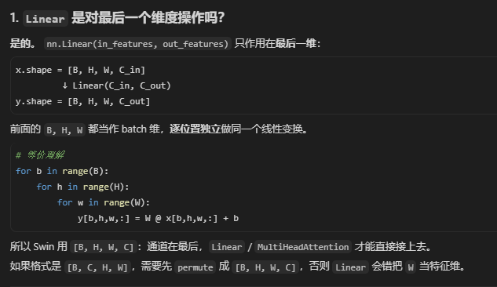

> ### 4. 存在的问题（按严重程度排序）
>
> 严重：这些问题会导致网络实际行为与设计不符
>
> 1. GAT 的注意力参数实际上没有被学习。 `gatAttention.py` 的 `forward` 中每次都重新创建 `self.n = nn.Parameter(torch.zeros(...))`。它初始化为全 0，所以注意力分数 `exp(0)=1` 恒定，注意力退化为均匀权重。这个参数也不在构造时创建的优化器里，所以永远不会被训练。
>
>    > 1.   nn.Parameter 应该是batch内样本共享
>    > 2. 并不能写在forward
>    > 3. `nn.init.xavier_uniform_(self.n)` 是 PyTorch 的参数初始化函数
>
> 1. 多头注意力的实现有 bug。 `forward` 里外层先写了 `k = torch.zeros(...)`，内层 `for k in range(self.heads)` 又把 `k` 覆盖成整数，`k += e` 实际变成 `(heads-1) + e_last`。结果是只用到最后一个 head，并且多加了一个常数 `heads-1`。`gat_heads` 参数基本没有实际作用。
>
>    > 1. 代码写错了..小bug
>    > 2. 需要对多头结果进行平均, 不然会线性增大`out = k / self.heads`
>    > 3. [改进] 进行add, 而是concat后连接linear进行降维
>
> 2. 注意力归一化和掩码错误。
>
>    - `atten_sum[j]` 按列 j 归一化，而标准 GAT 应该对每个节点 i 沿邻居 j 归一化。
>    - `atten_sum` 的初始化使用的是 `sum(adj, dim=1)`，即行和，但后面又按列 j 索引，行列混用。
>    - 之后对整行 `softmax`，非邻居位置的值为 0，但仍会得到 `exp(0)` 的权重，邻接掩码没有生效。
>
>    > 1. **归一化方向错误**: 权重 `α_ij` 应该沿 `j` 归一化，即对每个 `i` 对其所有邻居求和为 1。
>    >
>    > 2. 复杂度为n^2
>    >
>    > 3. **`adj[i, j] != 0` 的判断**
>    >
>    >    如果 `adj` 是浮点 tensor，直接 `!= 0` 做条件判断可行但不够稳健（浮点误差）
>    >
>    > 4. `torch.zeros` 默认 **dtype/device 问题**
>    >
>    >    ```
>    >    concat_matrix = torch.zeros(size=(x.size(0), x.size(0)))
>    >    ```
>    >
>    >    
>    >
>    >    默认是 `float32` 且在 CPU 上，而 `x`、`adj`、`n` 可能在 GPU 或 `float64`。应该：
>    >
>    >    ```
>    >    concat_matrix = torch.zeros(N, N, dtype=x.dtype, device=x.device)
>    >    
>    >    ```
>    >
>    > 5.  如果某一行 `i` 的所有 `adj[i, j]` 都为 0（孤立节点），`atten_sum[i] = 0`，除法会产生 `nan` 或 `inf`。需要加保护
>    >
>    > 6. 冗余的softmax
>
> 中等：影响效率、可用性和可维护性
>
> 1. Python 三重循环，速度极慢。 `concat_attention_adjacency_matrix` 和 `atten_matrix` 对 N×N 做逐元素循环，在 `B × heads × (T+1)` 上重复执行，并且 `gat_2` 也是逐时间步循环。`FSC_Personalized` 还对 batch 维做了 Python 循环，没有向量化。
>
>    > 1. 向量化>>>
>    > 2. 循环的计算量本身并不大，主要浪费在 Python 调度上。???
>    >    有四处 Python 循环，每个循环里又嵌套小张量运算，开销主要在解释器和小算子调度上
>    > 3. einsum求内积i,i->
>    > 4. FSC_Personalized 是如何做到支持 batch? 以后要怎么写才能支持batch而不是写循环?
>    >    切片时显式保留第 0 维（batch）
>    >    维度用负索引：用 `dim=-1`、`dim=-2`，不要写死 `dim=0`，也不要用 `x.size(0)` 假设 batch 位置。
>    >
>
> 2. 设备不兼容。 `GATAttention` 中多处用 `torch.zeros(...)` 创建 CPU 张量，GPU 上会报设备不匹配错误。
>
>    > 不在函数里手动创建张量，而是用输入张量推导出的运算生成结果（`einsum`、`exp`、`mask` 等），这样结果自动跟随输入的设备。
>
> 3. `gat_2` 的邻接没有稀疏化。 它直接用相关矩阵作为邻接，只要元素非零就视为相连。相关值可以为负，实际等价于稠密全连接图，和 `gat_1` 使用 top-30% 稀疏邻接的设计不一致。
>
>    > 
>
> 4. Transformer 的维度是隐式耦合的。 `transformer_embed_dim` 默认是 20，而 token 的维度是 `features_dim`，两者必须相等，否则 `MultiHeadAttention` 会报错。另外类名叫 `Decoder`，实际只是 encoder 式的自注意力，没有 cross-attention 和 causal mask。
>
>    > 
>
> 5. 序列长度为 `(2T+1)·N`，注意力复杂度为 O(L²)。 对于 N=90 或 116 的脑图谱，加上 T 个时间步，显存压力会很大。
>
>    > 
>
> 6. 输出已经是 softmax 概率。 如果训练时直接接 `nn.CrossEntropyLoss`，会重复 softmax。应该改为输出 logits，或者使用 `NLLLoss(log(out))`。
>
>    > 
>
> 7. GAT 的参数依赖节点数 N。 `GATAttention` 的 `Linear(N→D)` 与 `self.n` 的形状都绑定到 N，换脑图谱（节点数变化）就需要重新训练。
>
>    > 
>
> 8. `nn.Parameter` 的形状里不应该出现 batch 维，因为参数是模型的权重，不随样本变化。
>
>    > 不用“每对节点独立的参数”
>    > 过拟合风险：脑网络样本数通常很少，每对节点的参数很难从少量样本里学好。
>    > 参数量随 N² 增长
>
> 轻微：代码整洁性
>
> 1. `filter_topk_global` 只保留正值最大的 30%，负相关全部被丢弃。这可能是有意的，需要确认。


# 广播

## 1 怎么给计算带上batch


## 2 计算广播

用广播一次性算出所有位置对 `((r1,c1), (r2,c2))` 之间的坐标差，不写循环。

**两个操作数**

```python
A = coords[:, :, :, None, None]   # (2, W, W, 1, 1)
B = coords[:, None, None, :, :]   # (2, 1, 1, W, W)
D = A - B                          # (2, W, W, W, W)
```

`None`（等价 `unsqueeze`）插入长度为 1 的维度，用来占位。

- `A` 只在 `(r1, c1)` 两维有真实值，`(r2, c2)` 两维为 1。
- `B` 只在 `(r2, c2)` 两维有真实值，`(r1, c1)` 两维为 1。

**形状对齐**

| 维度       | A    | B    | 结果 | 谁被拉伸     |
| ---------- | ---- | ---- | ---- | ------------ |
| 0 坐标分量 | 2    | 2    | 2    | —            |
| 1 r1       | W    | 1    | W    | B 沿此维复制 |
| 2 c1       | W    | 1    | W    | B 沿此维复制 |
| 3 r2       | 1    | W    | W    | A 沿此维复制 |
| 4 c2       | 1    | W    | W    | A 沿此维复制 |

广播规则

某维一方长度为 1，就沿该维复制到另一方长度。**复制的是自己那一个值**：

- `A` 的 `(1,1)` 维扩展 → `r1`（或 `c1`）被复制 `W×W` 份，**不随** `r2,c2` 变化。
- `B` 的 `(1,1)` 维扩展 → `r2`（或 `c2`）被复制 `W×W` 份，**不随** `r1,c1` 变化。

广播是惰性的：语义上等价复制，实现上不真正分配那 `W²` 份内存。

#### **复制的是 `A` 自己的值**。

关键在于：`A` 在维度 3、4 上长度是 1，也就是这两个维度上 `A` **只有一个元素**。广播时，PyTorch 把这个唯一的元素沿该维度重复 `W` 次——重复的当然就是它自己那一个值。

具体看 `A[0, r1, c1, 0, 0] = r1`。对固定的 `(r1, c1)`，`A` 在 `(r2, c2)` 这两维上只有一个值 `r1`。广播后：

```
A拉伸[0, r1, c1, r2, c2] = r1   对所有 r2, c2 都成立
```

也就是 `r1` 这个值在 `(r2, c2)` 平面上被复制了 `W×W` 份，**全都是 `r1` 本身。**它**不随** `r2, c2` 变化，因为 `A` 在这两维根本没有别的值可给。

再看 `A[1, r1, c1, 0, 0] = c1`，同理，`c1` 被复制成 `W×W` 份。

所以相减时：

```
结果[0, r1, c1, r2, c2] = （A 复制的 r1） - （B 复制的 r2） = r1 - r2
```


****

# 细节

## 1. `Linear` 是对什么维度操作？




## 2. `view` 是怎么操作的？维度顺序是什么？

`view` **不改变内存里的数据顺序，只重新解释形状**。

数据按 行优先（C 风格） 排：最后一个维度变化最快。
`view` 不会打乱这段内存，只是给同一段**数据贴上新的「维度标签」**。

假设 `H=8, W=8, window_size=4, C=1`，原图坐标和内存顺序如下（行优先，最后一个维度 `C` 变化最快）：

```
原图 [B, H, W, C] 在内存里等价于按这个顺序排:

(H=0,W=0) (H=0,W=1) ... (H=0,W=7)

(H=1,W=0) (H=1,W=1) ... (H=1,W=7)

...

(H=7,W=0) ...            (H=7,W=7)

---
正确的 view
x.view(B, nH=2, ws=4, nW=2, ws=4, C)
#      [B,  2,   4,   2,   4,  C]
内存第 1 段 16 个元素 → 被解释成 nH=0, nW=0 这个 4×4 窗口
内存第 2 段 16 个元素 → 被解释成 nH=0, nW=1
内存第 3 段 → nH=1, nW=0
内存第 4 段 → nH=1, nW=1

对应关系：
```

```
例如：
x = torch.arange(24)
x.view(2, 3, 4)
就是：

24 个元素
↓
2 个大 block
↓
每个大 block 有 3 个小 block
↓
每个小 block 有 4 个元素
```


## 3 问题

```
1. 主要理解这个: view 不改变内存里的数据顺序，只重新解释形状。就是说内存里不变, 只是说哪一部分变成了nH的1,2 哪部分变成了ws的4
2. 如果我view改写成x = x.view(
        batch_size,
        window_size,
        height // window_size,
        window_size,
        width // window_size,
        channels,
    )会怎么样
3. 如果我故意写成第一个是2*window_size, 第二个是window_size//2, 那么原本的W,H 就会不够且, 会怎么处理

```

### 1. 「内存不变，只重新解释形状」是什么意思？

```
假设 `H=8, W=8, window_size=4, C=1`，原图坐标和内存顺序如下（行优先，最后一个维度 `C` 变化最快）：

原图 [B, H, W, C] 在内存里等价于按这个顺序排:

(H=0,W=0) (H=0,W=1) ... (H=0,W=7)

(H=1,W=0) (H=1,W=1) ... (H=1,W=7)

...

(H=7,W=0) ...              (H=7,W=7)

`view` 不会打乱这段内存，只是给同一段数据贴上新的「维度标签」。

### 正确的 view

x.view(B, nH=2, ws=4, nW=2, ws=4, C)

*#      [B,  2,   4,   2,   4,  C]*

内存第 1 段 16 个元素 → 被解释成 `nH=0, nW=0` 这个 4×4 窗口
内存第 2 段 16 个元素 → 被解释成 `nH=0, nW=1`
内存第 3 段 → `nH=1, nW=0`
内存第 4 段 → `nH=1, nW=1`

对应关系：

nH=0, ws=0~3, nW=0, ws=0~3  →  原图 H=0~3, W=0~3  (左上窗口)

nH=0, ws=0~3, nW=1, ws=0~3  →  原图 H=0~3, W=4~7  (右上)

nH=1, ws=0~3, nW=0, ws=0~3  →  原图 H=4~7, W=0~3  (左下)

nH=1, ws=0~3, nW=1, ws=0~3  →  原图 H=4~7, W=4~7  (右下)

所以：

- 哪部分变成 `nH=0/1`：由 `view` 时 `nH` 和 `ws` 在维度顺序中的位置决定
- 哪部分变成 `ws=0~3`：是 `nH` 下面那一层，每个窗口内的 4 行

`view` 只改「怎么读」，不改「怎么存」。
```


## 4. 如果改成 view(B, ws, nH, ws, nW, C) 会怎样？

```
# 你提议的写法
x.view(B, window_size, height//window_size, window_size, width//window_size, C)
#         [B,     4,            2,              4,            2,          C]
元素总数仍对得上（4×2×4×2 = 8×8），但语义完全错了。

内存里前 4 个「H 方向」元素会被当成 ws=0,1,2,3，而它们实际来自原图第一行的 4 个不同 W，不是同一个 4×4 窗口。

你以为的窗口:          实际被读成:
┌────┬────┐           ┌────────────────┐
│ W0 │ W1 │           │ 原图第0行 4 点 │  ← 被当成一个"窗口"
├────┼────┤           ├────────────────┤
│ W2 │ W3 │           │ 原图第1行 4 点 │  ← 又一个"窗口"
└────┴────┘           └────────────────┘
结果：

不会报错（总元素数一致）
每个「窗口」里混的是跨行的条带，不是空间上相邻的 4×4 块
Attention 在错误的邻域上计算，模型学不到正确的局部结构
结论：view 各维乘积必须等于原 shape，但维度顺序决定语义；Swin 必须用 (nH, ws, nW, ws) 这种顺序，不能把 ws 和 nH 随便对调。
```

> 1. 行优先
> 2. 


## 5 是不是view之后一定要加contiguous? 那我以后都改用reshape好了, contiguous写在那些位置

> **不是。** `contiguous()` 要写在 **`view` 之前**，不是之后。
>
> ### 规则
>
> | 操作                    | 需要 contiguous？                                     |
> | ----------------------- | ----------------------------------------------------- |
> | `view`                  | 是：非连续内存会报错，先 `.contiguous()` 再 `.view()` |
> | `reshape`               | 否：能 view 就 view，不能就自动拷一份                 |
> | `transpose` / `permute` | 结果通常**非连续**                                    |
> | `matmul` / 多数算子     | 一般不强制你手写 contiguous                           |
>
> 所以：
>
> ```python
> # 对：transpose 后要 view，先 contiguous
> t.transpose(1, 2).contiguous().view(...)
> 
> # 错：view 成功后再 contiguous 没解决 view 的前置条件
> t.transpose(1, 2).view(...).contiguous()  # 若中间 view 已失败就到不了这步
> ```
>
> ### 用 `reshape` 可以吗？
>
> 可以，很多时候更省事：
>
> ```python
> # 等价于「必要时 contiguous + view」
> t.transpose(1, 2).reshape(B, C, H, W)
> ```
>
> 你这段可以写成：
>
> ```python
> def to_map(t):  # (B, N, C) -> (B, C, H, W)
>     return t.transpose(1, 2).reshape(B, -1, H, W)
> 
> def to_seq(t):  # (B, C, H, W) -> (B, N, C)
>     return t.reshape(B, t.shape[1], -1).transpose(1, 2)
> ```
>
> `to_seq` 里对已是 `(B,C,H,W)` 的卷积输出，本身多半已连续，**不必**先 `contiguous()`；`to_map` 里 `transpose` 之后才是必须处理连续性问题的地方——用 `reshape` 就够了。
>
> ### 以后怎么选
>
> - **习惯用 `reshape`**：少踩 `view` 的坑，日常模块里够用。
> - **仍要写 `contiguous()` 的场景**：你明确要「强制拷成连续内存再交给某个只认 contiguous 的 API / 自定义 CUDA」，或想保证后续 `view` 一定成功且不隐式拷贝时机不清楚时。
> - **别到处加**：多余的 `contiguous()` 可能多一次拷贝，没收益。


## 6. torch.meshgrid

`torch.meshgrid` 是 PyTorch 中用于从一维坐标向量生成多维坐标网格的方法。它的作用是接收若干一维张量，并返回一组经过维度扩展的张量，这些张量的每个位置组合起来，就能覆盖所有输入坐标点的笛卡尔积。

> 所以是构造一个坐标矩阵, 使得每次coords[0]都是取得行, 而coords[1]是列
>
> `coords` 相当于一个**坐标查找表**：对窗口内任意位置 `(r, c)`，直接取 `coords[:, r, c]` 就得到 `(r, c)` 本身。
>
> `coords[0]` 是一张"行号地图"，`coords[1]` 是一张"列号地图"，两张图叠加起来，每个像素位置都存着它自己的 `(行, 列)` 坐标。


```
coords = torch.stack(torch.meshgrid(
    torch.arange(window_size), torch.arange(window_size), indexing="ij"
))
```

`torch.arange(window_size)` 生成了 `0, 1, ..., window_size - 1` 的一维序列。`torch.meshgrid` 接收两个这样的相同序列，并指定 `indexing="ij"`，最终会生成两个形状为 `(window_size, window_size)` 的二维张量：一个在行方向重复变化，另一个在列方向重复变化。

把这两个张量堆叠起来，就得到了一个形状为 `(2, window_size, window_size)` 的坐标网格 `coords`，其中 `coords[0]` 给出每个位置的行坐标，`coords[1]` 给出每个位置的列坐标。

****

```
i, j = torch.meshgrid(torch.arange(3), torch.arange(3), indexing="ij")
```

在 `"ij"` 模式下，输出形状是 `(3, 3)`，并且：

- `i[a, b] = a`（第一个输入的值，只随第 0 维变化）
- `j[a, b] = b`（第二个输入的值，只随第 1 维变化）

所以：

```
i = [[0, 0, 0],
     [1, 1, 1],
     [2, 2, 2]]

j = [[0, 1, 2],
     [0, 1, 2],
     [0, 1, 2]]
```

现在看 `coords = torch.stack([i, j])`，形状为 `(2, 3, 3)`：

- `coords[0]` 就是 `i`，它的值 `coords[0][a, b] = a`，即**行下标**；
- `coords[1]` 就是 `j`，它的值 `coords[1][a, b] = b`，即**列下标**。


> ## 笔记：`torch.meshgrid` 与相对坐标表
>
> ### 1. `torch.meshgrid` 是什么
>
> 从一维坐标向量生成多维坐标网格，返回一组经过维度扩展的张量，覆盖所有输入坐标的笛卡尔积。
>
> ```python
> coords = torch.stack(torch.meshgrid(
>     torch.arange(window_size), torch.arange(window_size), indexing="ij"
> ))
> ```
>
> 结果形状 `(2, W, W)`，其中：
>
> - `coords[0][r, c] = r`（行坐标）
> - `coords[1][r, c] = c`（列坐标）
>
> 即 `coords[:, r, c]` 就是位置 `(r, c)` 自己的坐标。
>
> ### 2. `indexing` 参数
>
> - `"ij"`：第 i 个输出对应第 i 个输入，只在第 i 维变化 → `coords[0]` 是行、`coords[1]` 是列。
> - `"xy"`：顺序交换 → `coords[0]` 是列、`coords[1]` 是行。
> - PyTorch 当前默认 `"ij"`，但官方提示未来可能改为 `"xy"`，**建议显式指定**。
>
> ### 3. 为什么需要 `coords`，而不直接写 `(r, c)`
>
> `(r, c)` 只能表示**一个点**；`coords` 是**整个坐标场**，可参与批量张量运算（GPU、自动求导）。当坐标需要作为数据参与计算（相对位置编码、坐标嵌入、reshape 等）时，必须物化成张量。
>
> ### 4. 广播构造所有位置对的相对坐标
>
> ```python
> D = coords[:, :, :, None, None] - coords[:, None, None, :, :]
> ```
>
> #### 形状
>
> ```text
> A = coords[:, :, :, None, None]   # (2, W, W, 1, 1)  只在 (r1,c1) 有值
> B = coords[:, None, None, :, :]   # (2, 1, 1, W, W)  只在 (r2,c2) 有值
> D = A - B                         # (2, W, W, W, W)
> ```
>
> #### 广播规则
>
> 某维一方长度为 1，就沿该维复制到另一方长度。复制的是**自己那一个值**：
>
> - `A` 的 `(1,1)` 维扩展 → `r1`（或 `c1`）被复制 `W×W` 份，不随 `r2,c2` 变化。
> - `B` 的 `(1,1)` 维扩展 → `r2`（或 `c2`）被复制 `W×W` 份，不随 `r1,c1` 变化。
>
> #### 结果含义
>
> ```text
> D[0, r1, c1, r2, c2] = r1 - r2   # 行相对偏移
> D[1, r1, c1, r2, c2] = c1 - c2   # 列相对偏移
> ```
>
> 第 0 维选行差/列差，后四维是 `(锚点行, 锚点列, 目标行, 目标列)` 的四元组索引。
>
> ### 5. 为什么要扩展维度（核心动机）
>
> 为了让 `(r1,c1)` 和 `(r2,c2)` 作为**两组独立下标**出现在同一张量的不同维度上，广播自动完成"所有对"的组合，无需循环，可用 `D[:, r1, c1, r2, c2]` 一次索引任意一对的坐标差。扩维不是存更多数据，而是给两组坐标各留一组轴。
>
> ### 6. 使用注意
>
> - **符号方向**：`r1 - r2` 是从 `(r2,c2)` 指向 `(r1,c1)` 的偏移，与相对位置表的索引方向要对齐，否则正负会反。
> - **有序、不对称**：`D[·,r1,c1,r2,c2]` 与 `D[·,r2,c2,r1,c1]` 互为相反数，共 `W⁴` 条，不做对称压缩。
> - **偏移含负数**：范围 `-(W-1)…(W-1)`，查表前通常要平移（如 `+W-1`）再裁剪/索引。
> - **广播是惰性的**：语义上等价复制，实现上不真正分配那 `W²` 份内存。
>
> ### 7. 典型用途
>
> 相对位置编码、窗口注意力（Swin Transformer）中预生成窗口内二维坐标、构建坐标场 / 采样网格。


****

# 实现

## 1 怎么获取四个resnet 的layer的特征

给 `ResNet34` 加一个 `forward_features`，避免在外面拆 `layer*`：

```
# 写在 ResNet34 里
def forward_features(self, x: torch.Tensor) -> list[torch.Tensor]:
    x = self.layer1(x)
    feats = []
    for i in range(2, 6):
        x = getattr(self, f"layer{i}")(x)
        feats.append(x)
    return feats  # [c1, c2, c3, c4]
```

`SLR_Unet` 里：`c1, c2, c3, c4 = self.resnet.forward_features(x)`。


##  2 怎么加载resnet权重但是不冻结模型

加载 ≠ 冻结。 `load_state_dict` 默认所有参数仍是 `requires_grad=True`，会继续训练；只有显式 `p.requires_grad = False` 或像 `SAM3FeatureExtractor(freeze=True)` 才会冻。

```python
self.resnet = ResNet34()
ckpt = torch.load("resnet34.pth", map_location="cpu")  # 或 ckpt["state_dict"]
missing, unexpected = self.resnet.load_state_dict(ckpt, strict=False)
# 不要写下面这种，除非真要冻：
# for p in self.resnet.parameters():
#     p.requires_grad = False
```


## 3 zip方法遍历层

```python
# 调用已注册的 ffb_*，不要 setattr 覆盖成 tuple
ffbs = (self.ffb_1, self.ffb_2, self.ffb_3, self.ffb_4)
fused = [ffb(c, t) for ffb, c, t in zip(ffbs, c_feats, t_feats)]
```


# Module

mymodule= MyModule()

`Mymodule.bn.weight`

mymodule.bn.weight.data


# parameters

卷积核（`nn.Conv2d`）的权重维度是 **[out_channels, in_channels, kernel_height, kernel_width]**

> RuntimeError: Given groups=1, weight of size [6, 3, 3, 3], expected input[1, 640, 640, 3] to have 3 channels, but got 640 channels instead

**model.parameters()**


# Grad

### requires_grad

```
model.bn.weight.requires_grad
```


# INIT


```
torch.nn.init.trunc_normal_(tensor, mean=0.0, std=1.0, a=-2.0, b=2.0)
```

| 参数     | 含义                                                   | 默认值 |
| :------- | :----------------------------------------------------- | :----- |
| `tensor` | 要初始化的张量（原地修改，带下划线 `_` 表示 in-place） | —      |
| `mean`   | 正态分布均值                                           | 0.0    |
| `std`    | 正态分布标准差                                         | 1.0    |
| `a`      | 截断下界（以"多少个标准差"的绝对数值表示，不是倍数）   | -2.0   |
| `b`      | 截断上界                                               | 2.0    |

调用 `nn.init.trunc_normal_(t, std=0.02)` 时只传了 `std`，其余用默认：`mean=0`、`a=-2`、`b=2`。


****

# 钩子函数

> **钩子函数（Hook Function）\**是可以绑定到 `nn.Module` 的某一层（Layer）上的函数，在\**前向传播（forward）或反向传播（backward）时自动执行**，用来**提取中间特征、修改梯度或中间输出、调试模型等**。
>
> ### ✅ 什么是钩子函数（Hook Function）？
>
> 在 PyTorch 中，**钩子函数（Hook Function）\**是可以绑定到 `nn.Module` 的某一层（Layer）上的函数，在\**前向传播（forward）或反向传播（backward）时自动执行**，用来**提取中间特征、修改梯度或中间输出、调试模型等**。
>
> ------
>
> ### 📌 PyTorch 中的钩子种类：
>
> | 类型       | 方法                                                         | 作用                              |
> | ---------- | ------------------------------------------------------------ | --------------------------------- |
> | 前向钩子   | `register_forward_hook()`                                    | 在该层 **forward输出后** 自动调用 |
> | 前向前钩子 | `register_forward_pre_hook()`                                | 在该层 **forward输入前** 调用     |
> | 反向钩子   | `register_backward_hook()`（不推荐）或 `register_full_backward_hook()` | 在该层 **backward执行时** 调用    |
>
> 
>
> ------
>
> ### 🧠 为什么要注册钩子函数？
>
> 你这段代码中使用 `register_forward_hook()`，是为了在**蒸馏过程中提取教师模型和学生模型某些层的输出特征**，计算特征之间的差异作为蒸馏损失。


`.data`

# tensor

> 1 flatten方法
>
> 

1️⃣ view(shape)✅
 改变张量形状（reshape），但不改变内存布局。

例子：

```
x = torch.randn(2,3,4)
y = x.view(6,4)
print(y.shape)  # torch.Size([6, 4])
```

------

2️⃣ **reshape(shape)**
 类似 `view`，但更灵活，支持非连续内存。

例子：

```
x = torch.randn(2,3,4)
y = x.reshape(6,4)
print(y.shape)  # torch.Size([6, 4])
```

------

3️⃣ **squeeze(dim=None)**
 去掉所有为1的维度，或者指定维度的1。

例子：

```
x = torch.randn(2,1,3)
y = x.squeeze()
print(y.shape)  # torch.Size([2,3])
y2 = x.squeeze(1)
print(y2.shape)  # torch.Size([2,3])
```

------

4️⃣ **unsqueeze(dim)**
 在指定位置插入维度1。

例子：

```
x = torch.randn(2,3)
y = x.unsqueeze(1)
print(y.shape)  # torch.Size([2,1,3])
```

------

5️⃣ **transpose(dim0, dim1)**✅
只交换两个维度。

例子：

```
x = torch.randn(2,3,4)
y = x.transpose(1,2)
print(y.shape)  # torch.Size([2,4,3])
```

------

6️⃣ **permute(dims)**✅
 任意维度换序。

例子：

```
x = torch.randn(2,3,4)
y = x.permute(0,2,1)
print(y.shape)  # torch.Size([2,4,3])
```

------

7️⃣ **contiguous()**
 返回内存连续的 tensor（一般 `view` 前用）。

例子：

```
python复制编辑x = torch.randn(2,3,4).transpose(1,2)
y = x.contiguous().view(2,12)
print(y.shape)  # torch.Size([2,12])
```

------

8️⃣ **to(device)**
 转移到指定设备。

例子：

```
python复制编辑x = torch.randn(2,3)
y = x.to('cuda')
```

------

9️⃣ **cpu() / cuda()**
 简写版的 to('cpu') 或 to('cuda')

例子：

```
x = torch.randn(2,3).cuda()
y = x.cpu()
```

------

🔟 **clone()**
 复制 tensor（新开内存）。

例子：

```
x = torch.randn(2,3)
y = x.clone()
```

------

1️⃣1️⃣ **detach()**
 返回一个不参与计算图的新 tensor。

例子：

```
x = torch.randn(2,3, requires_grad=True)
y = x.detach()
```

------

1️⃣2️⃣ **item()**
 返回单元素 tensor 的 python 数值。

例子：

```
x = torch.tensor([3.14])
v = x.item()  # 3.14 (float)
```

------

1️⃣3️⃣ **numpy()**
 转为 numpy 数组（共享内存）。

例子：

```
x = torch.randn(2,3)
arr = x.numpy()
```

------

1️⃣4️⃣ **size(dim=None)**
 返回维度大小，dim=None 返回全部 shape。

例子：

```
x = torch.randn(2,3,4)
print(x.size())     # torch.Size([2,3,4])
print(x.size(1))    # 3
```

------

1️⃣5️⃣ **shape**
 属性，等价于 `size()`。

例子：

```
x = torch.randn(2,3,4)
print(x.shape)  # torch.Size([2,3,4])
```

------

1️⃣6️⃣ **numel()**
 张量元素总数。

例子：

```
x = torch.randn(2,3,4)
print(x.numel())  # 24
```


# torch.cuda

1️⃣ **torch.cuda.is_available()**
 检查当前 PyTorch 是否可以使用 GPU。

```

torch.cuda.is_available()  # True / False
```

------

2️⃣ **torch.cuda.device_count()**
 返回可用的 GPU 数量。

```

torch.cuda.device_count()  # 如 2
```

------

3️⃣ **torch.cuda.get_device_name(device=0)**
 获取指定 GPU 的名称。

```

torch.cuda.get_device_name(0)  # 'NVIDIA GeForce RTX 4090'
```

------

4️⃣ **torch.cuda.current_device()**
 返回当前默认设备的索引（int）。

```

torch.cuda.current_device()  # 如 0
```

------

5️⃣ **torch.cuda.set_device(device)**
 设置当前默认使用的 GPU。

```

torch.cuda.set_device(1)
```

------

6️⃣ **torch.cuda.memory_allocated(device=0)**
 返回当前分配给张量的显存大小（单位：字节）。

```

torch.cuda.memory_allocated(0) / 1024**2  # 单位：MB
```

------

7️⃣ **torch.cuda.memory_reserved(device=0)**
 返回为分配预留的显存（用于缓存机制）。

```

torch.cuda.memory_reserved(0) / 1024**2  # 单位：MB
```

------

8️⃣ **torch.cuda.empty_cache()**
 释放未使用的显存缓存（不会释放已使用的显存）。

```

torch.cuda.empty_cache()
```

------

9️⃣ **torch.cuda.synchronize(device=None)**
 等待所有 GPU 操作完成（用于计时时精准）。

```

torch.cuda.synchronize()
```

------

🔟 **torch.cuda.Stream / torch.cuda.Event**
 用于手动控制 CUDA 操作顺序（高级用法）。

```
python复制编辑stream = torch.cuda.Stream()
event = torch.cuda.Event()
```


# model

**`m.weight`**：获取`BatchNorm2d`层的权重参数。

```
w = m.weight.abs().detach()
```

```
b = m.bias.abs().detach()
```

1️⃣ **`model.parameters()`**✅
 返回一个生成器，只包含模型中所有参数（`nn.Parameter` 类型）。

例子：

```
for param in model.parameters():
    print(param.shape)
    param.nelement() * param.element_size()
```

------

2️⃣ **`model.named_parameters()`** ✅
 返回 `(name, param)` 元组的生成器，带有名字。

例子：

```
]for name, param in model.named_parameters():
    print(name, param.shape)
```

------

3️⃣ **`model.children()`**
 返回模型的**第一层子模块**，不递归。

例子：

```
python复制编辑for child in model.children():
    print(child)  # 只是一层，例如 Conv, ReLU, Linear
```

------

4️⃣ **`model.named_children()`**
 返回 `(name, module)` 的生成器，第一层子模块带名字。

例子：

```
python复制编辑for name, module in model.named_children():
    print(name, module)
```

------

5️⃣ **`model.modules()`**
 返回模型中所有模块（包括自身和递归子模块）。

例子：

```
python复制编辑for module in model.modules():
    print(type(module))
```

------

6️⃣ **`model.named_modules()`**
 返回 `(name, module)` 形式的所有模块（递归 + 包括自身）。

例子：

```
python复制编辑for name, module in model.named_modules():
    print(name, module)
```

------

7️⃣ **`model.state_dict()`**
 返回包含所有参数和缓冲区（如 `running_mean`）的字典。

例子：

```
python复制编辑for name, tensor in model.state_dict().items():
    print(name, tensor.shape)
```

------

8️⃣ **`model.load_state_dict(state_dict)`**
 加载 `.pth` 文件保存的权重。

例子：

```
python


复制编辑
model.load_state_dict(torch.load('xxx.pth'))
```

------

9️⃣ **`model.eval()` / `model.train()`**
 切换模型模式（影响 Dropout / BatchNorm 等）。

例子：

```
python复制编辑model.eval()   # 推理模式
model.train()  # 训练模式
```

------

🔟 **`model.zero_grad()`**
 清空所有参数的梯度（等效于 `optimizer.zero_grad()`）。

例子：

```
python


复制编辑
model.zero_grad()
```


# torch


`torch.sort` 是 PyTorch 中用于对张量进行排序的函数。

- `descending=True` 表示按降序排序。
- 这个函数返回一个元组 `(sorted_tensor, indices)`，其中 `sorted_tensor` 是排序后的张量，`indices` 是排序后的索引。

```
import torch

# 创建一个二维张量
tensor = torch.tensor([[0.1, 0.5, 0.3], [0.9, 0.7, 0.2]])

# 设置条件
condition = tensor > 0.4

# 使用 torch.where 找到满足条件的元素的索引
indices = torch.where(condition)

print("原始张量:", tensor)
print("条件:", condition)
print("返回的索引:", indices)
```

1️⃣ **torch.stack(preds_cls)**
 把 `preds_cls` 列表拼起来，增加一个新维度。

例子：

```
python复制编辑preds_cls = [cls1, cls2, cls3]  # 每个 cls shape (B, C, H, W)
torch.stack(preds_cls) → (3, B, C, H, W)
```

等价于 `torch.stack(preds_cls, dim=0)`

------

2️⃣ **weights_cls.view(-1,1,1,1,1)**
 把 `(N,)` 的权重 reshape 成 `(N,1,1,1,1)`，为了和 `(N, B, C, H, W)` 广播相乘。

例子：

```
python复制编辑weights_cls = torch.tensor([0.2, 0.3, 0.5])  # (3,)
weights_cls.view(-1,1,1,1,1) → (3,1,1,1,1)
```

------

3️⃣ **torch.sum(..., dim=0)**
 沿第0维（分支维度）求和，得到融合后的最终预测。

例子：

```
python


复制编辑
final_out = torch.sum(preds_cls * weights_cls, dim=0)  # (B, C, H, W)
```

------

4️⃣ **einsum 计算**
 用 `torch.einsum` 表达更紧凑的计算。

例子：

```
python


复制编辑
torch.einsum('n,nbchw->bchw', weights_cls, preds_cls)
```

等价于：

```
python


复制编辑
torch.sum(weights_cls.view(-1,1,1,1,1) * preds_cls, dim=0)
```

------

5️⃣ ***\*init\**(512) → forward(z, x)**
 初始化 `SiameseRPN`，512 是 Conv3 的通道数。

例子：

```
python复制编辑self.rpn3 = SiameseRPN(512)
cls_out, reg_out = self.rpn3(z, x)  # z, x 是 Conv3 特征
```

------

6️⃣ **torch.chunk(x, 2, dim=1)**
 把 `x` 在通道维（dim=1）一分为二。

例子：

```
python复制编辑x1, x2 = torch.chunk(x, 2, dim=1)
# x1, x2 → (B, C//2, H, W)
```

------

7️⃣ **torch.eye(H, device=x.device, dtype=x.dtype)**
 生成一个 H × H 的单位矩阵。

例子：

```
I = torch.eye(H, device=x.device, dtype=x.dtype)  # (H, H)
```


8️⃣ **torch.cat(tensors, dim)**
 把 tensor 列表按指定维拼接起来（不增加新维度）。

例子：

```
python复制编辑tensors = [t1, t2, t3]  # 每个 t shape (B, C, H, W)
torch.cat(tensors, dim=1) → (B, C*3, H, W)
```

------

9️⃣ **torch.unsqueeze(x, dim)**
 在 dim 位置增加一个新维度。

例子：

```
python复制编辑x.shape → (B, C, H, W)
torch.unsqueeze(x, dim=1) → (B, 1, C, H, W)
```

------

🔟 **torch.squeeze(x, dim)**
 去掉 dim 维度上的1维。

例子：

```
python复制编辑x.shape → (B, 1, C, H, W)
torch.squeeze(x, dim=1) → (B, C, H, W)
```

------

1️⃣1️⃣ **torch.permute(x, dims)**
 交换维度顺序。

例子：

```
python复制编辑x.shape → (B, C, H, W)
torch.permute(x, (0,2,3,1)) → (B, H, W, C)
```

------

1️⃣2️⃣ **torch.transpose(x, dim0, dim1)**
 交换两个维度。

例子：

```
python复制编辑x.shape → (B, C, H, W)
torch.transpose(x, 1, 2) → (B, H, C, W)
```

------

1️⃣3️⃣ **torch.mean(x, dim, keepdim=False)**
 在指定维求平均。

例子：

```
python复制编辑x.shape → (B, C, H, W)
torch.mean(x, dim=2) → (B, C, W)
```

------

1️⃣4️⃣ **torch.max(x, dim, keepdim=False)**
 在指定维取最大值（返回值和索引）。

例子：

```
python复制编辑vals, idxs = torch.max(x, dim=2)
vals.shape → (B, C, W)
idxs.shape → (B, C, W)
```

------

1️⃣5️⃣ **torch.clamp(x, min, max)**
 把值裁剪到 [min, max] 区间。

例子：

```
python复制编辑x = torch.tensor([-1, 0.5, 2])
torch.clamp(x, 0, 1) → tensor([0., 0.5, 1.])
```

------

1️⃣6️⃣ **torch.where(condition, x, y)**
 按条件选择，condition=True 取 x，否则取 y。

例子：

```
python复制编辑a = torch.tensor([1, 2, 3])
b = torch.tensor([10, 20, 30])
cond = a > 1
torch.where(cond, a, b) → tensor([10, 2, 3])
```

------

1️⃣7️⃣ **torch.linspace(start, end, steps)**
 生成等间隔序列。

例子：

```
python


复制编辑
torch.linspace(0,1,5) → tensor([0., 0.25, 0.5, 0.75, 1.])
```

------

1️⃣8️⃣ **torch.arange(start, end, step)**
 生成等步长序列。

例子：

```
python


复制编辑
torch.arange(0,5,1) → tensor([0,1,2,3,4])
```

------

1️⃣9️⃣ **torch.nn.functional.one_hot(indices, num_classes)**
 把索引转为 one-hot 编码。

例子：

```
python复制编辑idx = torch.tensor([0,2,1])
torch.nn.functional.one_hot(idx, num_classes=3) → 
tensor([[1,0,0],
        [0,0,1],
        [0,1,0]])
```

------

2️⃣0️⃣ **x.view_as(y)**
 把 x reshape 成和 y 相同的形状。

例子：

```
python复制编辑x = torch.arange(6)
y = torch.zeros(2,3)
x.view_as(y) → shape (2,3)
```


1️⃣5️⃣ **torch.cuda.amp.autocast**
 混合精度推理 / 训练。

例子：

```
python复制编辑with torch.cuda.amp.autocast():
    output = model(input)
```

------

1️⃣6️⃣ **torch.nn.utils.clip_grad_norm_**
 梯度裁剪（防止梯度爆炸）。

例子：

```
python


复制编辑
torch.nn.utils.clip_grad_norm_(model.parameters(), max_norm=1.0)
```


inplace=False

RuntimeError: one of the variables needed for gradient computation has been modified by an inplace operation: [torch.cuda.FloatTensor [32, 2048, 32, 32]], which is output 0 of ReluBackward0, is at version 3; expected version 1 instead. Hint: enable anomaly detection to find the operation that failed to compute its gradient, with torch.autograd.set_detect_anomaly(True).


RuntimeError: cuDNN error: CUDNN_STATUS_INTERNAL_ERROR

 GPU 内存不足或 CUDA 操作不当导致的。让我们通过以下方式解决这个问题

```
    if is_pretrain:

​      \# 预训练时使用较小的学习率

​      self.optimizer = optim.Adam(model.parameters(), lr=1e-5)

​    else:

​      \# 微调时使用较大的学习率

​      self.optimizer = optim.Adam(model.parameters(), lr=1e-4)
```

### 📍 小结

| 占用部分   | 推理占比 | 训练占比 |
| ---------- | -------- | -------- |
| 参数       | ✅        | ✅        |
| 特征图     | ✅        | ✅✅✅      |
| 梯度       | ❌        | ✅        |
| 优化器状态 | ❌        | ✅        |
| 数据缓存   | ✅（CPU） | ✅（CPU） |

```
🌟 深度学习中，哪些因素和内存（memory，占比）有关？
这里说的内存主要指 显存（GPU memory），但有些原则也适用于 CPU 内存。

我们可以把它拆成几部分：

✅ 1. 模型参数（parameters）
包含权重、偏置（weights, biases），每个参数通常用 float32（4字节）、float16（2字节）等存储。

只要模型加载到 GPU，就占用固定显存。

例子：

YOLOv8n → ~3M 参数，约 12MB (float32)

YOLOv8x → ~70M 参数，约 280MB (float32)

→ 和模型规模直接相关，占固定部分显存。

✅ 2. 中间特征图（feature maps / activations）
网络前向推理中每层产生的输出张量。

在训练中需要保存这些特征图来做反向传播，因此训练显存需求大约是推理的 2~3 倍。

这是训练中主要吃显存的部分。

影响因素：

输入图像大小（H × W）

batch size

模型的通道数、分辨率、层数

例子：
640×640 图像，batch=1，YOLOv8n 占用 ≈12GB
640×640 图像，batch=8，YOLOv8n 占用 ≈810GB

✅ 3. 梯度（gradients）
训练时需要为每个参数存储梯度，用于优化器更新权重。

通常大小 ≈ 参数大小。

推理时不需要。

例子：

参数 100MB → 梯度也大约 100MB

✅ 4. 优化器状态（optimizer state）
只有训练时才有，例如 Adam 优化器要存动量和方差。

通常是参数的 2~4 倍大小。

例子：

Adam 优化器，100MB 参数 → 额外约 200MB 优化器状态

✅ 5. 输入数据缓存（data loading buffer）
如果用 dataloader 预加载数据（比如 PyTorch DataLoader 的 num_workers 大、pin_memory=True），可能占用比较多 CPU 内存。

对 GPU 内存影响较小，但需要注意。


占用来源	主要和什么有关
模型权重	模型规模（n、s、m、l、x）
输入数据缓存	batch_size, num_workers, 图像分辨率
数据增强	增强方式、复杂程度
推理输出缓存	推理任务规模、是否及时落盘
框架开销	框架本身（PyTorch, TensorFlow）
系统多进程/线程	任务数、进程数、线程数

```


F.

# nn组件

### 1. nn.Linear


# 优化器


# 模型保存

## 保存和加载模型权重

通过 `torch.save` 方法进行持久化。

```
model = models.vgg16(weights='IMAGENET1K_V1')
torch.save(model.state_dict(), 'model_weights.pth')
```

然后使用 `load_state_dict()` 方法加载参数。

设置 `weights_only=True`

```
model = models.vgg16() # we do not specify ``weights``, i.e. create untrained model
model.load_state_dict(torch.load('model_weights.pth', weights_only=True))
model.eval()
```


### `state_dict()`

参数存储


### `load_state_dict()` 


## 保存和加载带结构

```
torch.save(model, 'model.pth')
```

然后，我们可以像下面演示的那样加载模型。

如 [保存和加载 torch.nn.Modules](https://pytorch.ac.cn/docs/stable/notes/serialization.html#saving-and-loading-torch-nn-modules) 中所述，保存 `state_dict` 被视为最佳实践。但是，下面我们使用了 `weights_only=False`，因为这涉及加载整个模型，这是 `torch.save` 的遗留用例。

```
model = torch.load('model.pth', weights_only=False)
```

